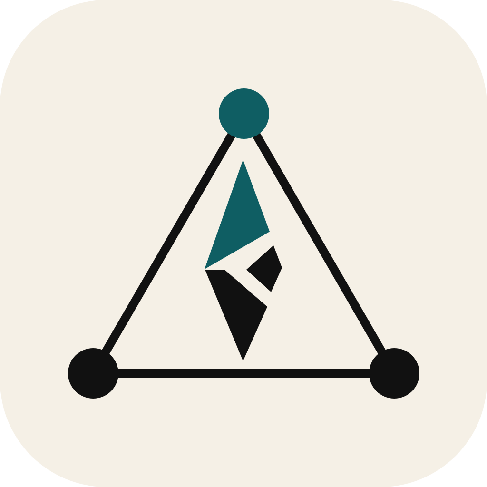

# ortsinn



<!-- givn:begin:coverage-badge -->
[](coverage/cobertura-coverage.xml)
[](coverage/cobertura-coverage.xml)
<!-- givn:end:coverage-badge -->

A sense of place for code agents.

<!-- givn:begin:development -->
## Development

Run the project-owned scripts configured in `givn/commands.yaml`:

```sh
./run-tests.sh
./run-tests.sh --e2e
```

`./measure-coverage.sh` writes the non-E2E and E2E Cobertura reports.
`./merge-coverages.sh` combines them into the merged report linked by the
badges above.

Add lint, build, and other project commands alongside these scripts.

<!-- givn:end:development -->


<!-- givn:begin:run -->
## Run

Run the tool:

```sh
. ./env.sh && cargo run -p benchmark -- run --manifest benchmark/tests/fixtures/e2e/manifest.yaml --mode replay --out reports/benchmark
```

<!-- givn:end:run -->


<!-- givn:begin:coverage -->
## Coverage

Merged report: [coverage/cobertura-coverage.xml](coverage/cobertura-coverage.xml)

Line coverage: 94% (2575/2754)
Branch coverage: n/a (0/0)

Reproduce the result:

```sh
./measure-coverage.sh
./merge-coverages.sh
```
<!-- givn:end:coverage -->
