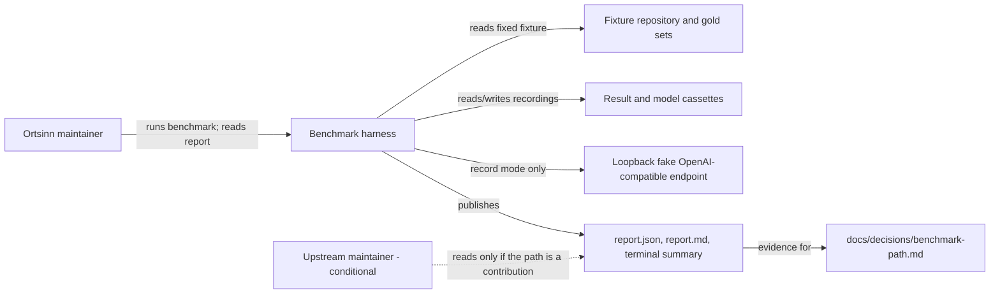
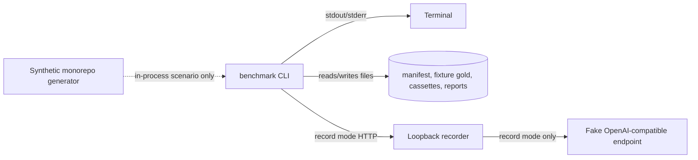
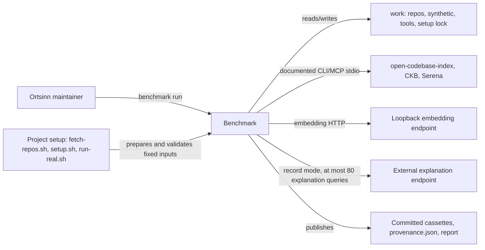

# 3. Context and Scope

The benchmark harness is a project-level tool outside the product's runtime
boundary. The product remains MCP-only; no product MCP tool, workspace, index,
or summary is designed or changed here. The harness is documented in these
chapters because its report contract is the project gate for the next product
decision.

The real-candidate path extends the context with real candidate tools, pinned
reference repositories, the synthetic monorepo, the project setup scripts, the
two model endpoints (loopback embeddings and a budgeted external explanation
endpoint), and the provenance record. The fixture context and the local
recording boundary remain the deterministic test path.

## Business context

| Partner / User | Input to system | Output from system |
|---|---|---|
| Ortsinn maintainer | Manifest, fixture gold, run mode, report directory | Terminal summary, report files, measured gaps, reproduction command |
| Fixture checkout and gold | `fixture-repo` at revision `fixture-1`, expected locations | Validated task locations and fixed task counts |
| Result cassette | Recorded normalized fixture candidate results | Scored metric cells and gaps |
| Loopback model endpoint | Fixture embedding/explanation requests in record mode | Recorded model responses and cassette fingerprints |
| Upstream maintainer (conditional) | None; reads the published report if a contribution is chosen | Candidate identity, gaps, evidence, and limitations |
| Product-path decision record | The published report as evidence | A later build/contribute/compose decision owned by the maintainer |

## Technical context

| Interface | Technology / Protocol | Direction |
|---|---|---|
| Maintainer → benchmark | CLI `benchmark run` with `--manifest`, `--mode`, `--out`, `--width`, `--model-endpoint` | In |
| Benchmark → terminal | Plain text on stdout; exit code 0 or 2 (fixed-input or replay miss) | Out |
| Benchmark → recordings | JSONL result and model cassettes keyed by canonical fingerprints | Both |
| Benchmark → recording boundary | OpenAI-compatible HTTP on `127.0.0.1` | Both |
| Recording boundary → model endpoint | Deterministic fake OpenAI-compatible endpoint on loopback | Record mode only |
| Benchmark → fixture checkout | Read-only source at `fixture-1`; gold path/line validation | In |
| Benchmark → report files | `report.json`, `report.md`, committed transcripts | Out |

## Real comparison context

| Interface | Technology / Protocol | Direction |
|---|---|---|
| Maintainer → benchmark | CLI `benchmark run` with `--manifest`, `--mode`, `--out`, `--width`, `--embedding-endpoint`, `--explanation-endpoint` | In |
| Project setup → benchmark | `benchmark/fetch-repos.sh`, `benchmark/setup.sh`, and `benchmark/run-real.sh` prepare and validate the fixed inputs; they are preconditions, not consumer actions | In |
| Benchmark → reference checkout | Git checkout at a pinned commit under `benchmark/work/repos/` | In |
| Benchmark → synthetic monorepo | Generated tree under `benchmark/work/synthetic/` | In |
| Benchmark → installed candidate | Documented CLI or MCP stdio over a child process | Both |
| Benchmark → setup lock | JSON probe and toolchain record at `benchmark/setup.lock.json`; never the pin origin | Both |
| Benchmark → embedding endpoint | Loopback OpenAI-compatible HTTP, record mode only | Both |
| Benchmark → explanation endpoint | External OpenAI-compatible HTTP for at most 80 reviewed explanation queries, record mode only | Both |
| Benchmark → evidence | Result/model cassettes, `benchmark/evidence/real-run/provenance.json`, and `report.json`/`report.md` | Out |

The fixture path in the business and technical context remains the test path;
the real path is the evidence path. The project setup scripts prepare the
external inputs, `benchmark run` is the only consumer action, and the real run
records the normalized results and benchmark model responses plus the provenance
record that binds them to the installed candidates and endpoints.

## Scope boundary

- In scope: the fixture manifest, normalized result contract,
  recording/replay, metric scoring, coverage, the report, the CLI, the
  reproduction command, the real candidate adapters, the pinned public fixed
  inputs, the reviewed gold sets, the setup/fetch scripts, the real record
  run, and the measured report.
- Out of scope: product runtime behavior, the product-path decision, a
  contribution plan, and patching or optimizing a candidate.
- External systems in this change: the fixture checkout, the committed
  cassettes, the loopback fake endpoint for tests, the installed candidates,
  the pinned reference checkouts, the loopback embedding endpoint, and the
  external explanation endpoint for the real record run. The benchmark is
  project tooling, not product architecture.
