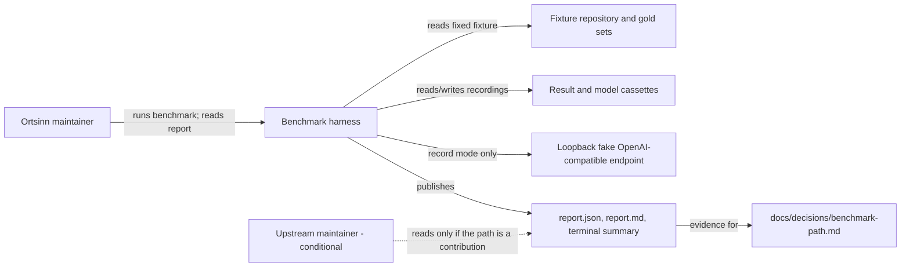
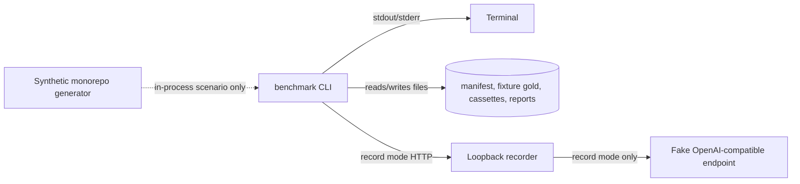

# 3. Context and Scope

The benchmark harness is a project-level tool outside the product's runtime
boundary. The product remains MCP-only; no product MCP tool, workspace, index,
or summary is designed or changed here. The harness is documented in these
chapters because its report contract is the project gate for the next product
decision.

The real candidate tools, reference repositories, and model endpoint are
`benchmark-run`'s external context. This change's context is the committed
fixture and the local recording boundary.

## Business context

| Partner / User | Input to system | Output from system |
|---|---|---|
| Ortsinn maintainer | Manifest, fixture gold, run mode, report directory | Terminal summary, report files, measured gaps, reproduction command |
| Fixture checkout and gold | `fixture-repo` at revision `fixture-1`, expected locations | Validated task locations and fixed task counts |
| Result cassette | Recorded normalized fixture candidate results | Scored metric cells and gaps |
| Loopback model endpoint | Fixture embedding/explanation requests in record mode | Recorded model responses and cassette fingerprints |
| Upstream maintainer (conditional) | None; reads the published report if a contribution is chosen | Candidate identity, gaps, evidence, and limitations |
| Product-path decision record | The published report as evidence | A later build/contribute/compose decision owned by the maintainer |

## Technical context

| Interface | Technology / Protocol | Direction |
|---|---|---|
| Maintainer → benchmark | CLI `benchmark run` with `--manifest`, `--mode`, `--out`, `--width`, `--model-endpoint` | In |
| Benchmark → terminal | Plain text on stdout; exit code 0 or 2 (fixed-input or replay miss) | Out |
| Benchmark → recordings | JSONL result and model cassettes keyed by canonical fingerprints | Both |
| Benchmark → recording boundary | OpenAI-compatible HTTP on `127.0.0.1` | Both |
| Recording boundary → model endpoint | Deterministic fake OpenAI-compatible endpoint on loopback | Record mode only |
| Benchmark → fixture checkout | Read-only source at `fixture-1`; gold path/line validation | In |
| Benchmark → report files | `report.json`, `report.md`, committed transcripts | Out |

## Scope boundary

- In scope: the fixture manifest, normalized result contract,
  recording/replay, metric scoring, coverage, the report, the CLI, and the
  reproduction command.
- Out of scope: the real candidate adapters, public fixed inputs, real gold
  sets, candidate installs, and the real record run; `benchmark-run` owns
  them. Also out of scope: product runtime behavior, the product-path
  decision, a contribution plan, and patching or optimizing a candidate.
- External systems in this change: the fixture checkout, the committed
  cassettes, and the loopback fake endpoint. They are fixed test inputs, not
  parts of the product architecture.
