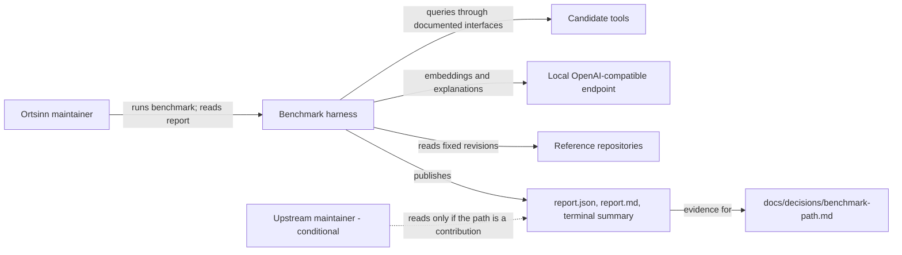
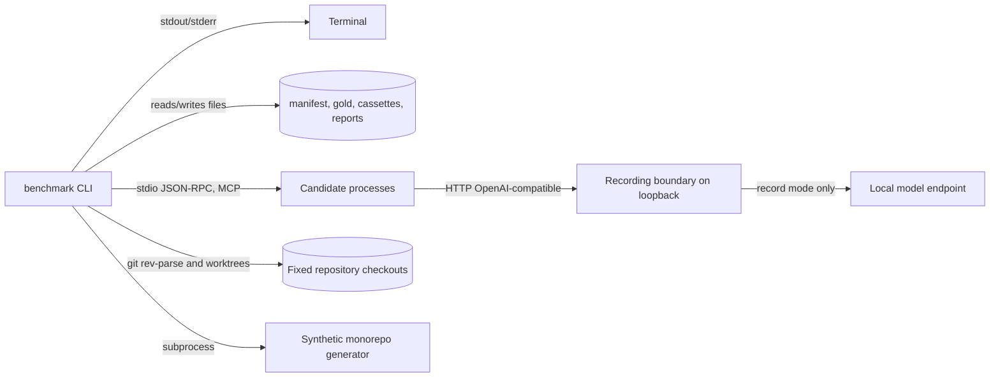

# 3. Context and Scope

The benchmark harness is a project-level tool outside the product's runtime
boundary. The product remains MCP-only; no product MCP tool, workspace, index,
or summary is designed or changed here. The harness is documented in these
chapters because its report is the project gate for the next product decision.

## Business context

| Partner / User | Input to system | Output from system |
|---|---|---|
| Ortsinn maintainer | Manifest, gold sets, run mode, candidate endpoint | Terminal summary, report files, measured gaps, reproduction command |
| Candidate tools (open-codebase-index, CKB, Serena) | Indexed repository; queries and explanation requests | Normalized ranked locations and explanations (or an unavailable reason) |
| Local model endpoint | Embedding and explanation requests in record mode | Recorded responses and cassette fingerprints |
| Reference repositories | Fixed revisions of the TypeScript, Python, and Rust references plus the generated monorepo | Measured line counts, verified `HEAD`, gold tasks |
| Upstream maintainer (conditional) | None; reads the published report if a contribution is chosen | Candidate identity, gaps, evidence, and limitations |
| Product-path decision record | The published report as evidence | A later build/contribute/compose decision owned by the maintainer |

## Technical context

| Interface | Technology / Protocol | Direction |
|---|---|---|
| Maintainer → benchmark | CLI `benchmark run` with `--manifest`, `--mode`, `--out`, `--width`, `--model-endpoint` | In |
| Benchmark → terminal | Plain text on stdout; exit code 0, 1 (internal error), or 2 (fixed-input or replay miss) | Out |
| Benchmark → candidate | MCP over stdio, or the candidate CLI, at the pinned version | Both |
| Candidate → recording boundary | OpenAI-compatible HTTP on `127.0.0.1` | Both |
| Recording boundary → model endpoint | OpenAI-compatible HTTP on loopback or localhost | Record mode only |
| Benchmark → repositories | Git checkout at a fixed commit, read-only source with writable per-candidate copies | In |
| Benchmark → report files | `report.json`, `report.md`, cassettes, transcript evidence | Out |

## Scope boundary

- In scope: fixed inputs, pinned candidates, adapters, recording/replay,
  metric scoring, coverage, the report, and the reproduction command.
- Out of scope: product runtime behavior, the product-path decision, a
  contribution plan, patching or optimizing a candidate, and throughput,
  memory, or cost acceptance criteria.
- External systems: the three candidate tools, the reference repositories, and
  the local model endpoint. They are pinned external dependencies, not parts of
  the product architecture.
