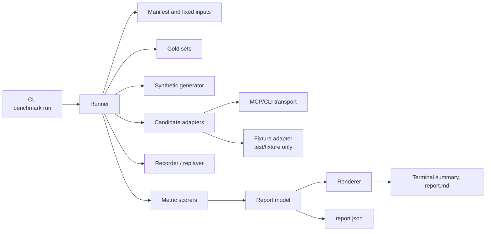

# 5. Building Block View

The benchmark harness is a project-level tool outside the product runtime. It
lives in the `benchmark` crate; this change creates the workspace with that
crate as its only member.

## Level 1 — System overview

| Building block | Responsibility |
|---|---|
| CLI (`src/cli.rs`) | Parse `run --manifest --mode --out --width --model-endpoint`; print the summary and report path; map failures to exit codes. |
| Runner (`src/runner.rs`) | Verify fixed inputs, loop candidates and repositories, enforce deadlines, assemble the report. |
| Manifest (`src/manifest.rs`) | Load and validate the manifest, targets, gold metadata, and fingerprints. |
| Gold (`src/gold/`) | Load and validate reviewed gold tasks; `propose.rs` drafts candidates outside scoring. |
| Generator (`src/gen/`) | Deterministically generate the 10M-line monorepo and its gold sets. |
| Adapters (`src/adapters/`) | Implement the `CandidateAdapter` contract per candidate; the fixture adapter is test-only. |
| Transport (`src/mcp/`) | `rmcp` client session over stdio with initialize, tools/list, tools/call, deadlines, and cancellation. |
| Recording (`src/record/`) | Canonical cassette keys, replay misses, and the loopback OpenAI-compatible recorder/replayer. |
| Metrics (`src/metrics/`) | Score typo, natural-language, explanation, and concept families per arm; deduplicate and micro-average. |
| Report (`src/report/`) | Typed report model, validation, Markdown and terminal rendering with width control. |

## Level 2 — Key building blocks

### Runner

**Responsibility:** verify the fixed inputs, drive each candidate/repository
pair, and publish a complete report or fail without publishing one.

**Contained elements:**

| Element | Responsibility |
|---|---|
| Input verifier | Check repository `HEAD`, candidate version and commit, gold version/fingerprint, synthetic fingerprint, and cassette fingerprints. |
| Candidate loop | Prepare a per-candidate worktree, index with the manifest deadline, run queries and explanations, record normalized results. |
| Gap calculator | Compute `to_target` (with `target_status`) and `to_best`, or `unavailable`/`not_applicable` with a reason. |
| Report writer | Validate and write `report.json` and `report.md` only after every input and cassette check passed. |

### Adapter layer

**Responsibility:** normalize each candidate's documented interface into ranked
locations and, where available, explanations with citations.

**Contained elements:**

| Element | Responsibility |
|---|---|
| `CandidateAdapter` trait | `capabilities`, `prepare`, `index`, `query`, `explain`, `close`. |
| `open_codebase_index.rs` | CLI/MCP adapter with custom embedding provider pointed at the recorder. |
| `ckb.rs` | CLI/MCP/HTTP adapter with pinned SCIP indexers and `ckb doctor` probe. |
| `serena.rs` | MCP stdio adapter with Python 3.13 environment and language servers; NL marked unavailable. |
| `fixture.rs` | Deterministic adapter compiled only for tests or the `fixture` feature. |

### Recording boundary

**Responsibility:** make model calls recordable and replayable without an
external service.

**Contained elements:**

| Element | Responsibility |
|---|---|
| Request normalizer | Remove headers, IDs, timestamps, and transport metadata; sort keys; replace response IDs with stable values. |
| Cassette store | Read/write `model/<fingerprint>.jsonl` and `results/<fingerprint>.jsonl`; fail with exit 2 on a miss. |
| Proxy/replayer | `axum` server on loopback; forward in record mode, serve recordings in replay. |

### Report and rendering

**Responsibility:** express the measured values, coverage, and gaps in one
model and two renderings.

**Contained elements:**

| Element | Responsibility |
|---|---|
| Model | Typed families including `concept_equivalence`, target status, gap status, candidate setup, and fingerprints. |
| Markdown renderer | Detailed report with metric and gap tables and a limitations section. |
| Terminal renderer | Concise summary; `--width` controls line width; label/value pairs stay on one line. |

### Gold and generator

**Responsibility:** provide fixed, reviewed expected answers and a
deterministic large input.

**Contained elements:**

| Element | Responsibility |
|---|---|
| Public gold | Maintainer-reviewed JSONL per repository/metric with version, task count, and fingerprint. |
| Proposer | Draft typo mutations, NL questions, concept groups, and explanation targets from the fixed commit. |
| Synthetic generator | Seeded 10M-line TypeScript/Python/Rust monorepo with gold from the same construction. |
