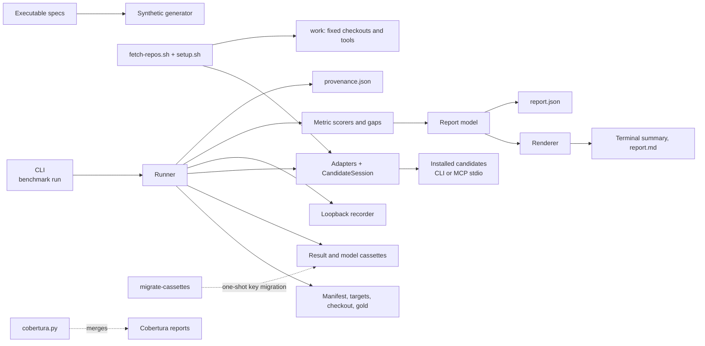

# 5. Building Block View

The benchmark harness is a project-level tool outside the product runtime. It
lives in the `benchmark` crate. This change adds the real candidate adapters,
the MCP transport, the setup/fetch scripts, and the real record path as
benchmark-tool building blocks; none is product runtime.

## Level 1 — System overview

| Building block | Responsibility |
|---|---|
| CLI (`src/cli.rs`) | Parse `run --manifest --mode --out --width --embedding-endpoint --explanation-endpoint`; print the summary and report path; map failures to exit code 2. |
| Runner (`src/runner.rs`) | Verify fixed inputs, gold review, and minimums; run replay/record; enforce deadlines; enforce the per-family publication floor before writing; assemble the report and provenance; raise the typed replay-miss failure. |
| Manifest (`src/manifest.rs`) | Load the manifest, the targets file or inline targets, checkout, gold metadata, per-power minimums, and cassette references; validate schema version, non-empty collections, and 40-character commits; compute the manifest and targets fingerprints. Gold path/line validation lives in `gold/mod.rs`; cassette fingerprints in the runner/cassette layer. |
| Gold (`src/gold/mod.rs`) | Load only manifest-referenced gold tasks, require `reviewed_by`, enforce the declared minimum mode, and validate every path and line range against the fixed checkout. |
| Generator (`src/gen/`) | Deterministically generate the 10M-line monorepo and its gold sets. |
| Normalized models (`src/adapters/mod.rs`) | `NormalizedLocation`, `ExplanationResponse`, `Citation`, deduplication. |
| Recording (`src/record/`) | Result/model cassettes, canonical fingerprints, typed replay misses, and the loopback OpenAI-compatible recorder. |
| Metrics (`src/metrics/`) | Score typo, natural-language, explanation, and concept families per arm; deduplicate, micro-average, and compute gaps with closed statuses. |
| Report (`src/report/`) | Typed report model and Markdown/terminal rendering with width control. |
| Coverage tool (`tools/cobertura.py`) | Merge the regular and e2e Cobertura reports and probe production files. |
| Real adapters (`src/adapters/`) | `CandidateSession`; `StdioMcpSession` over `rmcp`; candidate-specific mapping for open-codebase-index, CKB, and Serena; normalized results and setup probes. |
| Gold proposal (`src/gold/propose.rs`, `src/gold/minimums.rs`) | Draft unreviewed tasks, require `reviewed_by`, and enforce the per-power minimum mode; an unreferenced draft is never loaded. |
| Setup validation and scripts (`src/setup.rs`, `fetch-repos.sh`, `setup.sh`, `run-real.sh`) | Validate manifest-authored pins and checkouts, generate the synthetic monorepo, install/pin candidates exactly as authored, write the setup lock probes, and run the evidence sequence. |
| Provenance and migration (`src/provenance.rs`, `src/bin/migrate-cassettes.rs`) | Build the committed provenance record and perform the one-shot result-cassette key migration with a recomputed fingerprint. |

## Level 2 — Key building blocks

### Runner

**Responsibility:** verify the fixed inputs and gold, score the recorded
results, and publish a complete report or fail without publishing one.

**Contained elements:**

| Element | Responsibility |
|---|---|
| Input verifier | Check each result's recorded candidate version/commit and repository commit against the manifest, verify committed cassette digests, and verify every model dependency exists in the model cassette. |
| Gold verifier | Require the checkout; verify each file's declared SHA-256; check path containment, file existence, ordered line ranges, end lines inside the file, and explanation evidence ranges. |
| Record path | Post fixture model requests to the loopback endpoint, write model and result cassettes under the caller's output directory, then score them. |
| Replay path | Read the normalized result and model cassettes; a missing model response is a typed `MissingRecordedResponse` and exit 2. |
| Deadline recording | Apply the manifest index deadline per candidate and repository; every index record carries the applied `deadline_seconds`, and a breach is `timed_out` with `index_timeout` and the elapsed time. |
| Gap calculator | Compute `to_target` (with `target_status`) and `to_best`, or `unavailable`/`not_applicable` with a reason. |
| Floor gate | Require one measured candidate cell per metric family and one measured cell per manifest repository; exit 2 before writing either report file when unmet. |
| Provenance writer | Record the command, UTC start/end, host/toolchain, endpoint localities/models and explanation budget, manifest pins, index outcomes, targets fingerprint, and cassette digests. |
| Report writer | Validate and write `report.json` and `report.md` only after every input, gold, cassette, and floor check passed. |

### Recording boundary

**Responsibility:** make model calls recordable and replayable without an
external service.

**Contained elements:**

| Element | Responsibility |
|---|---|
| Cassette store | Read/write the result JSONL indexed by `(candidate, metric, task, arm)` and the model JSONL indexed by canonical key; compute file fingerprints; reject duplicates. |
| Typed miss | `MissingRecordedResponse` names key, candidate, repository, task, query, and layer; `RunFailure::from_error` preserves it as exit 2. |
| Fake endpoint | `FakeOpenAiEndpoint` serves deterministic fixture completions and embeddings on an ephemeral loopback port and records every request/peer. |

### Metric scorers and gaps

**Responsibility:** score four families and both concept arms from the
normalized records, and express coverage and gaps with closed statuses.

**Contained elements:**

| Element | Responsibility |
|---|---|
| Typo | Recall at ranks one and five, separate no-match rate, per-candidate cells. |
| Natural language | Recall at five, MRR at ten, separate query-error totals, labelled proxy arms excluded from the aggregate. |
| Explanation | Rubric correctness and evidence grounding. |
| Concept | Default and no-expansion arms for concept and concept-equivalence; `no_expansion_arm_cell` gives candidate/index unavailability precedence over `no_expansion_switch`. |
| Gaps | `Gap::unavailable` and `Gap::not_applicable`; `no_measured_candidate` and `no_applicable_task` reasons. |

### Report and rendering

**Responsibility:** express the measured values, coverage, and gaps in one
model and two renderings.

**Contained elements:**

| Element | Responsibility |
|---|---|
| Model | Typed families including `concept_equivalence`, target status, gap status, candidate setup, and fingerprints. |
| Markdown renderer | Detailed report with metric and gap tables, including unavailable to-best gaps. |
| Terminal renderer | Concise summary; `--width` controls line width; label/value pairs stay on one line. |

### Fixture gold and generator

**Responsibility:** provide fixed expected answers and a deterministic large
input.

**Contained elements:**

| Element | Responsibility |
|---|---|
| Fixture gold | Committed typo, natural-language, explanation, concept, and concept-equivalence JSONL with version, task count, and computed SHA-256 fingerprint. |
| Synthetic generator | Seeded 10M-line TypeScript/Python/Rust monorepo with gold from the same construction. |

### Real candidate adapters and setup

**Responsibility:** query each external candidate through its documented
interface and turn its answers into the normalized record; prepare and record
the fixed inputs and candidate toolchains.

**Contained elements:**

| Element | Responsibility |
|---|---|
| `CandidateSession` | Probe, index, query, and explain calls with a common error and result shape. |
| `StdioMcpSession` | Start the candidate's documented MCP command, initialize with `rmcp`, call tools, and terminate the child. |
| Candidate adapters | Map open-codebase-index, CKB, and Serena responses to normalized locations, explanations, capability statuses, setup deviations, and model-request dependencies. |
| `FakeSession` | Deterministic adapter-mapping test double; never starts a real candidate. |
| Fetch/setup scripts | Check out manifest-authored pins, prepare the synthetic input, install candidate toolchains exactly as pinned, and write the setup lock probes. |
| Draft proposer and minimums | Produce unreviewed gold drafts; require a reviewer and the per-power count before scoring; an unreferenced draft is never loaded. |
| Provenance and migration | Write the committed provenance record; migrate the result-cassette keys once with a recomputed fingerprint. |
