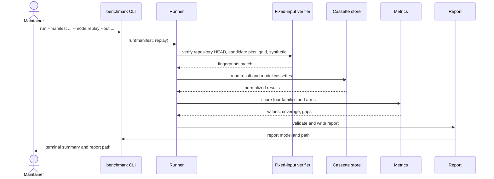
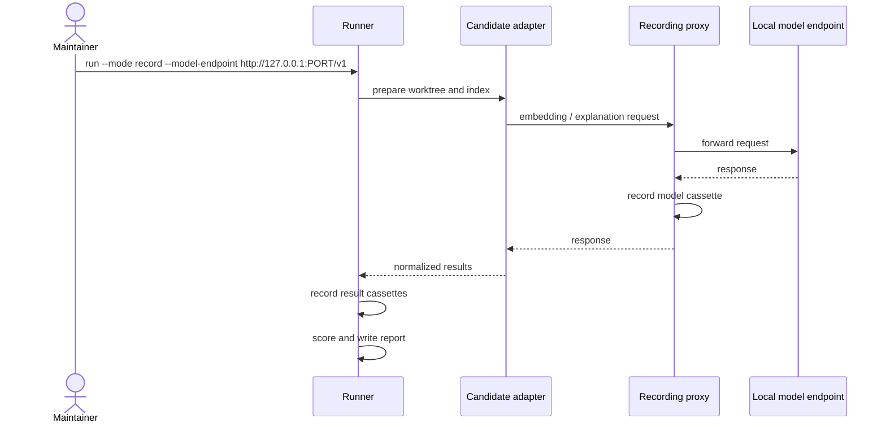
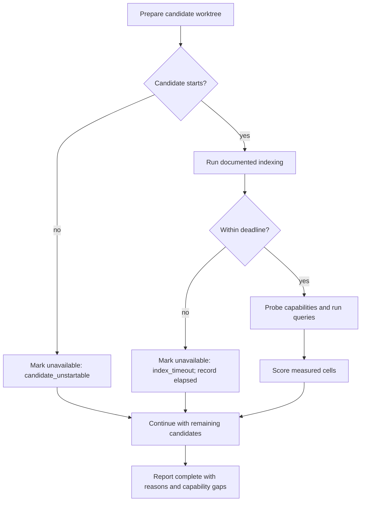
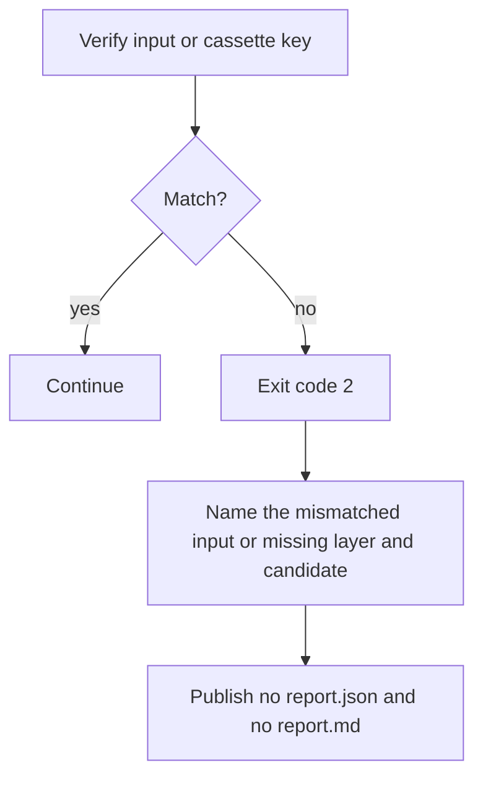

# 6. Runtime View

## Scenario: replay run

**Trigger:** the maintainer runs `benchmark run --mode replay`.

**Steps:**

1. The CLI loads and validates the manifest and its targets.
2. The runner verifies every fixed input and each cassette fingerprint.
3. The cassette store returns the normalized results; no candidate process is
   started and no external request is made.
4. The scorers compute values, coverage, and gaps for each metric and arm.
5. The report is written only after validation; the CLI prints the summary at
   `--width` (default: terminal width, fallback 80).

**Notes:** timestamps and run metadata are excluded from measurement identity.
A missing cassette key exits 2 and names candidate, repository, query, arm, and
layer; no partial complete report is written.

## Scenario: record run

**Trigger:** the maintainer runs `benchmark run --mode record` with a local
model endpoint.

**Steps:**

1. The runner prepares a writable worktree including `.git` and runs the
   candidate's documented indexing setup under the manifest deadline.
2. Candidate model requests go to the loopback proxy, which forwards them to
   the configured local endpoint and records request/response pairs.
3. The adapter normalizes results; the runner records them keyed by candidate,
   repository, revision, query, arm, limit, and gold fingerprint.
4. The report is scored and written; its model-cassette and result-cassette
   fingerprints identify the recording.

**Notes:** the record-mode E2E uses a local fake OpenAI-compatible endpoint;
the manual acceptance gate additionally requires one real record run against a
real candidate and repository.

## Scenario: index timeout or unavailable candidate

**Trigger:** a candidate fails to start, fails its indexer check, or exceeds its
index deadline.

**Steps:**

1. A failed handshake or install marks the candidate unavailable with its
   reason; the run continues.
2. A deadline breach marks every metric for that candidate/repository
   unavailable with `index_timeout` and records elapsed time.
3. A missing operation marks only that metric unavailable with a capability
   reason and adds a capability gap.
4. The final report still names the candidate and the unavailable cell; it
   never converts any of them to zero.

**Notes:** a per-query error counts as a miss and increments the separate error
total; there are no automatic retries. A fixed-input mismatch or a replay miss
is the only failure that stops the run.

## Scenario: fixed-input mismatch or missing recorded response

**Trigger:** a repository commit, candidate pin, gold fingerprint, synthetic
fingerprint, or cassette key does not match.

**Steps:**

1. The verifier compares the expected and actual values before scoring.
2. The run exits 2 with a message naming the mismatch or missing cassette
   layer, candidate, query, and arm.
3. No complete report is published; existing report files at the target path
   are not replaced.

**Notes:** replay never falls back to a live call, and no error path writes a
"complete" report with a missing measurement.
