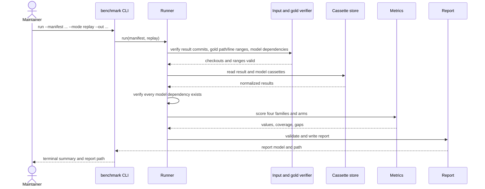
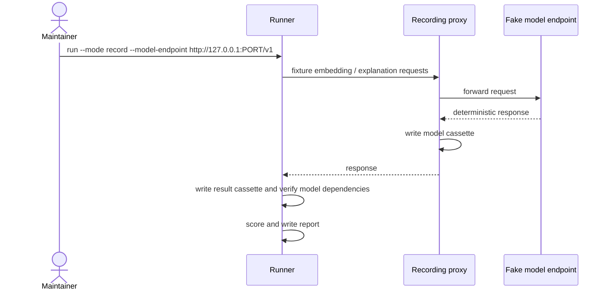
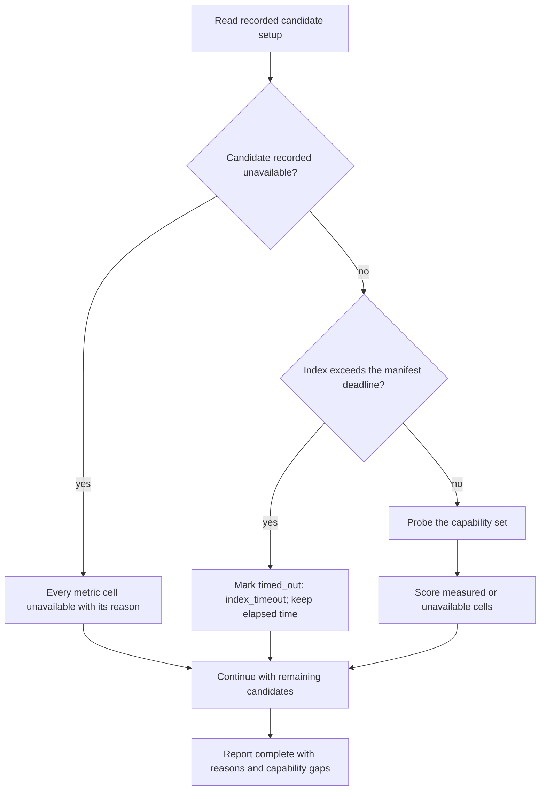
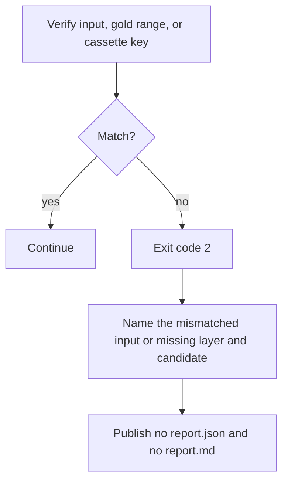

# 6. Runtime View

## Scenario: replay run

**Trigger:** the maintainer runs `benchmark run --mode replay`.

**Steps:**

1. The CLI loads and validates the manifest, its targets, and each repository's
   `checkout`.
2. `Gold::load` validates every expected path and line range, plus each
   explanation target and acceptable-evidence range, against the checkout.
3. The cassette store returns the normalized results; no candidate process is
   started and no external request is made. Every model dependency is checked.
4. The scorers compute values, coverage, and gaps for each metric and arm.
5. The report is written only after validation; the CLI prints the summary at
   `--width` (default: terminal width, fallback 80).

**Notes:** timestamps and run metadata are excluded from measurement identity.
A missing model response is a typed `MissingRecordedResponse`; the run exits 2
and names the key, candidate, repository, task, query, and layer. No partial
complete report is written.

## Scenario: record run

**Trigger:** the maintainer runs `benchmark run --mode record` with the
loopback fake endpoint.

**Steps:**

1. The runner reads the committed fixture result cassette and verifies its
   repository commits.
2. It posts the fixture model dependencies to the fake endpoint through the
   recorder and writes the returned records into the caller's output directory.
3. It writes the result cassette, verifies every model dependency, scores, and
   writes the report.
4. The report records the model and result cassette fingerprints.

**Notes:** the `@e2e` record scenario starts the endpoint on an ephemeral
loopback port and compares the replay report with the recorded one. The
committed fixture cassettes are never overwritten. The real record run is
`benchmark-run`'s.

## Scenario: index timeout or unavailable candidate

**Trigger:** the recorded fixture data marks a candidate unstartable or an
index beyond its deadline.

**Steps:**

1. A recorded unstartable candidate marks every metric cell unavailable with
   its reason; the run continues.
2. A deadline breach makes every metric for that candidate/repository
   unavailable with `index_timeout` and keeps the elapsed time.
3. A missing operation marks only that metric unavailable with a capability
   reason and adds a capability gap.
4. The final report still names the candidate and the unavailable cell; it
   never converts any of them to zero.

**Notes:** a per-query error counts as a miss and increments the separate error
total; there are no automatic retries. A fixed-input mismatch or a replay miss
is the only failure that stops the run.

## Scenario: fixed-input mismatch or missing recorded response

**Trigger:** a repository commit, gold path/line range, or cassette key does
not match.

**Steps:**

1. The verifier compares the expected and actual values before scoring.
2. The run exits 2 with a message naming the mismatch or missing cassette
   layer, candidate, repository, query, and task.
3. No complete report is published; existing report files at the target path
   are not replaced.

**Notes:** replay never falls back to a live call, and no error path writes a
"complete" report with a missing measurement.
