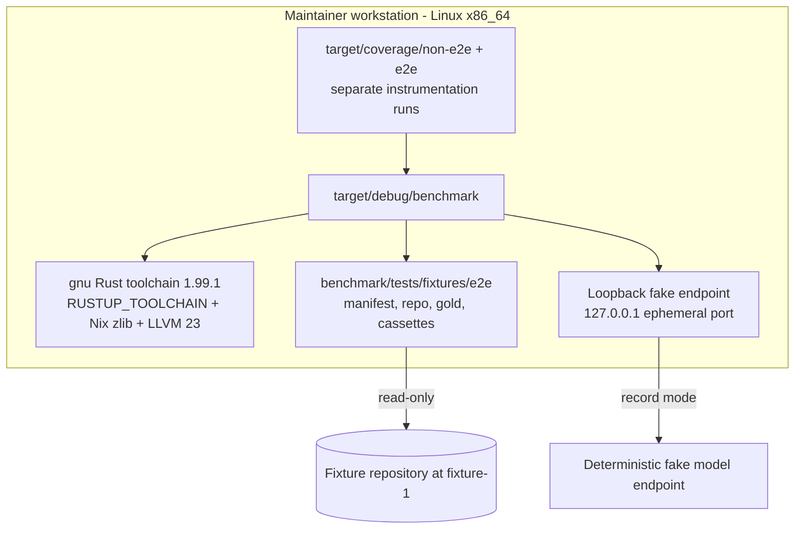

# 7. Deployment View

The benchmark runs on the maintainer's Linux workstation as a local project
tool. It deploys no product service and uses no container runtime.

## Infrastructure level 1

| Node / Environment | Description |
|---|---|
| Workstation | Linux x86_64 with `rustup`, Cargo, Nix for zlib and LLVM, and Python 3 for the Cobertura helper. |
| Toolchain | `stable-x86_64-unknown-linux-gnu`; the default musl toolchain is unusable here. `env.sh` also resolves `LLVM_COV`/`LLVM_PROFDATA` from `nixpkgs#llvmPackages_23.llvm`. |
| Fixture | `benchmark/tests/fixtures/e2e/manifest.yaml`, `repo/`, `gold/`, and `cassettes/`; committed and fixed. |
| Report output | The caller's `--out` directory (default `reports/benchmark`), not committed. |
| Recordings | The returned-temporary record scenario writes model and result cassettes under its output directory; the committed fixture cassettes are read-only input. |
| Model endpoint | The `@e2e` scenario's fake OpenAI-compatible endpoint on an ephemeral loopback port, used for both fixture endpoint roles in record mode only. |

The real candidate installs and tool prefixes, the public repository work
area, the per-candidate checkouts, the setup lock, and the committed public
cassettes and report are this change's evidence deployment. The fixture
deployment above remains the CI and replay path.

## Infrastructure level 2

### Workstation

| Property | Value |
|---|---|
| Hardware / VM | The maintainer's development machine; no dedicated benchmark host. |
| OS | Linux x86_64 (kernel 6.18 on the development host). |
| Middleware / Runtime | Cargo/rustc 1.99.1 (gnu), `cargo-llvm-cov` 0.9.0, LLVM 23.1.3, Python 3 for the Cobertura helper. |
| Key software deployed | The `benchmark` binary, the fixture inputs, the loopback fake endpoint, and the coverage scripts. |

### Fixture and recordings

| Path | Content | Pin / identity |
|---|---|---|
| `benchmark/tests/fixtures/e2e/repo` | Tiny Python checkout | `fixture-repo`, revision `fixture-1`, commit `1111…`, 120 code lines |
| `benchmark/tests/fixtures/e2e/gold` | Five JSONL gold files | Versions 1; computed `sha256:<hex>` for typo, natural-language, explanation, concept, and concept-equivalence |
| `benchmark/tests/fixtures/e2e/cassettes` | Result and model cassettes | Computed `sha256:<hex>` for each file; every result records candidate version and commit |
| `benchmark/evidence/visual` | Committed terminal transcripts | Two `@e2e` scenario transcripts |
| `target/coverage/{non-e2e,e2e}` | Per-scope cargo-llvm-cov targets | Distinct instrumentation runs |

### Coverage and evidence

`env.sh` supplies the toolchain, zlib, and LLVM 23 environment to
`run-tests.sh`, `setup.sh`, `measure-coverage.sh`, and `merge-coverages.sh`.
`measure-coverage.sh` runs the regular and e2e scopes with separate
`CARGO_TARGET_DIR`s and writes `GIVN_COVERAGE_NON_E2E_PATH` and
`GIVN_COVERAGE_E2E_PATH`; `merge-coverages.sh` merges the two Cobertura files
into `GIVN_COVERAGE_OUTPUT_PATH` and probes production files. Visual
transcripts are written to `${GIVN_EVIDENCE_DIR:-benchmark/evidence/visual}` so
they survive change archival.

### Real evidence deployment

| Path | Content | Pin / identity |
|---|---|---|
| `benchmark/work/repos/<repository>` | Pinned public reference checkout | URL, revision, commit, language, measured size |
| `benchmark/work/synthetic` | Generated 10M-line monorepo | Seed `20261020`, generator `1`, content fingerprint |
| `benchmark/work/<candidate>/<repository>` | Writable per-candidate copy with `.git` where required | Candidate version/commit and repository commit |
| `benchmark/work/tools` | Installed candidate binaries, SCIP indexers, language servers, Serena environment | Entries in `benchmark/setup.lock.json` |
| `benchmark/setup.lock.json` | Probe results, resolved toolchain versions, setup deviations, and endpoint/model records | Written by `setup.sh`; committed evidence; never the candidate-pin origin |
| `benchmark/evidence/real-run/provenance.json` | Command, UTC start/end, host/toolchain, endpoint localities/models and explanation budget, manifest pins, index outcomes, targets fingerprint, cassette digests | Committed evidence; cross-checked by the real-run scenarios |
| `benchmark/cassettes/results` and `benchmark/cassettes/model` | Committed normalized results and model responses | SHA-256 fingerprints in the manifest |
| `benchmark/reports` | Committed `report.json` and `report.md` | Manifest, targets, cassette, and provenance fingerprints |
| `benchmark/evidence/visual` | Committed terminal transcripts | Two `@e2e` scenario transcripts |
| Loopback embedding endpoint | Local OpenAI-compatible embedding server (`nomic-embed-text`) | Locality/model in the setup lock, provenance, and report |
| External explanation endpoint | Provider OpenAI-compatible endpoint used only for at most 80 reviewed explanation queries | Locality/model/budget in the setup lock, provenance, and report; recorded operator decision |

`env.sh` supplies the toolchain, zlib, and LLVM 23 environment to
`run-tests.sh`, `setup.sh`, `measure-coverage.sh`, and `merge-coverages.sh`.
Candidate pins come from the committed manifest; the setup lock records only
what was probed and installed. The embedding endpoint stays on loopback, and
only the reviewed explanation queries leave the machine; replay and the fixture
suite make no external call. The real record run is not a CI deployment step.
