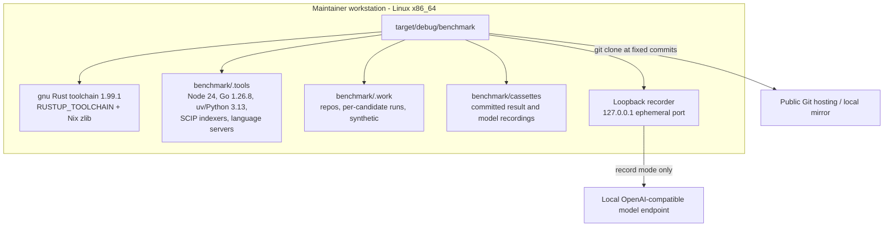

# 7. Deployment View

The benchmark runs on the maintainer's Linux workstation as a local project
tool. It deploys no product service and uses no container runtime.

## Infrastructure level 1

| Node / Environment | Description |
|---|---|
| Workstation | Linux x86_64 with `rustup`, Cargo, Node, Go, `uv`, and optionally Nix for zlib. |
| Toolchain | `stable-x86_64-unknown-linux-gnu`; the default musl toolchain is unusable here. |
| Tool prefixes | `benchmark/.tools/node`, `benchmark/.tools/go/bin`, `benchmark/.tools/serena`, plus pinned SCIP indexers and language servers; generated and gitignored. |
| Work area | `benchmark/.work/repos` fixed checkouts, `benchmark/.work/runs/<candidate>/<repo>` writable copies including `.git`, `benchmark/.work/synthetic/<digest>` generated monorepo. |
| Recordings | `benchmark/cassettes/model` and `benchmark/cassettes/results`, committed; replay needs only these. |
| Model endpoint | A local OpenAI-compatible endpoint (Ollama if installed) on loopback/localhost; used in record mode only. |

## Infrastructure level 2

### Workstation

| Property | Value |
|---|---|
| Hardware / VM | The maintainer's development machine; no dedicated benchmark host. |
| OS | Linux x86_64 (kernel 6.18 on the design host). |
| Middleware / Runtime | Cargo/rustc 1.99.1 (gnu), Node.js 24 LTS, Go 1.26.8, Python 3.13 via `uv`, `cargo-llvm-cov`. |
| Key software deployed | The `benchmark` binary, candidate tools in isolated prefixes, the loopback recorder, and the coverage scripts. |

### Candidate tool prefixes

| Prefix | Content | Pin |
|---|---|---|
| `benchmark/.tools/node` | Node.js runtime and `open-codebase-index` | Node 24 LTS; ocbi v0.37.0, commit `573b71c3…` |
| `benchmark/.tools/go/bin` | `ckb` | v9.3.1, commit `5ff375db…` |
| `benchmark/.tools/serena` | Serena agent environment and language servers | v2.1.0, commit `5e4f5cd1…`; Python 3.13; pinned pyright, typescript-language-server, rust-analyzer |
| CKB indexers | `scip-typescript`, `scip-python`, `rust-analyzer scip` | Versions recorded in the manifest |

Setup probes every candidate with its documented help/doctor command. An
installation that is impossible on the host is recorded as a deviation and its
affected measurement cells are marked unavailable; it is never silently
degraded.

### Coverage and evidence

`env.sh` supplies the toolchain and zlib environment to `run-tests.sh`,
`setup.sh`, `measure-coverage.sh`, and `merge-coverages.sh`. Coverage profiles
are written to `coverage/non-e2e-%p.profraw` and `coverage/e2e-%p.profraw`,
merged with `llvm-profdata`, and rendered as Cobertura reports. Visual
transcripts are written to `${GIVN_EVIDENCE_DIR:-benchmark/evidence/visual}` so
they survive change archival.
