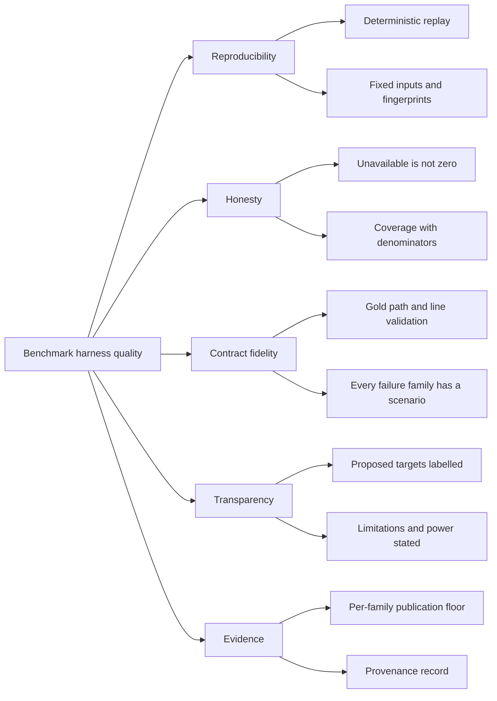

# 10. Quality Requirements

## Quality tree

## Quality scenarios

| ID | Quality attribute | Scenario | Metric / Acceptance criterion |
|---|---|---|---|
| QS-001 | Reproducibility | The maintainer reruns the same manifest, gold, fixture identities, and cassettes in replay. | Identical metric values, coverage, ordering, and fingerprints; no external request; no candidate install. |
| QS-002 | Reproducibility | A repository commit, candidate identity, gold digest, cassette digest, or gold path/line range does not match the manifest or checkout. | Exit 2 naming the mismatch and both values; no `report.json`/`report.md` published. |
| QS-003 | Honesty | A candidate has no explanation operation. | Explanation cells `unavailable` with `no_explanation_operation`; coverage 0/4 for that candidate; aggregate remains measured from other candidates; capability gap listed. |
| QS-004 | Honesty | A metric has no measured candidate at all. | `to_best` and `to_target` have status `unavailable`, reason `no_measured_candidate`, and no numeric value; the report is still complete. |
| QS-005 | Honesty | A candidate returns no result for some typo tasks. | No-match rate reported separately from recall, with its numerator and denominator. |
| QS-006 | Contract fidelity | The fixture CKB record has Rust Tier 3 and the fixture Serena record has no NL search. | The tier and `no_natural_language_search` are recorded on the cells; no silent quality difference and no zero. |
| QS-007 | Transparency | The report shows a gap to AC-01's 0.90. | Gap labelled "gap to proposed target" with `target_status: proposed`; never "confirmed". |
| QS-008 | Determinism | The synthetic monorepo is regenerated from the fixed seed and generator version. | Same content fingerprint and same gold locations; ten million code lines across three languages. |
| QS-009 | Contract fidelity | A candidate exceeds its index deadline. | `index_timeout` with the applied deadline and elapsed time; every metric for that candidate/repository unavailable and never zero. |
| QS-010 | Transparency | A query errors during a metric run. | Error counted as a miss, recall denominator unchanged, error total reported separately. |
| QS-011 | Usability | The terminal summary is rendered at 80 and 160 columns. | No metric label/value pair wraps or splits across lines at either width. |
| QS-012 | Testability | A step is undefined or skipped. | The `harness = false` cucumber runner exits non-zero; the run cannot report GREEN with nothing executed. |
| QS-013 | Contract fidelity | A real adapter needs a record shape or failure family the fixture does not exercise. | Every failure family has a scenario, the record shape is the reviewed contract, and the real record run must publish the measured report before the path decision; the split is recorded as the operator decision. |
| QS-014 | Code coverage | Both the cucumber runner and CLI child run under instrumentation. | `GIVN_COVERAGE_NON_E2E_PATH` and `GIVN_COVERAGE_E2E_PATH` come from distinct target directories; `merge-coverages.sh` merges them and each production probe is non-zero. |
| QS-015 | Evidence | The maintainer reads the report after a fixture replay. | The report path and the four metric sections are printed; the report values match the fixture contract at widths 80 and 160. |
| QS-016 | Honesty | A real candidate fails its setup probe before indexing. | Every metric cell for that candidate is `unavailable` with the probe reason; other installed candidates are measured; the report remains complete. |
| QS-017 | Honesty | A real candidate has a documented setup deviation on one repository. | The affected measured cells carry the deviation label; no affected cell is reported as zero; the report names the deviation. |
| QS-018 | Contract fidelity | A real gold set is below its per-power published minimum, or a manifest-referenced set has no reviewer. | Below-minimum: exit 2 with the typed `gold_below_minimum` error naming the set, metric, minimum, and count. Unreviewed: exit 2 with the typed `unreviewed gold set` error. Neither publishes a report; a draft the manifest does not reference is not loaded. |
| QS-019 | Reproducibility | The maintainer changes one gold query, recomputes its set fingerprint, and replays the recorded run. | The run exits 2 with a missing recorded response for the changed query's digest; the original query's recorded response is not reused; no report is published. |
| QS-020 | Evidence completeness | The maintainer records the real run on the fixed inputs. | At least one measured candidate cell exists for typo, natural-language, explanation, and concept, and at least one measured cell exists for every manifest repository; otherwise exit 2 with no report files. The published report names identities, power labels, gold reviewers, endpoints, deviations, and the deferred path decision. |
| QS-021 | Reproducibility | The maintainer replays the committed real cassettes. | Measurements and ordering match the recorded run; every installed candidate's measured slice reproduces; no candidate process starts and no external request is made. |
| QS-022 | Evidence completeness | The maintainer inspects the committed real evidence against the provenance record. | Provenance pins equal the manifest, probe records equal the setup lock, cassette digests equal the committed files, and index outcomes equal the report cells; a hand-authored artifact fails the check. |
| QS-023 | Transparency | The maintainer reads the real report's endpoint and budget record. | Both endpoint localities and model names, the explanation-query budget, and the consumed count are stated; candidate-internal embeddings stay on loopback. |
| QS-024 | Honesty | The maintainer reads the real report's gold sets and repository labels. | The primary repository shows the full minimums, each secondary shows half and a `lower_power` label, and no aggregate combines a primary and a secondary repository. |
