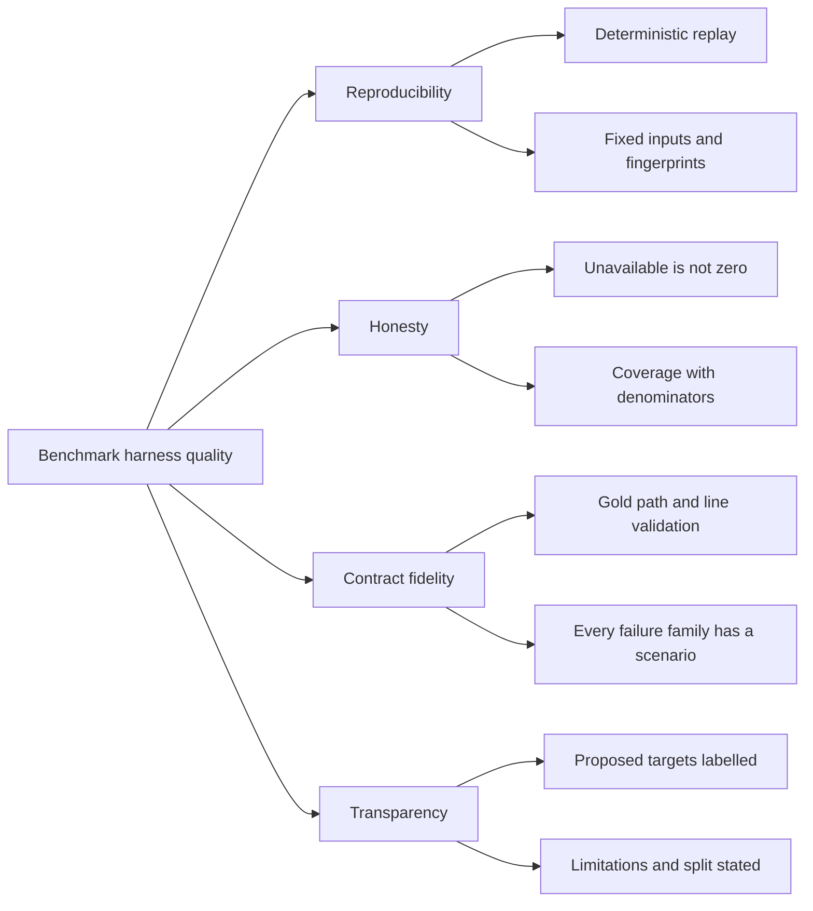

# 10. Quality Requirements

## Quality tree

## Quality scenarios

| ID | Quality attribute | Scenario | Metric / Acceptance criterion |
|---|---|---|---|
| QS-001 | Reproducibility | The maintainer reruns the same manifest, gold, fixture identities, and cassettes in replay. | Identical metric values, coverage, ordering, and fingerprints; no external request; no candidate install. |
| QS-002 | Reproducibility | A repository commit, candidate identity, gold digest, cassette digest, or gold path/line range does not match the manifest or checkout. | Exit 2 naming the mismatch and both values; no `report.json`/`report.md` published. |
| QS-003 | Honesty | A candidate has no explanation operation. | Explanation cells `unavailable` with `no_explanation_operation`; coverage 0/4 for that candidate; aggregate remains measured from other candidates; capability gap listed. |
| QS-004 | Honesty | A metric has no measured candidate at all. | `to_best` and `to_target` have status `unavailable`, reason `no_measured_candidate`, and no numeric value; the report is still complete. |
| QS-005 | Honesty | A candidate returns no result for some typo tasks. | No-match rate reported separately from recall, with its numerator and denominator. |
| QS-006 | Contract fidelity | The fixture CKB record has Rust Tier 3 and the fixture Serena record has no NL search. | The tier and `no_natural_language_search` are recorded on the cells; no silent quality difference and no zero. |
| QS-007 | Transparency | The report shows a gap to AC-01's 0.90. | Gap labelled "gap to proposed target" with `target_status: proposed`; never "confirmed". |
| QS-008 | Determinism | The synthetic monorepo is regenerated from the fixed seed and generator version. | Same content fingerprint and same gold locations; ten million code lines across three languages. |
| QS-009 | Contract fidelity | A candidate exceeds its index deadline. | `index_timeout` with the applied deadline and elapsed time; every metric for that candidate/repository unavailable and never zero. |
| QS-010 | Transparency | A query errors during a metric run. | Error counted as a miss, recall denominator unchanged, error total reported separately. |
| QS-011 | Usability | The terminal summary is rendered at 80 and 160 columns. | No metric label/value pair wraps or splits across lines at either width. |
| QS-012 | Testability | A step is undefined or skipped. | The `harness = false` cucumber runner exits non-zero; the run cannot report GREEN with nothing executed. |
| QS-013 | Contract fidelity | A real adapter needs a record shape or failure family the fixture does not exercise. | Every failure family has a scenario, the record shape is the reviewed contract, and `benchmark-run` must publish the real report before the path decision; the split is recorded as the operator decision. |
| QS-014 | Code coverage | Both the cucumber runner and CLI child run under instrumentation. | `GIVN_COVERAGE_NON_E2E_PATH` and `GIVN_COVERAGE_E2E_PATH` come from distinct target directories; `merge-coverages.sh` merges them and each production probe is non-zero. |
| QS-015 | Evidence | The maintainer reads the report after a fixture replay. | The report path and the four metric sections are printed; the report values match the fixture contract at widths 80 and 160. |
