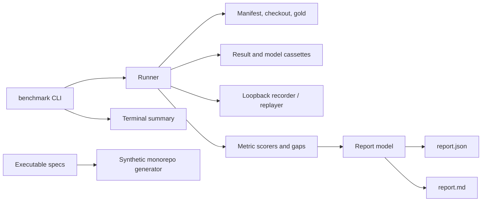
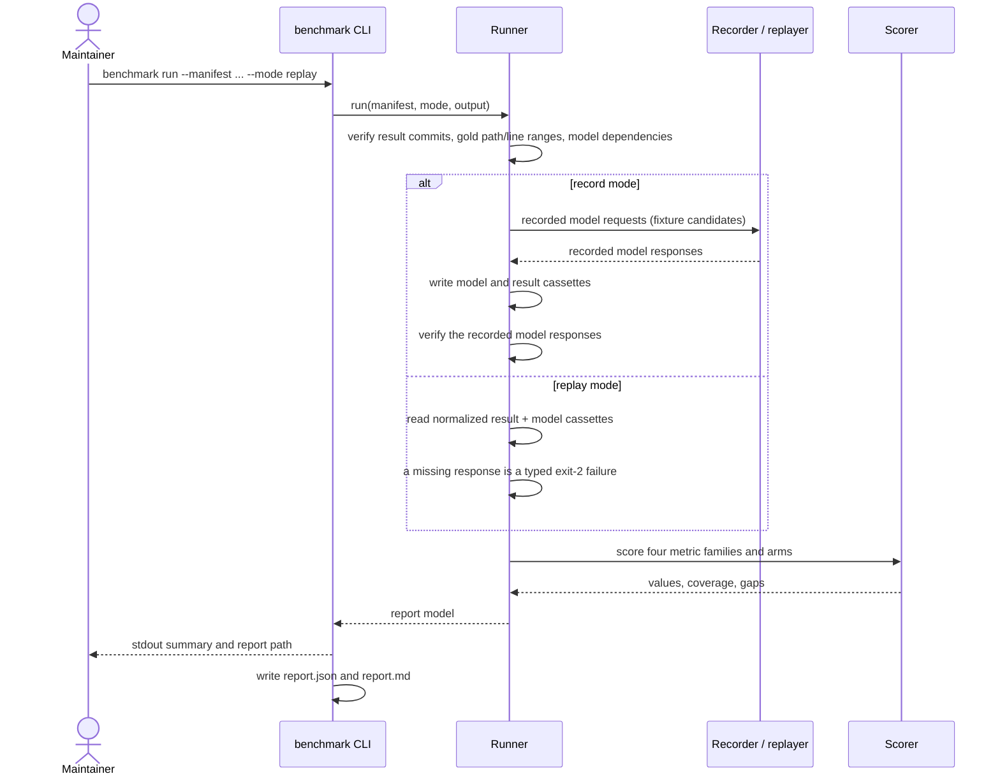

# Design: benchmark-gate

## Scope

This design builds the maintainer-run benchmark harness and report contract
for a project gate. It adds the Cargo workspace and `benchmark` crate, the
fixed-input manifest shape, the normalized-result and model cassettes, the
recording/replay boundary, the four metric families with coverage and gaps,
the report model and renderer, the CLI, and the committed fixture that proves
the contract. It adds no product runtime behavior: the product remains
MCP-only, and no MCP tool, workspace, index, or summary is designed here.

The change is split. `benchmark-run` owns the real candidate adapters
(open-codebase-index, CKB, Serena), the `rmcp` stdio client, the public
`benchmark/manifest.yaml`, `benchmark/targets.yaml`, `benchmark/fetch-repos.sh`,
the real reference repositories, the maintainer-authored gold sets, the
candidate installs/indexers, the committed public cassettes, and the real
record run and report. This design marks those as `benchmark-run` interfaces
and fixes the contract they must satisfy. The split is recorded as the
operator decision in `review.md`.

The operator decision is: on 2026-10-20 the user chose to split the
real-candidate measurement into `benchmark-run`; `benchmark-gate` delivers the
fixture harness. The manual real record run is therefore not a gate of this
change, and the success guarantee is scoped to the fixture-backed harness and
report contract.

The harness is a Rust project tool. This change creates the Cargo workspace
with `benchmark` as its only member; product crates join the same workspace
later, when they exist. The harness is a separate crate, not a product
building block. The product remains Rust, so the harness and the future product
crates share one language and one toolchain. The benchmark contract and the
Gherkin specifications are unchanged by this choice; they are
language-agnostic.

The workstation has `rustup` and `cargo`, but its default toolchain is the
musl target, whose `cargo` is not runnable, and the gnu `rustc` needs
`libz.so.1`, which is present in the Nix store but not on the default loader
path. The project scripts therefore pin
`RUSTUP_TOOLCHAIN=stable-x86_64-unknown-linux-gnu` and resolve zlib via Nix
(or use a system zlib when present). This is a local setup constraint, not a
reason to use another language. The harness is Rust.

## Technology decisions

| Decision | Choice | Rationale |
|---|---|---|
| Harness language | Rust, edition 2024 | Same language as the product; one Cargo workspace and one lockfile. The harness is a separate crate. |
| Toolchain | `stable-x86_64-unknown-linux-gnu` (cargo/rustc 1.99.1) | The default musl toolchain is broken on this workstation. Project scripts set `RUSTUP_TOOLCHAIN`; `setup.sh` resolves zlib via Nix or the system. |
| Dependency management | Cargo with a committed `Cargo.lock` | Reproducible builds and a single lockfile for the workspace. |
| Gherkin runner | `cucumber` 0.23.0 (cucumber-rs) | Native Rust Gherkin runner with async support, tag/name filters, and `.fail_on_skipped()` strict mode. Declared as a `harness = false` test target; see "Executable-spec runner". |
| Data validation | `serde`, `serde_json`, `serde_yaml_ng` | Typed manifests and reports; explicit validation errors; YAML remains human-editable. |
| MCP driving | `benchmark-run` interface: `rmcp` 3.5.1 with features `client` and `transport-child-process` | Not built by this change. The real stdio MCP client and its handshake/timeout behavior belong to `benchmark-run`'s adapters. This change fixes the normalized-result contract those adapters record into. |
| Recorder | `axum` 0.8.9 + `tokio` 1.54.0 local OpenAI-compatible HTTP server | Records and replays embedding/explanation calls on loopback; no external service on replay. |
| Candidate result recording | Normalized result cassettes in addition to raw model cassettes | Makes the report reproducible and free to rerun even when a candidate's retrieval is not internally deterministic. |
| Runner isolation | Local Cargo build, fixture checkout under `benchmark/tests/fixtures/e2e/repo`, loopback recorder | No container runtime is required. This change starts no candidate and no external service; replay has no network path. `benchmark-run` adds the workspace-local candidate prefixes. |
| Candidate toolchains | `benchmark-run` interface: Node 24 LTS for open-codebase-index; Go 1.26.8 for CKB; `uv`/Python for Serena | Not installed by this change. The fixture uses pinned candidate identities recorded in the manifest. |
| Coverage | `cargo-llvm-cov` 0.9.0 with the LLVM 23 tools that match rustc 1.99.1; two Cobertura reports merged by `benchmark/tools/cobertura.py` | The host path has no LLVM tools; `nixpkgs#llvmPackages.llvm` is LLVM 21.1.8 and rejects rustc's raw profile format version 11. The LLVM 23 package matches rustc and merges both scopes' profiles. |
| Report formats | `report.json` and `report.md` from one Rust report model | Machine-readable source of truth plus a human-readable render; the terminal summary uses the same model. |

### Version freshness

Every version below was resolved at design time (2026-10-20), not recalled
from memory. Versions without a listed number are resolved at setup time and
pinned in `Cargo.lock`. Rows marked `benchmark-run` are that change's
interface; this change does not install them.

`reqwest` was re-pinned: the original workspace lock resolved 0.12.28 against
a `0.12` requirement even though the design named 0.13.5. The dependency is
now `0.13.5` and `Cargo.lock` records 0.13.5; `cargo check --workspace
--all-targets` passes with it.

| Technology | Resolution | Verified how and when |
|---|---|---|
| Rust toolchain | `stable-x86_64-unknown-linux-gnu`, cargo/rustc 1.99.1 | `rustup run stable-x86_64-unknown-linux-gnu cargo --version` and a compiled `main.rs`, 2026-10-20. The default musl toolchain is not used. |
| `cucumber` | 0.23.0 | crates.io lookup (`cargo search cucumber`), 2026-10-20; rust-version 1.88, compatible with 1.99.1. |
| `rmcp` (`benchmark-run`) | 3.5.1 | crates.io lookup, 2026-10-20; not a dependency of this change. |
| `axum` | 0.8.9 | crates.io lookup, 2026-10-20. |
| `reqwest` | 0.13.5 | crates.io lookup, 2026-10-20; `Cargo.lock` now records 0.13.5 and the workspace type-checks against it. Used for recorder forwarding. |
| `tokio` | 1.54.0 | crates.io lookup, 2026-10-20. |
| `serde_json` | 1.0.154 | crates.io lookup, 2026-10-20. |
| `serde_yaml_ng` | 0.10.0 | crates.io lookup, 2026-10-20; maintained YAML fork, replaces deprecated `serde_yaml`. |
| `clap` | 4.6.7 | crates.io lookup, 2026-10-20. |
| `sha2` | 0.11.1 | crates.io lookup, 2026-10-20. |
| `anyhow` | 1.0.104 | crates.io lookup, 2026-10-20. |
| `cargo-llvm-cov` | 0.9.0 observed (latest 0.9.1) | `cargo llvm-cov --version`, 2026-10-20; installed at setup if absent, pinned in the setup script. |
| Nix LLVM | 23.1.3 (`nixpkgs#llvmPackages_23.llvm`) | `nix eval --raw nixpkgs#llvmPackages_23.llvm.version`, 2026-10-20; matches rustc's LLVM 23.1.1 raw profile format. `nixpkgs#llvmPackages.llvm` resolves 21.1.8 and rejects that profile. |
| Node.js (`benchmark-run`) | 24 LTS (observed 24.21.0) | `node --version`, 2026-10-20; open-codebase-index requires Node.js 22.13 or newer and recommends Node.js 24 LTS. |
| Go (`benchmark-run`) | 1.26.8 | `go version`, 2026-10-20; installs CKB into `benchmark/.tools/go/bin`. |
| Python (`benchmark-run`) | 3.14.7 | `python3 --version`, 2026-10-20; only the Serena candidate uses it. |
| `uv` (`benchmark-run`) | 0.13.0 | `uv --version`, 2026-10-20; installs and runs Serena. |
| `tokei` (`benchmark-run`) | 15.0.0 | `tokei --version`, 2026-10-20; used only to measure reference repository sizes. |
| open-codebase-index (`benchmark-run`) | v0.37.0, peeled commit `573b71c3d5cfaba3a83d602f7534605047a01363` | GitHub tag `v0.37.0^{}` and npm release, 2026-10-20. |
| CKB (`benchmark-run`) | v9.3.1, peeled commit `5ff375db862c17dbf40168fa3924696baf1839a6` | GitHub tag `v9.3.1^{}`, 2026-10-20. |
| Serena (`benchmark-run`) | v2.1.0, commit `5e4f5cd173c7ff3eed37ee3f1de6c266b937c5dc` | GitHub tag `v2.1.0`, 2026-10-20. |
| Model service | A local OpenAI-compatible endpoint; the fixture uses the loopback `axum` recorder | The recorder/replayer is the benchmark boundary. The endpoint and model identity are recorded in the manifest; replay makes no model call. |
| Embedding model | `nomic-embed-text` by default when the local endpoint provides it; exact model identity recorded in the fixture manifest | The model identity and digest, not a remembered version, are part of the recording key and report. |

## Architecture impact

New Cargo workspace member and test infrastructure; no product module is
touched.

Change delta:

```text
givn/changes/benchmark-gate/
  proposal.md
  design.md
  specs/benchmark-comparison/
    usecase.md
    benchmark-comparison.feature
```

Harness (this change):

```text
Cargo.toml                     # workspace: members = ["benchmark"]
Cargo.lock
benchmark/
  Cargo.toml                   # [[test]] name = "benchmark_features", harness = false
  src/
    main.rs                    # binary entry point
    lib.rs
    cli.rs                     # `benchmark run` only
    manifest.rs                # manifest, targets, checkout, fingerprints
    runner.rs                  # fixed-input verification, replay/record, report assembly
    adapters/
      mod.rs                   # normalized location, explanation, dedup models
    record/
      cassette.rs              # result/model cassettes, fingerprints, replay errors
      proxy.rs                 # axum loopback OpenAI-compatible recorder
    metrics/
      typo.rs
      natural_language.rs
      explanation.rs
      concept.rs
      gaps.rs
      common.rs                # matching, deduplication, micro-average, availability
    report/
      model.rs                 # report structs and schema version
      render.rs                # Markdown, terminal summary, and width control
    gen/
      synthetic_repo.rs        # deterministic 10M-line monorepo and its gold sets
    gold/
      mod.rs                   # gold loading and path/line validation
  tests/
    benchmark_features.rs      # cucumber-rs runner and World (harness = false)
    steps/
      mod.rs
      benchmark_comparison.rs
      e2e/
        mod.rs
        benchmark_cli.rs       # E2E: drives the built benchmark binary
    fixtures/
      e2e/
        manifest.yaml          # the fixture contract below
        repo/                  # tiny fixed fixture repository, revision `fixture-1`
        gold/                  # typo, natural-language, explanation, concept
        cassettes/             # result and model cassettes with recorded fingerprints
  tools/
    cobertura.py               # merge the two Cobertura reports and probe a file
  setup.sh                     # shared env, toolchain, zlib; installs no candidate
benchmark/evidence/visual/     # committed terminal transcripts
env.sh                         # toolchain, zlib, LLVM 23, feature resolution
run-tests.sh                   # toolchain/zlib env + cargo test
measure-coverage.sh            # two cargo llvm-cov scopes -> two Cobertura files
merge-coverages.sh             # merge the two Cobertura files -> output report
```

The real candidate adapters (`benchmark/src/adapters/open_codebase_index.rs`,
`ckb.rs`, `serena.rs`), the `rmcp` stdio client
(`benchmark/src/mcp/stdio_client.rs`), the gold proposer
(`benchmark/src/gold/propose.rs`), `benchmark/fetch-repos.sh`,
`benchmark/manifest.yaml`, `benchmark/targets.yaml`, the public
`benchmark/gold/` sets, and the committed public `benchmark/cassettes/` are
`benchmark-run`'s interface. This change fixes the normalized-result contract
they must satisfy and proves it on the fixture. The deleted `FixtureAdapter`
is not part of the design: the scenarios and CLI read the committed
normalized cassettes directly through the runner.

### Component view



`benchmark-run` adds the real candidate adapters between the runner and the
recorder; they are not drawn here because they do not exist in this change.

### Run sequence



`benchmark-run` replaces the fixture-only record step with real candidate
prepare/index/query calls and records their normalized results into the same
cassette shape.

## Fixed inputs

This change's fixed inputs are the committed fixture. The public reference
repositories (`typescript-reference`, `python-reference`,
`rust-reference`), the real gold sets, and the pinned candidate releases are
`benchmark-run`'s fixed inputs; they are not fetched, installed, or scored
here.

| ID | Language | Fixed revision | Reference-language code lines | Checkout |
|---|---|---|---|---|
| `fixture-repo` | Python | `fixture-1` (`1111…`) | 120 | `benchmark/tests/fixtures/e2e/repo` |

The manifest records each repository's `checkout`, relative to the manifest
directory. `Gold::load` requires the checkout to exist and validates every
expected location before scoring: the path must stay inside the checkout, the
file must exist, the line range must be ordered, and the end line must fall
inside the file. The explanation rubric's target and acceptable-evidence
ranges are validated the same way. The fixture gold files are committed and
fixed.

The synthetic monorepo is generated by `benchmark/src/gen/synthetic_repo.rs`
from seed `20261020`, generator version `1`, and emits exactly 10,000,000
non-blank, non-comment code lines. Generation is not committed; its content
fingerprint is the SHA-256 over the sorted `(relative path, file content hash)`
list. Regeneration with the fixed seed and generator version produces the same
fingerprint, and the generator emits its gold sets from the same construction
so the expected locations are exact. The full 10M-line generation is proven
by the synthetic scenario; a production run at that size remains
`benchmark-run`'s.

In replay mode no clone or install happens. `benchmark-run` adds the public
repositories, their per-candidate writable copies, and the `.git` metadata
each real candidate needs.

## Candidates and fixture identities

This change's candidates are fixture identities, not external tools:

| Candidate | Version / commit | Capability set | Why it exists |
|---|---|---|---|
| `fixture-ocbi` | `fixture-1` / `aaaa…` | typo, natural-language, concept, concept-equivalence, expansion measured; explanation unavailable (`no_explanation_operation`) | Exercises the four measured families, both concept arms, and a capability gap. |
| `fixture-ckb` | `fixture-1` / `bbbb…` | explanation measured; other families not applicable (`fixture_family_not_measured`); expansion not applicable (`no_expansion_switch`) | Exercises the explanation rubric and exact coverage denominators. |
| `fixture-serena` | `fixture-1` / `cccc…` | natural-language unavailable (`no_natural_language_search`); other families not applicable | Exercises unavailable-never-zero and the regex-proxy exclusion. |

The fixture candidate matrix and expected values are fixed in the "Fixture
contract" section below. The real open-codebase-index, CKB, and Serena
candidates, their pinned versions, setup normalization, MCP/SCIP/LSP
interfaces, and fourth-candidate rule are `benchmark-run`'s design.

A candidate that is recorded as uninstallable/unstartable keeps every metric
cell unavailable with its reason. A candidate whose index exceeded the
manifest deadline is unavailable for every metric on that repository with
`index_timeout`; the elapsed time stays in the report. An unavailable
capability is never a zero score.

### Normalized-result contract

The harness consumes normalized candidate records, not a candidate process.
A result is:

```text
{candidate, candidate_version, candidate_commit, repository, repository_commit,
 metric, task, arm,
 results: [{path, start_line, end_line, symbol, kind, resolution}],
 explanation?: {text, citations: [{path, start_line, end_line}]},
 error?, model_requests: [{key, query}]}
```

`results` is the candidate's own order, deduplicated by
`(path, start_line, end_line, symbol)` without reordering. A result without a
line range is a `file` resolution and never a promoted symbol match. The
result cassette is indexed by `(candidate, metric, task, arm)`; a duplicate
entry fails the load.

`benchmark-run`'s adapters produce this record through each candidate's
documented interface and must not infer a capability from a README. They
record a missing operation as `unavailable` with a reason such as
`no_explanation_operation`, `no_symbol_search`, or `no_expansion_switch`.
This change proves the scoring, report, and replay behavior of the record
shape against the committed fixture.

Index deadlines are manifest fields. A deadline breach marks that
candidate/repository unavailable with `index_timeout` for that repository
only, records the applied `deadline_seconds` and the elapsed time, and leaves
the candidate in the report. A per-query error counts as a miss for that query
and is counted separately in the error total. There are no automatic retries.

## Recording and replay

Replay is the default and the only mode needed for a free rerun.

- **Record mode** records the fixture run once against the loopback
  endpoint and writes two layers under the caller's output directory:
  - `cassettes/model/model.jsonl`: OpenAI-compatible requests and responses
    for embeddings and explanation generation.
  - `cassettes/results/results.jsonl`: normalized candidate results keyed by
    candidate identity, repository, metric, task, and arm. `benchmark-run`
    records the same shape from the real adapters into
    `benchmark/cassettes/`.
- **Replay mode** reads the normalized result cassettes and the model
  cassettes, starts no candidate, and makes no external request. This is what
  makes the report deterministic and free even when a candidate's internal
  retrieval is not deterministic.
- Result entries are indexed by `(candidate, metric, task, arm)`; model
  entries by `(candidate, task or model)` (`model:explanation:<candidate>:<task>`
  or `model:embedding:<candidate>:<model>`). The model key excludes the query
  in this fixture harness; a model-record digest and the report limitation
  make the omission visible. `benchmark-run` must add a query digest before
  reusing a model cassette across gold versions. The SHA-256 fingerprint is
  computed over the cassette file bytes, not over a request object.
- Replay verifies every fixed input it can check: each result's candidate
  version and commit against the manifest, each result's repository commit,
  every gold file's digest, and each committed cassette's digest. A mismatch
  exits 2, names the input and both values, and writes no report. A locally
  recorded cassette (the record→replay scenario) is identified by its computed
  digest because the record run created it.
- A missing model key fails the run with exit code 2 through the typed
  `MissingRecordedResponse` (key, candidate, repository, task, query, layer).
  It never falls back to a live call in replay and never writes a partial
  "complete" report.
- The report records `mode`, the manifest fingerprint, each gold fingerprint,
  the model-cassette fingerprint, the result-cassette fingerprint, and the
  exact reproduction command.

The recording boundary is a local OpenAI-compatible HTTP server bound to
loopback, implemented with `axum` and `tokio`. In replay it serves recorded
responses only and makes no external request. In this change's record mode the
`@e2e` scenario starts its own deterministic fake endpoint and passes it with
`--model-endpoint`; the recorder posts the fixture model requests and writes
the cassettes. `benchmark-run` points the same recorder at the configured
local OpenAI-compatible endpoint for the real candidates. No scenario depends
on a live third-party service.

Record mode is a consumer action, not a hidden setup flag: the use-case
inventory lists it, the Interaction Coverage Matrix maps it to its own `@e2e`,
and that E2E runs against a local fake OpenAI-compatible endpoint and the
fixture candidates. It asserts that model requests were recorded and that a
replay of the recorded run produces the same measurements. The fixture record
run uses a temporary cassette directory; it never overwrites the committed
fixture cassettes.

## Metrics

All metrics use a micro-average for the aggregate: total hits divided by total
attempted tasks, with unavailable tasks excluded from the value denominator and
reported separately as metric/task coverage. Per-repository values are also
reported. Results are deduplicated by `(path, start_line, end_line, symbol)` and
capped at the candidate's returned order; the harness never reorders a
candidate's results.

A target is a number with a source citation and an explicit status:
`confirmed`, `proposed`, or `unstated`. The manifest's `targets` map records
the targets; the real `benchmark/targets.yaml` is `benchmark-run`'s. AC-01
appears in the proposal attachments 1 and 7 with a Recall@1 of
0.90, but those attachments are recorded as proposal material, not confirmed
acceptance criteria. The target is therefore recorded as
`{value: 0.90, status: proposed, source: "proposal attachments 1/7 (AC-01); not confirmed"}`
and the report labels its gap "gap to proposed target". The only in-repository
occurrence of 0.90 is Q5's illustrative example ("0.88 against 0.90"), which is
not a confirmation either; it is not used as the target source. The confirmed
records available in this repository state no numeric targets for AC-03,
AC-12, AC-21, or AC-22; the manifest records `target: {value: null, status:
unstated, source: "unstated in confirmed records"}` for them rather than
inventing a number. The report still shows their measured values, the best
measured value, and the candidate spread. A target added later requires a new
manifest fingerprint and is visible in the report. The report never derives a
build threshold from a metric, and it never presents a proposed target as an
accepted one.

Metric/task coverage is defined per metric and per arm as
`attempted / (attempted + unavailable)`, where `not_applicable` cells are
excluded from both numerator and denominator. The typo no-match rate uses the
attempted typo tasks as its denominator (including tasks that returned no
match; an errored query is counted as a miss and tallied in the separate error
total). Reported coverage always carries its numerator and denominator, so a
value of 1.0 with a denominator of 2 cannot be read as a broad measurement.

| Metric | Definition | Reported |
|---|---|---|
| Typo recall @1 | Fraction of typo gold tasks whose expected symbol definition is the first deduplicated result. | numerator, denominator, value, coverage, no-match rate |
| Typo recall @5 | Fraction whose expected definition is in the top five. | value, numerator, denominator |
| Typo no-match rate | Fraction of attempted typo tasks for which the candidate returns no result at all. | value, numerator, denominator; separates "wrong rank" from "no match" |
| Natural-language recall @5 | Fraction of NL tasks with at least one expected target in the top five. | value, coverage, numerator, denominator |
| Natural-language MRR @10 | Mean reciprocal rank of the first expected target within ten results; a miss contributes zero. | value, attempted |
| Explanation correctness | Fraction of explanation tasks whose response contains every required fact (any listed surface form) and at least one valid citation inside the target. | value, attempted, unavailable, coverage |
| Explanation evidence grounding | Fraction of explanation responses with at least one valid citation inside the target. | value, attempted |
| Concept recall @5 | Fraction of concept tasks with at least one expected target in the top five. | default and no-expansion arms, coverage per arm |
| Concept-equivalence recall @5 | Fraction of gold concept variants whose expected target is retrieved in the top five. | default and no-expansion arms, coverage per arm |

Explanation scoring is a fixed, maintainer-reviewed rubric in the gold set:
each task carries `required_facts` with accepted surface forms and
`acceptable_evidence` ranges. The rubric and gold fingerprint are published
with the report. It does not call a judge at scoring time, so the score is
deterministic and free to rerun; the limitation (a paraphrase outside the
listed surface forms is not credited) is stated in the report rather than
hidden.

The no-expansion arm is measured only when the candidate exposes a documented
switch for disabling query expansion. Otherwise it is `not_applicable` with
the reason. It is never reported as zero.

## Gold sets

The maintainer owns the gold sets. This change ships the committed fixture
gold and the loader/validator; the real public gold sets, the draft proposer
(`benchmark/src/gold/propose.rs`), the minimum task counts per repository, and
their review are `benchmark-run`'s.

- The committed fixture gold files are `typo.jsonl`,
  `natural_language.jsonl`, `explanation.jsonl`, `concept.jsonl`, and
  `concept_equivalence.jsonl` under `benchmark/tests/fixtures/e2e/gold/`.
  `concept.jsonl` holds the five concept tasks; `concept_equivalence.jsonl`
  holds the four equivalence variants, so each family has its own version,
  task count, and digest.
- `Gold::load` reads each file named by the manifest's `gold` list, verifies
  the file's SHA-256 against the declared `fingerprint` before parsing,
  checks the task count summed across that metric's entries, and validates
  every expected location against the repository's fixed `checkout`: path
  inside the checkout, file present, ordered line range, and end line inside
  the file. Explanation targets and their acceptable-evidence ranges are
  validated the same way. A fingerprint mismatch, missing path, or
  out-of-range line fails the run before scoring and publishes no report.
- `benchmark/src/gen/synthetic_repo.rs` writes the synthetic gold from the same
  construction, so every expected location is exact and the seed fixes it.
- Every gold file has a `version` and a computed `sha256:<hex>` fingerprint in
  the manifest; the report names both. A gold file changed without updating
  its declared fingerprint exits 2 and names the set, the expected digest,
  and the actual digest.
- Gold is frozen before the first record run. Changing a task after seeing
  results requires a new gold version and manifest fingerprint; the report
  records the change. This prevents tuning the expected answers to a
  candidate.

## Fixture contract

The regular scenarios and the E2E run against one committed fixture, defined at
`benchmark/tests/fixtures/e2e/manifest.yaml`. It is small enough to review and
fixed enough that every Then-step can assert an exact number.

| Fixture fact | Value |
|---|---|
| Repository | `fixture-repo`, revision `fixture-1`, commit `1111111111111111111111111111111111111111`, 120 code lines |
| Fixture candidates | `fixture-ocbi` commit `aaaa…` (40 hex), `fixture-ckb` commit `bbbb…`, `fixture-serena` commit `cccc…`; all version `fixture-1`, adapter `fixture`, adapter version 1 |
| Gold task counts | 5 typo, 4 natural-language, 4 explanation, 5 concept, 4 concept-equivalence variants |
| Gold fingerprints | Computed `sha256:<hex>` for each file; the five fixture sets are `67ec37…` (typo), `dbdb52…` (natural-language), `e9de35…` (explanation), `13faa3…` (concept), and `e37e8f…` (concept-equivalence); `gold_version: 1` for each |
| Result cassette fingerprint | Computed `sha256:0c98fd…`; every entry records the candidate version and commit as well as the repository commit |
| Model cassette fingerprint | Computed `sha256:7f63ef…` |
| Mismatch variant | repository commit `2222…` for `fixture-repo`; the run must exit 2 and publish no complete report |
| Candidate-identity variant | one recorded result's `candidate_version` is `fixture-0`; the run must exit 2, name `fixture-ocbi` and both versions, and publish no report |
| Gold-fingerprint variant | `gold/typo.jsonl` is mutated while the manifest keeps its digest; the run must exit 2, name the typo gold set and both digests, and publish no report |
| Cassette-fingerprint variant | the result cassette is mutated while the manifest keeps its digest; the run must exit 2, name the result cassette and both digests, and publish no report |
| Gold-path variant | `typo-1` expected path `src/absent.py`; the run must exit 2, name the task and path, and publish no report |
| Gold-line variant | `typo-1` expected end line `1000`; the run must exit 2, name the task and out-of-range line, and publish no report |
| Multi-repository variant | adds `fixture-extra` (`extra-1`, commit `2222…`, 40 code lines) with a five-task typo gold set; per-repository typo @1 is `3/5` for `fixture-repo` and `2/5` for `fixture-extra`, aggregate `5/10` |
| Timeout variant | `fixture-timeout`, `index_deadline_seconds: 1` on `fixture-repo`; status `index_timeout`, applied deadline and elapsed time recorded, every metric for that cell unavailable |
| Uninstallable variant | `fixture-uninstallable`, recorded as `unavailable` with `candidate_uninstallable`; the run continues |
| Unstartable variant | `fixture-unstartable`, recorded as `unavailable` with `candidate_unstartable` (the real adapter's MCP handshake is `benchmark-run`'s); the run continues |
| Query-error variant | one of the 4 NL tasks returns an error; recall stays `2/4`, `query_errors: 1` |
| Limitations variant | the base report carries a `Limitations` section and `limitations` list; an inconsistent report is rejected before write |

Expected values (each family is measured by one fixture candidate; a candidate
whose family is `not_applicable` is excluded from that family's coverage
denominator, while an `unavailable` cell counts in it):

| Metric / arm | Numerator / denominator (value) | Expected value | Coverage (attempted / attempted + unavailable) |
|---|---|---|---|
| Typo recall @1 (`fixture-ocbi`) | 3 / 5 | 0.60 | 5/5 = 1.0 |
| Typo recall @5 (`fixture-ocbi`) | 4 / 5 | 0.80 | 5/5 = 1.0 |
| Typo no-match rate (`fixture-ocbi`) | 1 / 5 | 0.20 | 5/5 = 1.0 |
| NL recall @5 (`fixture-ocbi`) | 2 / 4 | 0.50 | 4/8 = 0.5 |
| NL MRR @10 (`fixture-ocbi`) | reciprocal ranks 1.0 + 0.2, 4 tasks | 0.30 | 4/8 = 0.5 |
| Explanation correctness (`fixture-ckb`) | 2 / 4 | 0.50 | 4/8 = 0.5 |
| Explanation grounding (`fixture-ckb`) | 4 / 4 | 1.00 | 4/8 = 0.5 |
| Concept recall default (`fixture-ocbi`) | 2 / 5 | 0.40 | 5/5 = 1.0 |
| Concept recall no-expansion (`fixture-ocbi`) | 1 / 5 | 0.20 | 5/5 = 1.0 |
| Concept-equivalence recall default (`fixture-ocbi`) | 2 / 4 | 0.50 | 4/4 = 1.0 |
| Concept-equivalence recall no-expansion (`fixture-ocbi`) | 1 / 4 | 0.25 | 4/4 = 1.0 |

The fixture candidate matrix is:

| Candidate | Typo | NL | Explanation | Concept | Concept equivalence |
|---|---|---|---|---|---|
| `fixture-ocbi` | measured | measured | unavailable (`no_explanation_operation`) | measured | measured |
| `fixture-ckb` | not applicable (`fixture_family_not_measured`) | not applicable | measured | not applicable | not applicable |
| `fixture-serena` | not applicable (`fixture_family_not_measured`) | unavailable (`no_natural_language_search`) | not applicable | not applicable | not applicable |

The NL and explanation coverage denominators are 8 because the other
candidate's four tasks are unavailable (4 attempted + 4 unavailable). The
`fixture-ckb` typo/NL/concept cells and `fixture-serena`'s non-NL cells are
`not_applicable` and do not enter any denominator. `fixture-serena` supports
no query-expansion switch, so its no-expansion cells are `not_applicable`
(`no_expansion_switch`).

The fixture cassettes are committed result and model JSONL files; the recorder
serves the model cassette in replay and the fake local OpenAI-compatible
endpoint records into a temporary copy in the record→replay scenario. The
scenario Then-steps assert the values above, not the presence of a heading.

## Report contract

`report.json` is the source of truth; `report.md` is rendered from the same
model. The CLI prints a concise summary and the report path. The report has a
`schema_version`; the model is built only after every input and cassette
check passed, so a failure never writes a report.

Required top-level content:

- **Run**: id, mode, and external-request count. Timestamps are not part of
  measurement identity and the model carries none.
- **Inputs**: each repository's id, URL, revision, commit, language, and
  line-count record (language/total code lines, tool, command, exclusions);
  each gold file's repository, metric, version, task count, and fingerprint.
  The synthetic generator's seed and digest are proven by its scenario and
  are not a report input.
- **Candidates**: id, version, source commit, install command, adapter and
  adapter version, the recorded setup (environment, indexers, doctor output,
  language-support tiers, embedding configuration, `git_metadata`, per-index
  status/duration and the effective `deadline_seconds`), candidate status, and
  the unavailability reason. The capability set drives scoring and capability
  gaps. `candidate_uninstallable` and `candidate_unstartable` are distinct
  recorded reasons and both leave the run continuing with the other
  candidates.
- **Metrics**: for each family, the target as `{value, status, source}` with
  status `confirmed | proposed | unstated`, aggregate
  value/numerator/denominator/coverage, per-candidate cells, `per_repository`
  cells for every fixed repository, the concept-equivalence family with
  default/no-expansion arms, and the no-expansion arm for concept recall. A
  cell is `measured`, `unavailable` with a reason, or `not_applicable` with a
  reason; it is never a fabricated zero. A proposed target's gap is labelled
  "to proposed target" in the rendered report, never "accepted target".
  Aggregates combine the repository cells, so a multi-repository run reports
  each repository's value instead of collapsing it.
- **Gaps**: `to_target` for every metric with a stated target, as
  `value - target`, carrying `status: measured | unavailable | not_applicable`
  with a reason and `target_status: confirmed | proposed`; `to_best` for every
  metric, naming the best measured candidate and each candidate's delta, with
  the same status model; and `capability_gaps` for every unavailable capability
  or operation. When no candidate has a measured value for a metric,
  `to_best` is `status: unavailable` with reason `no_measured_candidate` and
  no numeric value; `to_target` is `unavailable` for the same reason. Neither
  is rendered as zero or as an empty gap.
- **Path decision**: `status: deferred`, `owner: maintainer--ortsinn`,
  `artifact: docs/decisions/benchmark-path.md`, and the rule "decide after the
  report; no pre-registered build threshold". The report contains no
  build/contribute/compose choice.
- **Reproduction**: the runnable replay command (`. ./env.sh && cargo run -p
  benchmark -- run --manifest ... --mode replay --out ...`), the toolchain
  prefix as a report field, and all fingerprints. The report states that
  replay requires no candidate install and no external model call.
- **Limitations**: a closed `limitations` string list containing the proposed
  target label, every `unavailable` capability reason such as
  `no_natural_language_search` or `no_explanation_operation`, the fixture CKB
  Rust Tier 3 setup note, the labelled regex proxy arm, and the explanation
  rubric's surface-form rule. The report contains no path choice.
- **Write validation**: `Report::validate()` checks the schema version,
  coverage arithmetic (`coverage.numerator == attempted`,
  `coverage.denominator == attempted + unavailable`), measured/non-measured
  value and fraction invariants, gap status/value invariants, the required
  gold fingerprints, and a non-empty limitations list. `write_reports` calls
  it before creating either file, so an inconsistent report is rejected and
  nothing is published.

`report.md` is one heading per section and bullet lines, not tables: Run,
Reproduction, Fixed inputs, Gold sets, Candidates, Typo recall,
Natural-language retrieval, Explanation correctness, Concept recall (with
concept and concept-equivalence default and no-expansion values and
coverage), Measured gaps, Limitations, and Path decision. Each metric section
also lists its per-repository values. The measured-gaps section appears before
the limitations and the deferred path decision. The terminal summary uses the
four metric section names and prints the report path; `--width` controls the
rendered line width, and `COLUMNS` is the fallback when the option is absent.

## Data model

The manifest is the single fixed-input record. Its shape (the fixture's
values) is:

```yaml
schema_version: 1
run_id: fixture-benchmark-v1
mode: replay
repositories:
  - id: fixture-repo
    url: "fixture://fixture-repo"
    revision: fixture-1
    commit: "1111111111111111111111111111111111111111"
    language: python
    checkout: repo
    loc: {language_code_lines: 120, total_code_lines: 120, tool: fixture, command: "...", exclusions: []}
candidates:
  - id: fixture-ocbi
    version: fixture-1
    commit: "aaaaaaaaaaaaaaaaaaaaaaaaaaaaaaaaaaaaaaaa"
    install: "fixture adapter"
    adapter: fixture
    adapter_version: 1
    capabilities:
      typo: {status: measured}
      # natural_language, concept, concept_equivalence, expansion
      explanation: {status: unavailable, reason: no_explanation_operation}
    setup:
      embedding: {provider: custom, base_url: "http://127.0.0.1:43117/v1", model: nomic-embed-text}
      git_metadata: present
      indexes:
        - {repository: fixture-repo, status: indexed, seconds: 2.5, deadline_seconds: 14400}
  # fixture-ckb, fixture-serena
targets:
  typo_recall_at_1: {value: 0.90, status: proposed, source: "proposal attachments 1/7 (AC-01); not confirmed"}
  typo_recall_at_5: {value: null, status: unstated, source: "unstated in confirmed records"}
  # natural_language_recall_at_5, explanation_correctness, concept_recall_at_5, concept_equivalence_recall_at_5
gold:
  - {repository: fixture-repo, metric: typo, version: 1, tasks: 5, fingerprint: "sha256:67ec37…", path: gold/typo.jsonl}
  # one entry per metric, including concept_equivalence
cassettes:
  results: {path: cassettes/results/results.jsonl, fingerprint: "sha256:0c98fd…"}
  model: {path: cassettes/model/model.jsonl, fingerprint: "sha256:7f63ef…"}
index_deadlines: {public_repository_seconds: 14400, synthetic_seconds: 28800}
```

The report model is:

```text
Report
  schema_version: 1
  run: {id, mode, external_requests}
  inputs: {repositories[{id, url, revision, commit, language, loc}], gold[{repository, metric, version, tasks, fingerprint}]}
  candidates[]: {id, version, commit, install, adapter, adapter_version, setup, status, unavailable_reason}
  metrics:
    typo: {target, aggregate: Score, recall_at_5: Score, per_candidate{}, recall_at_5_per_candidate{}, no_match_rate, no_match_rate_per_candidate{}, per_repository{}}
    natural_language: {target, aggregate: Score, per_candidate{}, mrr_at_10{value, attempted}, query_errors, query_errors_per_candidate{}, proxy_arms{}, per_repository{}}
    explanation: {target, aggregate: Score, per_candidate{}, evidence_grounding{value, attempted}, per_repository{}}
    concept: {target, aggregate, per_candidate, arms{default: Arm, no_expansion: Arm}, per_repository{}}
    concept_equivalence: {target, aggregate, per_candidate, arms{default, no_expansion}, per_repository{}}
  gaps:
    to_target{}: Gap
    to_best{}: Gap
    capability_gaps[]{candidate, capability, reason}
  limitations[]: string
  path_decision: {status: deferred, owner: maintainer--ortsinn, artifact: docs/decisions/benchmark-path.md, rule}
  reproduction: {command, toolchain_prefix, manifest_fingerprint, gold_fingerprints{}, model_cassette_fingerprint, result_cassette_fingerprint, candidate_install_required, external_model_calls}

Score  = {status: measured | unavailable | not_applicable, value, numerator, denominator, attempted, unavailable, coverage{numerator, denominator, value}, reason}
Arm    = {score: Score, per_candidate{}}
Gap    = {value | null, status, reason, target_status, best_candidate, best_value, deltas{}}
```

All maps are serialized with sorted keys; task results are ordered by the
manifest's repository and task order. The public manifest is the same shape
with `benchmark-run`'s repositories, candidates, gold paths, and cassette
paths.

### Internal primitives

The runner and steps rely on these internal structures; the review
cross-checks this list against the tree.

| Primitive | Module | Role |
|---|---|---|
| `Manifest`, `Repository` (with `checkout`), `Candidate`, `CandidateSetup`, `GoldSet`, `Target` | `src/manifest.rs` | Fixed-input record, setup record, target status, manifest fingerprint. |
| `RecordedResult`, `ModelDependency`, `ResultCassette`, `ModelCassette` | `src/record/cassette.rs` | Normalized-result and model layers, cassette fingerprints. |
| `NormalizedLocation`, `ExplanationResponse`, `Citation` | `src/adapters/mod.rs` | Normalized result contract. |
| `MissingRecordedResponse`, `RunFailure`, `RunResult` | `src/runner.rs` | Typed replay-miss and exit-code failure model. |
| `Score`, `Coverage`, `Arm`, `Gap`, `Report`, `CandidateReport` | `src/report/model.rs` | Closed status model, report schema, and `Report::validate()`. |
| `Gold`, `GoldTask`, `ExplanationTask`, `ConceptEntry` | `src/gold/mod.rs` | Gold loading and path/line validation. |
| `SyntheticRepo` | `src/gen/synthetic_repo.rs` | Fixed-seed 10M-line generator and its gold. |
| `FakeOpenAiEndpoint`, `ModelRecorder` | `src/record/proxy.rs` | Loopback OpenAI-compatible recording boundary. |

## Executable-spec runner

`givn/commands.yaml` declares `verify.command: ./run-tests.sh` and
`verify.e2e_command: ./run-tests.sh --e2e`. This change supplies the script.
`benchmark/Cargo.toml` declares the runner as a test binary without the libtest
harness:

```toml
[[test]]
name = "benchmark_features"
harness = false
```

Without `harness = false`, libtest parses the arguments first and rejects
`--name`/`--tags` with an "Unrecognized option" error, so the runner can never
honour a filter.

- `. ./env.sh` is sourced by `run-tests.sh`, `setup.sh`,
  `measure-coverage.sh`, and `merge-coverages.sh`. It sets
  `RUSTUP_TOOLCHAIN=stable-x86_64-unknown-linux-gnu` and resolves
  `LD_LIBRARY_PATH` for `libz.so.1` (system zlib when present, otherwise
  `nix build --no-link --print-out-paths nixpkgs#zlib`). The default musl
  toolchain is not used.
- `env.sh` exports `givn_resolve_features`. It returns `GIVN_FEATURES` when
  the caller supplies it; otherwise it lists every `*.feature` under
  `givn/specs` plus every active `givn/changes/*/specs` directory. No change id
  is hard-coded, and after archive the change directory is gone, so the
  permanent corpus is the only input. `run-tests.sh` fails before running
  anything when the resolved list is empty.
- The runner reads `GIVN_FEATURES` as a newline-separated multi-file list and
  stages the listed files into a fresh directory under
  `target/givn-features/` (one flat staging directory). It fails when the list
  resolves to no features. The default when `GIVN_FEATURES` is absent in the
  test binary is `givn/specs`.
- The runner calls `filter_run_and_exit(&staged, |_, _, _| true)`.
  `filter_run` applies the cucumber CLI `--name`/`--tags` filters first; when
  neither is supplied the runner sets `CUCUMBER_FILTER_TAGS=not @wip` before
  the runner starts. `filter_run_and_exit` then makes any failed, undefined,
  pending, or skipped step a non-zero process exit. `.fail_on_skipped()` alone
  only records skips in the writer; it does not set the exit code. `run_and_exit`
  would delegate to the same path, but the explicit call is the reviewed
  mechanism.
- The single-scenario command is:
  `GIVN_FEATURES="<change>/specs/benchmark-comparison/benchmark-comparison.feature" cargo test --test benchmark_features -- --name "^Report contains the four acceptance measurements$"`
- The E2E command is:
  `./run-tests.sh --e2e`, which resolves to
  `GIVN_FEATURES="$FEATURES" cargo test --test benchmark_features -- --tags @e2e`.
- The regular coverage scope filters the E2E scenario out:
  `CARGO_TARGET_DIR=target/coverage/non-e2e cargo llvm-cov --test benchmark_features --cobertura --output-path "$GIVN_COVERAGE_NON_E2E_PATH" -- --tags 'not @e2e'`.

### Strict mode and the RED stub pattern

cucumber-rs reports undefined, pending, and skipped steps; the runner uses
`.fail_on_skipped()` plus `filter_run_and_exit()` so any of them fails the test
binary. The setup task proves strictness against this exact configuration: a
temporary `.feature` file with one undefined step must make
`cargo test --test benchmark_features` exit non-zero. No parallel
hand-maintained test file exists.

The not-implemented pattern for RED is uniform: every new step body is written
as `unimplemented!("benchmark-comparison: <step text>")` and every new
production entry point returns the typed `NotImplemented` error until its
scenario is worked. The World and manifest loaders are real from the first
step, so a RED failure names the missing behavior instead of failing on a
panic in fixture setup. A scenario is only allowed to turn GREEN after its
Then-step asserts the concrete fixture value from the "Fixture contract"
section.

### Step definition locations

| Scope | File |
|---|---|
| In-process benchmark integration steps for `benchmark-comparison` | `benchmark/tests/steps/benchmark_comparison.rs` |
| E2E CLI steps for `benchmark-comparison` | `benchmark/tests/steps/e2e/benchmark_cli.rs` |
| cucumber-rs runner, `World`, and fixture lifecycle | `benchmark/tests/benchmark_features.rs` |

The E2E file is separate because it starts the real
`env!("CARGO_BIN_EXE_benchmark")` binary and uses the fixture manifest; the
integration file drives the same capability's runner and report model through
the committed cassettes. There is one file per scope per capability, not one
file for the whole change. `benchmark/tests/e2e_fixture.rs` is removed: its
loopback request/peer assertion is covered by the S21 `@e2e` scenario.

## Canonical E2E policy

The interaction inventory, one-E2E-per-action scope, real-interface
assertions, and flag-variant classification are owned by
`givn instructions specs --change benchmark-gate` and the use-case document
`givn/changes/benchmark-gate/specs/benchmark-comparison/usecase.md` (the
change-local copy that merges to the durable
`givn/specs/benchmark-comparison/usecase.md` on archive). This design supplies
the infrastructure and the matrix below; it does not restate the policy.

## Interaction Coverage Matrix

| Inventory entry | @e2e scenario title | Real interface | Driving mechanism |
|---|---|---|---|
| Run the benchmark in replay mode on the fixed inputs and read the measured report | Maintainer runs the benchmark and reads the measured report | CLI | `std::process::Command` runs `env!("CARGO_BIN_EXE_benchmark")` with `run --manifest benchmark/tests/fixtures/e2e/manifest.yaml --mode replay`; the step captures stdout/stderr and reads the printed report path. |
| Record a benchmark run against a local model endpoint and replay the recorded run | Maintainer records a run and replays it without an external call | CLI | The same subprocess with `--mode record --model-endpoint http://127.0.0.1:<port>/v1` against a local fake OpenAI-compatible endpoint and the fixture candidates; the step then reruns with `--mode replay` and compares the two report models except run metadata. |

The `benchmark` CLI exposes exactly one command, `run`, with `--manifest`,
`--mode {record,replay}`, `--out`, `--width`, and `--model-endpoint` options.
There is no `verify` or `report` subcommand: the consumer surface is the one
proposed benchmark command, and every action in the inventory maps to `run`.

## E2E smoke test infrastructure

- **E2E runner command**: `./run-tests.sh --e2e`, resolving to
  `cargo test --test benchmark_features -- --tags @e2e`.
- **E2E step definitions**: `benchmark/tests/steps/e2e/benchmark_cli.rs`.
- **Local infrastructure**: no shared server or database for the replay scenario. The E2E fixture is a tiny fixed repository with three pinned fixture candidate identities and committed result cassettes. The child writes to a per-run directory under `target/benchmark-e2e/`; the replay boundary is in-process and the child makes no network request. The record→replay scenario starts one loopback fake OpenAI-compatible endpoint (an `axum` test server on an ephemeral port) and points the child at it with `--model-endpoint`; the endpoint is deterministic and returns fixture completions/embeddings.
- **E2E framework**: cucumber-rs, matching the Rust harness and the regular executable-spec runner. The real interface is the CLI, so the step drives a subprocess rather than an in-process function.
- **E2E strict-mode proof**: `.fail_on_skipped()` and `filter_run_and_exit()` in the runner, plus a temporary `.feature` with an undefined step that must make the test binary fail. A pending E2E step fails the run.
- **Primary assertion**: the child process exit status, the terminal's four measurement sections, the printed report path, and the report file's measured values from the fixture contract. The child is `env!("CARGO_BIN_EXE_benchmark")`, so the test binary is the one Cargo built for this change. The assertion is on what the consumer interface returned and displayed; no database is the primary boundary.
- **Width assertion**: the step reruns the summary with `--width 80` and `--width 160` and asserts that every metric label/value row is a single line within the requested width and that no label is separated from its value. `--width` is a CLI option applied by `report/render.rs`; when absent, the renderer reads `COLUMNS` and falls back to 80. No pty is required.
- **Transcript**: the E2E step writes the captured terminal output to
  `${GIVN_EVIDENCE_DIR:-benchmark/evidence/visual}/<scenario-slug>/transcript.txt`.
  The default is a durable path inside the repository, so the step still works
  after the change directory is archived; no test writes into
  `givn/changes/benchmark-gate/`.

## Visual Design Contract

- Interface: terminal. The tool prints plain text to stdout; it renders no
  HTML, CSS, or JavaScript, so this is not a Web UI and no browser driver
  (Playwright or equivalent) applies.
- Approval: the single terminal baseline below was approved by the user's
  go-ahead on 2026-10-20. No alternative layout is rendered for this change;
  a future layout change reopens the contract.
- Viewports: not applicable to a terminal. The report is checked at 80 and
  160 columns through `--width 80` and `--width 160`, and no metric label/value
  pair may wrap or be split across lines at either width.
- Design system: none; the project has no `docs/design/` system. The terminal
  baseline below is the contract for this change.
- Typography and layout: plain text with one top-level title, one heading per
  report section, and aligned tables; no ANSI color as the only carrier of a
  state.
- Component primitives: run summary, metric table, gap table, capability
  table, error line. Each has a default and an error/unavailable state.
- Accessibility: headings and labels are textual; metric names are domain
  terms, not internal IDs; no duplicated visible content; no motion.
- Screens covered: the benchmark run summary and the measured report.
- Rendered reference: the committed transcript for the E2E scenario shows the
  run identity, candidate list, four metric sections, report path, and the
  deferred path decision at both widths.
- Capture mechanism and evidence path: every `@e2e` scenario commits
  `${GIVN_EVIDENCE_DIR:-benchmark/evidence/visual}/<scenario-slug>/transcript.txt`.
  Intermediate captures live under `reports/visual/` and are not review
  evidence.
- Motion: none. The CLI does not animate; `prefers-reduced-motion` is not
  applicable to terminal output, and the design adds no motion.

## Black-box-first

Prefer the real interface for every behavior. If an internal test is retained,
the design must answer: which case this test covers that the E2E does not? If
there is no concrete answer, use the E2E scenario instead.

| Regular scenario | Case the E2E does not cover |
|---|---|
| Report identifies every candidate and fixed repository revision | Identity and revision checks on every candidate, not only the fixture candidate. |
| Report contains the four acceptance measurements | Metric arithmetic and coverage on the full fixture set. |
| Report states measured gaps without a pre-registered build threshold | Target/gap arithmetic, unstated targets, the proposed-only AC-01 target, all-unavailable gaps, and the deferred decision owner/artifact. |
| Report compares concept recall with and without query expansion | The two-arm report and the `not_applicable` status. |
| Report distinguishes an unavailable capability from a zero score | Coverage and capability-gap semantics. |
| Replay rerun reproduces the report without an external model call | Cross-run determinism and the recording fingerprint. |
| A missing recorded response stops the run | The failure path and non-zero exit. |
| The synthetic monorepo is regenerated to the same content fingerprint | The fixed-seed generator and gold consistency. |
| Report separates wrong rank from no match in typo recall | The no-match denominator and the per-candidate split. |
| Report states metric and task coverage with denominators | Per-metric, per-arm coverage arithmetic and the unavailable exclusion. |
| Report names each gold set's version, task count, and fingerprint | Gold identity on every metric, not only the fixture. |
| Report states the exact command that reproduces the run | Reproduction command and shell prefix. |
| Report records candidate setup, index status, and timeouts | Setup deviations, indexer versions, `index_timeout`, never-zero handling. |
| A fixed-input mismatch stops the run | Fingerprint/revision mismatch, non-zero exit, no complete report. |
| A gold task whose path is absent stops the run | Gold path validation at the fixed checkout, exit 2, no report. |
| A gold line range outside the file stops the run | Gold line-range validation at the fixed checkout, exit 2, no report. |
| An uninstallable or unstartable candidate is recorded and the run continues | Distinct candidate-level unavailability reasons (`candidate_uninstallable`, `candidate_unstartable`) and the continuing run. |
| A candidate that exceeds its index deadline is unavailable, not zero | Deadline derivation, applied deadline, elapsed time, and never-zero cells. |
| A query error counts as a miss and is reported separately | Error total and the miss denominator. |
| A metric with no measured candidate reports an unavailable gap | The all-unavailable `to_best`/`to_target` boundary. |
| Report does not score a regex interface mismatch as natural-language recall | Serena NL unavailability and the proxy exclusion from the NL aggregate. |
| Report states values for each repository | Per-repository aggregation of a multi-repository run. |
| A gold fingerprint mismatch stops the run | Gold digest verification, exit 2, no report. |
| A cassette fingerprint mismatch stops the run | Cassette digest verification, exit 2, no report. |
| A candidate identity mismatch stops the run | Recorded candidate version/commit verification, exit 2, no report. |
| Report states its limitations and rejects an invalid report | The closed limitations list and `Report::validate()` before write. |

No regular scenario re-asserts only the E2E outcome. The E2E's measured-value
assertion is an end-to-end fidelity check on the CLI and the fixture contract;
the regular scenarios assert the same behavior through the in-process
capability and cover more failure boundaries.

## Local runnability and digital twins

- **Local run command** (also declared in `givn/commands.yaml`):
  `./run-tests.sh` for the specs, or
  `. ./env.sh && cargo run -p benchmark -- run --manifest benchmark/tests/fixtures/e2e/manifest.yaml --mode replay --out reports/benchmark`.
  `run-tests.sh` sets the toolchain, zlib, and LLVM environment.
- **Record mode**: pass `--mode record --model-endpoint <base-url>` with the
  loopback fake endpoint the `@e2e` scenario starts. This change has no
  external model endpoint; `benchmark-run` adds the real local endpoint and
  the committed record run.
- **Isolated boundary**: no container runtime and no candidate process. The
  fixture checkout is read-only input; the recorder binds to `127.0.0.1`;
  replay makes no external request. There is no shared dev database or shared
  service.
- **Local toolchain setup**: `benchmark/setup.sh` sources `env.sh`, then:
  1. resolves `libz.so.1` (system zlib, otherwise Nix `zlib`) and sets
     `LD_LIBRARY_PATH`;
  2. verifies `cargo-llvm-cov` and the LLVM 23 `LLVM_COV`/`LLVM_PROFDATA`
     pair that matches rustc;
  3. verifies that the fixture manifest, gold sets, cassettes, checkout, and
     the loopback fake endpoint fixture are present.
  It installs no real candidate. The pinned candidate installs, SCIP indexers,
  language servers, and `ckb doctor` probes are `benchmark-run`'s.
- **Manual record-run acceptance gate**: not a gate of this change. The real
  record run requires a host with an installed real candidate, its indexers,
  and its fixed repository; `benchmark-run` owns the gate and its committed
  evidence. The split is dispositioned by the recorded operator decision in
  `review.md` and the `DEFERRAL` line there.
- **Repository fetch**: absent. `benchmark/fetch-repos.sh` and the public
  repository clones belong to `benchmark-run`. The synthetic repo is generated
  from the fixed seed as part of the synthetic scenario.

### Digital twins

| External dependency | Twin | Determinism |
|---|---|---|
| OpenAI-compatible embedding/explanation endpoint | `benchmark/src/record/proxy.rs` (`FakeOpenAiEndpoint`) is started by the `@e2e` record scenario; replay reads the committed model cassette | Replay returns recorded responses; no network. The fake endpoint is deterministic and records one request per recorded model response. |
| Candidate tools | Committed normalized result cassette and fixture candidate identities | The fixture has no candidate process. `benchmark-run` records real candidate results in the same cassette shape, so a rerun does not depend on candidate process behavior. |

No scenario, `@e2e` or otherwise, depends on a live third-party service.

### Anticipated interface obstacles and fixes

- **80-column terminal wrapping**: the summary prints one metric per line with
  a short label and value; the Markdown report is the detailed artifact. The
  `@e2e` step asserts one-line rows at widths 80 and 160.
- **10M generation time and disk**: stream generation, cache by fingerprint,
  and verify the digest before scoring. The generator records its exact
  code-line counter. The synthetic scenario performs two full regenerations
  and compares the content digest and gold locations.
- **Gherkin filtering under `harness = false`**: libtest would reject
  `--name`/`--tags`; the explicit `harness = false` target and
  `filter_run_and_exit` are the fix.
- **Rust toolchain and zlib**: the default musl toolchain is broken; the
  scripts pin the gnu toolchain and resolve zlib. If the host provides a
  system zlib, the fallback is not used.
- **LLVM profile version mismatch**: `nixpkgs#llvmPackages.llvm` is 21.1.8 and
  rejects the raw profile format version 11 that rustc 1.99.1 (LLVM 23.1.1)
  writes. `env.sh` resolves `nixpkgs#llvmPackages_23.llvm` from rustc's
  reported LLVM major and exports `LLVM_COV`/`LLVM_PROFDATA`; the measured
  scopes then merge cleanly.
- **Coverage of a child process**: `measure-coverage.sh` runs the e2e scope
  under `cargo llvm-cov` with its own `CARGO_TARGET_DIR`. Cargo instruments
  `env!("CARGO_BIN_EXE_benchmark")` at build time and sets
  `LLVM_PROFILE_FILE`; the child inherits it and writes its own profile into
  the e2e target directory. No Rust step exports shell variables.

## Coverage process boundaries

Coverage is enabled. The tests start the cucumber runner and, in E2E, the
benchmark CLI as a child process. No product process exists in this change.

`env.sh` is sourced by every script. It exports `RUSTUP_TOOLCHAIN`,
`LD_LIBRARY_PATH`, and `LLVM_COV`/`LLVM_PROFDATA` resolved from
`nixpkgs#llvmPackages_23.llvm`, whose LLVM 23 major matches rustc 1.99.1's
LLVM 23.1.1. The older `nixpkgs#llvmPackages.llvm` (21.1.8) cannot merge the
raw profile format version 11 rustc writes.

| Scope | Command | Target directory | Cobertura output | Non-zero production probe |
|---|---|---|---|---|
| regular | `CARGO_TARGET_DIR=target/coverage/non-e2e cargo llvm-cov --test benchmark_features --cobertura --output-path "$GIVN_COVERAGE_NON_E2E_PATH" -- --tags 'not @e2e'` | `target/coverage/non-e2e` | `GIVN_COVERAGE_NON_E2E_PATH` (default `coverage/non-e2e-cobertura.xml`) | `benchmark/tools/cobertura.py probe` on `benchmark/src/metrics/typo.rs` and `benchmark/src/report/render.rs` |
| e2e | `CARGO_TARGET_DIR=target/coverage/e2e cargo llvm-cov --test benchmark_features --cobertura --output-path "$GIVN_COVERAGE_E2E_PATH" -- --tags @e2e` | `target/coverage/e2e` | `GIVN_COVERAGE_E2E_PATH` (default `coverage/e2e-cobertura.xml`) | `benchmark/tools/cobertura.py probe` on `benchmark/src/cli.rs`, which is reached only by the CLI child process |

The regular scope excludes `@e2e`, so the two reports come from distinct
instrumentation runs. Distinct `CARGO_TARGET_DIR`s keep the profiles apart;
cargo-llvm-cov writes the profile set into its own target directory, merges
it, and exports the Cobertura report. The e2e scope builds
`env!("CARGO_BIN_EXE_benchmark")` with the same instrumentation and the child
inherits cargo-llvm-cov's `LLVM_PROFILE_FILE`, so the CLI path is covered
rather than runner-only.

`merge-coverages.sh` merges the two Cobertura files, not the profiles:
`python3 benchmark/tools/cobertura.py merge "$GIVN_COVERAGE_NON_E2E_PATH"
"$GIVN_COVERAGE_E2E_PATH" "$GIVN_COVERAGE_OUTPUT_PATH"`. The helper unions the
per-file line hits and recomputes the rates. The script refuses to run when a
report is missing or when both files are byte-identical (a copied report is
never a second measurement), then probes `benchmark/src/metrics/typo.rs`,
`benchmark/src/report/render.rs`, and `benchmark/src/cli.rs` in the merged
report. A probe with zero covered lines exits non-zero, so a runner-only or
all-zero report cannot pass. The measured probe output is recorded in
`review.md`.

## Decisions

- **Decides D1 (seed Q5)** — no pre-registered build threshold; the report
  publishes measured gaps and records the product-path decision as deferred to
  `maintainer--ortsinn` and `docs/decisions/benchmark-path.md`. The ideation
  record `questions.md` Q5 is closed with option 4, source user/2026-10-20;
  this change does not reopen it. Closing Q5 does not confirm AC-01's 0.90:
  the manifest's `targets` map records it as `proposed`, not `confirmed`.
  Realized
  in `benchmark/src/report/model.rs` (`path_decision`) and
  `benchmark/src/report/render.rs`; verified by the scenario "Report states
  measured gaps without a pre-registered build threshold".
- **Carries D2 (seed "Reference repositories and gold sets") to
  `benchmark-run`, owner `maintainer--ortsinn`** — the fixed public
  repositories, the real gold sets at the reviewed minimum counts, and the
  draft proposer are `benchmark-run`'s. This change fixes the manifest/gold
  shape, the `checkout` field, and the path/line validation; realized in
  `benchmark/src/manifest.rs` and `benchmark/src/gold/mod.rs`, verified by the
  gold-identity scenario and every fixture run.
- **Carries D3 (seed "Competitor versions and setup normalization") to
  `benchmark-run`, owner `maintainer--ortsinn`** — pinned candidate releases,
  installed toolchains, SCIP indexers, language servers, and documented setup
  deviations are `benchmark-run`'s. This change fixes the candidate/setup
  fields, the deadline rule, and unavailable-never-zero; realized in
  `benchmark/src/manifest.rs`, `benchmark/src/runner.rs`, and
  `benchmark/src/metrics/common.rs`, verified by the setup, timeout, and
  unstartable scenarios.
- **Carries D4 (seed "Fuzzy behavior of open-codebase-index") to
  `benchmark-run`, owner `maintainer--ortsinn`** — the real typo measurement
  runs in `benchmark-run`. This change implements rank-one recall, top-five
  recall, and the no-match rate, and proves them on the fixture; realized in
  `benchmark/src/metrics/typo.rs`, verified by the typo metric scenarios.

## Use-case traceability

| Use-case guarantee, rule, or flow | Technical decision | Evidence |
|---|---|---|
| Goal: reproducible harness and report contract with identity, coverage, and gaps | Manifest + report model + renderer | Scenario "Report identifies every candidate and fixed repository revision" |
| Success guarantee: complete fixture-backed report; real measurement is `benchmark-run`'s | Committed fixture contract and exact Then-step values | 28 scenarios: 26 regular plus 2 `@e2e` |
| Main flow 2: verify the fixed inputs replay can check | Candidate version/commit, result commit, gold and cassette digest verification, model-dependency checks, and `checkout` path/line validation | Scenarios "Replay rerun...", "A fixed-input mismatch...", "A gold fingerprint mismatch...", "A cassette fingerprint mismatch...", "A candidate identity mismatch...", and the gold path/line scenarios |
| Main flow 3: recorded setup, deadlines, and unavailable candidates | `recorded_setup`, `index_deadlines`, `IndexRecord.deadline_seconds`, closed status model | Timeout, uninstallable/unstartable, and candidate setup scenarios |
| Main flow 4: four metric families | `metrics/typo.rs`, `natural_language.rs`, `explanation.rs`, `concept.rs` | Scenario "Report contains the four acceptance measurements" |
| Main flow 5: no-expansion arm | `no_expansion_arm_cell` and the concept metrics | Scenario "Report compares concept recall with and without query expansion" |
| Main flow 6: coverage and measured gaps | Micro-average, status model, `gaps.to_target`/`to_best` | Scenario "Report states measured gaps..." |
| Main flow 7: deferred path decision | `path_decision` report field and Markdown section | Scenario "Report states measured gaps..." and the E2E |
| R1: read-only over fixed inputs | Fixture checkout is read-only; output goes to the report directory | Candidate setup section; fixture checkout |
| R2: unavailable is never zero | Closed status model and coverage denominators | Unavailable-capability scenario |
| R3: candidate/repository/gold identity | Manifest and report identity fields; recorded candidate version/commit; per-set gold digest | Identity, gold-identity, and candidate-identity-mismatch scenarios |
| R4: all four measurement families | Metric modules and report sections | Four-measurements scenario |
| R5: no-expansion comparison | Arm handling and `not_applicable` | No-expansion scenario |
| R6: replay is free and external-call free | Result and model cassettes; replay mode | Replay scenario; E2E |
| R7: no threshold, no path choice | `path_decision` and target model | Gaps scenario |
| R8: deterministic order and values | Canonical keys, fixed ordering, timestamps excluded | Replay scenario |
| R9: normalized records from documented interfaces | Normalized-result contract; real adapters are `benchmark-run`'s | Candidate table; unavailable-capability scenario |
| R10: project artifact, no product change | New `benchmark/` crate only; no product MCP code | Scope and out-of-scope |
| Extension 1 (step 2): fixed-input mismatch exits non-zero and publishes no report | Revision/fingerprint checks in `runner.rs`; no partial report writer | Scenario "A fixed-input mismatch stops the run" |
| Extension 2 (step 3): uninstallable/unstartable candidate is unavailable and the run continues | Recorded `unavailable` status; closed status model | Scenario "An uninstallable or unstartable candidate is recorded and the run continues" |
| Extension 3 (step 3): index deadline is `index_timeout`, never zero | Manifest `index_deadlines`; `recorded_setup` | Scenario "A candidate that exceeds its index deadline is unavailable, not zero" |
| Extension 4 (step 4): a missing operation is unavailable with a capability reason | Capability set with status/reason; capability gaps list | Unavailable-capability scenario |
| Extension 5 (step 6): query error counts as a miss and the error total is separate | Metric denominators and `query_errors` field | Scenario "A query error counts as a miss and is reported separately" |
| Extension 6 (step 5): no-expansion switch absent means `not_applicable` | `no_expansion_arm_cell` in the concept metrics | No-expansion scenario |
| Extension 7 (step 6): a target-less metric reports its value and the best measured value | Target status model and gap status | Gaps scenario |
| Extension 8 (step 6): a stated target reports a signed gap | `gaps.to_target` with `target_status` | Gaps scenario |
| Extension 9 (step 2): replay reproduces values; a missing response fails the run | Result/model cassettes; typed `MissingRecordedResponse` | Replay and missing-response scenarios |
| Extension 10 (step 6): no measured candidate yields unavailable gaps, not zero | `Gap::unavailable` with `no_measured_candidate` | Scenario "A metric with no measured candidate reports an unavailable gap" |
| Extension 11 (step 2): an absent gold path fails the run | `validate_location` canonicalizes inside the checkout | Scenario "A gold task whose path is absent stops the run" |
| Extension 12 (step 2): an out-of-range gold line fails the run | `validate_location` counts file lines | Scenario "A gold line range outside the file stops the run" |
| Extension 13 (step 2): a stale gold digest fails the run | `Gold::load` compares the file digest with the manifest | Scenario "A gold fingerprint mismatch stops the run" |
| Extension 14 (step 2): a stale cassette digest fails the run | `cassette_identity` compares committed cassette digests | Scenario "A cassette fingerprint mismatch stops the run" |
| Extension 15 (step 2): a stale candidate identity fails the run | `verify_fixed_inputs` compares candidate version/commit | Scenario "A candidate identity mismatch stops the run" |
| Extension 16 (step 6): multi-repository values are reported separately | `per_repository` scores in every metric; aggregates combine repository cells | Scenario "Report states values for each repository" |
| Extension 17 (step 7): limitations are stated and invalid reports are rejected | `limitations` list and `Report::validate()` before write | Scenario "Report states its limitations and rejects an invalid report" |
| Persona `maintainer--ortsinn` (user-visible terminal/report) | CLI summary and report; owner of the deferred decision | E2E transcript and report |
| Persona `upstream--maintainer` (conditional) | Report is the only artifact consumed if the path is a contribution; no runtime surface | Report contract; post-report decision record |
| D2–D4 | Carried to `benchmark-run`; this change fixes the contract they must satisfy | Decisions ledger; `benchmark-run` proposal |

## Risks and limitations

- **Single most likely implementation failure: the fixture contract drifts
  from what a real candidate record can express.** The fixture is small and
  hand-built; a real adapter could need a result shape (file-only resolution,
  an error record, a timed-out index) the scorer does not handle, and the
  fixture suite would still pass. Mitigation: the normalized-result contract
  is the reviewed interface; every fixed-input and report failure family
  (missing response, repository-commit mismatch, candidate-identity mismatch,
  gold/cassette digest mismatch, gold path/range violation, timeout,
  uninstallable, unstartable, query error, all-unavailable gap, invalid
  report) has its own scenario; and `benchmark-run` records the real cassettes
  in the same shape and must publish the real measured report before the
  product-path decision.
- The split leaves the real comparison unpublished until `benchmark-run`
  completes. The deferral is recorded as the operator decision and is not
  evidence that the real measurement was made.
- Candidate interfaces can drift; pinned versions and recorded result
  cassettes keep a report reproducible even when an upstream tool changes.
  The adapters themselves are `benchmark-run`'s.
- A 10M-line monorepo can exceed a candidate's practical index time. The
  deadline is an explicit, reported capability gap, not an invisible failure.
  The synthetic scenario proves generation and fingerprinting, not a
  candidate's index time.
- Candidate setup normalization can fail (a missing SCIP indexer, a missing
  language server, an unreachable embedding model). That is `benchmark-run`'s
  setup risk; this change's rule is that a failed install is marked
  unavailable in every affected cell rather than degrading silently.
- The default musl Rust toolchain is broken on this workstation; the scripts
  pin the gnu toolchain and resolve zlib. LLVM coverage also needs the LLVM 23
  package; the 21.1.8 package rejects rustc's raw profile. `env.sh` resolves
  both.
- The harness only scores normalized records and reports behavior. It does not
  patch, optimize, or reconfigure a candidate beyond the documented
  normalization.
- The AC-01 target is proposed, not accepted. A reader can mistake a small
  `to_target` gap for a confirmed pass; the report labels it "gap to proposed
  target" and its target status, and no path decision may cite it as accepted.
