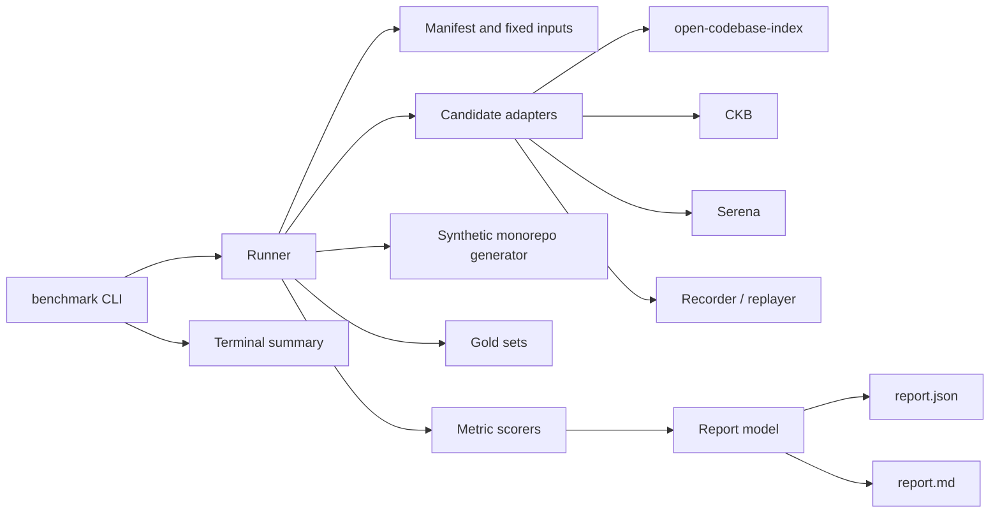
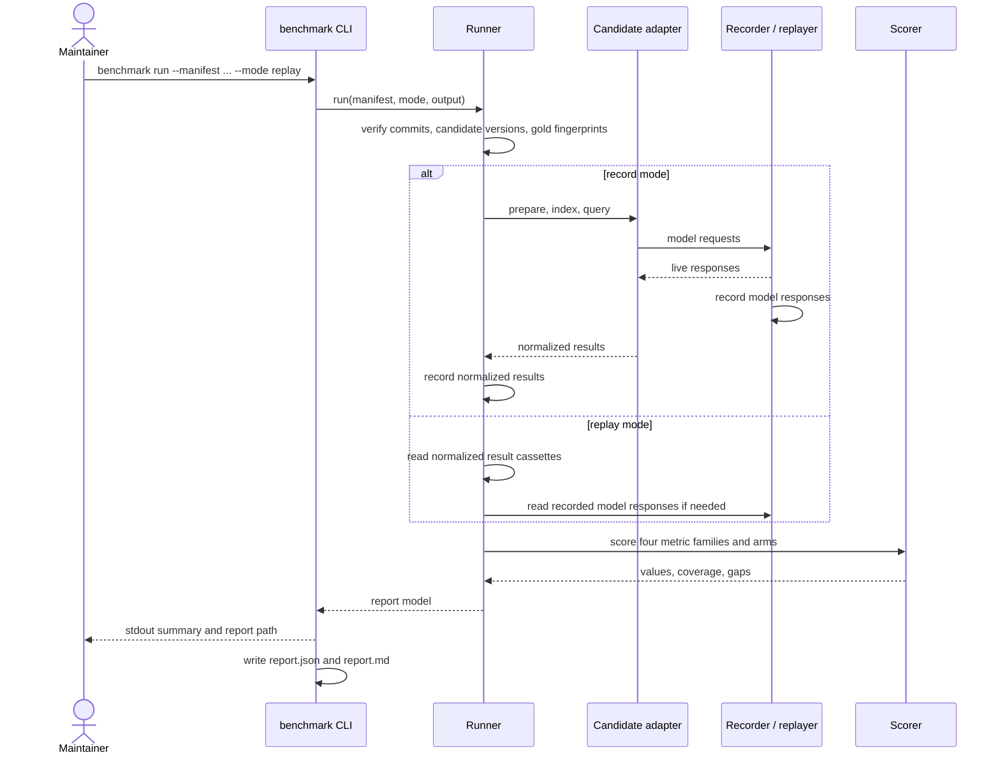

# Design: benchmark-gate

## Scope

This design builds a maintainer-run project gate. It adds a benchmark harness,
fixed benchmark inputs, gold sets, candidate adapters, a recording/replay
boundary, metric scoring, and a report. It adds no product runtime behavior:
the product remains MCP-only, and no MCP tool, workspace, index, or summary is
designed here.

The harness is a Rust project tool. This change creates the Cargo workspace
with `benchmark` as its only member; product crates join the same workspace
later, when they exist. The harness is a separate crate, not a product
building block. The product remains Rust, so the harness and the future product
crates share one language and one toolchain. The benchmark contract and the
Gherkin specifications are unchanged by this choice; they are
language-agnostic.

The workstation has `rustup` and `cargo`, but its default toolchain is the
musl target, whose `cargo` is not runnable, and the gnu `rustc` needs
`libz.so.1`, which is present in the Nix store but not on the default loader
path. The project scripts therefore pin
`RUSTUP_TOOLCHAIN=stable-x86_64-unknown-linux-gnu` and resolve zlib via Nix
(or use a system zlib when present). This is a local setup constraint, not a
reason to use another language. The harness is Rust.

## Technology decisions

| Decision | Choice | Rationale |
|---|---|---|
| Harness language | Rust, edition 2024 | Same language as the product; one Cargo workspace and one lockfile. The harness is a separate crate. |
| Toolchain | `stable-x86_64-unknown-linux-gnu` (cargo/rustc 1.99.1) | The default musl toolchain is broken on this workstation. Project scripts set `RUSTUP_TOOLCHAIN`; `setup.sh` resolves zlib via Nix or the system. |
| Dependency management | Cargo with a committed `Cargo.lock` | Reproducible builds and a single lockfile for the workspace. |
| Gherkin runner | `cucumber` 0.23.0 (cucumber-rs) | Native Rust Gherkin runner with async support, tag/name filters, and `.fail_on_skipped()` strict mode. Declared as a `harness = false` test target; see "Executable-spec runner". |
| Data validation | `serde`, `serde_json`, `serde_yaml_ng` | Typed manifests and reports; explicit validation errors; YAML remains human-editable. |
| MCP driving | `rmcp` 3.5.1 with features `client` and `transport-child-process` | The official Rust SDK; real stdio MCP client with initialize, tools/list, tools/call, timeouts, and cancellation. `client` and `transport-child-process` are optional features in 3.5.1 and are enabled explicitly. A small stdio JSON-RPC fallback is permitted if a candidate needs a non-SDK handshake. |
| Recorder | `axum` 0.8.9 + `tokio` 1.54.0 local OpenAI-compatible HTTP server | Records and replays embedding/explanation calls on loopback; no external service on replay. |
| Candidate result recording | Normalized result cassettes in addition to raw model cassettes | Makes the report reproducible and free to rerun even when a candidate's retrieval is not internally deterministic. |
| Runner isolation | Local Cargo build, workspace-local tool prefixes under `benchmark/.tools/`, loopback recorder | No container runtime is required. Candidate installs and the model boundary stay workspace-local; replay has no external network path. |
| Candidate toolchains | Node 24 LTS for open-codebase-index; Go 1.26.8 for CKB; `uv`/Python for Serena | All three are present on the workstation; each candidate installs into an isolated prefix under `benchmark/.tools/`. |
| Report formats | `report.json` and `report.md` from one Rust report model | Machine-readable source of truth plus a human-readable render; the terminal summary uses the same model. |

### Version freshness

Every version below was resolved at design time (2026-10-20), not recalled
from memory. Versions without a listed number are resolved at setup time and
pinned in `Cargo.lock`, `.nvmrc`, the workspace-local tool prefixes, or the
benchmark manifest.

| Technology | Resolution | Verified how and when |
|---|---|---|
| Rust toolchain | `stable-x86_64-unknown-linux-gnu`, cargo/rustc 1.99.1 | `rustup run stable-x86_64-unknown-linux-gnu cargo --version` and a compiled `main.rs`, 2026-10-20. The default musl toolchain is not used. |
| `cucumber` | 0.23.0 | crates.io lookup (`cargo search cucumber`), 2026-10-20; rust-version 1.88, compatible with 1.99.1. |
| `rmcp` | 3.5.1 | crates.io lookup, 2026-10-20. |
| `axum` | 0.8.9 | crates.io lookup, 2026-10-20. |
| `reqwest` | 0.13.5 | crates.io lookup, 2026-10-20; used for candidate HTTP endpoints and recorder forwarding. |
| `tokio` | 1.54.0 | crates.io lookup, 2026-10-20. |
| `serde_json` | 1.0.154 | crates.io lookup, 2026-10-20. |
| `serde_yaml_ng` | 0.10.0 | crates.io lookup, 2026-10-20; maintained YAML fork, replaces deprecated `serde_yaml`. |
| `clap` | 4.6.7 | crates.io lookup, 2026-10-20. |
| `sha2` | 0.11.1 | crates.io lookup, 2026-10-20. |
| `anyhow` | 1.0.104 | crates.io lookup, 2026-10-20. |
| `cargo-llvm-cov` | 0.9.0 observed (latest 0.9.1) | `cargo llvm-cov --version`, 2026-10-20; installed at setup if absent, pinned in the setup script. |
| Node.js | 24 LTS (observed 24.21.0) | `node --version`, 2026-10-20; open-codebase-index requires Node.js 22.13 or newer and recommends Node.js 24 LTS. |
| Go | 1.26.8 | `go version`, 2026-10-20; installs CKB into `benchmark/.tools/go/bin`. |
| Python | 3.14.7 | `python3 --version`, 2026-10-20; only the Serena candidate uses it. |
| `uv` | 0.13.0 | `uv --version`, 2026-10-20; installs and runs Serena. |
| `tokei` | 15.0.0 | `tokei --version`, 2026-10-20; used only to measure reference repository sizes. |
| open-codebase-index | v0.37.0, peeled commit `573b71c3d5cfaba3a83d602f7534605047a01363` | GitHub tag `v0.37.0^{}` and npm release, 2026-10-20. |
| CKB | v9.3.1, peeled commit `5ff375db862c17dbf40168fa3924696baf1839a6` | GitHub tag `v9.3.1^{}`, 2026-10-20. |
| Serena | v2.1.0, commit `5e4f5cd173c7ff3eed37ee3f1de6c266b937c5dc` | GitHub tag `v2.1.0`, 2026-10-20. |
| Model service | A local OpenAI-compatible endpoint, or Ollama if installed; no container required | The recorder/replayer is the benchmark boundary. The endpoint and model identity are recorded in the manifest; replay makes no model call. |
| Embedding model | `nomic-embed-text` by default when the local endpoint provides it; exact model identity recorded at setup | The model identity and digest, not a remembered version, are part of the recording key and report. |

## Architecture impact

New Cargo workspace member and test infrastructure; no product module is
touched.

Change delta:

```text
givn/changes/benchmark-gate/
  proposal.md
  design.md
  specs/benchmark-comparison/
    usecase.md
    benchmark-comparison.feature
```

Harness:

```text
Cargo.toml                     # workspace: members = ["benchmark"]
Cargo.lock
benchmark/
  Cargo.toml                   # [[test]] name = "benchmark_features", harness = false
  src/
    main.rs                    # binary entry point
    lib.rs
    cli.rs                     # `benchmark run` only
    manifest.rs                # manifest, targets, gold loading and fingerprints
    runner.rs                  # fixed-input verification, candidate loop, report assembly
    adapters/
      mod.rs                   # CandidateAdapter trait and normalized models
      open_codebase_index.rs
      ckb.rs
      serena.rs
      fixture.rs               # cfg(test) or `fixture` feature only; never in the release binary
    mcp/
      stdio_client.rs          # rmcp client session wrapper; stdio JSON-RPC fallback
    record/
      cassette.rs              # request normalization, keys, fingerprints, replay errors
      proxy.rs                 # axum OpenAI-compatible recorder/replayer
    metrics/
      typo.rs
      natural_language.rs
      explanation.rs
      concept.rs
      common.rs                # matching, deduplication, micro-average, ordering
    report/
      model.rs                 # report structs and schema version
      render.rs                # Markdown, terminal summary, and width control
    gen/
      synthetic_repo.rs        # deterministic 10M-line monorepo and its gold sets
    gold/
      mod.rs                   # gold-file loading, validation, fingerprints
      propose.rs               # deterministic draft proposals; not part of scoring
  tests/
    benchmark_features.rs      # cucumber-rs runner and World (harness = false)
    steps/
      mod.rs
      benchmark_comparison.rs
      e2e/
        mod.rs
        benchmark_cli.rs       # E2E:: drives the built benchmark binary
    fixtures/
      e2e/
        manifest.yaml          # the fixture contract below
        repo/                  # tiny generated fixture repository, revision `fixture-1`
        cassettes/             # result and model cassettes with recorded fingerprints
  setup.sh                     # shared env, toolchain, zlib, candidate installs
  fetch-repos.sh
  .tools/                      # generated, gitignored: Node, Go, Python prefixes
benchmark/targets.yaml
benchmark/manifest.yaml
benchmark/gold/
benchmark/cassettes/
env.sh                         # RUSTUP_TOOLCHAIN + LD_LIBRARY_PATH, sourced by every script
run-tests.sh                   # toolchain/zlib env + cargo test
measure-coverage.sh            # cargo llvm-cov regular and e2e Cobertura outputs
merge-coverages.sh             # merge profiles, then one Cobertura report
```

The fixture adapter is compiled only for tests or the `fixture` feature
(`#[cfg(any(test, feature = "fixture"))]`), so the release `benchmark` binary
cannot emit fixture measurements. `gold/propose.rs` only drafts gold files;
neither the fixture adapter nor the proposer is linked into the release build.

### Component view



### Run sequence



## Fixed inputs

Repository revisions and candidate versions were resolved through the GitHub
API and npm on 2026-10-20. Repository line counts were measured with tokei
15.0.0 on tarballs at the exact commits. The measurement command was
`tokei --exclude node_modules --exclude target --exclude tests --exclude test
--exclude extensions`; the reported line count is the reference language's
`code` count. The exact command, tool version, exclusions, and both total and
language counts are recorded in the manifest and report.

| ID | Language | Repository | Fixed revision | Reference-language code lines |
|---|---|---|---|---|
| `typescript-reference` | TypeScript | `https://github.com/microsoft/vscode` | tag `1.142.0`, commit `d956e8a6ac5d904486557eea07e1d6bd62a4d36f` | 1,581,082 TypeScript |
| `python-reference` | Python | `https://github.com/pandas-dev/pandas` | tag `v3.0.6`, commit `2905718b126579d2cf0fe5bae05bd75facb67d77` | 217,996 Python (excluding `tests/`) |
| `rust-reference` | Rust | `https://github.com/rust-lang/rust-analyzer` | tag `2026-10-19`, commit `5ec20d044dbf04895877a55921ddc0ae6e73e127` | 455,078 Rust |
| `synthetic-monorepo` | TypeScript, Python, Rust | generated by `benchmark/src/gen/synthetic_repo.rs` | seed `20261020`, generator version `1` | exactly 10,000,000 non-blank, non-comment code lines |

The synthetic monorepo is generated under `benchmark/.work/synthetic/<digest>`
and is not committed; its content fingerprint is the SHA-256 over the sorted
`(relative path, file content hash)` list. Regeneration with the fixed seed and
generator version must produce the same fingerprint. The generator emits its
gold sets from the same construction, so the synthetic expected locations are
exact.

The three public repositories are fetched once into
`benchmark/.work/repos/<id>` at the fixed commit. Each candidate receives its
own writable copy under `benchmark/.work/runs/<candidate>/<repo>` so that index
stores and tool caches never modify the fixed checkout or another candidate's
state. Every candidate copy includes the `.git` directory (a local clone with
the fixed commit checked out), because CKB reads Git metadata for blame and
ownership; the manifest and report record `git_metadata: present` for each
candidate copy. `git rev-parse HEAD` must equal the manifest revision before
any query runs. In replay mode no clone or install happens.

## Candidates and setup normalization

| Candidate | Pinned identity | Native interface used | Adapter | Measured capabilities | Normalization |
|---|---|---|---|---|---|
| open-codebase-index | v0.37.0, peeled commit `573b71c3...` | CLI `ocbi` and MCP tools (`codebase_peek`, `codebase_search`, `implementation_lookup`) | `benchmark/src/adapters/open_codebase_index.rs` | typo, natural-language, concept; explanation unavailable (no explanation operation); expansion arm only if a documented switch exists | Node.js 24 LTS; full index; no watch; `maxResults` 20; default fusion. Config sets `embeddingProvider: "custom"`, `embedding.baseUrl: "http://127.0.0.1:<recorder-port>/v1"`, `embedding.model: "nomic-embed-text"`, and the recorded dimensions, so the candidate cannot bypass the recording boundary via Ollama's default. |
| CKB | v9.3.1, peeled commit `5ff375db...` | CLI `ckb` and MCP/HTTP tools (`index`, semantic search, `understand`, `explore`) | `benchmark/src/adapters/ckb.rs` | typo, natural-language, concept; explanation only if a documented evidence-backed explanation operation exists; expansion arm only if a documented switch exists | `ckb init` and `ckb index` with pinned SCIP indexers: `scip-typescript`, `scip-python`, and `rust-analyzer scip` (versions recorded in the manifest). `setup.sh` installs and pins all three; `ckb doctor --tier standard` output is recorded before indexing. Language support is a capability note: TypeScript/Python Tier 2, Rust Tier 3 (basic support; call graph may be incomplete). |
| Serena | v2.1.0, commit `5e4f5cd1...` | MCP stdio (`find_symbol`, `search_for_pattern`, `find_referencing_symbols`) | `benchmark/src/adapters/serena.rs` | typo (substring symbol search); natural-language `unavailable` with `no_natural_language_search`; concept (no expansion: not applicable); explanation unavailable | `uv tool install -p 3.13 serena-agent` into `benchmark/.tools/serena`, with `pyright`, `typescript-language-server`, and `rust-analyzer` installed and pinned; one project root; warm-up call; fixed startup and query deadlines. |

Serena has no natural-language retrieval operation: `search_for_pattern` is a
regular-expression search over text. Submitting NL gold questions to it would
measure an interface mismatch as near-zero recall by construction, not the
capability. The NL cells for Serena are therefore `unavailable` with the reason
`no_natural_language_search` and are excluded from the NL aggregate. If the
maintainer wants the behavioural data point, a separate, clearly labelled
`regex_pattern_search_proxy` arm may be measured from the same questions; it is
reported as a proxy, never folded into NL recall or MRR, and the report states
the limitation. A missing explanation or NL capability is never a zero score.

CKB's Rust support is Tier 3 in its own documentation. That tier is recorded as
a capability/coverage note on every CKB Rust cell, so a lower Rust value is
read as a documented support limit and not as a silent quality difference
between candidates.

A fourth candidate is not added. The three cover the relevant technical
shapes (hybrid index with CLI/MCP, SCIP/LSP/HTTP, and LSP/MCP) and the three
reference languages. If an adapter cannot run a reference language at all, the
report records that as a capability gap instead of silently dropping the
repository. Adding a fourth candidate requires a named coverage gap, a pinned
version, an adapter, and a manifest change; the report records the manifest
fingerprint, so a late addition is visible.

### Adapter contract

```rust
trait CandidateAdapter {
    fn capabilities(&self) -> CapabilitySet;
    fn prepare(&mut self, worktree: &Path) -> Result<PreparedCandidate>;
    fn index(&mut self) -> Result<IndexResult>;
    fn query(&mut self, request: &QueryRequest) -> Result<QueryResponse>;
    fn explain(&mut self, request: &ExplanationRequest) -> Result<ExplanationResponse>;
    fn close(&mut self) -> Result<()>;
}
```

`QueryRequest` is `{repository, query, limit: 10, arm: default | no-expansion,
kind: any}`. `QueryResponse` is an ordered list of normalized locations:
`{repository, path, start_line, end_line, symbol, kind, resolution:
symbol | file, evidence}`. A candidate result without a line range is a
`file` resolution and only matches a gold task whose expected target is
file-level; it is never silently promoted to a symbol match. A candidate
explanation is `{text, citations: [{path, start_line, end_line}]}` or an
`Unavailable` value with a closed reason.

Adapters call only the pinned candidate's documented interface. They do not
infer a capability from a README: the capability set is probed by listing the
tool's tools or running its documented help at the pinned version, and the
probe result is recorded. A missing operation produces `unavailable` with a
reason such as `no_explanation_operation`, `no_symbol_search`, or
`no_expansion_switch`; it never produces a zero.

Index deadlines are manifest fields: 4 hours per public repository and 8 hours
for the synthetic monorepo. A deadline breach marks that candidate/repository
unavailable with `index_timeout`, records the elapsed time, and leaves the
candidate in the report. Query timeout is 60 seconds; explanation generation
timeout is 180 seconds. A per-query error counts as a miss for that query and
is counted separately in the error total. There are no automatic retries.

## Recording and replay

Replay is the default and the only mode needed for a free rerun.

- **Record mode** runs the candidates live once. It records two layers under
  `benchmark/cassettes/`:
  - `model/<fingerprint>.jsonl`: raw OpenAI-compatible requests and responses
    for embeddings and explanation generation.
  - `results/<fingerprint>.jsonl`: normalized candidate responses keyed by
    candidate identity and adapter version, repository revision, query, arm,
    limit, and gold-set fingerprint.
- **Replay mode** reads the normalized result cassettes and the model
  cassettes, starts no candidate, and makes no external request. This is what
  makes the report deterministic and free even when a candidate's internal
  retrieval is not deterministic.
- A cassette key is a SHA-256 of a canonical JSON object with sorted keys and
  normalized fields. Request headers, request IDs, timestamps, and transport
  metadata are excluded from the key. Model response IDs are replaced with a
  stable value when recorded.
- A missing key fails the run with exit code 2 and an error naming the
  candidate, repository, query, arm, and missing layer. It never falls back to
  a live call in replay and never writes a partial "complete" report.
- The report records `mode`, the manifest fingerprint, the gold fingerprint,
  the model-cassette fingerprint, the result-cassette fingerprint, and the
  exact reproduction command.

The recording boundary is a local OpenAI-compatible HTTP server bound to
loopback, implemented with `axum` and `tokio`. In replay it serves recorded
responses only and makes no external request. In record mode it forwards to
the configured local OpenAI-compatible endpoint (Ollama if installed) for the
fixed embedding model and, where a candidate supports an explanation model, to
the same endpoint. No scenario or benchmark run depends on a live third-party
service.

Record mode is a consumer action, not a hidden setup flag: the use-case
inventory lists it, the Interaction Coverage Matrix maps it to its own `@e2e`,
and that E2E runs against a local fake OpenAI-compatible endpoint and the
fixture candidates. It asserts that model requests were recorded and that a
replay of the recorded run produces the same measurements. The fixture record
run uses a temporary cassette directory; it never overwrites the committed
fixture cassettes.

## Metrics

All metrics use a micro-average for the aggregate: total hits divided by total
attempted tasks, with unavailable tasks excluded from the value denominator and
reported separately as metric/task coverage. Per-repository values are also
reported. Results are deduplicated by `(path, start_line, end_line, symbol)` and
capped at the candidate's returned order; the harness never reorders a
candidate's results.

A target is a number with a source citation and an explicit status:
`confirmed`, `proposed`, or `unstated`. `benchmark/targets.yaml` records the
targets. AC-01 appears in the proposal attachments 1 and 7 with a Recall@1 of
0.90, but those attachments are recorded as proposal material, not confirmed
acceptance criteria. The target is therefore recorded as
`{value: 0.90, status: proposed, source: "proposal attachments 1/7 (AC-01); not confirmed"}`
and the report labels its gap "gap to proposed target". The only in-repository
occurrence of 0.90 is Q5's illustrative example ("0.88 against 0.90"), which is
not a confirmation either; it is not used as the target source. The confirmed
records available in this repository state no numeric targets for AC-03,
AC-12, AC-21, or AC-22; the manifest records `target: {value: null, status:
unstated, source: "unstated in confirmed records"}` for them rather than
inventing a number. The report still shows their measured values, the best
measured value, and the candidate spread. A target added later requires a new
manifest fingerprint and is visible in the report. The report never derives a
build threshold from a metric, and it never presents a proposed target as an
accepted one.

Metric/task coverage is defined per metric and per arm as
`attempted / (attempted + unavailable)`, where `not_applicable` cells are
excluded from both numerator and denominator. The typo no-match rate uses the
attempted typo tasks as its denominator (including tasks that returned no
match; an errored query is counted as a miss and tallied in the separate error
total). Reported coverage always carries its numerator and denominator, so a
value of 1.0 with a denominator of 2 cannot be read as a broad measurement.

| Metric | Definition | Reported |
|---|---|---|
| Typo recall @1 | Fraction of typo gold tasks whose expected symbol definition is the first deduplicated result. | numerator, denominator, value, coverage, no-match rate |
| Typo recall @5 | Fraction whose expected definition is in the top five. | value, numerator, denominator |
| Typo no-match rate | Fraction of attempted typo tasks for which the candidate returns no result at all. | value, numerator, denominator; separates "wrong rank" from "no match" |
| Natural-language recall @5 | Fraction of NL tasks with at least one expected target in the top five. | value, coverage, numerator, denominator |
| Natural-language MRR @10 | Mean reciprocal rank of the first expected target within ten results; a miss contributes zero. | value, attempted |
| Explanation correctness | Fraction of explanation tasks whose response contains every required fact (any listed surface form) and at least one valid citation inside the target. | value, attempted, unavailable, coverage |
| Explanation evidence grounding | Fraction of explanation responses with at least one valid citation inside the target. | value, attempted |
| Concept recall @5 | Fraction of concept tasks with at least one expected target in the top five. | default and no-expansion arms, coverage per arm |
| Concept-equivalence recall @5 | Fraction of gold concept variants whose expected target is retrieved in the top five. | default and no-expansion arms, coverage per arm |

Explanation scoring is a fixed, maintainer-reviewed rubric in the gold set:
each task carries `required_facts` with accepted surface forms and
`acceptable_evidence` ranges. The rubric and gold fingerprint are published
with the report. It does not call a judge at scoring time, so the score is
deterministic and free to rerun; the limitation (a paraphrase outside the
listed surface forms is not credited) is stated in the report rather than
hidden.

The no-expansion arm is measured only when the candidate exposes a documented
switch for disabling query expansion. Otherwise it is `not_applicable` with
the reason. It is never reported as zero.

## Gold sets

The maintainer owns the gold sets; an automated helper proposes candidates
from the fixed commit, but the maintainer reviews and commits every public
task. The helper is not part of scoring.

- `benchmark/src/gold/propose.rs` samples symbols and identifiers from the
  fixed revision and proposes typo mutations (edit distance 1-2), candidate
  natural-language questions from docstrings and comments, concept groups, and
  explanation targets. Proposals are drafts; the maintainer edits them and
  sets `reviewed_by: maintainer--ortsinn`.
- The committed gold files are `typo.jsonl`, `natural_language.jsonl`,
  `explanation.jsonl`, and `concept.jsonl` under
  `benchmark/gold/<repository-id>/`.
- Minimum task counts per public repository: 100 typo, 50 natural-language,
  20 explanation, 50 concept. Synthetic minimums: 200 typo, 100
  natural-language, 40 explanation, 100 concept.
- `benchmark/src/gen/synthetic_repo.rs` writes the synthetic gold from the same
  construction, so every expected location is exact and the seed fixes it.
- Every gold file has a `gold_version` and a SHA-256 fingerprint. The harness
  verifies that every cited path exists at the fixed commit and that every
  expected line is inside the file before scoring. A mismatch fails the run.
- Gold is frozen before the first record run. Changing a task after seeing
  results requires a new `gold_version` and manifest fingerprint; the report
  records the change. This prevents tuning the expected answers to a
  candidate.

## Fixture contract

The regular scenarios and the E2E run against one committed fixture, defined at
`benchmark/tests/fixtures/e2e/manifest.yaml`. It is small enough to review and
fixed enough that every Then-step can assert an exact number.

| Fixture fact | Value |
|---|---|
| Repository | `fixture-repo`, revision `fixture-1`, commit `1111111111111111111111111111111111111111`, 120 code lines |
| Fixture candidates | `fixture-ocbi` commit `aaaa…` (40 hex), `fixture-ckb` commit `bbbb…`, `fixture-serena` commit `cccc…`; all version `fixture-1`, adapter `fixture`, adapter version 1 |
| Gold task counts | 5 typo, 4 natural-language, 4 explanation, 5 concept, 4 concept-equivalence variants |
| Gold fingerprints | `sha256:fixture-typo-v1`, `sha256:fixture-nl-v1`, `sha256:fixture-explanation-v1`, `sha256:fixture-concept-v1`; `gold_version: 1` for each |
| Result cassette fingerprint | `sha256:fixture-results-v1` |
| Model cassette fingerprint | `sha256:fixture-model-v1` |
| Mismatch variant | commit `2222…` for `fixture-repo`; the run must exit 2 and publish no complete report |
| Timeout variant | `fixture-timeout`, `index_deadline_seconds: 1` on `fixture-repo`; status `index_timeout`, elapsed recorded, every metric for that cell unavailable |
| Unstartable variant | `fixture-unstartable`, whose MCP handshake fails; recorded `unavailable` with `candidate_unstartable`, run continues |
| Query-error variant | one of the 4 NL tasks returns an error; recall stays `2/4`, `query_errors: 1` |

Expected values (each family is measured by one fixture candidate; a candidate
whose family is `not_applicable` is excluded from that family's coverage
denominator, while an `unavailable` cell counts in it):

| Metric / arm | Numerator / denominator (value) | Expected value | Coverage (attempted / attempted + unavailable) |
|---|---|---|---|
| Typo recall @1 (`fixture-ocbi`) | 3 / 5 | 0.60 | 5/5 = 1.0 |
| Typo recall @5 (`fixture-ocbi`) | 4 / 5 | 0.80 | 5/5 = 1.0 |
| Typo no-match rate (`fixture-ocbi`) | 1 / 5 | 0.20 | 5/5 = 1.0 |
| NL recall @5 (`fixture-ocbi`) | 2 / 4 | 0.50 | 4/8 = 0.5 |
| NL MRR @10 (`fixture-ocbi`) | reciprocal ranks 1.0 + 0.2, 4 tasks | 0.30 | 4/8 = 0.5 |
| Explanation correctness (`fixture-ckb`) | 2 / 4 | 0.50 | 4/8 = 0.5 |
| Explanation grounding (`fixture-ckb`) | 4 / 4 | 1.00 | 4/8 = 0.5 |
| Concept recall default (`fixture-ocbi`) | 2 / 5 | 0.40 | 5/5 = 1.0 |
| Concept recall no-expansion (`fixture-ocbi`) | 1 / 5 | 0.20 | 5/5 = 1.0 |
| Concept-equivalence recall default (`fixture-ocbi`) | 2 / 4 | 0.50 | 4/4 = 1.0 |
| Concept-equivalence recall no-expansion (`fixture-ocbi`) | 1 / 4 | 0.25 | 4/4 = 1.0 |

The fixture candidate matrix is:

| Candidate | Typo | NL | Explanation | Concept | Concept equivalence |
|---|---|---|---|---|---|
| `fixture-ocbi` | measured | measured | unavailable (`no_explanation_operation`) | measured | measured |
| `fixture-ckb` | not applicable (`fixture_family_not_measured`) | not applicable | measured | not applicable | not applicable |
| `fixture-serena` | not applicable (`fixture_family_not_measured`) | unavailable (`no_natural_language_search`) | not applicable | not applicable | not applicable |

The NL and explanation coverage denominators are 8 because the other
candidate's four tasks are unavailable (4 attempted + 4 unavailable). The
`fixture-ckb` typo/NL/concept cells and `fixture-serena`'s non-NL cells are
`not_applicable` and do not enter any denominator. `fixture-serena` supports
no query-expansion switch, so its no-expansion cells are `not_applicable`
(`no_expansion_switch`).

The fixture cassettes are committed result and model JSONL files; the recorder
serves the model cassette in replay and the fake local OpenAI-compatible
endpoint records into a temporary copy in the record→replay scenario. The
scenario Then-steps assert the values above, not the presence of a heading.

## Report contract

`report.json` is the source of truth; `report.md` is rendered from the same
model. The CLI prints a concise summary and the report path. The report has a
`schema_version` and is validated on write.

Required top-level content:

- **Run**: id, start/finish metadata, mode, harness version, locked dependency
  versions, hardware, run command, manifest fingerprint. Timestamps are not
  part of measurement identity.
- **Inputs**: each repository URL, fixed revision, language, line-count value,
  line-count tool and command, and exclusions; the synthetic seed, generator
  version, line count, and fingerprint; each gold file's version, task count,
  and fingerprint.
- **Candidates**: id, version, source commit, install command, adapter
  version, capability set with status and reason, per-repository index status,
  duration, language-support tier (CKB Rust Tier 3 is recorded here), and any
  setup deviation.
- **Metrics**: for each family, the target as `{value, status, source}` with
  status `confirmed | proposed | unstated`, aggregate
  value/numerator/denominator/coverage, per-repository values, the
  concept-equivalence family with default/no-expansion arms, and the
  no-expansion arm for concept recall. A cell is `measured`, `unavailable`
  with a reason, or `not_applicable` with a reason; it is never a fabricated
  zero. A proposed target's section is labelled "proposed target", never
  "accepted target".
- **Gaps**: `to_target` for every metric with a stated target, as
  `value - target`, carrying `status: measured | unavailable | not_applicable`
  with a reason and `target_status: confirmed | proposed`; `to_best` for every
  metric, naming the best measured candidate and each candidate's delta, with
  the same status model; and `capability_gaps` for every unavailable capability
  or operation. When no candidate has a measured value for a metric,
  `to_best` is `status: unavailable` with reason `no_measured_candidate` and
  no numeric value; `to_target` is `unavailable` for the same reason. Neither
  is rendered as zero or as an empty gap.
- **Path decision**: `status: deferred`, `owner: maintainer--ortsinn`,
  `artifact: docs/decisions/benchmark-path.md`, and the rule "decide after the
  report; no pre-registered build threshold". The report contains no
  build/contribute/compose choice.
- **Reproduction**: the exact replay command (including the manifest path,
  mode, output path, and the shell prefix that sets the toolchain), the mode,
  and all fingerprints. The report states that replay requires no candidate
  install and no external model call.
- **Limitations**: the explanation rubric's surface-form limitation, any
  candidate capability gap (including Serena's `no_natural_language_search`
  and the `regex_pattern_search_proxy` limitation if that arm is measured),
  CKB's Rust Tier 3 support, and any target that is unstated or proposed.

`report.md` follows the same order with headings and tables. Its metric
sections are "Typo recall", "Natural-language retrieval", "Explanation
correctness", and "Concept recall"; concept-equivalence recall is rendered
inside its own table next to concept recall, each with default and
no-expansion arms, and the no-expansion table follows concept recall. The
measured-gaps section appears before the deferred path decision.
The terminal summary uses the same four section names and prints the report
path; `--width` controls the rendered line width.

## Data model

The manifest is the single fixed-input record. Its shape is:

```yaml
schema_version: 1
run_id: benchmark-<date>-<sequence>
mode: replay
repositories:
  - id: typescript-reference
    url: https://github.com/microsoft/vscode
    commit: d956e8a6ac5d904486557eea07e1d6bd62a4d36f
    language: typescript
    loc: {language_code_lines: 1581082, total_code_lines: 3504614, tool: "tokei 15.0.0", command: "...", exclusions: [extensions]}
  # python-reference, rust-reference
synthetic:
  generator: benchmark/src/gen/synthetic_repo.rs
  generator_version: 1
  seed: 20261020
  code_lines: 10000000
  fingerprint: "sha256:..."
candidates:
  - id: open-codebase-index
    version: v0.37.0
    commit: 573b71c3d5cfaba3a83d602f7534605047a01363
    install: "npm install -g open-codebase-index@0.37.0"
    adapter: open_codebase_index
    adapter_version: 1
    config: {...}
  # ckb, serena
targets:
  typo_recall_at_1: {value: 0.90, status: proposed, source: "proposal attachments 1/7 (AC-01); not confirmed"}
  typo_recall_at_5: {value: null, status: unstated, source: "unstated in confirmed records"}
  natural_language_recall_at_5: {value: null, status: unstated, source: "unstated in confirmed records"}
  explanation_correctness: {value: null, status: unstated, source: "unstated in confirmed records"}
  concept_recall_at_5: {value: null, status: unstated, source: "unstated in confirmed records"}
  concept_equivalence_recall_at_5: {value: null, status: unstated, source: "unstated in confirmed records"}
gold:
  - {repository: typescript-reference, metric: typo, version: 1, fingerprint: "sha256:...", path: benchmark/gold/typescript-reference/typo.jsonl}
  # one entry per repository and metric
cassettes:
  results: benchmark/cassettes/results
  model: benchmark/cassettes/model
index_deadlines: {public_repository_seconds: 14400, synthetic_seconds: 28800}
```

The report model is:

```text
Report
  schema_version: 1
  run: {id, started_at, finished_at, mode, harness_version, dependencies, hardware, command, manifest_fingerprint}
  inputs: {repositories[], synthetic, gold[], cassettes}
  candidates[]: {id, version, commit, install, adapter_version, capabilities, repositories[{id, index_status, index_seconds, reason}], language_support{typescript, python, rust}, git_metadata}
  metrics:
    typo: {target{value, status, source}, aggregate{value, numerator, denominator, coverage, status, gap}, per_repository{}, no_match_rate{value, numerator, denominator}}
    natural_language: {target{value, status, source}, aggregate{value, numerator, denominator, coverage, status, gap}, per_repository{}, mrr_at_10{value, attempted}, proxy: optional{name: regex_pattern_search_proxy, value, excluded_from_aggregate: true}}
    explanation: {target{value, status, source}, aggregate{value, attempted, unavailable, coverage, status, gap}, per_repository{}, evidence_grounding{value, attempted}}
    concept: {target{value, status, source}, aggregate{value, numerator, denominator, coverage, status, gap}, per_repository{}, arms{default, no_expansion}}
    concept_equivalence: {target{value, status, source}, aggregate{value, numerator, denominator, coverage, status, gap}, per_repository{}, arms{default, no_expansion}}
  gaps:
    to_target{}: {value | null, status: measured | unavailable | not_applicable, reason, target_status: confirmed | proposed}
    to_best{}: {value | null, status: measured | unavailable | not_applicable, reason, best_candidate, deltas{}}
    capability_gaps[]
  path_decision: {status: deferred, owner: maintainer--ortsinn, artifact: docs/decisions/benchmark-path.md, rule: "decide after the report"}
  reproduction: {command, mode, manifest_fingerprint, gold_fingerprint, model_cassette_fingerprint, result_cassette_fingerprint}
  limitations[]
```

All maps are serialized with sorted keys; task results are ordered by the
manifest's repository and task order.

## Executable-spec runner

`givn/commands.yaml` declares `verify.command: ./run-tests.sh` and
`verify.e2e_command: ./run-tests.sh --e2e`. This change supplies the script.
`benchmark/Cargo.toml` declares the runner as a test binary without the libtest
harness:

```toml
[[test]]
name = "benchmark_features"
harness = false
```

Without `harness = false`, libtest parses the arguments first and rejects
`--name`/`--tags` with an "Unrecognized option" error, so the runner can never
honour a filter.

- `. ./env.sh` is sourced by `run-tests.sh`, `setup.sh`,
  `measure-coverage.sh`, and `merge-coverages.sh`. It sets
  `RUSTUP_TOOLCHAIN=stable-x86_64-unknown-linux-gnu` and resolves
  `LD_LIBRARY_PATH` for `libz.so.1` (system zlib when present, otherwise
  `nix build --no-link --print-out-paths nixpkgs#zlib`). The default musl
  toolchain is not used.
- `run-tests.sh` uses `GIVN_FEATURES` when the caller supplies it; otherwise it
  resolves the permanent corpus and, only when it exists, this change's delta:
  `FEATURES=${GIVN_FEATURES:-$(find givn/specs -name '*.feature' 2>/dev/null; [ -d "givn/changes/${GIVN_CHANGE:-benchmark-gate}/specs" ] && find "givn/changes/${GIVN_CHANGE:-benchmark-gate}/specs" -name '*.feature')}`.
  It exports them as `GIVN_FEATURES` and fails before running anything when the
  list is empty or a listed file is unreadable. After archive the change
  directory is gone, so the fallback then resolves only the permanent corpus
  and does not reference a deleted path.
- The runner reads `GIVN_FEATURES` as a newline-separated multi-file list,
  stages the listed files into a fresh directory under
  `target/givn-features/` (one flat staging directory, duplicate basenames
  rejected), and runs one `cucumber::Cucumber` over that directory with
  `.fail_on_skipped()`. If staging is not possible it iterates the files and
  aggregates failures, but it never runs only the first path.
- The runner calls `filter_run_and_exit()`, not `run()`. That applies the
  cucumber CLI filters (`--name`, `--tags`) and exits the process non-zero when
  any step is failed, undefined, pending, or skipped. `.fail_on_skipped()` alone
  only records skips in the writer; it does not set the exit code.
- The single-scenario command is:
  `GIVN_FEATURES="givn/changes/benchmark-gate/specs/benchmark-comparison/benchmark-comparison.feature" cargo test --test benchmark_features -- --name "^Report contains the four acceptance measurements$"`
- The E2E command is:
  `./run-tests.sh --e2e`, which resolves to
  `GIVN_FEATURES="$FEATURES" cargo test --test benchmark_features -- --tags @e2e`.
- The regular command filters the E2E scenario out of its report:
  `cargo llvm-cov --test benchmark_features --cobertura --output-path "$GIVN_COVERAGE_NON_E2E_PATH" -- --tags 'not @e2e'`.

### Strict mode and the RED stub pattern

cucumber-rs reports undefined, pending, and skipped steps; the runner uses
`.fail_on_skipped()` plus `filter_run_and_exit()` so any of them fails the test
binary. The setup task proves strictness against this exact configuration: a
temporary `.feature` file with one undefined step must make
`cargo test --test benchmark_features` exit non-zero. No parallel
hand-maintained test file exists.

The not-implemented pattern for RED is uniform: every new step body is written
as `unimplemented!("benchmark-comparison: <step text>")` and every new
production entry point returns the typed `NotImplemented` error until its
scenario is worked. The World and manifest loaders are real from the first
step, so a RED failure names the missing behavior instead of failing on a
panic in fixture setup. A scenario is only allowed to turn GREEN after its
Then-step asserts the concrete fixture value from the "Fixture contract"
section.

### Step definition locations

| Scope | File |
|---|---|
| In-process benchmark integration steps for `benchmark-comparison` | `benchmark/tests/steps/benchmark_comparison.rs` |
| E2E CLI steps for `benchmark-comparison` | `benchmark/tests/steps/e2e/benchmark_cli.rs` |
| cucumber-rs runner, `World`, and fixture lifecycle | `benchmark/tests/benchmark_features.rs` |

The E2E file is separate because it starts the real `target/debug/benchmark`
binary and uses the fixture manifest; the integration file drives the same
capability's report model with fixture adapters. There is one file per scope
per capability, not one file for the whole change.

## Canonical E2E policy

The interaction inventory, one-E2E-per-action scope, real-interface
assertions, and flag-variant classification are owned by
`givn instructions specs --change benchmark-gate` and the use-case document
`givn/changes/benchmark-gate/specs/benchmark-comparison/usecase.md` (the
change-local copy that merges to the durable
`givn/specs/benchmark-comparison/usecase.md` on archive). This design supplies
the infrastructure and the matrix below; it does not restate the policy.

## Interaction Coverage Matrix

| Inventory entry | @e2e scenario title | Real interface | Driving mechanism |
|---|---|---|---|
| Run the benchmark in replay mode on the fixed inputs and read the measured report | Maintainer runs the benchmark and reads the measured report | CLI | `std::process::Command` runs `env!("CARGO_BIN_EXE_benchmark")` with `run --manifest benchmark/tests/fixtures/e2e/manifest.yaml --mode replay`; the step captures stdout/stderr and reads the printed report path. |
| Record a benchmark run against a local model endpoint and replay the recorded run | Maintainer records a run and replays it without an external call | CLI | The same subprocess with `--mode record --model-endpoint http://127.0.0.1:<port>/v1` against a local fake OpenAI-compatible endpoint and the fixture candidates; the step then reruns with `--mode replay` and compares the two report models except run metadata. |

The `benchmark` CLI exposes exactly one command, `run`, with `--manifest`,
`--mode {record,replay}`, `--out`, `--width`, and `--model-endpoint` options.
There is no `verify` or `report` subcommand: the consumer surface is the one
proposed benchmark command, and every action in the inventory maps to `run`.

## E2E smoke test infrastructure

- **E2E runner command**: `./run-tests.sh --e2e`, resolving to
  `cargo test --test benchmark_features -- --tags @e2e`.
- **E2E step definitions**: `benchmark/tests/steps/e2e/benchmark_cli.rs`.
- **Local infrastructure**: no shared server or database for the replay scenario. The E2E fixture is a tiny generated repository with fixed revisions, three pinned fixture candidate identities, and committed result cassettes. The harness runs in a temporary `BENCHMARK_HOME`; the replay boundary is in-process and no network is available to the child process in the test environment. The record→replay scenario starts one loopback fake OpenAI-compatible endpoint (an `axum` test server on an ephemeral port) and points the child at it with `--model-endpoint`; the endpoint is deterministic and returns fixture completions/embeddings.
- **E2E framework**: cucumber-rs, matching the Rust harness and the regular executable-spec runner. The real interface is the CLI, so the step drives a subprocess rather than an in-process function.
- **E2E strict-mode proof**: `.fail_on_skipped()` and `filter_run_and_exit()` in the runner, plus a temporary `.feature` with an undefined step that must make the test binary fail. A pending E2E step fails the run.
- **Primary assertion**: the child process exit status, the terminal's four measurement sections, the printed report path, and the report file's measured values from the fixture contract. The child is `env!("CARGO_BIN_EXE_benchmark")`, so the test binary is the one Cargo built for this change. The assertion is on what the consumer interface returned and displayed; no database is the primary boundary.
- **Width assertion**: the step reruns the summary with `--width 80` and `--width 160` and asserts that every table row is a single line within the requested width and that no label is separated from its value. `--width` is a CLI option applied by `report/render.rs`; when absent, the renderer queries the terminal size and falls back to 80. No pty is required.
- **Transcript**: the E2E step writes the captured terminal output to
  `${GIVN_EVIDENCE_DIR:-benchmark/evidence/visual}/<scenario-slug>/transcript.txt`.
  The default is a durable path inside the repository, so the step still works
  after the change directory is archived; no test writes into
  `givn/changes/benchmark-gate/`.

## Visual Design Contract

- Interface: terminal. The tool prints plain text to stdout; it renders no
  HTML, CSS, or JavaScript, so this is not a Web UI and no browser driver
  (Playwright or equivalent) applies.
- Approval: the single terminal baseline below was approved by the user's
  go-ahead on 2026-10-20. No alternative layout is rendered for this change;
  a future layout change reopens the contract.
- Viewports: not applicable to a terminal. The report is checked at 80 and
  160 columns through `--width 80` and `--width 160`, and no metric label/value
  pair may wrap or be split across lines at either width.
- Design system: none; the project has no `docs/design/` system. The terminal
  baseline below is the contract for this change.
- Typography and layout: plain text with one top-level title, one heading per
  report section, and aligned tables; no ANSI color as the only carrier of a
  state.
- Component primitives: run summary, metric table, gap table, capability
  table, error line. Each has a default and an error/unavailable state.
- Accessibility: headings and labels are textual; metric names are domain
  terms, not internal IDs; no duplicated visible content; no motion.
- Screens covered: the benchmark run summary and the measured report.
- Rendered reference: the committed transcript for the E2E scenario shows the
  run identity, candidate list, four metric sections, report path, and the
  deferred path decision at both widths.
- Capture mechanism and evidence path: every `@e2e` scenario commits
  `${GIVN_EVIDENCE_DIR:-benchmark/evidence/visual}/<scenario-slug>/transcript.txt`.
  Intermediate captures live under `reports/visual/` and are not review
  evidence.
- Motion: none. The CLI does not animate; `prefers-reduced-motion` is not
  applicable to terminal output, and the design adds no motion.

## Black-box-first

Prefer the real interface for every behavior. If an internal test is retained,
the design must answer: which case this test covers that the E2E does not? If
there is no concrete answer, use the E2E scenario instead.

| Regular scenario | Case the E2E does not cover |
|---|---|
| Report identifies every candidate and fixed repository revision | Identity and revision checks on every candidate, not only the fixture candidate. |
| Report contains the four acceptance measurements | Metric arithmetic and coverage on the full fixture set. |
| Report states measured gaps without a pre-registered build threshold | Target/gap arithmetic, unstated targets, the proposed-only AC-01 target, all-unavailable gaps, and the deferred decision owner/artifact. |
| Report compares concept recall with and without query expansion | The two-arm report and the `not_applicable` status. |
| Report distinguishes an unavailable capability from a zero score | Coverage and capability-gap semantics. |
| Replay rerun reproduces the report without an external model call | Cross-run determinism and the recording fingerprint. |
| A missing recorded response stops the run | The failure path and non-zero exit. |
| The synthetic monorepo is regenerated to the same content fingerprint | The fixed-seed generator and gold consistency. |
| Report separates wrong rank from no match in typo recall | The no-match denominator and the per-candidate split. |
| Report states metric and task coverage with denominators | Per-metric, per-arm coverage arithmetic and the unavailable exclusion. |
| Report names each gold set's version, task count, and fingerprint | Gold identity on every metric, not only the fixture. |
| Report states the exact command that reproduces the run | Reproduction command and shell prefix. |
| Report records candidate setup, index status, and timeouts | Setup deviations, indexer versions, `index_timeout`, never-zero handling. |
| A fixed-input mismatch stops the run | Fingerprint/revision mismatch, non-zero exit, no complete report. |
| An uninstallable or unstartable candidate is recorded and the run continues | Candidate-level unavailability with reason. |
| A query error counts as a miss and is reported separately | Error total and the miss denominator. |
| A metric with no measured candidate reports an unavailable gap | The all-unavailable `to_best`/`to_target` boundary. |
| Report does not score a regex interface mismatch as natural-language recall | Serena NL unavailability and the proxy exclusion from the NL aggregate. |

No regular scenario re-asserts only the E2E outcome. The E2E's measured-value
assertion is an end-to-end fidelity check on the CLI and the fixture contract;
the regular scenarios assert the same behavior through the in-process
capability and cover more failure boundaries.

## Local runnability and digital twins

- **Local run command**:
  `./run-tests.sh` for the specs, or
  `cargo run -p benchmark -- run --manifest benchmark/manifest.yaml --mode replay --out benchmark/reports/latest`.
  `run-tests.sh` sets the toolchain and zlib environment.
- **Record mode**: set `BENCHMARK_MODEL_ENDPOINT` to a local
  OpenAI-compatible endpoint (Ollama if installed) and run the same command
  with `--mode record`. The recorder forwards to that endpoint and writes both
  cassette layers. The manual record-run acceptance gate (below) requires one
  committed record run against at least one real candidate and repository.
- **Isolated boundary**: no container runtime is used. The recorder binds to
  `127.0.0.1`; candidate subprocesses run in workspace-local worktrees under
  `benchmark/.work/runs/`; replay makes no external request. There is no
  shared dev database or shared service. The workspace-local boundary is the
  equivalent isolation on this workstation.
- **Local toolchain setup**: `benchmark/setup.sh` sources `env.sh`, then:
  1. resolves `libz.so.1` (system zlib, otherwise Nix `zlib`) and sets
     `LD_LIBRARY_PATH`;
  2. installs `cargo-llvm-cov` if absent;
  3. installs the pinned Node candidate into `benchmark/.tools/node`, CKB into
     `benchmark/.tools/go/bin` using the observed Go toolchain, and Serena
     into a `uv`-managed Python 3.13 environment under
     `benchmark/.tools/serena`;
  4. installs and pins the CKB SCIP indexers `scip-typescript`,
     `scip-python`, and `rust-analyzer` (used with `rust-analyzer scip`), and
     runs `ckb doctor --tier standard` after `ckb init`;
  5. installs and pins Serena's language servers `pyright`,
     `typescript-language-server`, and `rust-analyzer`;
  6. writes the open-codebase-index config with
     `embeddingProvider: "custom"` and the recorder `baseUrl`, model, and
     dimensions;
  7. probes every candidate with its documented help/doctor command and writes
     the version, probe output, and any installation deviation into
     `benchmark/manifest.yaml` and the report.
  If an installation is impossible on this host, the affected cells are marked
  `unavailable` with a reason in every candidate/repository/metric row they
  affect; the degradation is never buried in a footnote.
- **Manual record-run acceptance gate**: before the benchmark report is
  accepted, the maintainer commits one evidence file
  `benchmark/evidence/record-runs/<candidate>-<repository>.json` produced by a
  real `--mode record` run against at least one installed candidate and one
  real reference repository, plus the output of a `benchmark run --mode replay`
  probe per installed candidate. The file records candidate version, repository
  commit, index status, query counts, cassette fingerprints, and the report
  fingerprint. The tasks artifact adds this as an explicit gate; the E2E
  cannot replace it because three heterogeneous real adapters (MCP stdio,
  SCIP/LSP, LSP/MCP) can all be empty while the fixture suite passes.
- **Repository fetch**: `benchmark/fetch-repos.sh` clones the three public
  repositories at their fixed commits into `benchmark/.work/repos/`; the
  runner verifies `HEAD`. The synthetic repo is generated in the work
  directory from the fixed seed and verified by fingerprint.

### Digital twins

| External dependency | Twin | Determinism |
|---|---|---|
| OpenAI-compatible embedding/explanation endpoint | `benchmark/src/record/proxy.rs` in replay; the configured local endpoint (Ollama if installed) in record mode | Replay returns recorded responses keyed by canonical request hashes; no network. Record mode uses the local endpoint; the model identity and digest are recorded. |
| Candidate tools | Local pinned installs under `benchmark/.tools/` | Versions and commits are fixed; normalized results are recorded so a rerun does not depend on candidate process behavior. |

No scenario, `@e2e` or otherwise, depends on a live third-party service.

### Anticipated interface obstacles and fixes

- **Candidate writes into the repository**: run each candidate in a writable
  worktree under `benchmark/.work/runs/`; never mount the fixed checkout
  writable. Record the worktree hash.
- **MCP stdio startup and cancellation**: use one process per candidate,
  explicit `initialize` and `tools/list`, a fixed startup deadline, and kill
  the process tree on timeout. A failed handshake is an unavailable candidate,
  not a crash. Use `rmcp`'s client session; a small stdio JSON-RPC fallback is
  permitted if a candidate needs a non-SDK handshake.
- **80-column terminal wrapping**: the summary prints one metric per line with
  a short label and value; the Markdown report is the detailed artifact.
- **10M generation time and disk**: stream generation into the work directory,
  cache by fingerprint, and verify the digest before scoring. The generator
  records its exact code-line counter.
- **Node/Candidate version conflicts**: one Node.js LTS in
  `benchmark/.tools/node`; if a candidate requires a different runtime, it
  gets an isolated prefix and the deviation is recorded. No candidate silently
  uses the product's toolchain.
- **Rust toolchain and zlib**: the default musl toolchain is broken; the
  scripts pin the gnu toolchain and resolve zlib. If the host provides a
  system zlib, the fallback is not used.
- **Coverage of a child process**: `measure-coverage.sh` (not a Rust step)
  exports the `cargo llvm-cov show-env` variables, sets
  `LLVM_PROFILE_FILE="$PWD/coverage/e2e-%p.profraw"`, runs the E2E scope, and
  merges the profiles with `llvm-profdata`; the child
  `env!("CARGO_BIN_EXE_benchmark")` inherits the instrumentation from the
  process environment and writes its own profile. A Rust step cannot export
  shell variables, so nothing depends on the step doing so.

## Coverage process boundaries

Coverage is enabled. The tests start the cucumber runner and, in E2E, the
benchmark CLI as a child process. No product process exists in this change.

| Process | Started by | Instrumented artifact | Profile output | Merge step | Non-zero production probe |
|---|---|---|---|---|---|
| cucumber runner (regular scope) | `./measure-coverage.sh` | `cargo llvm-cov --test benchmark_features --cobertura --output-path "$GIVN_COVERAGE_NON_E2E_PATH" -- --tags 'not @e2e'` | `LLVM_PROFILE_FILE=coverage/non-e2e-%p.profraw` | `measure-coverage.sh`: `llvm-profdata merge -sparse coverage/non-e2e-*.profraw -o coverage/non-e2e.profdata`; `cargo llvm-cov report --profdata coverage/non-e2e.profdata --cobertura --output-path "$GIVN_COVERAGE_NON_E2E_PATH"` | `benchmark/src/metrics/typo.rs` `recall_at_k` and `benchmark/src/report/render.rs` metric-table path |
| benchmark CLI child (E2E) | `benchmark/tests/steps/e2e/benchmark_cli.rs` starts it; `measure-coverage.sh` supplies the environment | `eval "$(cargo llvm-cov show-env --export-prefix)"` in `measure-coverage.sh`; then `cargo test --test benchmark_features -- --tags @e2e` | `LLVM_PROFILE_FILE=coverage/e2e-%p.profraw` (inherited by the child) | `measure-coverage.sh`: `llvm-profdata merge -sparse coverage/e2e-*.profraw -o coverage/e2e.profdata`; `cargo llvm-cov report --profdata coverage/e2e.profdata --cobertura --output-path "$GIVN_COVERAGE_E2E_PATH"` | `benchmark/src/cli.rs` `run` command path and `benchmark/src/report/render.rs` terminal-summary path |

`env.sh` is sourced by all four scripts, so `measure-coverage.sh` and
`merge-coverages.sh` run cargo/rustc under the same
`RUSTUP_TOOLCHAIN`/`LD_LIBRARY_PATH` as the test scripts. The regular scope
excludes `@e2e` so the E2E scenario is not executed twice and the non-E2E
report is genuinely non-E2E.

`merge-coverages.sh` merges the two profile sets, not the two XML files:
`llvm-profdata merge -sparse coverage/non-e2e.profdata coverage/e2e.profdata -o coverage/merged.profdata`,
then `cargo llvm-cov report --profdata coverage/merged.profdata --cobertura --output-path "$GIVN_COVERAGE_OUTPUT_PATH"`.
It then asserts a non-zero covered-line count for the four named probe
functions (two per scope) and exits non-zero when a probe is zero, so a
runner-only or all-zero report cannot pass. The E2E step does not copy the
regular profile; the two `LLVM_PROFILE_FILE` patterns are disjoint.

## Decisions

- **Decides D1 (seed Q5)** — no pre-registered build threshold; the report
  publishes measured gaps and records the product-path decision as deferred to
  `maintainer--ortsinn` and `docs/decisions/benchmark-path.md`. The ideation
  record `questions.md` Q5 is closed with option 4, source user/2026-10-20;
  this change does not reopen it. Closing Q5 does not confirm AC-01's 0.90:
  `benchmark/targets.yaml` records it as `proposed`, not `confirmed`. Realized
  in `benchmark/src/report/model.rs` (`path_decision`) and
  `benchmark/src/report/render.rs`; verified by the scenario "Report states
  measured gaps without a pre-registered build threshold".
- **Decides D2 (seed "Reference repositories and gold sets")** — fixed
  repositories and commits in `benchmark/manifest.yaml`; maintainer-owned,
  reviewed gold sets with versions and fingerprints; synthetic gold generated
  from the seed. Realized in `benchmark/gold/`, `benchmark/src/gen/`, and
  `benchmark/src/manifest.rs`; verified by the identity and
  synthetic-fingerprint scenarios.
- **Decides D3 (seed "Competitor versions and setup normalization")** — pinned
  candidate releases and commits, isolated local tool prefixes, documented
  setup and deadlines, and an unavailable status instead of zero. Realized in
  `benchmark/src/adapters/` and `benchmark/setup.sh`; verified by the
  unavailable-capability scenario.
- **Decides D4 (seed "Fuzzy behavior of open-codebase-index")** — measure the
  same typo tasks for every candidate and report rank-one recall, top-five
  recall, and no-match rate; no candidate's fuzzy behavior is inferred.
  Realized in `benchmark/src/metrics/typo.rs` and the open-codebase-index
  adapter; verified by the typo metric table in the report.

## Use-case traceability

| Use-case guarantee, rule, or flow | Technical decision | Evidence |
|---|---|---|
| Goal: complete measured comparison with candidate identity, revisions, coverage, and gaps | Manifest + report model + renderer | Scenario "Report identifies every candidate and fixed repository revision" |
| Main flow 2: verify fixed inputs before scoring | Fingerprint checks for repositories, candidates, gold, synthetic, cassettes | Scenarios "Replay rerun..." and "The synthetic monorepo..." |
| Main flow 3: candidate-specific setup with recorded deviations | Adapter contract, isolated worktrees, index deadlines | Candidate table; unavailable-capability scenario |
| Main flow 4: four metric families | `metrics/typo.rs`, `natural_language.rs`, `explanation.rs`, `concept.rs` | Scenario "Report contains the four acceptance measurements" |
| Main flow 5: no-expansion arm | Arm field in the result cassette and the concept metric | Scenario "Report compares concept recall with and without query expansion" |
| Main flow 6: coverage and measured gaps | Micro-average, status model, `gaps.to_target`/`to_best` | Scenario "Report states measured gaps..." |
| Main flow 7: deferred path decision | `path_decision` report field and Markdown section | Scenario "Report states measured gaps..." and the E2E |
| R1: read-only over fixed repositories | Writable per-candidate worktrees; fixed checkout verification | Candidate setup section |
| R2: unavailable is never zero | Closed status model and coverage denominators | Unavailable-capability scenario |
| R3: candidate/repository/gold identity | Manifest and report identity fields | Identity scenario |
| R4: all four measurement families | Metric modules and report sections | Four-measurements scenario |
| R5: no-expansion comparison | Arm handling and `not_applicable` | No-expansion scenario |
| R6: replay is free and external-call free | Result and model cassettes; replay mode | Replay scenario; E2E |
| R7: no threshold, no path choice | `path_decision` and target model | Gaps scenario |
| R8: deterministic order and values | Canonical keys, fixed ordering, timestamps excluded | Replay scenario |
| R9: documented candidate interfaces only | Capability probe and adapters | Candidate table; unavailable-capability scenario |
| R10: project artifact, no product change | New `benchmark/` crate only; no product MCP code | Scope and out-of-scope |
| Extension 1: fixed-input mismatch exits non-zero and publishes no report | Fingerprint and revision checks in `runner.rs`; no partial report writer | Scenario "A fixed-input mismatch stops the run" |
| Extension 2: uninstallable/unstartable candidate is unavailable and the run continues | Capability probe and adapter startup deadline; closed status model | Scenario "An uninstallable or unstartable candidate is recorded and the run continues" |
| Extension 3: index deadline is `index_timeout`, never zero | Manifest `index_deadlines`; per-candidate/repository status | Scenario "A candidate that exceeds its index deadline is unavailable, not zero" |
| Extension 4: a missing operation is unavailable with a capability reason | Capability set with status/reason; capability gaps list | Unavailable-capability scenario |
| Extension 5: query error counts as a miss and the error total is separate | Metric denominators and `query_errors` field | Scenario "A query error counts as a miss and is reported separately" |
| Extension 6: no-expansion switch absent means `not_applicable` | Arm handling in the concept metrics | No-expansion scenario |
| Extension 7: a target-less metric reports its value and the best measured value | Target status model and gap status | Gaps scenario |
| Extension 8: a stated target reports a signed gap | `gaps.to_target` with `target_status` | Gaps scenario |
| Extension 9: replay reproduces values; a missing response fails the run | Result/model cassettes; `ReplayMiss` error path | Replay and missing-response scenarios |
| Extension 10: no measured candidate yields unavailable gaps, not zero | Gap status model with `no_measured_candidate` | Scenario "A metric with no measured candidate reports an unavailable gap" |
| Persona `maintainer--ortsinn` (user-visible terminal/report) | CLI summary and report; owner of the deferred decision | E2E transcript and report |
| Persona `upstream--maintainer` (conditional) | Report is the only artifact consumed if the path is a contribution; no runtime surface | Report contract; post-report decision record |

## Risks and limitations

- **Single most likely implementation failure: the real candidate adapters and
  the record path are never exercised end to end.** Three heterogeneous
  adapters (MCP stdio handshakes, CKB's SCIP indexers, Serena's language
  servers) can all return empty or wrong results while the fixture suite and
  the replay E2E pass, yielding a published report with no real measurement.
  Mitigation: the record-mode E2E proves the recorder→replay contract, and the
  manual record-run acceptance gate requires one committed evidence file from a
  real record run against at least one installed candidate and one reference
  repository, plus a replay probe per installed candidate. The E2E alone is
  not accepted as evidence for the real adapters.
- Candidate interfaces can drift; pinned versions, recorded result cassettes,
  and adapter versions keep the report reproducible even when the upstream
  tool changes.
- A 10M-line monorepo can exceed a candidate's practical index time. The
  deadline is an explicit, reported capability gap, not an invisible failure.
- Candidate setup normalization can fail (a missing SCIP indexer, a missing
  language server, an unreachable embedding model). `setup.sh` pins and probes
  each component, and a failed install is marked unavailable in every affected
  cell rather than degrading silently.
- The default musl Rust toolchain is broken on this workstation; the scripts
  pin the gnu toolchain and resolve zlib. A host without zlib or Nix must
  install zlib before the harness builds.
- The benchmark only invokes pinned local installs and reports behavior. It
  does not patch, optimize, or reconfigure a candidate beyond the documented
  normalization.
- The AC-01 target is proposed, not accepted. A reader can mistake a small
  `to_target` gap for a confirmed pass; the report labels it "gap to proposed
  target" and its target status, and no path decision may cite it as accepted.
