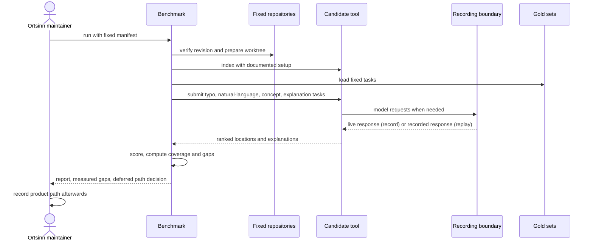

# Use case: benchmark-comparison

## Level

!

## Actors

- Ortsinn maintainer (primary)
- Upstream project maintainer (conditional, supporting)

## Goal

The maintainer gets a reproducible, measured comparison of the nearest
code-knowledge tools against the acceptance criteria on fixed repositories,
with candidate identity, repository revisions, measured values, coverage, and
gaps, so the product path can be decided after the report.

## Trigger

The maintainer requests a benchmark run on the fixed inputs, or requests a
replay of a completed run.

## Preconditions

Record mode:

- A benchmark manifest fixes the inputs, candidates, and target records.
- The pinned candidate toolchains are installed, including CKB's SCIP
  indexers and Serena's Python 3.13 environment and language servers.
- The reference repositories are available at their fixed revisions.
- The synthetic monorepo is regenerable from its fixed seed.
- A local OpenAI-compatible model endpoint is configured.

Replay mode:

- A benchmark manifest fixes the inputs, candidates, and target records.
- Recorded result and model cassettes exist for the manifest, gold, and
  candidate set.
- No candidate install and no model endpoint are required; replay starts no
  candidate process.

## Main flow

1. The maintainer requests a benchmark run with the fixed manifest, a recording mode, and an output location.
2. The benchmark verifies every fixed input: repository revision, candidate version and commit, gold-set version and fingerprint, synthetic seed and fingerprint, and recorded-response fingerprint when replaying.
3. For each candidate and repository, the benchmark prepares an isolated worktree at the fixed revision and runs the candidate's documented indexing setup with a stated deadline; the worktree and setup deviation are recorded.
4. The benchmark submits the fixed gold queries for typo recall, natural-language retrieval, concept recall, and explanation correctness through the candidate's native interface and normalizes each response to ranked locations and, where supported, an explanation with citations.
5. Where a candidate supports disabling query expansion, the benchmark repeats the concept-recall queries without expansion and records a separate arm.
6. The benchmark scores each metric and each arm, records coverage and any unavailable capability with its reason, and computes the measured gaps.
7. The benchmark writes a machine-readable report and a human-readable report, prints a concise summary, and states that the product-path decision is deferred to the maintainer and the named decision record.
8. The maintainer reads the report and records the build/contribute/compose decision in the post-report decision record.

## Extensions

- 1: A fixed-input mismatch fails the run with a non-zero exit, names the
  mismatched input, and publishes no complete report.
- 2: An uninstallable or unstartable candidate is recorded as unavailable with
  its reason and the run continues with the others.
- 3: A candidate that cannot index a repository within the deadline is
  unavailable for every metric for that candidate and repository, with the
  reason, and is never scored as zero.
- 4: A missing required operation marks the metric unavailable with a
  capability reason and lists it as a capability gap.
- 5: A query error counts as a miss for that candidate and repository, and the
  error count is reported separately.
- 6: A candidate without a query-expansion switch marks the no-expansion arm
  not applicable with the reason; it is never reported as zero.
- 7: A metric without a stated target reports its measured value and the best
  measured value and marks the target unstated.
- 8: A metric with a stated target reports its signed measured gap; a proposed
  target is labelled as proposed, never as confirmed.
- 9: Replay uses recorded model responses, makes no external call, and
  reproduces the measurements and ordering; a missing response fails the run
  and names the request and candidate.
- 10: When no candidate has a measured value for a metric, its to-best and
  to-target gaps are unavailable with the reason `no_measured_candidate` and
  carry no numeric value; the report is still complete.

## Rules

- R1. The benchmark is read-only over the fixed repositories and writes only to its declared work, recording, and report locations.
- R2. Every candidate and repository remains in the report, including unavailable ones; a missing measurement is never omitted or converted to zero.
- R3. The report names each candidate's version and source commit, each repository's URL, revision, language, and measured size, and each gold set's version and fingerprint.
- R4. The report contains all four measurement families, with first-rank and top-k variants where the family defines them.
- R5. Concept recall includes a no-expansion arm where the candidate supports disabling expansion; otherwise the arm is marked not applicable.
- R6. The report states the recording mode, the recorded-response fingerprint, and the exact command that reproduces the run; replay makes no external model call and can be rerun without cost.
- R7. The report contains no pre-registered build threshold and no chosen product path; it names the maintainer and the post-report decision record as the owner and artifact of that decision.
- R8. The same fixed inputs, candidate versions, gold-set versions, and recorded responses produce the same measurements and ordering; timestamps and run metadata are excluded from measurement identity.
- R9. A candidate is driven through its own documented interface; the benchmark normalizes results and never synthesizes a capability the candidate does not expose.
- R10. The benchmark's recording and report are project artifacts, not product runtime behavior; no product MCP tool is added or changed.

## Examples

- Example 1 — a measured capability gap: A candidate indexes the TypeScript reference repository but exposes no explanation operation; its typo, natural-language, and concept cells are measured, its explanation cell is unavailable with a capability reason, and the capability-gap list names the candidate.
- Example 2 — a replay rerun: The maintainer records one live run and reruns the same manifest in replay mode; the metric values, ordering, candidate identities, repository revisions, and measured gaps match, the recording fingerprint is unchanged, and no request leaves the local recording boundary.

## Minimal guarantee

When a candidate is unavailable, cannot index a repository, lacks an
operation, or a recorded response is missing, the maintainer still receives
either a complete report that names the unavailable measurement and its reason
or a failed run that names the missing input. The benchmark never presents a
missing measurement as a zero score or a complete report.

## Success guarantee

The maintainer receives a complete, reproducible report naming the candidates,
the fixed repository revisions, the measured typo, natural-language,
explanation, and concept-recall results, the no-expansion comparison where
applicable, coverage and capability gaps, and the measured gaps, with the
product-path decision explicitly deferred to the maintainer and the named
decision record.

The comparison is backed by at least one real measurement, not only fixture
data: a committed record-run evidence file from a real `--mode record` run
against at least one installed candidate and one reference repository, plus a
replay probe per installed candidate, accompanies the report as the manual
acceptance gate.

## Personas

- maintainer--ortsinn
- upstream--maintainer

`maintainer--ortsinn` is confirmed and is the user-visible actor.
`upstream--maintainer` is conditional: relevant only if the post-report path is
a contribution, and not exercised by this change.

## Capabilities

- benchmark-comparison

## Interactions

| Capability | Consumer action | E2E scenario |
|---|---|---|
| benchmark-comparison | Run the benchmark in replay mode on the fixed inputs and read the measured report | Maintainer runs the benchmark and reads the measured report |
| benchmark-comparison | Record a benchmark run against a local model endpoint and replay the recorded run | Maintainer records a run and replays it without an external call |

## Includes

- none

## Extends

- none

## Out of scope

- The product's runtime MCP surface and any product use case.
- The build/contribute/compose decision; the post-report decision record owns
  it.
- Patching or optimizing a candidate.
- Measuring metrics other than the four named acceptance families; index time
  is recorded only to explain availability.
- The product's owner-visibility record for external model calls (Q6).

## Diagram

