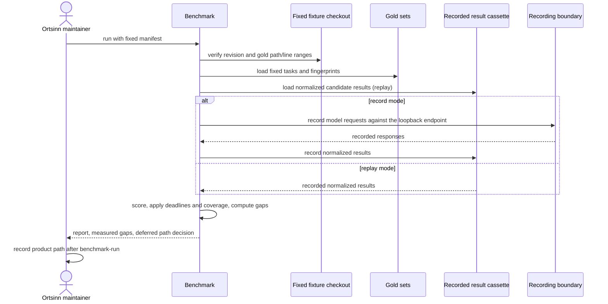

# Use case: benchmark-comparison

## Level

!

## Actors

- Ortsinn maintainer (primary)
- Upstream project maintainer (conditional, supporting)

## Goal

The maintainer gets a reproducible benchmark harness and report contract that
verifies fixed inputs, replays recorded candidate results, scores typo,
natural-language, explanation, and concept recall with coverage and measured
gaps, and publishes a report whose values and limitations are checkable, so
the real comparison can be published by `benchmark-run` and the product path
decided after that report.

## Trigger

The maintainer requests a benchmark run on the fixed inputs, or requests a
replay of a completed run.

## Preconditions

Record mode:

- The committed fixture manifest fixes the repository, the fixture candidate
  identities, the target records, the gold sets, and the cassettes.
- The fixture checkout, gold sets, and recorded result cassette exist at the
  fixed revision.
- A local OpenAI-compatible model endpoint is available; the fixture record
  boundary runs against a loopback fake endpoint.
- No real candidate install is required. Real candidate installs are
  `benchmark-run`'s precondition.

Replay mode:

- A benchmark manifest fixes the inputs, candidate identities, target
  records, gold sets, and cassettes.
- Recorded result and model cassettes exist for the manifest, gold, and
  candidate set, and the manifest records each repository's fixed checkout.
- No candidate install and no model endpoint are required; replay starts no
  candidate process.

## Main flow

1. The maintainer requests a benchmark run with the fixed manifest, a recording mode, and an output location.
2. The benchmark verifies the fixed inputs replay can check: each recorded result's repository commit, every gold path and line range at the fixed checkout, and that every model dependency exists in the model cassette. The manifest, gold, and cassette fingerprints are reported as recorded identities; a locally recorded cassette's digest is computed when it is written.
3. The benchmark loads each candidate's normalized results and recorded setup, applies the index deadlines, and records unavailable candidates and timed-out indexes instead of dropping them.
4. The benchmark reads the fixed gold queries for typo recall, natural-language retrieval, concept recall, and explanation correctness from the normalized results and, where recorded, an explanation with citations.
5. Where a candidate supports disabling query expansion, the benchmark scores the concept-recall queries without expansion and records a separate arm.
6. The benchmark scores each metric and each arm, records coverage and any unavailable capability with its reason, and computes the measured gaps.
7. The benchmark writes a machine-readable report and a human-readable report, prints a concise summary, and states that the product-path decision is deferred to the maintainer and the named decision record.
8. The maintainer reads the report and records the build/contribute/compose decision in the post-report decision record after `benchmark-run` publishes the real measured report.

## Extensions

- 1 (main flow step 2): A fixed-input mismatch fails the run with a non-zero
  exit, names the mismatched input, and publishes no complete report.
- 2 (main flow step 3): A candidate recorded as uninstallable or unstartable
  is recorded as unavailable with its reason and the run continues with the
  others.
- 3 (main flow step 3): A candidate that exceeded its index deadline is
  unavailable for every metric for that candidate and repository, with the
  reason, and is never scored as zero.
- 4 (main flow step 4): A missing required operation marks the metric
  unavailable with a capability reason and lists it as a capability gap.
- 5 (main flow step 6): A query error counts as a miss for that candidate and
  repository, and the error count is reported separately.
- 6 (main flow step 5): A candidate without a query-expansion switch marks the
  no-expansion arm not applicable with the reason; it is never reported as
  zero.
- 7 (main flow step 6): A metric without a stated target reports its measured
  value and the best measured value and marks the target unstated.
- 8 (main flow step 6): A metric with a stated target reports its signed
  measured gap; a proposed target is labelled as proposed, never as
  confirmed.
- 9 (main flow step 2): Replay uses recorded model responses, makes no
  external call, and reproduces the measurements and ordering; a missing
  response fails the run and names the request and candidate.
- 10 (main flow step 6): When no candidate has a measured value for a metric,
  its to-best and to-target gaps are unavailable with the reason
  `no_measured_candidate` and carry no numeric value; the report is still
  complete.
- 11 (main flow step 2): A gold task whose expected path is absent from the
  fixed checkout fails the run with exit code 2, names the task and path, and
  publishes no report.
- 12 (main flow step 2): A gold task whose line range exceeds the file fails
  the run with exit code 2, names the task and range, and publishes no report.

## Rules

- R1. The benchmark is read-only over the fixed inputs and writes only to its declared work, recording, and report locations.
- R2. Every candidate and repository remains in the report, including unavailable ones; a missing measurement is never omitted or converted to zero.
- R3. The report names each candidate's version and source commit, each repository's URL, revision, language, and measured size, and each gold set's version and fingerprint.
- R4. The report contains all four measurement families, with first-rank and top-k variants where the family defines them.
- R5. Concept recall includes a no-expansion arm where the candidate supports disabling expansion; otherwise the arm is marked not applicable.
- R6. The report states the recording mode, the recorded-response fingerprint, and the exact command that reproduces the run; replay makes no external model call and can be rerun without cost.
- R7. The report contains no pre-registered build threshold and no chosen product path; it names the maintainer and the post-report decision record as the owner and artifact of that decision.
- R8. The same fixed inputs, candidate identities, gold-set versions, and recorded responses produce the same measurements and ordering; timestamps and run metadata are excluded from measurement identity.
- R9. Candidate results enter the harness as normalized records produced through the candidate's own documented interface; the harness normalizes and scores them and never synthesizes a capability the candidate does not expose. The real adapters are `benchmark-run`'s.
- R10. The benchmark's recording and report are project artifacts, not product runtime behavior; no product MCP tool is added or changed.

## Examples

- Example 1 — an unavailable capability is not zero: `fixture-ocbi` has no
  explanation operation; its typo, natural-language, and concept cells are
  measured, its explanation cell is unavailable with
  `no_explanation_operation`, and the capability-gap list names the candidate.
- Example 2 — a replay rerun: the maintainer records a fixture run against
  the loopback endpoint and reruns the same manifest in replay mode; the
  metric values, ordering, candidate identities, repository revisions, and
  measured gaps match, the recording fingerprint is unchanged, and no request
  leaves the local recording boundary.

## Minimal guarantee

When a candidate is unavailable, cannot index a repository, lacks an
operation, or a recorded response is missing, the maintainer still receives
either a complete report that names the unavailable measurement and its reason
or a failed run that names the missing input. The benchmark never presents a
missing measurement as a zero score or a complete report.

## Success guarantee

The maintainer receives a complete, reproducible report from the committed
fixture naming the fixture candidates, the fixed repository revision, the
measured typo, natural-language, explanation, and concept-recall results, the
no-expansion comparison where applicable, coverage and capability gaps, and
the measured gaps, with the product-path decision explicitly deferred to the
maintainer and the named decision record. The regular scenarios and the two
`@e2e` CLI scenarios assert the exact fixture values and the record→replay
boundary.

The real-candidate comparison and its committed record-run evidence are
`benchmark-run`'s success guarantee; this change guarantees the harness and
report contract that report uses, and the fixture evidence that the contract
behaves as specified.

## Personas

- maintainer--ortsinn
- upstream--maintainer

`maintainer--ortsinn` is confirmed and is the user-visible actor.
`upstream--maintainer` is conditional: relevant only if the post-report path is
a contribution, and not exercised by this change.

## Capabilities

- benchmark-comparison

## Interactions

| Capability | Consumer action | E2E scenario |
|---|---|---|
| benchmark-comparison | Run the benchmark in replay mode on the fixed inputs and read the measured report | Maintainer runs the benchmark and reads the measured report |
| benchmark-comparison | Record a benchmark run against a local model endpoint and replay the recorded run | Maintainer records a run and replays it without an external call |

## Includes

- none

## Extends

- none

## Out of scope

- The product's runtime MCP surface and any product use case.
- The real candidate adapters, fixed reference repositories, real gold sets,
  fetch script, candidate installs, and the real record run; `benchmark-run`
  owns them.
- The build/contribute/compose decision; the post-report decision record owns
  it.
- Patching or optimizing a candidate.
- Measuring metrics other than the four named acceptance families; index time
  is recorded only to explain availability.
- The product's owner-visibility record for external model calls (Q6).

## Diagram

