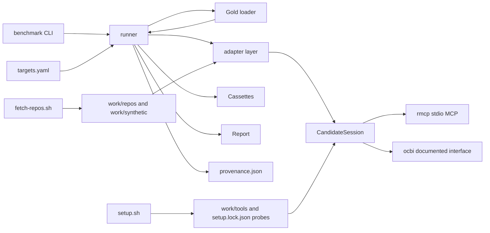

# Design: benchmark-run

## Scope

This change adds the real-candidate path to the benchmark harness delivered by
`benchmark-gate`:

- real adapters for open-codebase-index, CKB, and Serena behind the existing
  normalized-result contract;
- the real manifest, `benchmark/targets.yaml`, fixed reference repositories,
  synthetic monorepo, gold sets, fetch and setup scripts;
- the one-time real record run, its committed cassettes, its provenance
  record, and its report;
- the per-family publication floor and the reviewed-gold minimum check;
- the query digest in the model-cassette key, and the fixture-cassette
  migration that follows from it.

It does not change the harness scoring formulas, the report schema's existing
meaning, the fixture contract tests, or any product runtime behavior. The
product remains MCP-only; the product-path decision remains deferred.

## Decisions

- **Decides D1 (real candidate setup and availability; carries
  `benchmark-gate` D3; applies the operator's hybrid-endpoint decision of
  2026-10-27): install and pin every documented candidate dependency, and take
  candidate pins from the authored manifest.** `benchmark/manifest.yaml` is the
  only origin of candidate pins: the maintainer authors each candidate version,
  its 40-character source commit, and the evidence for both, and commits them
  with the manifest. `benchmark/setup.sh` installs exactly those pins, verifies
  each installation against them, and exits non-zero on any drift;
  `benchmark/setup.lock.json` records probe results and resolved toolchain
  versions but never writes or re-resolves a candidate pin. `--refresh` is an
  explicit new pin, and by definition a new record run.
  The model boundary is hybrid: a loopback OpenAI-compatible embedding endpoint
  serves the benchmark's embedding requests and configures candidate-internal
  embeddings; an external OpenAI-compatible explanation endpoint serves only
  the at-most-80 reviewed gold explanation queries. Both endpoint localities,
  both model names, and the explanation-query budget are recorded in the setup
  lock, the provenance record, and the report. The external explanation call
  exists only under this recorded operator decision. Candidate-internal
  embedding calls are not benchmark model dependencies and are recorded in the
  candidate setup; they are bounded only by the index deadline, and no
  candidate-side external call is permitted without a recorded operator
  decision.
  Rejected alternatives: resolving the latest official release at setup time
  (the pin would not constrain the run, setup would mutate a reviewed fixed
  input, and it reverses the predecessor's rejected "latest at run time"
  option); loopback-only explanations (lower explanation quality, which the
  report would have to publish as a limitation); an unbounded external endpoint
  for candidate-internal embeddings (an unbudgeted bill attached to a manual
  run).
  Realized in `benchmark/manifest.yaml`, `benchmark/fetch-repos.sh`,
  `benchmark/setup.sh`, `benchmark/src/setup.rs`, and
  `benchmark/src/adapters/`; verified by the scenarios "Real manifest pins
  every candidate version and commit", "The real manifest and setup lock agree
  on every pin", "A real fixed input that differs from its pin stops before
  scoring", "A documented setup deviation is recorded on every affected cell",
  and "A candidate that fails its setup probe is unavailable, not zero".
- **Decides D2 (gold set production; carries `benchmark-gate` D2; applies the
  operator's per-power gold-depth decision of 2026-10-27): maintainer-reviewed
  gold sets at per-power minimum counts.** The primary public reference
  repository uses 50 typo, 30 natural-language, 20 explanation, 50 concept, and
  20 concept-equivalence tasks (170 reviewed tasks). Each secondary public
  repository uses half: 25/15/10/25/10 (85 reviewed tasks each). Secondary
  repositories are labelled lower-power in the report and excluded from
  cross-repository aggregate claims; only same-power cells are aggregated. The
  manifest declares `gold_minimums` and each repository's `power`, so the
  fixture manifest sets `mode: fixture` and opts out of the published counts.
  A manifest-referenced gold set without `reviewed_by` fails before scoring
  with the typed `unreviewed gold set` error and no report; a draft not
  referenced by the manifest is never loaded. The synthetic monorepo's gold is
  generated and reviewed with its generator.
  Rejected alternatives: full minimums on all three public repositories (510
  authored tasks, the change's largest schedule risk); lowering the published
  floor everywhere (weakest evidence); relying on the draft directory alone to
  exclude unreviewed tasks (a referenced draft would silently shrink a gold
  set's total).
  Realized in `benchmark/src/gold/propose.rs`, `benchmark/src/gold/mod.rs`,
  `benchmark/src/gold/minimums.rs`, and the real gold files; verified by the
  scenarios "The real gold sets declare reviewed task counts", "A real gold set
  below the published minimum stops before scoring", and "An unreviewed gold
  set referenced by the manifest stops before scoring".
- **Decides D3 (real record-run gate; applies the operator's per-family floor
  and synthetic-deadline decisions of 2026-10-27): all three candidates on all
  four fixed inputs with a per-family publication floor.** The committed record
  run covers every candidate/repository pair in the manifest. A candidate that
  cannot be installed, a candidate that fails its setup probe, and a
  repository that exceeds its index deadline are recorded as unavailable with
  the reason; the run continues. A real report may publish only when there is
  at least one measured candidate cell for each of typo, natural-language,
  explanation, and concept, and at least one measured cell for every manifest
  repository; the runner exits 2 before writing either report file when the
  floor is unmet, and unavailable candidates remain in the report. The replay
  probe for every installed candidate is `run_replay` over the committed real
  cassettes: every cell the candidate recorded as measured must reproduce
  identically, starting no candidate process. The real record run attempts the
  synthetic monorepo for every candidate with a 30-minute (1800-second) index
  deadline; a breach is `index_timeout` with its elapsed time, never zero and
  never omitted.
  Rejected alternatives: a single global "one measured cell" floor (an
  all-unavailable report would pass while claiming a measured comparison);
  the archived eight-hour synthetic deadline (a multi-day run that still
  proves nothing about tractability); excluding the synthetic input this round
  (weakens the fixed-input claim the proposal makes).
  Realized in `benchmark/manifest.yaml`, `benchmark/src/runner.rs`,
  `benchmark/src/report/model.rs`, the committed cassettes, and the committed
  report; verified by the scenarios "The real record run covers every manifest
  candidate and repository", "A real replay reproduces the report without an
  external call", "A real run below the per-family measurement floor publishes
  no report", and "The real report publishes the measured comparison and
  defers the product path".
- **D4 (fuzzy behavior of open-codebase-index; carried from `benchmark-gate`,
  decided once here):** open-codebase-index results are not post-filtered.
  Its typo no-match rate records the tool's actual fuzzy/substring behavior,
  and fuzziness is a reported limitation, never a normalization applied by the
  harness.
- **Fourth candidate: none.** The three named candidates cover every metric
  family at least once across the manifest's capability declarations, so no
  coverage gap justifies a fourth candidate.
- **Adapter/session boundary (routed to `design.md`): one `CandidateSession`
  trait over each candidate's documented interface.** Rejected: per-candidate
  ad-hoc calls without a shared session, because normalization, the setup
  probe, and the `FakeSession` mapping would fork per candidate and the
  adapter-order contract could not be tested without a real process. Realized
  in `benchmark/src/adapters/session.rs` and the candidate modules.
- **Query digest (routed to `design.md`; the durable format is ADR-0001).**
  Rejected: keeping the query-free key and documenting the limitation, because
  a changed gold query would silently reuse another query's recorded response
  and the real report's replay claim would be false. Realized in
  `benchmark/src/record/` and the fixture migration.

The seed's Q5 remains closed (decide after the report); this design does not
reopen it.

## Version freshness

No candidate, toolchain, or repository version is written from memory. The
manifest is the single origin of the candidate and repository pins; the
maintainer authors each value with its evidence during implementation, and the
setup script only installs and verifies those pins. `setup.lock.json` records
the probes and resolved toolchain versions, never the pin origin.

| Technology | Resolution |
|---|---|
| open-codebase-index | maintainer-authored pin in `benchmark/manifest.yaml`: official release version, 40-character source commit, and its evidence. `setup.sh` installs exactly that pin and exits non-zero on drift. |
| CKB | maintainer-authored release version and 40-character commit in the manifest, with evidence; installed exactly and verified. |
| Serena | maintainer-authored release version and 40-character commit in the manifest, with evidence; installed exactly and verified. |
| Serena Python | the Python version Serena's official setup instructions require, latest patch resolved by `uv` at setup time and recorded in `benchmark/setup.lock.json` as a toolchain value. |
| SCIP indexers and language servers | the versions CKB's official documentation pins for each supported language, resolved at setup time and recorded in the setup lock; a documented tier without SCIP is recorded as such. |
| Go, Rust, Node toolchains | latest stable Go, stable Rust, and latest LTS Node at setup time; recorded in the setup lock. A resolved toolchain change is a new record run, not a silent manifest edit. |
| `rmcp` | latest stable on crates.io at implementation time; pinned in `Cargo.lock`. The current dependency set otherwise stays unchanged. |
| Public reference repositories | the maintainer selects the official upstream repositories and authors URL, 40-character commit, language, measured size, and power label in the manifest with evidence. Each public repository has at least 200,000 reference-language code lines; `fetch-repos.sh` checks out exactly that commit. |
| Synthetic monorepo | the existing fixed seed `20261020` and generator version `1`; 10,000,000 non-blank, non-comment code lines; 1800-second index deadline. |
| Cucumber | existing `0.23.0` from the lockfile; unchanged. |
| Explanation endpoint | external OpenAI-compatible endpoint; locality (provider origin), model name, and the at-most-80 explanation-query budget are recorded in the setup lock, provenance record, and report. Used only for reviewed gold explanation queries. |
| Embedding endpoint | loopback OpenAI-compatible endpoint (`http://127.0.0.1:<port>/v1`, model `nomic-embed-text`); serves benchmark embeddings and configures candidate-internal embeddings. Locality and model recorded. |
| Targets | `benchmark/targets.yaml`, authored and committed; its SHA-256 fingerprint is recorded in the report and provenance record. |

## Architecture impact

New code:

- `benchmark/src/adapters/session.rs` — `CandidateSession` trait: `probe`,
  `index`, `query`, `explain`, and a normalized-result constructor. The real
  implementation is `StdioMcpSession`, using `rmcp` over the candidate's
  documented stdio MCP command. Test implementations use `FakeSession`.
- `benchmark/src/adapters/ocbi.rs`, `ckb.rs`, `serena.rs` — candidate-specific
  mapping from the documented interface to normalized results, capabilities,
  setup records, and model-request dependencies. The adapters preserve the
  candidate's order and resolution and never infer a capability from a README.
  The file names deliberately differ from the predecessor's
  `adapters/open_codebase_index.rs` and `mcp/stdio_client.rs`: the session
  moved under `adapters/session.rs` because it is part of the adapter
  boundary, and the shorter candidate names avoid a package/module collision;
  no interface from the predecessor was dropped.
- `benchmark/src/gold/propose.rs` — draft task proposer; writes unreviewed
  drafts only.
- `benchmark/src/gold/minimums.rs` — the per-power published minimum counts
  and the review-count check.
- `benchmark/src/setup.rs` — shared validation for the fetch and setup scripts:
  fixed-input pins, checkout/LOC checks, setup-lock shape, and per-candidate
  probe requirements.
- `benchmark/src/provenance.rs` — builds the committed `provenance.json` from
  the run's command, UTC start/end, host and toolchain, both endpoint
  localities and models, the explanation-query budget and consumed count,
  manifest pins, per-candidate/repository index outcomes, targets fingerprint,
  and cassette digests.
- `benchmark/src/bin/migrate-cassettes.rs` — the one-shot migration of the
  committed fixture result cassette's `model_requests` keys to the
  query-digest form. It preserves record order and payloads, rewrites the
  result-cassette fingerprint, and is verified by the replayed measurements.
- `benchmark/fetch-repos.sh` — clone or check out the pinned public
  repositories, generate the synthetic monorepo, create per-candidate writable
  copies with the `.git` metadata the candidates need, and verify the pins.
- `benchmark/setup.sh` — install and pin the candidate toolchains, SCIP
  indexers, language servers, and Serena environment; write
  `benchmark/setup.lock.json`; run the setup probes.
- `benchmark/run-real.sh` — the evidence-run helper: re-checks the committed
  manifest and setup lock, runs the record pass with the hybrid endpoints, runs
  the replay probe, writes `provenance.json` next to the run output, and is
  not part of `run-tests.sh`. `fetch-repos.sh` and `setup.sh` are project
  setup preconditions run before it; none of the three is a new consumer
  action.

The existing `benchmark/src/runner.rs` gains a real record path: when a
manifest candidate declares a non-fixture adapter, the runner obtains
normalized results from the adapters and then records model responses through
the existing recording boundary. The fixture record path and its temporary
cassette behavior are unchanged. The runner also enforces the manifest
`gold_minimums` mode, computes the per-family publication floor before writing
either report file, and writes the targets fingerprint.

The manifest loader gains `targets_file` and `gold_minimums`; the fixture
manifest keeps inline `targets` and sets `gold_minimums.mode: fixture`. The
real manifest references `benchmark/targets.yaml` and declares the published
per-power minimums.



## Fixed inputs

The real manifest uses the existing schema with these values:

| ID | Language | Revision | Power | Minimum code lines | Index deadline | Checkout |
|---|---|---|---|---|---|---|
| `typescript-reference` | TypeScript | pinned in the manifest | primary | 200,000 | 14,400 s | `work/repos/typescript-reference` |
| `python-reference` | Python | pinned in the manifest | secondary | 200,000 | 14,400 s | `work/repos/python-reference` |
| `rust-reference` | Rust | pinned in the manifest | secondary | 200,000 | 14,400 s | `work/repos/rust-reference` |
| `synthetic-monorepo` | synthetic | seed `20261020`, generator `1` | secondary | 10,000,000 | 1,800 s | `work/synthetic` |

Exactly one public repository is `primary` and carries the full gold
minimums; the other two are `secondary`, carry half the minimums, and are
labelled lower-power. The design does not guess the public repositories' URLs
or commits: the maintainer authors both, with evidence, in the committed
manifest. `fetch-repos.sh` checks out exactly the authored commit, creates the
per-candidate copies under `benchmark/work/<candidate>/<repository>/`,
preserves `.git` where the candidate needs it, and records the checkout. The
manifest's repository `checkout` points at the shared fixed checkout; the
per-candidate copy path is derived from the candidate and repository IDs.

The synthetic monorepo is generated, not committed. Its content fingerprint is
the SHA-256 over the sorted `(relative path, file content hash)` list, as in
the fixture generator. The 10M-line production run is a task; the existing
fixture synthetic scenario proves the generator and fingerprint.

Index deadlines are manifest fields: public repositories use
`public_repository_seconds` (14,400 seconds) and the synthetic monorepo uses
`synthetic_seconds` (1,800 seconds). The real record run attempts every
candidate on the synthetic monorepo within that 30-minute deadline. A breach
marks every metric for that candidate/repository `unavailable` with
`index_timeout` and keeps the elapsed time; it is never zero and never
omitted.

## Candidate setup and adapters

Each candidate is installed at the pinned version and probed before any query.

| Candidate | Documented interface | Setup probe | Normalized mapping |
|---|---|---|---|
| open-codebase-index | its documented CLI/HTTP interface, configured with the loopback OpenAI-compatible embedding endpoint | binary starts; index/query operation answers; embedding endpoint reachable | typo, natural-language, concept, concept-equivalence, explanation if exposed |
| CKB | MCP stdio via `rmcp` | server initializes; declared tools list; language-support tiers record CKB's documented Rust tier | typo, natural-language, concept, explanation per declared operations |
| Serena | MCP stdio via `rmcp` | server initializes; declared tools list; Python and language-server versions record | natural-language and symbol operations per declared operations; no inferred explanation |

The adapter produces the existing normalized record shape (`candidate`,
`candidate_version`, `candidate_commit`, `repository`, `repository_commit`,
`metric`, `task`, `arm`, `results`, `explanation`, `error`,
`model_requests`). It preserves the candidate's order, deduplicates by
`(path, start_line, end_line, symbol)` without reordering, and keeps a
file-only answer as a file resolution. A missing operation is `unavailable`
with a capability reason such as `no_explanation_operation` or
`no_symbol_search`.

`CandidateSetup` gains:

```text
setup_deviations: [
  { dependency, reason, affected_capabilities[], affected_repositories[] }
]
```

A setup deviation is recorded when a documented dependency cannot be installed
or a documented mode is unavailable. Every metric cell affected by the
deviation carries the deviation label; the cell's measured value is retained
when the candidate can still answer, and the cell is unavailable when it
cannot. A candidate-level `unavailable` reason is used when the interface
cannot start at all.

## Model endpoints

The model boundary is hybrid (operator decision of 2026-10-27):

| Use | Locality | Model | Recorded as |
|---|---|---|---|
| Benchmark explanation queries | external OpenAI-compatible provider | the model name the operator records at setup | benchmark model dependency, one request per reviewed gold explanation query |
| Benchmark embeddings | loopback `http://127.0.0.1:<port>/v1` | `nomic-embed-text` | benchmark model dependency |
| Candidate-internal embeddings | loopback, configured in the candidate's setup | candidate-configured | the candidate's setup record, never a benchmark model dependency |

The external explanation endpoint serves only the at-most-80 reviewed gold
explanation queries; the budget and the consumed count are recorded. It is
used only under the recorded operator decision in this design; no other
external call is permitted, and no candidate-side external call is unbounded.
Candidate-internal embeddings are bounded only by the candidate's index
deadline. The setup lock, provenance record, and report record both endpoint
localities, both model names, and the explanation-query budget.

## Gold sets

Minimum task counts are per repository power, declared by the manifest:

```yaml
gold_minimums:
  mode: published          # the fixture manifest sets `mode: fixture`
  primary: {typo: 50, natural_language: 30, explanation: 20, concept: 50, concept_equivalence: 20}
  secondary: {typo: 25, natural_language: 15, explanation: 10, concept: 25, concept_equivalence: 10}
repositories:
  - {id: typescript-reference, power: primary, ...}
  - {id: python-reference, power: secondary, ...}
  - {id: rust-reference, power: secondary, ...}
  - {id: synthetic-monorepo, power: secondary, ...}
```

| Metric | Primary minimum | Secondary minimum |
|---|---|---|
| typo | 50 tasks (including no-match tasks) | 25 tasks |
| natural_language | 30 tasks | 15 tasks |
| explanation | 20 tasks with rubric targets and acceptable-evidence ranges | 10 tasks |
| concept | 50 tasks | 25 tasks |
| concept_equivalence | 20 variants | 10 variants |

The primary public repository therefore carries 170 reviewed tasks; each
secondary public repository carries 85. Every secondary repository is
rendered with a `lower_power` label, its per-repository values are published,
and it is excluded from cross-repository aggregate claims: an aggregate for a
metric combines only repositories of the same power, so a primary aggregate is
never diluted by a secondary repository. The published minimum is per
repository and power, not one global count.

The synthetic monorepo gold is emitted by the generator with the same counts;
it is exact by construction and reviewed as part of the generator review, not
task by task. It follows the synthetic input's declared power.

The draft proposer reads the fixed checkout and writes
`benchmark/gold/drafts/<repository>/<metric>.jsonl`. It never edits a reviewed
gold file and never updates the manifest. The maintainer reviews drafts and
moves them to `benchmark/gold/<repository>/<metric>.jsonl`; the manifest entry
gains `version`, `tasks`, `fingerprint`, and `reviewed_by:
maintainer--ortsinn`.

`GoldSet` gains `reviewed_by`, and `Gold::load` enforces exactly two
semantics:

- only manifest-referenced files are loaded; a draft under
  `benchmark/gold/drafts/` that the manifest does not reference is never
  loaded or scored;
- a manifest-referenced gold set with an empty or missing `reviewed_by` fails
  before scoring with the typed `unreviewed gold set` error, naming the set
  and metric, exiting 2, and publishing no report.

When `gold_minimums.mode` is `published`, a referenced gold set whose count is
below the manifest minimum for its repository's power fails with the typed
`gold_below_minimum` error, naming the set, metric, minimum, and actual count,
exiting 2, and publishing no report. When the mode is `fixture`, only the
reviewer requirement and a non-empty count are enforced; the fixture manifest
declares `mode: fixture` and sets a reviewer value on its committed gold sets,
so the existing contract tests keep using the same loader and keep their
5/4/4/5/4 counts.

## Recording, replay, and the query digest

The model-cassette key gains the query digest:

- `model:explanation:<candidate>:<task>:sha256:<query-digest>`
- `model:embedding:<candidate>:<model>:sha256:<query-digest>`

The digest is the SHA-256 of the normalized query text. The result cassette's
`model_requests` keys use the same value. A changed gold query is therefore a
different cassette key: replay fails with `missing recorded response` instead
of reusing another query's answer.

### Fixture migration

The committed fixture cassettes are migrated once, in this order:

1. `cargo run -p benchmark --bin migrate-cassettes -- --manifest
   benchmark/tests/fixtures/e2e/manifest.yaml --out <tmp>` rewrites every
   result-cassette `model_requests` key to the digested form, resolving each
   key to its gold task query, preserving record order and payload; it writes
   a new result-cassette fingerprint.
2. The fixture record path runs once over the migrated result cassette against
   the loopback fake endpoint, writing the model cassette under the same
   digest keys.
3. The migrated result cassette, the regenerated model cassette, and the
   recomputed cassettes fingerprint are copied into the fixture manifest and
   fixture directory.
4. Replay of the regenerated fixture reproduces the measurements and every key
   carries a digest.

The result cassette is a record-path *input*, so its keys cannot be derived by
the record path and the one-shot migration is required. Verification: the
migrated fixture replays with identical measurements, the model-dependency
check passes, and the delta `@givn.modified` scenario "Replay rerun reproduces
the report without an external model call" asserts the manifest-declared model
cassette fingerprint, its recomputed file digest, and the query-digest key
shape. The permanent spec's literal fixture digest is replaced by this
manifest-declared-and-recomputed assertion because the migration changes the
value; a stale literal would make the plan un-executable. The report limitation
about the missing query digest is removed; the remaining limitations stay.

### S9 replay recipe

The scenario "A changed query does not reuse a recorded model response" uses
this exact recipe:

1. copy `benchmark/tests/fixtures/e2e/` to a temporary directory;
2. edit the `query` field of one explanation gold task in the copied
   `gold/explanation.jsonl`;
3. recompute that gold file's SHA-256 and write it as the set's `fingerprint`
   in the copied manifest (otherwise the run stops on the gold-fingerprint
   mismatch first);
4. replay the copied manifest into a temporary output directory;
5. assert exit 2, the typed missing-response error naming the changed query's
   new digest and the candidate, no report file, and that the original
   query's recorded key was not reused.

### Real record run

```bash
./benchmark/fetch-repos.sh     # project setup precondition
./benchmark/setup.sh           # project setup precondition
./benchmark/run-real.sh        # record pass, replay probe, provenance
```

`run-real.sh` invokes the runner with the hybrid endpoints and then replays:

```bash
cargo run -p benchmark -- run --manifest benchmark/manifest.yaml \
  --mode record \
  --embedding-endpoint http://127.0.0.1:11434/v1 \
  --explanation-endpoint "$BENCHMARK_EXPLANATION_ENDPOINT" \
  --out target/real-run
cargo run -p benchmark -- run --manifest benchmark/manifest.yaml \
  --mode replay --out target/real-run-replay
```

The CLI replaces the single `--model-endpoint` flag with
`--embedding-endpoint` and `--explanation-endpoint`; the fixture e2e record
step passes the same loopback fake URL to both. The record run writes the
result and model cassettes and `provenance.json` under `target/real-run/`, and
the report under `target/real-run/report.*`. The evidence task copies the
cassettes to `benchmark/cassettes/`, the reports to `benchmark/reports/`, the
provenance record to `benchmark/evidence/real-run/provenance.json`, updates the
manifest cassette and targets fingerprints, and commits the evidence. Replay
then runs from the committed manifest with no candidate process and no external
model call. The real record run is a manual evidence task; `run-tests.sh` never
performs it.

### Provenance record

`benchmark/evidence/real-run/provenance.json` is committed evidence, not a log.
It records:

- the exact command and the UTC start and end times;
- the host and toolchain versions (OS, kernel, architecture, rustc, cargo,
  LLVM, Python, Go, Node, and each candidate toolchain recorded in the setup
  lock);
- both endpoint localities and model names, plus the explanation-query budget
  and the number of explanation queries actually consumed;
- every candidate version and 40-character commit, equal to the manifest pins;
- every repository commit and power label, equal to the manifest;
- per-candidate and per-repository index outcome, elapsed seconds, and applied
  deadline (including `index_timeout`);
- the targets, manifest, model-cassette, and result-cassette SHA-256
  fingerprints.

Scenarios 7, 11, and 15 read this record, cross-check its pins against the
setup lock and manifest, cross-check its cassette digests against the committed
cassettes, and cross-check its index outcomes against the report cells. A
hand-authored cassette or report therefore fails an assertion instead of
passing.

The real run records every benchmark model request/response and normalized
result through the existing recording boundary. Candidate-internal embedding
calls are part of the candidate's own interface and are recorded in its setup,
not as benchmark model-request dependencies; they are bounded only by the index
deadline.

## Targets

`benchmark/targets.yaml` is the real target file named by the proposal. The
manifest references it through `targets_file`; the fixture manifest keeps its
inline `targets` block and no `targets_file`. Loading precedence is: an
explicit `--targets <path>` overrides `targets_file`, which overrides inline
`targets`; supplying more than one source is a usage failure (exit 2) rather
than a silent merge. The loader validates every target's `{value, status,
source}` with status `confirmed`, `proposed`, or `unstated`; the file's SHA-256
is recorded as `reproduction.targets_fingerprint` and in the provenance
record. The report copies every real target label and source verbatim, so
AC-01's 0.90 is published as `proposed` and AC-03/12/21/22 as `unstated`.

## Report changes

`Report` gains:

- `candidates[].setup_deviations` — the same list as the manifest setup record;
- `inputs.gold[].reviewed_by` — the reviewer of each loaded gold set;
- `inputs.repositories[].power` — `primary` or `secondary`, rendering
  `lower_power` for secondary repositories;
- `run.endpoints` — embedding locality/model and explanation locality/model,
  plus the explanation-query budget and consumed count;
- `reproduction.targets_fingerprint` — the targets file's SHA-256;
- `reproduction.provenance_fingerprint` — the committed provenance record's
  SHA-256;
- real candidate/repository identity and measured sizes, as the existing
  schema already supports.

`reproduction.gold_fingerprints` is keyed by `<repository>/<metric>` instead of
`<metric>`; `SCHEMA_VERSION` becomes 2. `Report::validate` checks every
`inputs.gold` entry has exactly one matching key, so a multi-repository report
can no longer collapse two repositories' fingerprints for one metric. The
renderer and the fixture step assertion use the same key.

The runner evaluates the publication floor before `render::write_reports` is
called: at least one measured candidate cell for typo, natural-language,
explanation, and concept, and at least one measured cell for every manifest
repository. When the floor is unmet it returns exit 2 with the missing
families and repositories and writes neither report file. Unavailable
candidates stay in the report whenever a report is published.

Metric aggregates combine only repositories of the same power: a secondary
(lower-power) repository publishes its per-repository cells and is excluded
from cross-repository aggregate claims. The report marks it `lower_power` and
its limitations name the reduced power.

The terminal summary keeps the four metric section names and the report path.
The Markdown report adds the setup-deviation, gold-reviewer, endpoint,
power-label, and targets information to the existing candidate and fixed-input
sections. The measured gaps, capability gaps, limitations, and deferred path
decision keep their existing meaning.

## Executable-spec runner and strict mode

`givn/commands.yaml` keeps `verify.command: ./run-tests.sh` and
`verify.e2e_command: ./run-tests.sh --e2e`. The runner remains
`benchmark/tests/benchmark_features.rs` with cucumber-rs, `.fail_on_skipped()`,
and `filter_run_and_exit()`. `filter_run` applies `--name`/`--tags`; without a
filter the runner sets `CUCUMBER_FILTER_TAGS=not @wip`. The strict-mode proof
is repeated in the setup task: a temporary feature with an undefined step must
make the test binary exit non-zero.

Single-scenario command:

```bash
source ./env.sh
GIVN_FEATURES="$(realpath givn/changes/benchmark-run/specs/benchmark-comparison/benchmark-comparison.feature)" \
  cargo test --test benchmark_features -- \
  --name "^A real replay reproduces the report without an external call$"
```

The real-candidate scenarios are regular scenarios, not `@e2e`. The external
record run is a task and evidence, never a test dependency. Each scenario
starts as `@wip` with a step body that returns a typed `NotImplemented` error;
the `@wip` tag is removed only when its concrete evidence assertion is green.

### Scenario drivers

Every scenario is executable in CI without real inputs, network access, or a
real candidate process. This table is the contract between the feature and the
step definitions:

| # | Scenario | Driver | Asserted evidence |
|---|---|---|---|
| 1 | Real manifest pins every reference repository and the synthetic monorepo | Read the committed `benchmark/manifest.yaml` | URL, 40-hex commit, language, measured size, and power per repository; synthetic seed/generator/content fingerprint; public 14,400 s and synthetic 1,800 s deadlines |
| 2 | Real manifest pins every candidate version and commit | Read the committed manifest | three candidates, each with a version, 40-hex commit, and evidence citation |
| 3 | The real manifest and setup lock agree on every pin | Read the committed manifest and `setup.lock.json`; run `setup::validate` (the shared code `setup.sh` calls) | identical pins in both files; 40-hex commits; a probe record and toolchain versions per candidate; no pin origin in the lock; both endpoint localities, models, and the explanation budget; drift exits non-zero |
| 4 | A real fixed input that differs from its pin stops before scoring | `setup::validate` over a temporary manifest and checkout whose commit differs | exit 2 naming the mismatched fixed input; no benchmark run starts |
| 5 | A documented setup deviation is recorded on every affected cell | `FakeSession` declares the deviation; record/replay over a temporary manifest | the report names the deviation and every affected cell carries it with its measured value |
| 6 | A candidate that fails its setup probe is unavailable, not zero | `FakeSession` returns a probe error | every cell for that candidate unavailable with the reason; other candidates measured; candidate listed unavailable |
| 7 | The committed real run records its recording mode, cassette fingerprints, and model dependencies | Read the committed provenance record, cassettes, and report | mode `record`; model and result cassette fingerprints; every measured cell's model dependency present in the model cassette; provenance command/UTC times, pins equal the manifest, digests equal the cassettes, index outcomes equal the report |
| 8 | A real replay reproduces the report without an external call | `run_replay("benchmark/manifest.yaml", out)` over the committed real cassettes | identical measurements and order; no external request; no candidate process; each installed candidate's measured slice reproduces |
| 9 | A changed query does not reuse a recorded model response | The S9 recipe: `run_replay` over a fixture copy with one edited explanation query and its recomputed gold fingerprint | exit 2; missing recorded response for the new digest; the original key is not reused; no report |
| 10 | An unreviewed gold set referenced by the manifest stops before scoring | `Gold::load` over a temporary manifest that references a draft | typed `unreviewed gold set` error; exit 2; no report; a draft the manifest does not reference is not loaded |
| 11 | The real record run covers every manifest candidate and repository | Read the committed manifest, provenance, and result cassette, then `run_replay` | candidate × repository × metric audit over the cassette and `inputs.*`; floor; provenance index outcomes; a timed-out outcome carries `index_timeout` and elapsed time |
| 12 | The real gold sets declare reviewed task counts | Read the committed manifest and gold files | per-repository power, reviewed counts and minima, versions, fingerprints, and reviewers; secondary sets labelled lower-power; synthetic set generated and reviewed |
| 13 | A real candidate's evidence keeps its order and resolution | `FakeSession` returns duplicate answers and a file-only answer | candidate order preserved; dedup without reordering; file-only answer stays a file resolution |
| 14 | A real candidate without an operation is unavailable with the capability reason | `FakeSession` exposes no explanation operation | explanation cell unavailable with the capability reason; measured families remain measured; capability gap listed |
| 15 | The real report publishes the measured comparison and defers the product path | `run_replay` over the committed real cassettes | four families and gaps; concept no-expansion arm; every identity and fingerprint; target labels, sources, and targets fingerprint; provenance fingerprint; endpoint localities, models, and budget; power labels; deferred path decision |
| 16 | A real run below the per-family measurement floor publishes no report | `run_replay` over a temporary manifest and cassette set with one family or repository unmeasured | exit 2 naming the missing family and repository; neither report file written; unavailable candidates stay in the report when one is published |
| 17 | A real gold set below the published minimum stops before scoring | `Gold::load` over a temporary manifest with a below-minimum real set | typed `gold_below_minimum` error naming the set, metric, minimum, and actual count; exit 2; no report |
| 18 | Replay rerun reproduces the report without an external model call (`@givn.modified`) | `run_replay` over the regenerated fixture cassettes | the report states the manifest-declared model fingerprint; the committed file's recomputed digest equals it; every model key carries the query digest |

## Step definitions

| Scope | Step definition file | Permanent merge target |
|---|---|---|
| Regular real-run steps for `benchmark-comparison` | `benchmark/tests/steps/benchmark_comparison.rs` | `benchmark/tests/steps/benchmark_comparison.rs` |
| E2E CLI steps for `benchmark-comparison` (unchanged) | `benchmark/tests/steps/e2e/benchmark_cli.rs` | `benchmark/tests/steps/e2e/benchmark_cli.rs` |
| Cucumber runner, `World`, and fixture lifecycle | `benchmark/tests/benchmark_features.rs` | `benchmark/tests/benchmark_features.rs` |

No delta step copy is needed; the new phrases are bound in the permanent
regular step file. The archive hook must find every delta phrase there.

## Interaction Coverage Matrix

| Inventory entry | @e2e scenario title | Real interface | Driving mechanism |
|---|---|---|---|
| Run the benchmark in replay mode on the fixed inputs and read the measured report | Maintainer runs the benchmark and reads the measured report | CLI | `std::process::Command` starts the real `benchmark` binary with the fixture manifest; the step reads stdout, the report path, and the report files. |
| Record a benchmark run against a model endpoint and replay the recorded run | Maintainer records a run and replays it without an external call | CLI | The step starts a loopback fake OpenAI-compatible endpoint, runs the real binary in record mode with the fixture candidates, then runs replay and asserts no external request and equal measurements. |

The real record run is the same record action on the real manifest, executed by
`benchmark/run-real.sh`; it is not a new inventory entry. `fetch-repos.sh`,
`setup.sh`, and `run-real.sh` are project setup preconditions that prepare and
verify the fixed inputs; they are not consumer actions, so scenarios 3 and 4
assert the benchmark's own manifest/setup-lock validation rather than a
consumer preparation action.

The durable `givn/specs/benchmark-comparison/usecase.md` is replaced by this
change's delta `usecase.md` at archive. The delta is the only edited use-case
copy; its Goal, Trigger, and guarantees carry no change ID, and its
interaction-inventory wording is identical to the durable document.

## E2E smoke test infrastructure

- **E2E runner command**: `./run-tests.sh --e2e`, distinct from the regular
  `./run-tests.sh`; it runs the real `benchmark` binary against the committed
  fixture manifest.
- **E2E step definition location**: `benchmark/tests/steps/e2e/benchmark_cli.rs`.
- **Local test infrastructure**: `FakeOpenAiEndpoint` on loopback, fixture
  candidates, a temporary output directory, and no external service. Ports are
  assigned by the fake endpoint; the transcript normalizes the port.
- **Framework**: cucumber-rs with the real CLI subprocess, because the
  capability's interface is a CLI.
- **Strict-mode proof**: `.fail_on_skipped()` plus `filter_run_and_exit()`;
  the setup task's temporary undefined-step feature proves a non-zero exit.

## Visual Design Contract

- Interface: terminal. The benchmark prints plain text; it renders no HTML,
  CSS, or JavaScript.
- Viewports: not applicable. The terminal report is checked at 80 and 160
  columns; every metric label and value stays on one line at both widths.
- Design system: none; the project has no `docs/design/` system.
- Typography and layout: plain text with one top-level title, one heading per
  report section, and aligned tables; no ANSI color as the only state carrier.
- Component primitives: run summary, metric table, gap table, capability table,
  setup-deviation row, error line; each has default and unavailable/error
  states.
- Accessibility: textual headings and labels; domain terms; no motion.
- Screens covered: the benchmark run summary and the measured report. The real
  report adds setup-deviation and reviewer rows but no new screen.
- Rendered reference: the committed `@e2e` transcripts for the two CLI
  scenarios, captured at 80 and 160 columns. The real report is a regular
  scenario's committed evidence, not a new `@e2e` transcript.
- Capture mechanism and evidence path: `${GIVN_EVIDENCE_DIR:-benchmark/evidence/visual}/<scenario-slug>/transcript.txt`.
- Motion: none; `prefers-reduced-motion` is not applicable to terminal output.
- Persona impact: `maintainer--ortsinn` reads the terminal summary and report;
  `upstream--maintainer` remains conditional on a later contribution path and
  consumes only the report.

## Local runnability and digital twins

- **Local run command**: `./run-tests.sh` runs the complete fixture suite and
  the record/replay contract with no external service. The real evidence run is
  `./benchmark/run-real.sh` after `fetch-repos.sh` and `setup.sh` and after
  starting the loopback embedding endpoint and exporting
  `BENCHMARK_EXPLANATION_ENDPOINT`; it records with the hybrid endpoints, runs
  the replay probe, and writes the provenance record.
- **Isolated tests**: the test suite uses fixture candidates, a loopback fake
  OpenAI-compatible endpoint, and temporary directories. It makes no external
  request and starts no real candidate.
- **Digital twins**:
  - the fixture candidates are the deterministic twin of the real candidate
    interfaces for the report contract;
  - `FakeSession` is the twin of the `rmcp` stdio session for adapter mapping;
  - `FakeOpenAiEndpoint` is the twin of both model endpoints.
- **Real dependencies**: the real candidates, their SCIP indexers/language
  servers, the reference repository clones, the loopback embedding endpoint,
  and the external explanation endpoint are required only by the manual
  evidence run. The candidate and repository pins are authored in the manifest;
  probes and toolchain versions are recorded in the setup lock; a missing
  dependency is recorded, not silently skipped.
- **Anticipated interface obstacles and fixes**:
  - MCP stdio startup and shutdown: the `StdioMcpSession` owns the child,
    initializes once, and kills it on drop; the probe runs before indexing.
  - Candidate index time and disk: deadlines and per-candidate writable copies;
    a timeout is `index_timeout`, not a zero.
  - Synthetic 10M-line generation: generated under `benchmark/work/`, never
    committed; the content fingerprint and LOC checks gate the run, and the
    real attempt is bounded by the 1800-second deadline.
  - External model cost: only the at-most-80 reviewed explanation queries leave
    the machine; candidate-internal embeddings stay on loopback and are bounded
    by the index deadline; record once and replay for every later run.

## Coverage process boundaries

| Process | Started by | Instrumented artifact | Profile output | Merge step | Non-zero production probe |
|---|---|---|---|---|---|
| `benchmark_features` regular runner | `./run-tests.sh` | `target/coverage/non-e2e/llvm-cov-target` | `coverage/non-e2e.profraw` | `./merge-coverages.sh` | `src/adapters/session.rs` and `src/adapters/*.rs` normalization |
| `benchmark` CLI E2E | `benchmark_features` `@e2e` step | `target/coverage/e2e/llvm-cov-target` | `coverage/e2e.profraw` | `./merge-coverages.sh` | `src/cli.rs` run dispatch |
| `benchmark` real evidence run | `benchmark/run-real.sh` | normal build | not a coverage scope | not merged | manual evidence only; no CI coverage claim |

The existing `measure-coverage.sh` and `merge-coverages.sh` own the instrumented
builds and the merged Cobertura report. The real record run is deliberately
outside CI coverage; the adapter mapping and the real-report assertions are
covered through `FakeSession` and committed evidence.

## Use-case traceability

| Use-case guarantee, rule, or flow | Technical decision | Evidence |
|---|---|---|
| Goal: real measured comparison of pinned candidates | Real manifest, adapters, record run, report | Scenarios "The real record run covers every manifest candidate and repository" and "The real report publishes the measured comparison and defers the product path" |
| Preconditions: real repositories, power-labelled gold, pinned candidates, hybrid endpoints | `fetch-repos.sh`, `setup.sh`, manifest, setup lock, provenance | Scenarios "Real manifest pins every reference repository and the synthetic monorepo", "Real manifest pins every candidate version and commit", and "The real manifest and setup lock agree on every pin" |
| Main flow 1: prepare fixed inputs | Project setup scripts and the manifest/setup-lock validation | Scenarios "The real manifest and setup lock agree on every pin" and "A real fixed input that differs from its pin stops before scoring" |
| Main flow 2: verify fixed inputs | Manifest/gold/cassette verification and the targets fingerprint | Existing fixed-input scenarios; real gold and cassette identity in "The real gold sets declare reviewed task counts" |
| Main flow 3: setup probes, deadlines, unavailable candidates | `CandidateSession`, setup lock, `CandidateSetup`, deadlines | Scenarios "A documented setup deviation is recorded on every affected cell" and "A candidate that fails its setup probe is unavailable, not zero" |
| Main flow 4: gold queries | Real gold files, reviewer requirement, per-power counts | Scenarios "The real gold sets declare reviewed task counts", "An unreviewed gold set referenced by the manifest stops before scoring", and "A real gold set below the published minimum stops before scoring" |
| Main flow 6: score, coverage, gaps | Existing metric/report model, real adapter records, power-aware aggregation | Scenario "The real report publishes the measured comparison and defers the product path" |
| Main flow 7: deferred path decision | Existing `path_decision` report field | Scenario "The real report publishes the measured comparison and defers the product path" |
| R1: read-only over fixed inputs | Work files under `benchmark/work/`; report/cassette/provenance outputs | Real manifest and report scenarios |
| R2: unavailable is never zero | Closed status model; setup deviations | "A candidate that fails its setup probe is unavailable, not zero" |
| R3: candidate/repository/gold identity | Manifest, report identity fields, `<repository>/<metric>` gold fingerprints | "The real report publishes the measured comparison and defers the product path" |
| R6: record, replay, query digest | Model cassette key, migrated result cassette, regenerated fixture cassettes | "The committed real run records its recording mode, cassette fingerprints, and model dependencies", "A real replay reproduces the report without an external call", "A changed query does not reuse a recorded model response", and the `@givn.modified` replay-fingerprint scenario |
| R9: documented interfaces and normalized records | `CandidateSession`, adapters, `dedup_locations` | "A real candidate's evidence keeps its order and resolution" and "A real candidate without an operation is unavailable with the capability reason" |
| R11: reviewed gold | `reviewed_by`, per-power minimums, draft proposer | "The real gold sets declare reviewed task counts" and "An unreviewed gold set referenced by the manifest stops before scoring" |
| R12: setup deviation and unavailable setup | `setup_deviations`, probe result | "A documented setup deviation is recorded on every affected cell" and "A candidate that fails its setup probe is unavailable, not zero" |
| R13: every manifest candidate and repository | Real record runner and report validation | "The real record run covers every manifest candidate and repository" |
| R14: per-family publication floor | Runner floor check before report write | "A real run below the per-family measurement floor publishes no report" |
| R15: hybrid endpoints and bounded explanation calls | Two CLI endpoint flags, setup-lock/provenance/report endpoint records | "The committed real run records its recording mode, cassette fingerprints, and model dependencies" and the real report scenario |
| Extension 18: real fixed input differs from its pin | Setup validation | "A real fixed input that differs from its pin stops before scoring" |
| Extension 19: install/start failure | Candidate setup failure | "A candidate that fails its setup probe is unavailable, not zero" |
| Extension 20: setup deviation | Setup record on every affected cell | "A documented setup deviation is recorded on every affected cell" |
| Extension 21: unreviewed referenced gold set | Manifest reference rule and typed loader error | "An unreviewed gold set referenced by the manifest stops before scoring" |
| Extension 22: changed query | Query digest in the model key | "A changed query does not reuse a recorded model response" |
| Extension 23: full manifest coverage | Real record runner | "The real record run covers every manifest candidate and repository" |
| Extension 24: measurement floor | Runner floor check | "A real run below the per-family measurement floor publishes no report" |
| Extension 25: below-minimum real gold | Per-power minimum check | "A real gold set below the published minimum stops before scoring" |
| Persona `maintainer--ortsinn` | Terminal summary and report | Two `@e2e` CLI scenarios; real report evidence |
| Persona `upstream--maintainer` (conditional) | Report only | No runtime surface; path decision deferred |

## Risks and limitations

- **The real record run needs external repositories, candidate installs, a
  loopback embedding endpoint, and an external explanation endpoint.** The
  design authors the pins in the manifest, records probes and toolchains in the
  setup lock, and makes every missing dependency visible; the run is a manual
  evidence task. If the environment cannot provide them, the change is blocked
  at that task; it must not substitute fixture values for real measurements.
- **The provenance record could be fabricated.** It is the control that ties
  the cassettes and report to a real installation and endpoint. Scenarios 7,
  11, and 15 cross-check its pins against the manifest, its digests against the
  committed cassettes, and its index outcomes against the report, so a
  hand-authored artifact fails an assertion.
- **Gold authoring is substantial.** The primary repository needs 170 reviewed
  tasks and each secondary 85. The draft proposer reduces authoring, but the
  maintainer reviews every task and every expected location. A below-minimum or
  unreviewed referenced set fails the loader before scoring.
- **Candidate interfaces drift.** Candidate pins are authored in the manifest,
  the setup lock records the resolved toolchains and probes, and every
  deviation is reported. A changed interface is a new authored pin (`--refresh`)
  and a new record run, not a silent adapter assumption.
- **The synthetic 10M-line run can exceed the deadline.** The real attempt is
  bounded by the 1800-second synthetic deadline; a breach is `index_timeout`
  with elapsed time for that cell, and the report remains complete.
- **The fixture cassette key changes.** The result cassette is key-migrated
  once and the model cassette regenerated; until that migration completes,
  replay tests fail loudly rather than silently accepting a query-free key.
- **External explanation calls cost money and leak code questions.** Only the
  at-most-80 reviewed gold explanation queries leave the machine, under the
  recorded operator decision; candidate-internal embeddings stay on loopback and
  are bounded by the index deadline. The report states the endpoint localities
  and models as a limitation.
- **The real report is one recorded run per fixed-input set.** Replay is free
  and deterministic; a candidate's internal non-determinism is fixed by the
  result cassette, and the report states the recording mode and fingerprints.
