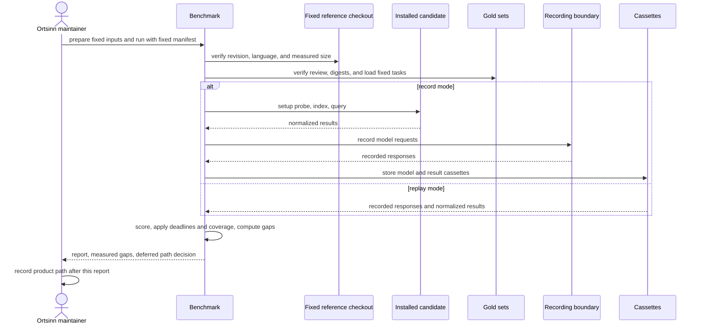

# Use case: benchmark-comparison

## Level

!

## Actors

- Ortsinn maintainer (primary)
- Upstream project maintainer (conditional, supporting)

## Goal

The maintainer gets a reproducible benchmark harness and report contract that
verifies fixed inputs, replays recorded candidate results, scores typo,
natural-language, explanation, and concept recall with coverage and measured
gaps, and publishes a real measured comparison of the pinned candidates on the
fixed inputs, so the product path can be decided after that report.

## Trigger

The maintainer requests a benchmark run on the fixed inputs, or requests a
replay of a completed run.

## Preconditions

- Fixture record mode — the committed fixture manifest fixes the repository, the fixture candidate identities, the target records, the gold sets, and the cassettes.
- Fixture record mode — the fixture checkout, gold sets, and recorded result cassette exist at the fixed revision.
- Fixture record mode — a local OpenAI-compatible model endpoint is available; the fixture record boundary runs against a loopback fake endpoint.
- Fixture record mode — no real candidate install is required; the fixture candidates are committed test doubles.
- Real record mode — the reference repositories and the synthetic monorepo exist at their pinned revisions, their gold sets are reviewed at the published minimum for the repository's power, and the candidates are installed at their pinned versions and commits.
- Real record mode — a loopback OpenAI-compatible embedding endpoint is available, and a recorded operator decision permits an external OpenAI-compatible explanation endpoint for at most 80 gold explanation queries; candidate-internal embedding calls stay on loopback and are bounded only by the index deadline.
- Real record mode — the record run stores every benchmark model response for replay.
- Replay mode — a benchmark manifest fixes the inputs, candidate identities, target records, gold sets, and cassettes.
- Replay mode — recorded result and model cassettes exist for the manifest, gold, and candidate set, and the manifest records each repository's fixed checkout.
- Replay mode — no candidate install and no model endpoint are required; replay starts no candidate process.

## Main flow

1. The maintainer prepares the fixed inputs and requests a benchmark run with the fixed manifest, a recording mode, and an output location.
2. The benchmark verifies every fixed input replay can check: each recorded result's candidate version and commit against the manifest, its repository commit, every gold file's declared SHA-256 digest, each committed cassette's declared digest, every gold path and line range at the fixed checkout, and that every model dependency exists in the model cassette. A mismatch fails the run with exit code 2 and publishes no report; a locally recorded cassette is identified by the digest computed when it is written.
3. The benchmark loads each candidate's normalized results and recorded setup, applies the effective index deadline per candidate and repository, and records unavailable candidates and timed-out indexes instead of dropping them. For the real comparison, each candidate's setup probe records its installed version, its setup deviations, and any missing operation before scoring, and the synthetic monorepo is attempted within its 30-minute index deadline. The report names the applied deadline and elapsed time.
4. The benchmark reads the fixed gold queries for typo recall, natural-language retrieval, concept recall, and explanation correctness from the normalized results and, where recorded, an explanation with citations.
5. Where a candidate supports disabling query expansion, the benchmark scores the concept-recall queries without expansion and records a separate arm.
6. The benchmark scores each metric and each arm, records coverage and any unavailable capability with its reason, and computes the measured gaps.
7. The benchmark writes a machine-readable report and a human-readable report only when the per-family measurement floor is met, prints a concise summary, and states that the product-path decision is deferred to the maintainer and the named decision record.
8. The maintainer reads the report and records the build/contribute/compose decision in the post-report decision record after this report publishes the real measured comparison.

## Extensions

- 1 (main flow step 2): A fixed-input mismatch fails the run with a non-zero exit, names the mismatched input, and publishes no complete report.
- 2 (main flow step 3): A candidate recorded as uninstallable or unstartable is recorded as unavailable with its reason and the run continues with the others.
- 3 (main flow step 3): A candidate that exceeded its index deadline is unavailable for every metric for that candidate and repository, with the reason, and is never scored as zero.
- 4 (main flow step 4): A missing required operation marks the metric unavailable with a capability reason and lists it as a capability gap.
- 5 (main flow step 6): A query error counts as a miss for that candidate and repository, and the error count is reported separately.
- 6 (main flow step 5): A candidate without a query-expansion switch marks the no-expansion arm not applicable with the reason; it is never reported as zero.
- 7 (main flow step 6): A metric without a stated target reports its measured value and the best measured value and marks the target unstated.
- 8 (main flow step 6): A metric with a stated target reports its signed measured gap; a proposed target is labelled as proposed, never as confirmed.
- 9 (main flow step 2): Replay uses recorded model responses, makes no external call, and reproduces the measurements and ordering; a missing response fails the run and names the request and candidate.
- 10 (main flow step 6): When no candidate has a measured value for a metric, its to-best and to-target gaps are unavailable with the reason `no_measured_candidate` and carry no numeric value; the report is still complete.
- 11 (main flow step 2): A gold task whose expected path is absent from the fixed checkout fails the run with exit code 2, names the task and path, and publishes no report.
- 12 (main flow step 2): A gold task whose line range exceeds the file fails the run with exit code 2, names the task and range, and publishes no report.
- 13 (main flow step 2): A gold file whose content no longer matches its declared fingerprint fails the run with exit code 2, names the gold set and both fingerprints, and publishes no report.
- 14 (main flow step 2): A cassette whose content no longer matches its declared fingerprint fails the run with exit code 2, names the cassette and both fingerprints, and publishes no report.
- 15 (main flow step 2): A recorded result from a different candidate version fails the run with exit code 2, names the candidate and both versions, and publishes no report.
- 16 (main flow step 6): A multi-repository run reports each repository's value separately and combines them into the aggregate instead of collapsing the repositories.
- 17 (main flow step 7): The report states its limitations, and an inconsistent report is rejected before either report file is written.
- 18 (main flow step 1): A real fixed input that differs from its pinned revision or candidate version fails before scoring, names the mismatched fixed input, and publishes no report.
- 19 (main flow step 3): A real candidate that cannot be installed or fails its setup probe is unavailable with its reason, and the run continues with the others.
- 20 (main flow step 3): A real candidate whose documented setup differs from its full setup keeps its measurements, and the report names the setup deviation on every affected cell.
- 21 (main flow step 2): A manifest-referenced gold set without a reviewer fails before scoring with the typed `unreviewed gold set` error, naming the set and metric, and publishes no report; a draft gold file the manifest does not reference is not loaded.
- 22 (main flow step 2): A changed gold query does not reuse a recorded model response; replay fails as a missing response and never uses another query's response.
- 23 (main flow step 3): The real run records every manifest candidate and repository, measured or unavailable; none is omitted.
- 24 (main flow step 7): A real run without at least one measured candidate cell for typo, natural-language, explanation, and concept, or without a measured cell for a manifest repository, exits with code 2, names the missing family and repository, and publishes neither report file.
- 25 (main flow step 2): A real gold set below the published minimum for its repository's power fails before scoring with the typed `gold_below_minimum` error, naming the set, metric, minimum, and reviewed count, and publishes no report.

## Rules

- R1. The benchmark is read-only over the fixed inputs and writes only to its declared work, recording, and report locations.
- R2. Every candidate and repository remains in a published report, including unavailable ones; a missing measurement is never omitted or converted to zero.
- R3. The report names each candidate's version and source commit, each repository's URL, revision, language, measured size, and power, and each gold set's version, reviewer, and fingerprint.
- R4. The report contains all four measurement families, with first-rank and top-k variants where the family defines them.
- R5. Concept recall includes a no-expansion arm where the candidate supports disabling expansion; otherwise the arm is marked not applicable.
- R6. The report states the recording mode, the recorded-response fingerprint, the cassette fingerprints, and the exact command that reproduces the run; the record run stores every model request and normalized result, replay makes no external model call and can be rerun without cost, and a changed query never reuses another query's recorded response.
- R7. The report contains no pre-registered build threshold and no chosen product path; it names the maintainer and the post-report decision record as the owner and artifact of that decision.
- R8. The same fixed inputs, candidate identities, gold-set versions, and recorded responses produce the same measurements and ordering; timestamps and run metadata are excluded from measurement identity.
- R9. Candidate results enter the harness as normalized records produced through the candidate's own documented interface; the real adapters probe each candidate's declared operations and never infer a capability from documentation. The harness normalizes and scores them and never synthesizes a capability the candidate does not expose.
- R10. The benchmark's recording and report are project artifacts, not product runtime behavior; no product MCP tool is added or changed.
- R11. A gold task is scored only after the Ortsinn maintainer has reviewed it and only from a gold set the manifest references; a manifest-referenced set without a reviewer fails before scoring, and an unreferenced draft is never loaded.
- R12. A real candidate's setup deviation is named on every affected cell; a candidate that cannot be installed or fails its setup probe is unavailable with its reason and is never scored as zero.
- R13. The real record run covers every candidate and repository named by the manifest; a candidate or repository is recorded as unavailable rather than omitted.
- R14. A real report publishes only when at least one measured candidate cell exists for typo, natural-language, explanation, and concept, and at least one measured cell exists for every manifest repository; otherwise the run exits with code 2 and writes neither report file.
- R15. Candidate pins originate in the committed manifest; the setup lock records probes and toolchain versions. The external explanation endpoint serves only the at-most-80 reviewed gold explanation queries; candidate-internal embedding calls stay on loopback and are bounded only by the index deadline.

## Examples

- Example 1 — an unavailable capability is not zero: `fixture-ocbi` has no explanation operation; its typo, natural-language, and concept cells are measured, its explanation cell is unavailable with `no_explanation_operation`, and the capability-gap list names the candidate.
- Example 2 — a replay rerun: the maintainer records a fixture run against the loopback endpoint and reruns the same manifest in replay mode; the metric values, ordering, candidate identities, repository revisions, and measured gaps match, the recording fingerprint is unchanged, and no request leaves the local recording boundary.
- Example 3 — a real setup deviation is not a zero: a real candidate runs with a documented reduced setup; its affected cells carry the measured value and the setup deviation, while an unaffected candidate remains fully measured.
- Example 4 — a changed query is a new request: the maintainer edits one gold explanation query and replays; the run fails as a missing recorded response for the changed query and never reuses the recorded answer for the old query.
- Example 5 — a real unavailable candidate: a real candidate fails its setup probe; its cells are unavailable with the probe reason, the other installed candidates are measured, and the report is still complete.
- Example 6 — an unreviewed referenced set: the manifest references a draft explanation file with no reviewer; the run exits 2 with the typed `unreviewed gold set` error and writes no report, while an unreferenced draft in the drafts directory is ignored.
- Example 7 — a below-minimum secondary set: a secondary repository's typo set has 20 reviewed tasks against a published minimum of 25; the run exits 2 naming the set, metric, minimum, and count, and writes no report.
- Example 8 — no measured family: every explanation candidate fails its setup probe; the run exits 2 naming the explanation family and the affected repository, and writes neither report file, although the unavailable candidates would remain in a report if the floor were met.

## Minimal guarantee

When a candidate cannot be installed, is unavailable, fails its setup probe,
cannot index a repository, lacks an operation, or a recorded response is
missing, the maintainer still receives either a complete report that names the
unavailable measurement and its reason or a failed run that names the missing
input. The benchmark never presents a missing measurement as a zero score or a
complete report.

## Success guarantee

The maintainer receives a complete, reproducible report from the real fixed
inputs naming the pinned candidates, each fixed repository revision, measured
size, and power, the reviewed gold sets, the measured typo, natural-language,
explanation, and concept-recall results, the no-expansion comparison where
applicable, coverage and capability gaps, both endpoint localities and models,
and the measured gaps, with the product-path decision explicitly deferred to
the maintainer and the named decision record. The fixture scenarios and the two
`@e2e` CLI scenarios assert the contract; the real record run and its committed
cassettes are the evidence of the real candidate path.

## Personas

- maintainer--ortsinn — confirmed; the user-visible actor.
- upstream--maintainer — conditional; relevant only if the post-report path is a contribution; not exercised by this change.

## Capabilities

- benchmark-comparison

## Interactions

| Capability | Consumer action | E2E scenario |
|---|---|---|
| benchmark-comparison | Run the benchmark in replay mode on the fixed inputs and read the measured report | Maintainer runs the benchmark and reads the measured report |
| benchmark-comparison | Record a benchmark run against a model endpoint and replay the recorded run | Maintainer records a run and replays it without an external call |

## Includes

- none

## Extends

- none

## Out of scope

- The product's runtime MCP surface and any product use case.
- The build/contribute/compose decision; the post-report decision record owns it.
- Patching or optimizing a candidate.
- Measuring metrics other than the four named acceptance families; index time is recorded only to explain availability.
- The product's owner-visibility record for external model calls (Q6).

## Diagram

