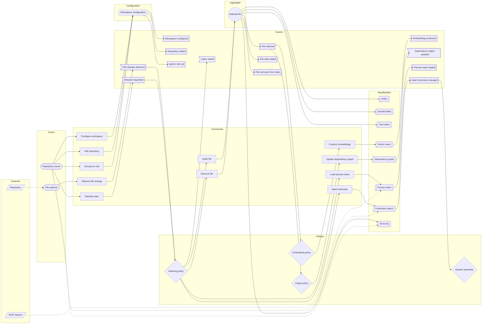
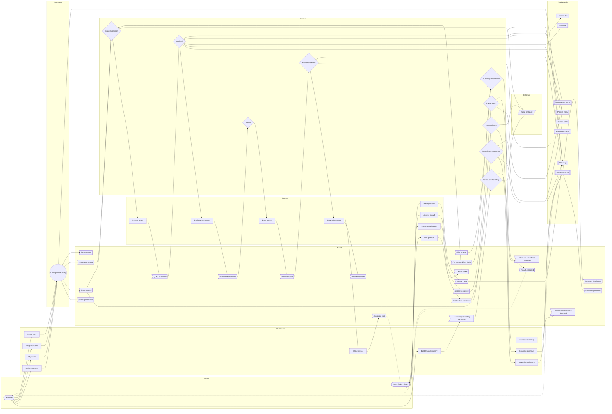

# Event Storming — repository orientation

- Topic: `repository-orientation`
- Status: confirmed 2026-10-20 after the term check; phase review applied
- Runtime scope: the product's runtime domain. The benchmark (Q2) is a project
  gate before the product exists; it is not a runtime event and is excluded.
  It stays in `questions.md` (Q5).

## Bounded contexts

| Context | What changes | Aggregate | Non-aggregate nodes |
|---|---|---|---|
| Workspace | which repositories, paths, and endpoint are in scope | none — configuration | Workspace configuration, workspace status |
| Indexing | derived entries per file | Indexed file | Index, symbol table, text index, vector index, dependency graph, precise index, freshness status, error list |
| Vocabulary | term-to-concept mappings | Concept vocabulary | Glossary (read model), symbol table |
| Query | nothing; it reads projections | none — read-only | ranked results, answer, evidence, impact result |
| Summary | cached explanations | none — cache | summary cache |
| Benchmark | project decision, outside the runtime | none | benchmark report |

## Actors

Runtime actors:

- Repository owner (human)
- Developer (human)
- Agent for the Developer (non-human primary consumer)
- File watcher (system)
- Indexing policy (system)
- Embedding policy (system)
- Graph policy (system)
- Summary invalidation policy (system)
- Vocabulary bootstrap policy (system)
- Inconsistency detection policy (system)
- Query expansion policy (system)
- Retrieval policy (system)
- Fusion policy (system)
- Answer assembly policy (system)
- Summarization policy (system)
- Impact query policy (system)
- Model endpoint (external system)
- SCIP indexer (external system)

The Ortsinn maintainer and the open-source adapter implementer act on the
project, not on the runtime. They are personas for review, not actors in this
event chain.

## Aggregates

### Indexed file

- Root noun: **Indexed file**.
- Invariant: every symbol, chunk, and edge derived from a file carries that
  file's current content hash; no derived entry points outside the file's line
  range; removing the file removes all its derived entries.
- Commands: Index file, Remove file.
- Events: File indexed, File index failed, File removed from index.
- Why a consistency boundary: a partial update would let a query return
  entries derived from two different versions of the same file.

### Concept vocabulary

- Root noun: **Concept vocabulary**.
- Invariant: each accepted term maps to at most one concept; every mapping
  cites evidence; merging two concepts preserves all their terms.
- Commands: Declare concept, Map term, Merge concepts, Reject term.
- Events: Concept declared, Term mapped, Concepts merged, Term rejected.
- Why a consistency boundary: one term mapped to two concepts makes every
  concept query ambiguous; the mapping must change as one unit.

## Non-aggregates on the canvas

| Node | Kind | Why not an aggregate |
|---|---|---|
| Workspace configuration | configuration | Records repositories, ignore rules, and the model endpoint; it is input, not a consistency boundary for domain decisions. |
| Index | read model | Derived projection over the indexed files; rebuildable. |
| Symbol table | read model | Derived projection. |
| Text index | read model | Derived projection. |
| Vector index | read model | Derived projection. |
| Dependency graph | read model | Derived projection. |
| Precise index | read model | Loaded from an external indexer. |
| Freshness status | read model | Derived observation. |
| Error list | read model | Append-only observation of indexing failures. |
| Glossary | read model | Persistent representation of the concept vocabulary. |
| Summary cache | cache record | Keyed by content hash and prompt version. |
| Repository | external system | Authoritative source; the product never edits it. |
| Model endpoint | external system | Receives code for embeddings, expansion, and summaries. |
| SCIP indexer | external system | Produces precise indexes outside the runtime. |
| Benchmark report | project artifact | Gate before the product path; not a runtime event. |

## Reverse narrative

A developer asks "where is the Besucher login?" The agent's answer requires:

- Answer delivered ← results fused ← candidates retrieved ← query expanded ←
  question asked.
- Candidates require the symbol table, text index, vector index, and
  dependency graph, all written by file indexing.
- Concept expansion requires the glossary, written by term mappings.
- File indexing requires the repositories in the workspace, a file change, and
  a successful parse.
- Precise navigation requires a SCIP index loaded from an indexer run.
- Impact assessment reads the dependency graph and returns the transitive
  dependents of a symbol.
- Summaries require chunks and the model endpoint, and are invalidated when a
  file changes.
- The chain starts at the repository owner adding the repositories to the
  workspace.

## Event chain

| # | Event | Triggered by | Command | Aggregate | Reacting policy | Read model |
|---|---|---|---|---|---|---|
| E1 | Workspace configured | Repository owner | Configure workspace | — configuration | — | Workspace status |
| E2 | Repository added | Repository owner | Add repository | — configuration | Indexing policy | Workspace status, index status |
| E3 | Ignore rule set | Repository owner | Set ignore rule | — configuration | Indexing policy | Workspace status |
| E4 | File change observed | File watcher | Observe file change | — | Indexing policy | Repository file list |
| E5 | File indexed | Indexing policy | Index file | Indexed file | Embedding policy, graph policy, summary invalidation | Symbol table, text index, index status |
| E6 | File index failed | Indexing policy | Index file | Indexed file | — | Error list |
| E7 | File removed from index | Indexing policy | Remove file | Indexed file | Summary invalidation | Index status |
| E8 | Embeddings produced | Embedding policy | Produce embeddings | — read model update | Retrieval policy | Vector index |
| E9 | Dependency edges updated | Graph policy | Update dependency graph | — read model update | Retrieval policy | Dependency graph |
| E10 | Precise index loaded | Indexing policy | Load precise index | — read model update | Retrieval policy | Precise index |
| E11 | Index freshness changed | Indexing policy | Mark freshness | — read model update | Answer assembly policy | Freshness status |
| E12 | Index rebuilt | Indexing policy | Rebuild index | — process; fans out to Index file | — | Index status |
| E13 | Concept candidates proposed | Vocabulary bootstrap policy | Bootstrap vocabulary | — external model output | Developer confirmation | Concept candidate list |
| E14 | Concept declared | Developer | Declare concept | Concept vocabulary | — | Glossary |
| E15 | Term mapped | Developer | Map term | Concept vocabulary | Inconsistency detection, query expansion | Glossary |
| E16 | Concepts merged | Developer | Merge concepts | Concept vocabulary | Query expansion | Glossary |
| E17 | Term rejected | Developer | Reject term | Concept vocabulary | — | Glossary |
| E18 | Naming inconsistency detected | Inconsistency detection policy | Detect inconsistency | — read-only scan | Developer review | Glossary, symbol table |
| E19 | Question asked | Agent for the Developer | Query: ask question | — read-only query | Query expansion policy | — |
| E20 | Query expanded | Query expansion policy | Query: expand query | — read-only query | Retrieval policy | Glossary, model endpoint |
| E21 | Candidates retrieved | Retrieval policy | Query: retrieve candidates | — read-only query | Fusion policy | Symbol table, text index, vector index, dependency graph, precise index |
| E22 | Results fused | Fusion policy | Query: fuse results | — read-only query | Answer assembly policy | Ranked result list |
| E23 | Answer delivered | Answer assembly policy | Query: assemble answer | — read-only query | — | Answer with evidence |
| E24 | Evidence cited | Answer assembly policy | Query: cite evidence | — read-only query | — | Source locations |
| E25 | Summary generated | Summarization policy | Generate summary | — cache update | — | Summary cache |
| E26 | Summary invalidated | Summary invalidation policy | Invalidate summary | — cache update | Summarization policy | Summary cache |
| E27 | Impact assessed | Impact query policy | Query: assess impact | — read-only query | — | Dependency graph, impact result |
| E28 | Rebuild requested | Repository owner | Rebuild index | — process request | Indexing policy | Index status |
| E29 | Vocabulary bootstrap requested | Developer | Bootstrap vocabulary | — process request | Vocabulary bootstrap policy | Concept candidate list |
| E30 | Explanation requested | Agent for the Developer | Query: request explanation | — read-only query | Summarization policy | Summary cache |
| E31 | Impact requested | Agent for the Developer | Query: assess impact | — read-only query | Impact query policy | — |
| E32 | Glossary read | Agent for the Developer | Query: read glossary | — read-only query | — | Glossary |

## Canvas — workspace and indexing

## Canvas — vocabulary, query, summary, and impact

## Policies

| Policy | Reacts to | Does |
|---|---|---|
| Indexing | File change observed, repository added, ignore rule set, rebuild requested | Indexes or removes the file, loads precise indexes, marks freshness, rebuilds. |
| Embedding | File indexed | Produces chunk embeddings in the vector index. |
| Graph | File indexed | Updates import, call, and containment edges. |
| Summary invalidation | File indexed, file removed from index | Invalidates summaries whose content hash no longer matches. |
| Vocabulary bootstrap | Vocabulary bootstrap requested | Asks the model endpoint for concept candidates; the developer confirms. |
| Inconsistency detection | Term mapped | Finds undeclared variants of a concept in the symbol table. |
| Query expansion | Question asked, term mapped, concepts merged | Expands the query with glossary terms and model-generated variants. |
| Retrieval | Query expanded | Reads symbol, text, vector, graph, and precise projections. |
| Fusion | Candidates retrieved | Fuses ranked lists and produces a stable order. |
| Answer assembly | Results fused, index freshness changed | Assembles the answer, cites evidence, and marks stale precision levels. |
| Summarization | Explanation requested | Generates a summary and caches it against content hash and prompt version. |
| Impact query | Impact requested | Reads the dependency graph and returns transitive dependents. |

## Term check — pending

The canvas relies on two new aggregate roots and the core terms around them.
They are candidates in `domain-terms.md` and are confirmed or renamed before
Use Case Definition.

| Term | One-sentence description | Collision check |
|---|---|---|
| Indexed file | The consistency boundary that keeps every derived entry for one file tied to that file's current content hash. | `grep -ric "indexed" docs/arc42/12-glossary.md` → 0 |
| Concept vocabulary | The consistency boundary that maps each accepted term to at most one concept and records the evidence for each mapping. | `grep -ric "vocabulary" docs/arc42/12-glossary.md` → 0 |
| Workspace | The set of independent repositories that one index covers. | `grep -ric "workspace" docs/arc42/12-glossary.md` → 0 |
| Repository | One of the independent directory trees in a workspace. | `grep -ric "repository" docs/arc42/12-glossary.md` → 0 |
| Index | The derived structure that answers queries over a workspace. | `grep -ric "index" docs/arc42/12-glossary.md` → 0 |
| Symbol | A named code entity with a definition location and a kind. | `grep -ric "symbol" docs/arc42/12-glossary.md` → 0 |
| Reference | An occurrence of a symbol at a location. | `grep -ric "reference" docs/arc42/12-glossary.md` → 0 |
| Precision level | The stated basis of a navigation answer: type-resolved or name-matched. | `grep -ric "precision" docs/arc42/12-glossary.md` → 0 |
| Freshness | How current the index is relative to the repositories. | `grep -ric "freshness" docs/arc42/12-glossary.md` → 0 |
| Concept | A unit of meaning that several terms may express. | `grep -ric "concept" docs/arc42/12-glossary.md` → 0 |
| Term | One spelling used in a repository for a concept. | `grep -ric "term" docs/arc42/12-glossary.md` → 3, template comment and table header only |
| Glossary | The persistent read model of the concept vocabulary. | `grep -ric "glossary" docs/arc42/12-glossary.md` → 1, document title only |
| Query expansion | Deriving additional search terms from a query before retrieval. | `grep -ric "expansion" docs/arc42/12-glossary.md` → 0 |
| Evidence | The file and line citation that backs an answer. | `grep -ric "evidence" docs/arc42/12-glossary.md` → 0 |
| Impact | The transitive set of dependents affected by a change to a symbol. | `grep -ric "impact" docs/arc42/12-glossary.md` → 0 |
| Summary | An LLM-generated explanation cached against a content hash and prompt version. | `grep -ric "summary" docs/arc42/12-glossary.md` → 0 |
| Chunk | A retrievable text segment bounded by a symbol or a size limit. | `grep -ric "chunk" docs/arc42/12-glossary.md` → 0 |
| Naming inconsistency | One concept expressed by several terms without a declared mapping. | `grep -ric "inconsistency" docs/arc42/12-glossary.md` → 0 |
