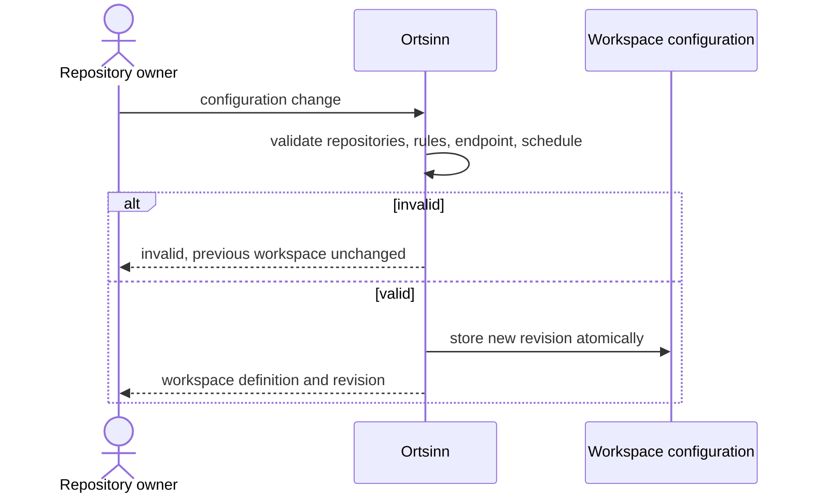

# Use case: UC1

## Level
!

## Actors
- Repository owner (primary)
- Supporting: Developer (applies the local endpoint and starts indexing under
  the policy)
- Supporting: Model endpoint operator (receives the endpoint selection)

## Goal
The workspace defines the repositories, ignore rules, model endpoint, offline
mode, indexing schedule, and test paths that the index covers.

## Trigger
The repository owner requests a workspace configuration change.

## Preconditions
- None. A workspace may be created or changed.

## Main flow
1. The owner submits a configuration change: `mode` (`replace` or `patch`),
   optional `expected_revision`, and the fields to change: `repositories`
   (name and path), `ignore_rules` (globs), `model_endpoint` (URL, model,
   permitted), `offline`, `schedule`, and `test_paths`. `replace` requires
   the full definition; `patch` changes only the named fields.
2. The system validates every repository name and path, every ignore and test
   glob, the endpoint shape, and the schedule.
3. The system applies the change atomically and records a new workspace
   revision.
4. The system returns the workspace definition with its revision.
5. The owner or developer starts indexing under the policy; that is UC2
   Restore index freshness, not this use case.

## Extensions
- 1: A required field is missing or malformed → `status: invalid`,
  `empty_reason: invalid_input`, one `errors` entry per field; the previous
  workspace is unchanged; protects the minimal guarantee.
- 2: A repository path is missing, unreadable, or duplicated → `status:
  invalid` with the repository named; no partial apply; protects the minimal
  guarantee.
- 2: An ignore or test glob is syntactically invalid → `status: invalid` with
  the rule named; no partial apply; protects the minimal guarantee.
- 2: The schedule is invalid (unknown mode, inverted window) → `status:
  invalid` with the schedule named; protects the minimal guarantee.
- 2: The model endpoint is not reachable → the configuration is still saved;
  reachability is not validated here, and the provider's availability is
  reported by later use cases; protects the minimal guarantee.
- 2: `offline` is true → the endpoint is retained as configuration but no
  external request is permitted; protects the offline rule.
- 3: Two owners change the workspace concurrently → one revision wins; the
  other receives `status: invalid` with the current revision, and no partial
  mix is written; protects the minimal guarantee.
- 4: The owner starts indexing → UC2 is the changing use case; this use case
  does not start jobs.

## Rules
- R1. The workspace is a configuration, not a repository change. It records
  repository names and paths, ignore rules, model endpoint, offline mode,
  schedule, and test paths.
- R2. A change applies atomically: either the whole new configuration is
  stored under a new `config_revision`, or the previous configuration stands.
  `replace` stores the full definition; `patch` changes only the named fields
  and leaves the rest untouched. When `expected_revision` is supplied, the
  change applies only if it equals the current revision; otherwise the result
  is `invalid` with `empty_reason: revision_conflict` and the current
  revision.
- R3. `offline` is a workspace setting. When true, no external request is
  permitted; the endpoint remains configured.
- R4. `model_endpoint` records whether external code transfer is permitted.
  The endpoint is not contacted during configuration.
- R5. `repositories` names are unique. Paths are workspace-relative for a
  shared workspace and must exist and be readable; duplicate detection uses
  the normalized real path (symlinks and `..` resolved).
- R6. `ignore_rules` and `test_paths` are glob sets; they are validated but
  not applied here.
- R7. The schedule states when indexing may run; it does not start a job.
  Outside the window, file changes are queued and the index reports pending
  changes; UC2 applies the schedule.
- R8. The use case never changes repository content and does not itself
  delete index entries. Removing a repository or adding an ignore rule marks
  the affected entries for removal; UC2 performs the removal before the index
  is marked fresh.
- R9. Every outcome uses the same envelope: `status`, `input`, `errors`,
  `workspace`, `empty_reason`. `status` is `ok` or `invalid`; `ok` holds
  exactly when `workspace` is non-null. `empty_reason` is `invalid_input` or
  `revision_conflict`.
- R10. `workspace` is `{config_revision, changed_at, repositories,
  ignore_rules, model_endpoint, offline, schedule, test_paths}`; it does not
  include the index content revision.
- R11. Only the workspace owner may change the workspace. Each revision
  records `changed_at`; actor identity and audit are Q6.
- R12. A configuration change advances `config_revision` only. Freshness is
  judged against the index content revision, not the configuration revision.

## Examples

### Example 1 — create a workspace

Input: repositories `[{name: "api", path: "../api"}, {name: "web", path:
"../web"}]`, `ignore_rules: ["**/node_modules/**"]`, `offline: false`,
`test_paths: ["**/*.test.ts"]`, schedule `{mode: "continuous"}`.

Result: `status: ok`; workspace revision `ws-1`; the definition echoed.

### Example 2 — add a repository

Input: `mode: "patch"`, `expected_revision: "cfg-1"`, `repositories` with the
existing two plus `{name: "shared", path: "../shared"}`.

Result: `status: ok`; `config_revision: "cfg-2"`; the previous ignore rules
and endpoint preserved.

### Example 3 — offline

Input: `mode: "patch"`, `offline: true`.

Result: `status: ok`; `config_revision` advances; repositories and rules
unchanged; the endpoint remains configured; later use cases must issue no
external request.

### Example 3a — scope narrowing

Input: `mode: "patch"` removes repository `web` or adds an ignore rule for
`vendor/**`.

Result: `status: ok`; the affected index entries are marked for removal; UC2
removes them before the index is marked fresh. Until then, freshness reports
the pending removal.

### Example 4 — invalid path

Input: a repository path that does not exist.

Result: `status: invalid`, `empty_reason: invalid_input`,
`errors: [{field: "repositories.shared.path", value: "../missing", reason:
"not found"}]`; the previous workspace stands.

### Example 5 — duplicate name

Input: two repositories named `api`.

Result: `status: invalid`, the duplicate named; no partial apply.

### Example 6 — concurrent change

Input: two updates with `expected_revision: "cfg-2"`.

Result: one update returns `status: ok` with `config_revision: "cfg-3"`; the
other returns `status: invalid`, `empty_reason: revision_conflict`, with the
current revision in `errors`, and no partial mix.

### Example 7 — invalid schedule

Input: `schedule: {mode: "window", start: "18:00", end: "09:00"}` where the
window is inverted.

Result: `status: invalid`, the schedule named.

## Minimal guarantee
Always: the owner receives the echoed input, a status, any errors, and the
previous workspace unchanged on failure; repository content and the index are
untouched.

## Success guarantee
The owner receives a stored workspace definition under a new revision with the
chosen repositories, ignore rules, model endpoint, offline mode, schedule, and
test paths.

## Personas
- repository-owner--platform-lead
- developer--agent-first (supporting)
- provider--model-endpoint (supporting)

## Capabilities
- Create and update the workspace configuration.
- Repository names and paths.
- Ignore and test globs.
- Model endpoint and offline mode.
- Indexing schedule.
- Atomic revisioned changes.

## Interactions
- none at ideation time; the MCP tool mapping is a design concern.

## Includes
- none

## Extends
- none

## Out of scope
- Starting or rebuilding the index (UC2).
- Editing repository content.
- Verifying endpoint reachability.
- Owner visibility into model calls and resource use (Q6, open).

## Diagram

