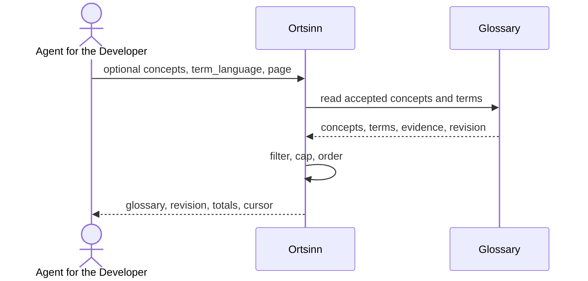

# Use case: UC10

## Level
!

## Actors
- Agent for the Developer (primary)
- Supporting: Developer (checks the accepted terms)

## Goal
The agent for the developer gets the glossary: the project's concepts and
accepted terms.

## Trigger
The agent for the developer requests the glossary.

## Preconditions
- A workspace is configured.
- A concept vocabulary exists, possibly empty.

## Main flow
1. The agent submits a glossary request with optional `concepts` (concept
   names), `term_language` (BCP-47 tag), `limit`, `token_budget`, and
   `cursor`.
2. The system reads the glossary read model: accepted concepts with their
   evidence, terms, term languages, identifiers, and term evidence.
3. The system applies the `concepts` and `term_language` filters, echoes
   requested concept names that are absent in `missing_concepts`, and orders
   concepts by name.
4. The system returns the glossary revision, each concept with its terms and
   evidence, and paginates concepts under the token budget. Terms per concept
   and evidence per term are capped, with totals and truncation markers.
5. The agent reads the vocabulary and may use it to interpret a query or
   resolve a naming inconsistency.

## Extensions
- 1: A malformed `concepts` list, unknown `term_language`, or invalid
  `limit` → `status: invalid`, `empty_reason: invalid_input`, naming the
  value; protects the minimal guarantee.
- 1: `token_budget` exceeds the hard cap → the system clamps it and reports
  the applied cap; protects the budget guarantee.
- 2: The vocabulary is empty → `status: empty`, `empty_reason:
  empty_glossary`, `concepts_total: 0`; protects the minimal guarantee.
- 3: No concept matches the filter → `status: empty`, `empty_reason:
  no_match`, with `missing_concepts`; protects the minimal guarantee.
- 3: The `term_language` filter leaves concepts without a term in that
  language → those concepts are omitted; if none remain, `status: empty`,
  `empty_reason: no_match`; protects the minimal guarantee.
- 4: The glossary exceeds the token budget → concepts are paginated,
  `has_more: true`, and a cursor is returned; the envelope alone not fitting
  yields `status: empty`, `empty_reason: budget_exceeded`; protects the
  budget guarantee.
- 4: A concept has more terms or evidence than the caps → the concept is
  returned with `terms_truncated` or `evidence_truncated` and the totals;
  protects the budget guarantee.
- 4: A cursor is presented with other input, filters, or page parameters →
  `invalid`; a changed glossary revision or an expired cursor → `status:
  empty`, `empty_reason: stale_cursor`, `restart_required: true`; protects
  determinism.
- 5: The agent refines the request → restart at step 1.

## Rules
- R1. The glossary is the read model of the concept vocabulary. It contains
  accepted concepts and accepted terms only; rejected terms are not returned.
- R2. Each concept carries its canonical name and its own evidence, and a
  list of terms. Each term carries its spelling, `term_language` (BCP-47),
  identifiers, and evidence.
- R3. An identifier is `{spelling, repository, qualified_name}`; repository
  and qualified name are optional when the identifier is a bare spelling. The
  agent resolves it through UC7 when it needs a definition.
- R4. Evidence is the recorded citation `{repository, path, line or range,
  excerpt?}`. It is historical: it records where the term was accepted and
  may not match the current file. Current source is UC8.2.
- R5. The `concepts` filter matches concept names exactly; `term_language`
  returns concepts with at least one accepted term in that language and only
  those terms. Concepts with no remaining term are omitted. Absent requested
  names are echoed in `missing_concepts`.
- R6. Concepts are ordered by name (Unicode code point, case-sensitive);
  terms by `term_language`, then spelling.
- R7. `glossary_revision` identifies the accepted vocabulary snapshot and is
  returned with the result.
- R8. `empty_reason` is one of `invalid_input`, `empty_glossary`, `no_match`,
  `budget_exceeded`, or `stale_cursor`.
- R9. The default token budget is 4,000; `token_budget` may raise it to the
  configured hard cap and is clamped above it. `limit` bounds concepts; the
  effective page is `min(limit, concepts that fit the budget)`.
  `concepts_total` is the post-filter, pre-pagination count. Terms per
  concept are capped at 100 and evidence per term at 10, with totals.
  Evidence excerpts are capped at 200 code points.
- R10. A cursor is bound to the filters, page parameters including the applied
  budget cap, and the glossary revision; the next page carries the cursor
  alone. A changed glossary revision returns `stale_cursor`.
- R11. The use case never changes the repository or the index.
- R12. The same filters, page parameters, and glossary revision return the
  same glossary.
- R13. Every outcome uses the same envelope: `status`, `input`, `errors`,
  `glossary`, `glossary_revision`, `budget`, `cursor`, `empty_reason`,
  `missing_concepts`, `concepts_total`, `returned`, `has_more`,
  `restart_required`. `status` is `ok`, `empty`, or `invalid`; `ok` holds
  exactly when `glossary.concepts` is non-empty.

## Examples

### Example 1 — full envelope

Input: no filters.

```json
{
  "status": "ok",
  "input": {"concepts": null, "term_language": null, "limit": null, "token_budget": 4000},
  "errors": [],
  "glossary": {
    "revision": "g-7",
    "concepts": [
      {
        "name": "user",
        "evidence": {"repository": "api", "path": "docs/glossary.md", "line": 5},
        "terms": [
          {"spelling": "user", "term_language": "en", "identifiers": [{"spelling": "User", "repository": "api", "qualified_name": "models.User"}], "evidence": {"repository": "api", "path": "src/user/user.ts", "line": 1}, "evidence_total": 1, "evidence_truncated": false},
          {"spelling": "Besucher", "term_language": "de", "identifiers": [{"spelling": "BesucherService", "repository": "api", "qualified_name": "services.BesucherService"}], "evidence": {"repository": "api", "path": "docs/glossary.md", "line": 12}, "evidence_total": 1, "evidence_truncated": false}
        ],
        "terms_total": 2,
        "terms_truncated": false
      }
    ]
  },
  "glossary_revision": "g-7",
  "budget": {"requested": 4000, "applied_max": 4000, "used_estimate": 620, "exceeded": false},
  "cursor": null,
  "empty_reason": null,
  "missing_concepts": [],
  "concepts_total": 1,
  "returned": 1,
  "has_more": false,
  "restart_required": false
}
```

### Example 2 — empty vocabulary

Result: `status: empty`, `empty_reason: empty_glossary`, `concepts_total: 0`.

### Example 3 — concept filter

Input: `concepts: ["user"]`.

Result: only the `user` concept and its accepted terms.

### Example 4 — term-language filter

Input: `term_language: "de"`.

Result: concepts with accepted German terms; only the German terms are
returned, e.g. `Besucher` for `user`.

### Example 5 — missing concept

Input: `concepts: ["user", "invoice"]`.

Result: the `user` concept; `missing_concepts: ["invoice"]`.

### Example 6 — pagination

Input: `limit: 1` over three concepts.

Result: one concept, `concepts_total: 3`, `returned: 1`, `has_more: true`,
cursor bound to `g-7`.

### Example 7 — invalid input

Input: `term_language: "not-a-tag"`.

Result: `status: invalid`, `empty_reason: invalid_input`,
`errors: [{field: "term_language", value: "not-a-tag", reason: "invalid BCP-47 tag"}]`.

## Minimal guarantee
Always: the agent receives the echoed input, a status, any errors, and no
invented term; the repository and the index are unchanged. When the glossary
was read: its revision and an empty or partial concept list with totals.

## Success guarantee
The agent receives the accepted concepts and terms with their term languages,
identifiers, evidence, totals, and the glossary revision.

## Personas
- agent--coding-harness
- developer--agent-first

## Capabilities
- Glossary read with concept and term-language filters.
- Accepted terms with identifiers and historical evidence.
- Glossary revision reporting.
- Per-concept and per-term caps with totals.
- Pagination under a token budget.

## Interactions
- none at ideation time; the MCP tool mapping is a design concern.

## Includes
- none

## Extends
- none

## Out of scope
- Curating the vocabulary (UC4).
- Finding naming inconsistencies (UC5).
- Reading current source (UC8.2).
- Editing the repository or the index.

## Diagram


