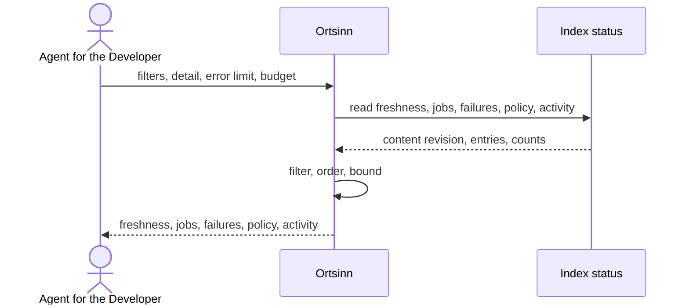

# Use case: UC11

## Level
!

## Actors
- Agent for the Developer (primary)
- Supporting: Repository owner (reads the same status for operations)
- Supporting: Developer (checks whether an answer may be stale)

## Goal
The agent for the developer knows whether the index is current and which index
level is stale.

## Trigger
The agent for the developer requests the index status.

## Preconditions
- A workspace is configured.

## Main flow
1. The agent submits an index-status request with optional `repositories`,
   `languages`, `detail` (`summary` or `entries`; default `summary`),
   `error_limit` (default 10), and `token_budget`.
2. The system reads the content revision, freshness per repository, language,
   and level, the jobs, the outstanding failure count and bounded list, the
   policy state, and the activity counters.
3. The system applies the repository and language filters, orders
   repositories by name, languages by name, and levels as syntactic, semantic,
   precise; jobs are ordered by start time then job identifier.
4. The system returns the status. In `summary` mode it returns counts and the
   names of stale, error, and not-built levels; in `entries` mode it returns
   the full freshness entries under the token budget.
5. The agent reads the status and decides whether to trust an answer, wait for
   a job, or ask the owner to rebuild.

## Extensions
- 1: An unknown `repositories` or `languages` value → `status: invalid`,
  `empty_reason: invalid_input`, naming the value; protects the minimal
  guarantee.
- 1: `error_limit` is outside 0..100 or `detail` is unknown → `status:
  invalid`; protects the minimal guarantee.
- 1: `token_budget` exceeds the hard cap → the system clamps it and reports
  the applied cap; protects the budget guarantee.
- 2: The workspace has no repositories → `status: empty`, `empty_reason:
  no_repositories`; protects the minimal guarantee.
- 2: No index has ever run → the entries report `not_built` for every level;
  `status: ok`, because the query answered; protects the minimal guarantee.
- 2: An index level is in error → its state is `error`, it carries
  `last_good_as_of`/`last_good_revision` when a prior index exists, and the
  remaining levels are still reported; protects the success guarantee.
- 2: The index state store is unreadable → `status: error`, with `errors`
  naming the fault; `empty_reason` is null; protects the minimal guarantee.
- 3: The filters exclude every repository → `status: empty`, `empty_reason:
  no_match`; protects the minimal guarantee.
- 4: More failures exist than `error_limit` → `index.failures.truncated:
  true`, `count` reports the total; with `error_limit: 0` the list is empty,
  `count` is still reported, and `truncated` is false; protects the budget
  guarantee.
- 4: `detail: entries` exceeds the token budget → entries are paginated with
  `has_more` and a cursor; `summary` is always bounded; the envelope alone not
  fitting yields `status: empty`, `empty_reason: budget_exceeded`; protects
  the budget guarantee.
- 4: A cursor is presented with other filters or page parameters, or the
  content revision changed → `status: empty`, `empty_reason: stale_cursor`,
  `restart_required: true`; protects determinism.
- 5: The agent decides to rebuild → UC2 Restore index freshness is the
  changing use case; this use case only reports.

## Rules
- R1. Freshness is per repository, language, and index level: `syntactic`,
  `semantic`, `precise`. Each level carries `state` (`fresh`, `stale`,
  `not_built`, or `error`), `as_of`, `revision`, `reason`, and `retryable`.
- R2. A level's `revision` is the content revision it was built from.
  `stale` means `level.revision != content_revision` or a file changed after
  `as_of`. `not_built` means no index exists for the level. `error` means the
  last attempt failed; when a prior index exists, the level also carries
  `last_good_as_of` and `last_good_revision`.
- R3. `content_revision` identifies the indexed content snapshot; it is not
  the workspace configuration revision. A configuration-only change does not
  make a level stale.
- R4. Jobs carry `job_id`, `trigger`, repository, languages, levels, state
  (`queued`, `running`, `completed`, `failed`, `cancelled`), `started_at`,
  and `finished_at` where applicable. Jobs are ordered by start time then
  identifier.
- R5. Index failures use the `failures` field, not the envelope `errors`.
  `failures` is `{count, items, truncated}`; items carry repository, path,
  level, reason, and time. The list is bounded by `error_limit`.
- R6. Policy reports `{offline, endpoint, permitted}`. Activity reports
  `{queue_depth, pending_changes, last_run_at, last_change_at}`.
- R7. Languages are discovered from the workspace language configuration or a
  file scan before any index exists; the discovery basis is reported.
- R8. `empty_reason` is one of `invalid_input`, `no_repositories`, `no_match`,
  `budget_exceeded`, or `stale_cursor`; it is null for `status: error`.
- R9. The use case never changes the repository or the index; it never starts,
  cancels, or retries a job.
- R10. The default token budget is 4,000; `token_budget` may raise it to the
  configured hard cap and is clamped above it. `summary` is the default and
  is always bounded.
- R11. A cursor is bound to the filters, `detail`, page parameters including
  the applied budget cap, and the content revision; the next page carries the
  cursor alone.
- R12. The result is deterministic for the same filters, detail, page
  parameters, content revision, job set, and `observed_at`; jobs and times are
  volatile and are reported as observed.
- R13. Every outcome uses the same envelope: `status`, `input`, `errors`,
  `index`, `content_revision`, `observed_at`, `budget`, `cursor`,
  `empty_reason`, `has_more`, `restart_required`. `status` is `ok`, `empty`,
  `invalid`, or `error`; `ok` holds when at least one repository entry is
  returned or `summary` reports the workspace.
- R14. `index` is `{freshness, jobs, jobs_total, failures, policy,
  activity, discovered_languages}`; `freshness` is an array of
  `{repository, languages: [{language, levels: {...}}]}`.

## Examples

### Example 1 — all fresh

Result: `status: ok`; `content_revision: "c-42"`; repository `api`,
language `typescript`: syntactic fresh, semantic fresh, precise fresh; no
jobs; `failures.count: 0`; policy `{offline: false, endpoint: "...",
permitted: true}`; activity `{queue_depth: 0, pending_changes: 0}`.

### Example 2 — stale precise level

Result: syntactic and semantic fresh; precise stale with
`level.revision: "c-41"` and `content_revision: "c-42"`; the agent knows
navigation may fall back to syntactic.

### Example 3 — never built

Result: all levels `not_built`; `status: ok`; `failures.count: 0`. The agent
knows the index has not run, not that it is fresh.

### Example 4 — running job

Result: semantic `stale`; job `{job_id: "j-8", trigger: "watcher",
repository: "api", languages: ["typescript"], levels: ["semantic"], state:
"running", started_at: "..."}`; `activity.pending_changes` reports the queue.

### Example 5 — errors

Result: precise `error` with `last_good_as_of` and `last_good_revision`;
`failures.count: 3`; the bounded list; `error_limit` controls the list.

### Example 6 — no repositories

Result: `status: empty`, `empty_reason: no_repositories`.

### Example 7 — unknown filter

Input: `repositories: ["unknown"]`.

Result: `status: invalid`, `empty_reason: invalid_input`,
`errors: [{field: "repositories", value: ["unknown"], reason: "unknown
repository"}]`.

### Example 8 — summary detail

Input: `detail: "summary"`.

Result: counts per state and the names of stale/error/not-built levels; no
full matrix; the result is bounded even for a large workspace.

### Example 9 — entries pagination

Input: `detail: "entries"`, `limit: 2`.

Result: two repository entries, `has_more: true`, cursor bound to
`content_revision`.

### Example 10 — error limit zero

Input: `error_limit: 0`, `failures.count: 5`.

Result: `failures.items: []`, `failures.count: 5`, `truncated: false`.

## Minimal guarantee
Always: the agent receives the echoed input, a status, any errors, and no
invented freshness; the repository and the index are unchanged, and no job is
started or cancelled. When the index state was read: the content revision,
the available entries or summary, and the failure count.

## Success guarantee
The agent receives freshness per repository, language, and level, the jobs,
the bounded failure list with its total, the policy and activity state, the
discovered languages, and the content revision.

## Personas
- agent--coding-harness
- developer--agent-first
- repository-owner--platform-lead (supporting)

## Capabilities
- Freshness per repository, language, and level.
- Summary or full-entry detail under a token budget.
- Job status with a shared job schema.
- Bounded failure list with a total.
- Policy and activity reporting.
- Content-revision-based staleness.

## Interactions
- none at ideation time; the MCP tool mapping is a design concern.

## Includes
- none

## Extends
- none

## Out of scope
- Rebuilding or reindexing (UC2).
- Diagnosing a specific failure (UC3).
- Changing the workspace configuration (UC1).
- Starting or cancelling jobs.

## Diagram

