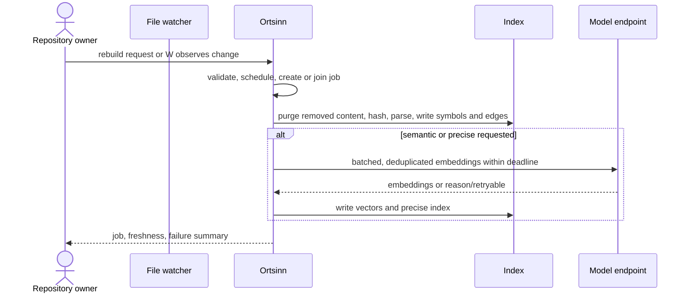

# Use case: UC2

## Level
!

## Actors
- Repository owner (primary)
- Supporting: Developer (operates the local index)
- Supporting: Model endpoint operator (serves embedding requests)

## Goal
The index reflects the current content of the workspace repositories.

## Trigger
The file watcher observes a file change (E4), or the repository owner requests
a rebuild (E28).

## Preconditions
- A workspace is configured.

## Main flow
1. The system receives a change event or a rebuild request with optional
   `mode` (`incremental` or `rebuild`), `repository_scope`, `levels`
   (syntactic, semantic, precise), `wait` (default false), and `wait_timeout`.
2. The system validates the request, applies the workspace schedule (outside
   the window, the work is queued), and creates or joins one active writing
   job per workspace. Changes within the debounce window coalesce into one
   job.
3. For each affected file, the system observes the change, computes the
   content hash, and skips unchanged content. Deleted files, ignore-rule
   exclusions, and removed repositories are purged before the index is marked
   fresh.
4. For a changed file, the system parses it, writes its symbols, chunks, and
   dependency edges, and then produces embeddings and loads the precise index
   for the requested levels. A rebuild reuses stored vectors for unchanged
   chunk hashes and embeds only new or changed chunks, under a per-run
   embedding cap.
5. Embedding chunks from all changed files are grouped into batches under a
   configured maximum (chunks and tokens); identical chunk hashes are embedded
   once. Each batch makes one attempt within a configured deadline, with no
   automatic retry.
6. The system records per-file failures without aborting the run, marks
   freshness per repository, language, and level, and records content
   revision.
7. The system returns the job, the freshness entries, and a failure summary.
   With `wait: true`, it completes or returns the job still running at
   `wait_timeout`.

## Extensions
- 1: No workspace is configured → `status: invalid`, `empty_reason:
  no_workspace`; protects the minimal guarantee.
- 1: `mode`, `levels`, `repository_scope`, or `wait_timeout` is invalid →
  `status: invalid` naming the field; protects the minimal guarantee.
- 2: A writing job is already running → the request joins the queue and
  returns `status: accepted` with the job; no second writer; protects the
  per-file consistency guarantee.
- 2: A change arrives during a rebuild → it is queued and applied after the
  rebuild; the older content hash is never published as fresh; protects the
  success guarantee.
- 3: A file is unchanged by hash → it is skipped; its previous index remains;
  protects the success guarantee.
- 3: A file is deleted, newly ignored, or in a removed repository → its
  symbols, chunks, edges, and vectors are purged before freshness advances;
  protects the data-boundary guarantee.
- 4: A file cannot be parsed → the file is recorded in the failure summary;
  the run continues; its previous index is not marked fresh; protects the
  minimal guarantee.
- 4: A file is binary or exceeds the size limit → it is recorded in the
  failure summary and excluded; protects the minimal guarantee.
- 4: Offline, or `model_endpoint.permitted` is false → no external request;
  the semantic level is `stale` when a prior semantic index exists, otherwise
  `not_built`, with reason `offline` or `not_permitted`; protects the
  minimal guarantee.
- 4: The language has no precise indexer → precise is `not_built` with
  reason `unsupported_language`; protects the minimal guarantee.
- 4: The embedding model identity changes → the semantic level is marked
  `stale`, and a bounded re-embed runs under the same cap and dedup; protects
  the success guarantee.
- 5: The endpoint is unreachable → reason `endpoint_unavailable`,
  `retryable: true`; the batch is abandoned within the deadline; protects the
  minimal guarantee.
- 5: The endpoint throttles → reason `rate_limited`, `retryable: true`; no
  immediate retry; protects the minimal guarantee.
- 5: The endpoint refuses or rejects authorization → reason `refused` or
  `unauthorized`, `retryable: false`; protects the minimal guarantee.
- 6: The per-run embedding cap is reached → the semantic level is marked
  `stale` with `cap_reached: true`; remaining chunks are queued for the next
  run; protects the budget guarantee.
- 7: `wait` exceeds `wait_timeout` → `status: accepted` with the job still
  running; the caller can check UC11; protects the minimal guarantee.
- 7: The job fails as a whole (workspace unreadable) → `status: error` with
  the failure; protects the minimal guarantee.
- 7: The owner cancels the job → `status: completed` with job state
  `cancelled`; the index marks only completed work as fresh; protects the
  minimal guarantee.

## Rules
- R1. The index reflects the current content of every eligible file. A file
  is eligible when it is in the workspace and not excluded by ignore rules.
  Deleted, ignored, and removed-repository content is purged.
- R2. Per-file consistency: all derived symbols, chunks, edges, and vectors
  for a file share that file's content hash. A partial file update is never
  published.
- R3. A failed file does not abort the run. It is recorded, and its previous
  index is not marked fresh.
- R4. Untouched files keep their previous index; a failed run does not erase
  them.
- R5. Syntactic indexing completes before semantic and precise work; those
  levels report their own state and do not block syntactic answers. Requesting
  precise implies syntactic for the affected files; requesting semantic
  implies syntactic.
- R6. The precise index runs in the background; a stale precise level is
  marked stale until the run completes.
- R7. External transfer requires both `offline: false` and
  `model_endpoint.permitted: true`. An embedding request carries chunk text
  and repository-relative path/range only; it never carries absolute paths,
  credentials, ignore-excluded content, or unrelated content.
- R8. The embedding model identity is recorded with the vector index; a model
  change marks semantic stale and triggers a bounded re-embed.
- R9. One active writing job per workspace, with a queue. Change events within
  the debounce window coalesce into one job. The workspace schedule gates
  when queued work runs.
- R10. Each embedding batch makes one attempt within the deadline, with no
  automatic retry. Failures carry `reason` and `retryable`.
- R11. The job states are `queued`, `running`, `completed`, `failed`, and
  `cancelled`. The job carries `job_id`, `trigger` (`watcher`, `owner`, or
  `developer`), repository, languages, requested levels, start and finish
  times.
- R12. The per-run embedding cap is a configured maximum of chunks and
  tokens. Hitting it leaves semantic `stale` with `cap_reached: true` and
  queues the rest.
- R13. Freshness is an array per repository, language, and level:
  `{repository, language, level, state, as_of, revision, reason, retryable}`;
  states are `fresh`, `stale`, `not_built`, `error`. `content_revision` is
  the index snapshot identity.
- R14. The failure summary is `{total, by_kind, by_level}` under the token
  budget; per-file detail is UC3 Diagnose indexing failures.
- R15. The use case never changes repository content.
- R16. Every outcome uses the same envelope: `status`, `input`, `errors`,
  `job`, `freshness`, `content_revision`, `failures`, `empty_reason`,
  `reason`, `retryable`. `status` is `accepted`, `completed`, `invalid`, or
  `error`.

## Examples

### Example 1 — save a file

A developer saves `api/src/user/profile.ts`.

Result: `status: accepted`; job `{job_id: "j-1", trigger: "watcher",
repository: "api", languages: ["typescript"], requested_levels: ["syntactic",
"semantic"], state: "running"}`; syntactic freshness for `api`/typescript
becomes `fresh` after the file is indexed; semantic follows; the failure
summary is empty.

### Example 2 — rebuild

Input: `mode: "rebuild"`, `levels: ["syntactic", "semantic", "precise"]`,
`wait: true`.

Result: the job completes; unchanged chunk hashes reuse stored vectors; only
new or changed chunks are embedded; freshness is fresh for completed levels;
the failure summary counts parse failures.

### Example 3 — parse failure

A file with a syntax error.

Result: the run completes for the other files; `failures.total: 1`,
`by_kind: {parse_error: 1}`, `by_level: {syntactic: 1}`; the file's previous
index is not fresh. UC3 gives the path and reason.

### Example 4 — offline

Input: a changed file while offline.

Result: syntactic completes; semantic `not_built` with reason `offline`,
`retryable: false`; precise unchanged; no external request.

### Example 5 — endpoint unavailable

Input: a changed file; the endpoint times out.

Result: syntactic completes; semantic `stale` with reason `endpoint_unavailable`,
`retryable: true`; one batch attempt abandoned at the deadline; no automatic
retry.

### Example 6 — rate limited

Input: a changed file; the endpoint throttles.

Result: semantic `stale` with reason `rate_limited`, `retryable: true`; the
work is queued; no immediate retry.

### Example 7 — model changed

Input: the embedding model identity changes in the workspace.

Result: semantic `stale`; a bounded re-embed runs under the cap and dedup;
unchanged chunk hashes are not re-sent if their vectors are model-compatible
only; otherwise they are re-embedded, and the cap queues the remainder.

### Example 8 — delete and ignore

A file is deleted, and a new ignore rule excludes `vendor/**`.

Result: the deleted file's entries and the newly ignored files' entries are
purged before freshness advances; the index no longer returns them.

### Example 9 — wait timeout

Input: `wait: true`, `wait_timeout` expires.

Result: `status: accepted`; the job is still `running`; the caller can check
UC11.

### Example 10 — no workspace

Input: a rebuild before any workspace exists.

Result: `status: invalid`, `empty_reason: no_workspace`.

## Minimal guarantee
Always: the caller receives the echoed input, a status, any errors, and a job
or a named reason; repository content is unchanged. A failed file does not
abort the run; untouched files keep their previous index; removed content is
purged before freshness advances.

## Success guarantee
The index reflects the current content of every eligible file for the
requested levels; freshness is current for completed levels; removed content
is gone; failures are summarized.

## Personas
- repository-owner--platform-lead
- developer--agent-first (supporting)
- provider--model-endpoint (supporting)

## Capabilities
- Incremental indexing on file change with debounce and coalescing.
- Full or scoped rebuild.
- Per-file hash, parse, symbols, chunks, edges, embeddings, and precise index.
- Removal and ignore-rule eviction.
- Batched, deduplicated embeddings with a per-run cap.
- Per-file failure recording and summary.
- Freshness per repository, language, and level.
- Job queue, status, wait, and cancel.

## Interactions
- none at ideation time; the MCP tool mapping is a design concern.

## Includes
- none

## Extends
- none

## Out of scope
- Changing the workspace configuration (UC1).
- Detailed failure diagnosis (UC3).
- Reporting freshness without a run (UC11).
- Owner visibility into per-call model usage and resource cost (Q6, open).

## Diagram

