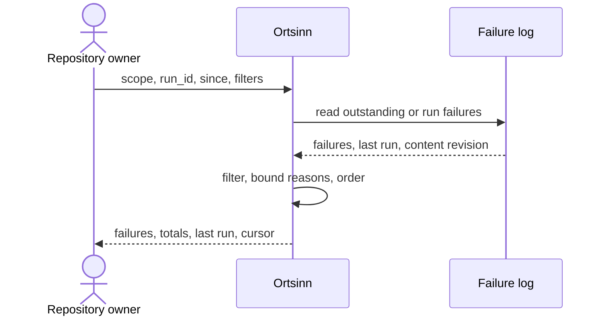

# Use case: UC3

## Level
!

## Actors
- Repository owner (primary)
- Supporting: Developer (reads the same report on the local machine)

## Goal
The owner knows which files failed to index and why.

## Trigger
The owner opens the failure report after an indexing run.

## Preconditions
- Indexing may never have run; the result reports `index_not_run`.

## Main flow
1. The owner requests the failure report with optional `scope`
   (`outstanding` or `run`; default `outstanding`), `run_id`, `since`,
   `repository_scope`, `language`, `level`, `limit`, `token_budget`, and
   `cursor`.
2. The system reads the failures that correspond to the requested scope:
   outstanding failures are files whose current index is not fresh; a run
   scope is a named run; `since` narrows by time.
3. The system applies the filters, orders newest first, and paginates under
   the token budget.
4. The system returns each failure with repository, path, language, level,
   failure kind, a bounded reason, and time; it also returns the total, the
   last run identity and state, and the content revision.
5. The owner or developer fixes the file, adjusts an ignore rule in UC1, or
   rebuilds in UC2.

## Extensions
- 1: An unknown `scope`, `run_id`, `repository_scope`, `language`, `level`, or
  malformed `since` → `status: invalid`, `empty_reason: invalid_input`,
  naming the value; protects the minimal guarantee.
- 1: `token_budget` exceeds the hard cap → the system clamps it and reports
  the applied cap; protects the budget guarantee.
- 2: Indexing has never run → `status: empty`, `empty_reason: index_not_run`;
  protects the minimal guarantee.
- 2: No failure matches the scope and filters → `status: empty`,
  `empty_reason: no_failures` or `no_match`, with the last run named; protects
  the minimal guarantee.
- 2: The failure log is unreadable or corrupt → `status: error`, with
  `errors` naming the failure-log fault; `empty_reason` is null; protects the
  minimal guarantee.
- 2: The failure log has been rotated → the result states `incomplete: true`
  and the earliest available time; protects the minimal guarantee.
- 3: The report exceeds the token budget → pagination with `has_more` and a
  cursor; a reason is truncated within the cap, never the envelope; protects
  the budget guarantee.
- 3: A cursor is presented with other input or page parameters → `invalid`;
  an expired cursor or a changed failure-log revision → `status: empty`,
  `empty_reason: stale_cursor`, `restart_required: true`; protects
  determinism.

## Rules
- R1. A failure is a file that an indexing run could not process for a level.
  It carries repository, path, language, level, failure kind, a bounded
  reason, and time.
- R2. The default scope is outstanding failures from the current index state,
  not only the last run. `run_id` or `since` narrows the report; the last run
  identity and state are always returned.
- R3. The report is read-only; it never changes the repository, the index, or
  the failure log.
- R4. `repository_scope` (repository names), `language`, and `level`
  (`syntactic`, `semantic`, `precise`) are hard filters. Removed counts appear
  in `scope`.
- R5. Failure kinds are a closed set: `parse_error`, `binary_file`,
  `file_too_large`, `unreadable`, `unsupported_language`, `offline`,
  `not_permitted`, `endpoint_unavailable`, `rate_limited`, `refused`,
  `unauthorized`, `stale_content`, and `other`. Each kind states whether it
  is owner-actionable.
- R6. Reasons are diagnostic text, capped at 200 code points with an ellipsis;
  they never contain source content or absolute paths.
- R7. Ordering is newest first, then repository, path, level.
- R8. `empty_reason` is one of `invalid_input`, `index_not_run`,
  `no_failures`, `no_match`, `budget_exceeded`, or `stale_cursor`; it is null
  for `status: error`.
- R9. The default token budget is 4,000; `limit` is capped and the token
  budget wins. A record is truncated within the cap rather than emitted
  whole; `budget.exceeded` reports truncation, never an over-cap envelope.
- R10. A cursor is bound to the filters, the failure-log revision, and the
  page parameters; the next page carries the cursor alone.
- R11. The same filters, failure-log revision, and page parameters return the
  same report.
- R12. Every outcome uses the same envelope: `status`, `input`, `errors`,
  `failures`, `last_run`, `content_revision`, `budget`, `cursor`,
  `empty_reason`, `scope`, `failures_total`, `returned`, `has_more`,
  `incomplete`, `restart_required`. `status` is `ok`, `empty`, `invalid`, or
  `error`; `ok` holds exactly when `failures` is non-empty.

## Examples

### Example 1 — outstanding parse failure

Result: `status: ok`; failure `{repository: "api", path:
"src/broken.ts", language: "typescript", level: "syntactic", kind:
"parse_error", owner_actionable: true, reason: "unexpected token at line 4",
at: "..."}`; `failures_total: 1`; `last_run: {run_id: "r-7", state:
"completed"}`.

### Example 2 — binary file

Result: failure `kind: "binary_file"`, `owner_actionable: true`; the run
continued.

### Example 3 — oversized file

Result: failure `kind: "file_too_large"`, with the size and the limit in the
reason; `owner_actionable: true`.

### Example 4 — offline semantic failure

Result: failure `level: "semantic"`, `kind: "offline"`,
`owner_actionable: true` (set the endpoint or stay offline); syntactic remains
fresh.

### Example 5 — no outstanding failures

Result: `status: empty`, `empty_reason: no_failures`; `last_run` named; the
owner knows the current index has no outstanding failures.

### Example 6 — index never ran

Result: `status: empty`, `empty_reason: index_not_run`.

### Example 7 — unreadable log

Result: `status: error`; `errors` names the failure-log fault;
`failures: []`; `empty_reason: null`.

### Example 8 — pagination

Input: `limit: 10` over 42 failures.

Result: ten newest, `failures_total: 42`, `returned: 10`, `has_more: true`,
cursor bound to the failure-log revision.

### Example 9 — invalid input

Input: `since: "not-a-date"`.

Result: `status: invalid`, `empty_reason: invalid_input`,
`errors: [{field: "since", value: "not-a-date", reason: "invalid timestamp"}]`.

## Minimal guarantee
Always: the owner receives the echoed input, a status, any errors, and no
invented failure; the repository, the index, and the failure log are
unchanged. When the log was read: the last run, the content revision, and an
empty or partial failure list.

## Success guarantee
The owner receives each outstanding failed file with its repository,
language, level, failure kind, actionability, bounded reason, and time, plus
the total, the last run identity and state, and the content revision.

## Personas
- repository-owner--platform-lead
- developer--agent-first (supporting)

## Capabilities
- Outstanding-failure report from the current index state.
- Run and time scopes.
- Repository, language, and level filters.
- Closed failure-kind set with actionability.
- Bounded reasons and last-run identity.
- Pagination under a token budget.

## Interactions
- none at ideation time; the MCP tool mapping is a design concern.

## Includes
- none

## Extends
- none

## Out of scope
- Rebuilding or reindexing (UC2).
- Reporting freshness states (UC11).
- Fixing files or ignore rules (UC1).
- Editing the repository or the index.

## Diagram

