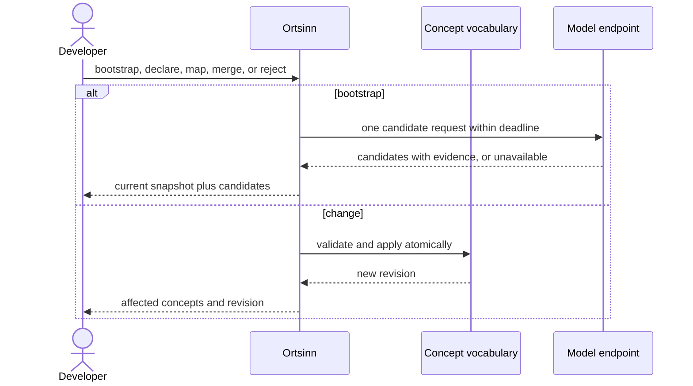

# Use case: UC4

## Level
!

## Actors
- Developer (primary)
- Supporting: Model endpoint operator (serves vocabulary bootstrap requests)

## Goal
Every accepted term maps to one concept with evidence in the glossary.

## Trigger
The developer requests a change to the concept vocabulary.

## Preconditions
- A workspace is configured.
- The index is available for `bootstrap`, `declare`, and `map`; `merge`,
  `reject`, and glossary reads do not require a fresh index.

## Main flow
1. The developer submits one operation: `bootstrap`, `declare`, `map`,
   `merge`, or `reject`, with optional `expected_revision`.
2. The system validates the operation, names, evidence, and the current
   glossary revision.
3. For `bootstrap`, the system gathers symbol names, selected comments, and
   docs within the request cap, calls the model endpoint once within the
   deadline, and returns candidates with stable `candidate_id`s and evidence.
   The accepted vocabulary is unchanged until the developer confirms a
   candidate with `declare` and `map`.
4. For `declare`, the system adds a concept with a canonical name and
   evidence.
5. For `map`, the system adds a term with its term language, identifiers, and
   evidence to exactly one concept. A term already mapped to another concept
   is rejected.
6. For `merge`, the system merges a source concept into a target concept,
   preserving all terms and evidence. Identical `(spelling, term_language)`
   pairs are unioned with their identifiers and evidence deduplicated.
7. For `reject`, the system records the rejection and leaves the accepted
   vocabulary unchanged.
8. The system stores the change atomically under a new glossary revision and
   returns the current accepted concepts and the affected change.

## Extensions
- 1: An unknown operation or malformed payload → `status: invalid`,
  `empty_reason: invalid_input`, one error per field; protects the minimal
  guarantee.
- 1: `expected_revision` differs from the current glossary revision →
  `status: invalid`, `empty_reason: revision_conflict`, `retryable: true`,
  with the current revision; the previous vocabulary stands; protects the
  minimal guarantee.
- 2: Evidence is missing, outside the workspace/index, or lacks a repository
  → `status: invalid` naming the evidence; protects the minimal guarantee.
- 2: An unknown term language → `status: invalid` naming the value; protects
  the minimal guarantee.
- 2: `bootstrap`/`declare`/`map` runs while the index is `not_built` or
  `stale` → `status: empty`, `empty_reason: not_indexed`, naming the missing
  level; protects the minimal guarantee.
- 3: The product is offline → `status: empty`, `empty_reason: unavailable`,
  reason `offline`, `retryable: false`; no external request; protects the
  minimal guarantee.
- 3: The endpoint times out or throttles → `status: empty`,
  `empty_reason: unavailable`, reason `timeout` or `throttled`,
  `retryable: true`; one attempt, no retry; protects the minimal guarantee.
- 3: The endpoint refuses or rejects authorization → reason `refused` or
  `unauthorized`, `retryable: false`; protects the minimal guarantee.
- 3: The request cap drops all evidence → `status: empty`,
  `empty_reason: unavailable`, reason `no_context`, `retryable: false`,
  `input_truncated: true`; protects the minimal guarantee.
- 4: A concept with the same canonical name exists → `status: invalid` with
  the existing concept; shared evidence is allowed; protects the minimal
  guarantee.
- 5: The term is already mapped to another concept → `status: invalid` with
  the existing concept; the previous vocabulary stands; protects the success
  guarantee.
- 6: The merge source or target is unknown, or they are the same → `status:
  invalid`; protects the minimal guarantee.
- 7: The rejected target is unknown as an accepted term, concept, or current
  candidate → `status: invalid`; protects the minimal guarantee.
- 8: Two changes race → one revision wins; the other returns `status:
  invalid`, `empty_reason: revision_conflict`, `retryable: true`; no partial
  vocabulary; protects the minimal guarantee.

## Rules
- R1. The concept vocabulary is the consistency boundary: a term maps to at
  most one concept; every accepted mapping cites evidence; merging preserves
  all terms.
- R2. A change applies atomically under a new glossary revision; on failure
  the previous vocabulary stands.
- R3. `bootstrap` only proposes candidates. It returns the current accepted
  snapshot plus candidates and never changes the accepted vocabulary.
  Candidates have `candidate_id`, concept, terms, `source_kind`
  (`identifier`, `comment`, `doc`), and evidence.
- R4. `bootstrap` makes one external attempt within the deadline, with no
  automatic retry. The request carries symbol names, selected comments and
  docs, and repository-relative paths; it carries no unrelated repository
  content. Offline or non-permitted external transfer issues no request.
- R5. Evidence is `{repository, path, line or range, excerpt?}` and resolves
  in the workspace. A term or concept without evidence is not accepted.
- R6. A rejected target is recorded with its `(spelling, term_language,
  concept)` suppression key and is omitted from UC5's inconsistency report
  until it is mapped with new evidence.
- R7. The use case never changes repository content or the index.
- R8. The glossary revision identifies the accepted vocabulary snapshot.
- R9. `vocabulary` is `{revision, concepts, candidates}`; `concept` is
  `{name, evidence}`; `term` is `{spelling, term_language, identifiers,
  evidence}`; `evidence` is as R5. A `merge` returns `concept` and
  `merged_from`.
- R10. Every outcome uses the same envelope: `status`, `input`, `errors`,
  `vocabulary`, `reason`, `retryable`, `empty_reason`, `input_truncated`.
  `status` is `ok`, `empty`, `invalid`, or `error`; `ok` holds exactly when
  `vocabulary` is non-null.
- R11. `empty_reason` is one of `invalid_input`, `revision_conflict`,
  `not_indexed`, `unavailable`, or `budget_exceeded`.

## Examples

### Example 1 — declare a concept

Input: `declare` concept `user`, evidence `{repository: "api", path:
"src/user/user.ts", line: 1}`.

Result: `status: ok`; glossary revision `g-1`; concept `user` with no terms
yet; the evidence recorded.

### Example 2 — map a term

Input: `map` term `Besucher`, `term_language: "de"`, concept `user`, evidence
`{repository: "api", path: "docs/glossary.md", line: 12}`.

Result: `status: ok`; revision `g-2`; `Besucher` maps to `user`; UC10 returns
it.

### Example 3 — conflicting mapping

Input: `map` term `Besucher` to concept `visitor` when it already maps to
`user`.

Result: `status: invalid`, `errors: [{field: "term", value: "Besucher",
reason: "already mapped to user"}]`; the vocabulary unchanged.

### Example 4 — merge concepts

Input: `merge` source `visitor` into target `user`.

Result: `status: ok`; all `visitor` terms and evidence now belong to `user`;
identical `(spelling, term_language)` pairs are unioned; revision advances;
no term is lost; `vocabulary.concept: "user"`, `merged_from: "visitor"`.

### Example 5 — reject a candidate

Input: `reject` term `client` with reason `too generic`.

Result: `status: ok`; the accepted vocabulary unchanged; the suppression key
recorded; UC5 omits it until new evidence is mapped.

### Example 6 — bootstrap candidates

Input: `bootstrap` with a limit of 20.

Result: `status: ok`; `vocabulary` is the current accepted snapshot;
`candidates` non-empty with `candidate_id`, `source_kind`, and evidence; the
accepted vocabulary unchanged.

### Example 7 — offline bootstrap

Input: `bootstrap` while offline.

Result: `status: empty`, `empty_reason: unavailable`, reason `offline`,
`retryable: false`; no external request; the vocabulary unchanged.

### Example 8 — missing evidence

Input: `map` a term without evidence.

Result: `status: invalid`, the evidence field named; the vocabulary unchanged.

### Example 9 — revision conflict

Input: `map` with `expected_revision: "g-1"` when the current revision is
`g-2`.

Result: `status: invalid`, `empty_reason: revision_conflict`,
`retryable: true`; the current revision is named; no change.

### Example 10 — index not available

Input: `declare` before the workspace has an index.

Result: `status: empty`, `empty_reason: not_indexed`, naming `syntactic`; no
change.

## Minimal guarantee
Always: the developer receives the echoed input, a status, any errors, and the
previous vocabulary unchanged on failure; repository content and the index are
untouched. An unavailable bootstrap leaves the vocabulary unchanged.

## Success guarantee
The developer receives the current accepted concepts and terms under a new
glossary revision, with every accepted term mapped to exactly one concept and
every mapping backed by evidence. A bootstrap returns the current snapshot
and candidates without changing the accepted vocabulary.

## Personas
- developer--agent-first
- provider--model-endpoint (supporting)

## Capabilities
- Bootstrap concept candidates from the indexed repository.
- Declare concepts.
- Map terms with term language, identifiers, and evidence.
- Merge concepts while preserving terms.
- Reject candidates with suppression.
- Atomic revisioned vocabulary changes with conflict detection.

## Interactions
- none at ideation time; the MCP tool mapping is a design concern.

## Includes
- none

## Extends
- none

## Out of scope
- Reading the glossary (UC10).
- Finding naming inconsistencies (UC5).
- Editing repository content.
- Automatic confirmation of bootstrap candidates.

## Diagram

