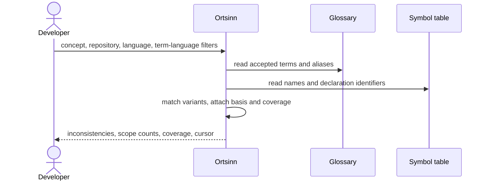

# Use case: UC5

## Level
!

## Actors
- Developer (primary)

## Goal
The developer sees concepts with undeclared term variants.

## Trigger
A term is mapped (E15), the inconsistency detection policy reports an
undeclared variant (E18), and the developer reviews the report.

## Preconditions
- The workspace is indexed.
- A concept vocabulary exists, possibly empty.

## Main flow
1. The developer requests the inconsistency report with optional `concepts`
   (concept names), `repository_scope`, `language` (programming language),
   `term_language`, `limit`, `token_budget`, and `cursor`.
2. The system reads the accepted vocabulary and the symbol table.
3. For each concept, the system finds symbol names or declaration identifiers
   that are not accepted terms and that match a declared term or identifier by
   segmentation, case-folded equality, or a stated fuzzy/translation basis.
   It records the repository, path, range, evidence, match basis, and the
   index level used.
4. The system applies the filters in order, marks items from a stale level,
   reports coverage, and paginates under the token budget.
5. The developer reviews the report and decides whether to map, merge, or
   reject terms in UC4 Curate the concept vocabulary.

## Extensions
- 1: A malformed `concepts` list, unknown `repository_scope`, unknown
  `language`, or unknown `term_language` → `status: invalid`,
  `empty_reason: invalid_input`, naming the value; protects the minimal
  guarantee.
- 1: `token_budget` exceeds the hard cap → the system clamps it and reports
  the applied cap; protects the budget guarantee.
- 2: The glossary is empty → `status: empty`, `empty_reason:
  empty_glossary`, `inconsistencies_total: 0`; protects the minimal
  guarantee.
- 2: The symbol table level is `not_built` → `status: empty`,
  `empty_reason: not_indexed`, with `coverage: not_built`; a missing level is
  never reported as "no inconsistencies"; protects the minimal guarantee.
- 3: A well-formed concept name is absent from the glossary → it is echoed in
  `missing_concepts`; if no concept remains, `status: empty`, `empty_reason:
  no_match`; protects the minimal guarantee.
- 3: A variant was rejected in UC4 with the same suppression key and no new
  evidence → it is omitted; protects the developer's decision.
- 3: No undeclared variant is found → `status: empty`, `empty_reason:
  no_inconsistencies`, with `coverage`; protects the minimal guarantee.
- 3: The filters remove every variant → `status: empty`, `empty_reason:
  no_match`, with the filters echoed; protects the minimal guarantee.
- 3: The symbol table is stale → the report is returned with `status: ok`,
  each item marked `stale: true` with its `index_level`, and `coverage`
  naming the stale level; protects the freshness guarantee.
- 4: The report exceeds the token budget → pagination with `has_more` and a
  cursor; a single item larger than the budget is truncated within the cap;
  the envelope alone not fitting yields `status: empty`, `empty_reason:
  budget_exceeded`; protects the budget guarantee.
- 4: A cursor is presented with other input or page parameters → `invalid`;
  a changed glossary or index revision → `status: empty`, `empty_reason:
  stale_cursor`, `restart_required: true`; protects determinism.
- 5: The developer maps a variant → UC4 changes the vocabulary; this use case
  only reports.

## Rules
- R1. A variant is a symbol name or declaration identifier that is not an
  accepted term for a concept and matches a declared term or identifier by
  one of: case-folded equality after camelCase/snake_case/kebab
  segmentation; a declared identifier alias; or a fuzzy/translation candidate
  from the vocabulary. Every item states its `match_basis` (`token`, `alias`,
  `fuzzy`, `translation`) and is advisory. Comments and string literals are
  not searched.
- R2. Each inconsistency carries the concept, the declared terms, the variant
  term, `term_language`, repository, path, range, evidence, `match_basis`,
  `index_level`, and `stale`.
- R3. The report is read-only. It never changes the vocabulary, the
  repository, or the index.
- R4. `concepts` matches concept names exactly; `repository_scope` filters
  the variant's repository; `language` filters the programming language;
  `term_language` filters the variant's natural language. All are hard
  filters; removed counts appear in `scope`.
- R5. Ordering: concept name, repository, path, range start, variant term.
- R6. `empty_reason` is one of `invalid_input`, `empty_glossary`,
  `no_inconsistencies`, `not_indexed`, `no_match`, `budget_exceeded`, or
  `stale_cursor`.
- R7. The default token budget is 4,000; `limit` bounds returned
  inconsistencies; the effective page is `min(limit, items that fit the
  budget)`. `inconsistencies_total` is the post-filter, pre-pagination count;
  one inconsistency is one occurrence `(repository, path, range, variant)`.
  Evidence excerpts are capped at 200 code points.
- R8. A cursor is bound to the filters, page parameters including the applied
  budget cap, the glossary revision, and the index revision; the next page
  carries the cursor alone.
- R9. Freshness is an array per repository, language, and index level with
  as-of time, revision, and a top-level workspace content revision.
  `coverage` states whether the symbol level is complete for the requested
  scope.
- R10. The same filters, page parameters, glossary revision, and index
  revision return the same report.
- R11. Every outcome uses the same envelope: `status`, `input`, `errors`,
  `inconsistencies`, `glossary_revision`, `missing_concepts`, `coverage`,
  `freshness`, `content_revision`, `budget`, `cursor`, `empty_reason`,
  `scope`, `inconsistencies_total`, `returned`, `has_more`,
  `restart_required`. `status` is `ok`, `empty`, or `invalid`; `ok` holds
  exactly when `inconsistencies` is non-empty.

## Examples

### Example 1 — translation variant

The glossary maps `user` to `user` and `visitor` (term languages `en`), and
`Benutzer` is declared as a German term of the same concept. A symbol
`BesucherService` appears in `api/src/user/besucher.ts`; the vocabulary has a
declared translation `Besucher` → `user` but `BesucherService` itself is not
an accepted term.

Result: `status: ok`; inconsistency: concept `user`, declared terms `[user,
visitor, Besucher]`, variant `Besucher`, `term_language: "de"`,
`match_basis: "translation"`, repository `api`, path
`src/user/besucher.ts`, range of the declaration, evidence at the declaration
line, `index_level: "syntactic"`, `stale: false`; `inconsistencies_total: 1`.

### Example 2 — token match

The concept `order` declares `order`; the symbol `OrderRepository` appears.
The variant `Order` matches by token after segmentation; it is advisory, not a
proof of inconsistency.

### Example 3 — no inconsistencies

The glossary maps every used variant.

Result: `status: empty`, `empty_reason: no_inconsistencies`,
`coverage: complete`, `inconsistencies_total: 0`.

### Example 4 — empty glossary

Result: `status: empty`, `empty_reason: empty_glossary`.

### Example 5 — not indexed

Result: `status: empty`, `empty_reason: not_indexed`, `coverage: not_built`.
A missing symbol level is not "no inconsistencies".

### Example 6 — concept filter with a missing name

Input: `concepts: ["user", "invoice"]`; `invoice` is absent.

Result: the `user` inconsistencies; `missing_concepts: ["invoice"]`.

### Example 7 — rejected variant omitted

Input: a variant rejected in UC4 with the same suppression key and no new
evidence.

Result: the variant is omitted; the report does not re-surface the rejected
choice.

### Example 8 — pagination

Input: `limit: 5` over 12 inconsistencies.

Result: five, `inconsistencies_total: 12`, `returned: 5`, `has_more: true`,
cursor.

### Example 9 — invalid input

Input: `language: "klingon"`.

Result: `status: invalid`, `empty_reason: invalid_input`,
`errors: [{field: "language", value: "klingon", reason: "unknown language"}]`.

## Minimal guarantee
Always: the developer receives the echoed input, a status, any errors, and no
invented inconsistency; the vocabulary, repository, and index are unchanged.
When the report was read: the glossary revision, coverage, freshness, and an
empty or partial inconsistency list.

## Success guarantee
The developer receives each concept with undeclared term variants, their
evidence, match basis, repository, programming language, term language, and
location, plus the totals, coverage, and freshness.

## Personas
- developer--agent-first

## Capabilities
- Name-based variant detection with token, alias, fuzzy, and translation
  bases.
- Concept, repository, programming-language, and term-language filters.
- Evidence, match-basis, coverage, and staleness reporting.
- Rejected-variant suppression.
- Pagination under a token budget.

## Interactions
- none at ideation time; the MCP tool mapping is a design concern.

## Includes
- none

## Extends
- none

## Out of scope
- Changing the vocabulary (UC4).
- Reading the glossary (UC10).
- Editing repository content.
- Treating a fuzzy or translation candidate as a confirmed mapping.

## Diagram

