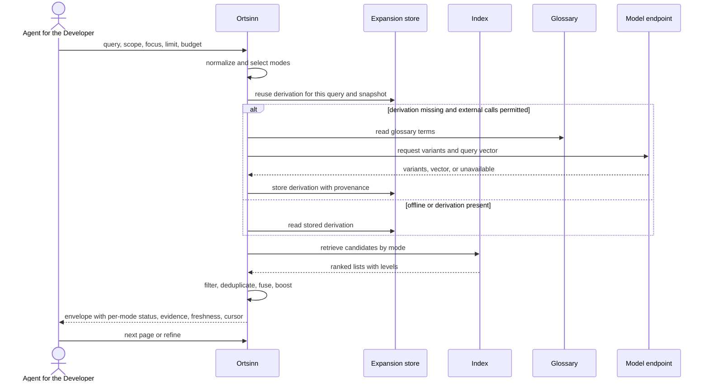

# Use case: UC6

## Level
!

## Actors
- Agent for the Developer (primary)
- Supporting: Developer (reads the same result when verifying an answer)
- Supporting: Model endpoint operator (serves query-variant and
  query-embedding requests)

## Goal
The agent for the developer gets a ranked set of candidate code locations for
a name or meaning query, with match basis, expanded terms, and evidence.

## Trigger
The agent for the developer receives a question that needs a code location and
issues a location query.

## Preconditions
- A workspace is configured.
- The index may be empty or stale; the result reports the available level and
  revision.
- The agent has a location question.
- The query is non-empty; a violation is handled as a validation result.

## Main flow
1. The agent submits a location query with `query` and optional
   `repository_scope` (hard repository-name filter), `focus_path` (soft path
   proximity boost), `kind`, `language`, `origin`, `limit`, `token_budget`,
   and `cursor`; the system validates every parameter.
2. The system normalizes the query and selects the modes: exact-symbol, typo,
   lexical, synonym/translation, and meaning-level.
3. The system derives expansions from the original query and the glossary;
   when a selected mode needs lexical or meaning-level variants and external
   calls are permitted, it derives model variants and the query vector. Each
   expansion term records its source: original, glossary, or model. The
   derivation is reused for the same normalized query, model identity, prompt
   version, and glossary snapshot.
4. The system retrieves candidates from the symbol table, text index, vector
   index, and dependency graph; each candidate records its mode, index level,
   matched terms, and origin.
5. The system applies the hard filters (`repository_scope`, `kind`,
   `language`, `origin`), deduplicates candidates by location identity, merges
   their match bases and matched terms, fuses the ranked lists, applies
   deterministic tie-breaking, and boosts definitions over references and
   results near `focus_path`.
6. The system assembles one result envelope under the token budget; the
   envelope carries the echoed query and constraints, status, per-mode status,
   expansion terms with sources, freshness per level with revision, cursor,
   and budget used; each candidate carries its symbol, repository, path, range,
   kind, role, origin, match bases, matched terms with sources, evidence,
   global rank, and stale flag.
7. The agent reads the ranked candidates and selects one, requests the next
   page, or refines the query.

## Extensions
- 1: `query` is empty or whitespace → the system returns `status: invalid`
  with `empty_reason: query_invalid` and names the offending parameter;
  protects the minimal guarantee.
- 1: A `repository_scope` entry is unknown to the workspace → the system
  returns `status: invalid` and names the repository; protects the minimal
  guarantee.
- 1: A `focus_path` points into an ignored path → it yields no boost; it is
  never a hard filter. Only `repository_scope`, `kind`, `language`, and
  `origin` produce `filters_excluded`; protects the success guarantee.
- 1: A scope repository contains only ignored paths → the system returns
  `status: empty` with `empty_reason: filters_excluded` and names the
  exclusion; protects the developer's verification.
- 1: `token_budget` exceeds the hard cap → the system clamps to the cap and
  states the applied cap; protects the budget guarantee.
- 2: The query has no alphabetic token → the system runs lexical and
  meaning-level and marks the symbol modes skipped; protects the success
  guarantee.
- 3: The glossary is empty or unavailable → the system uses the original query
  and any stored expansions and marks glossary expansion unavailable; protects
  the success guarantee.
- 3: The product is offline → the system makes no external request, uses
  glossary and stored expansions, and marks meaning-level unavailable;
  protects the minimal guarantee and the no-call rule.
- 3: The endpoint is unreachable, slow, throttling, refusing, or returns
  invalid variants → the system abandons the single attempt at the query
  deadline, marks model expansion unavailable with the reason and whether a
  retry is possible; protects the minimal guarantee.
- 4: An index level used by the query is stale or not built → the system
  returns the available level's candidates and marks the level and the
  affected candidates; protects the freshness guarantee.
- 4: No candidate is found in any mode → the system returns an empty page with
  per-mode status and `empty_reason: no_match`; protects the minimal
  guarantee.
- 5: The hard filters exclude all candidates → the system returns an empty
  page with `empty_reason: filters_excluded` and the applied constraints;
  protects the minimal guarantee.
- 6: The candidate set exceeds the budget → the system truncates at candidate
  boundaries in global rank order and returns a cursor; protects the budget
  guarantee.
- 6: The envelope alone exceeds the budget → the system summarizes the
  expansion list to a count and abbreviates mode reasons; if no candidate
  fits, it returns an empty page with `empty_reason: budget_exceeded` and a
  cursor; protects the budget guarantee.
- 6: Two candidates tie → the system orders by repository, path, range start,
  range end, then symbol-or-chunk identity; protects determinism.
- 6: The cursor is from an older index revision → the system returns a
  stale-marked page from the pinned revision when retained, otherwise an empty
  result with `restart_required: true`; protects the freshness guarantee.
- 6: The cursor's query or constraints differ from the request → the system
  returns `status: invalid` and names the mismatch; protects determinism.
- 7: The agent refines the query → the flow restarts at step 1; a refine with
  the same normalized query reuses the same expansion.

## Rules
- R1. A location query returns a ranked list of candidates, never a single
  unranked location.
- R2. A candidate's match basis is a set drawn from `exact-symbol`, `typo`,
  `lexical`, `synonym`, `translation`, and `meaning-level`. Multiple bases may
  apply and are all listed. A location retrieved by several modes is
  deduplicated by location identity and its bases and matched terms are
  merged.
- R3. A symbol-name query with an edit distance of at most two still finds the
  symbol, unless another symbol matches exactly.
- R4. Terms that the glossary maps to the same concept retrieve the same
  target set. Every expansion term states its source: original, glossary, or
  model. Model variants are never presented as glossary terms. Each candidate
  names the term or terms that produced its match.
- R5. Every candidate carries evidence: the path, the line, and an excerpt of
  the matched line or the matched symbol. Evidence is the smallest checkable
  citation, not a duplicate of the candidate range.
- R6. Every outcome, including validation and empty results, uses the same
  envelope: echoed query and constraints, `status` (`ok`, `empty`, `invalid`,
  or `error`), per-mode status, expansion terms with sources, freshness per
  level with revision, cursor, budget, `empty_reason`, `restart_required`, and
  candidates. `ok` holds when a non-empty candidate page is returned; `empty`
  when no candidate page is returned; `invalid` for request errors; `error`
  for an index-store failure.
- R7. The default token budget is 4,000; `token_budget` may raise it to a hard
  cap and `limit` bounds the candidate count. The effective page is
  `min(limit, candidates that fit the budget)` in global rank order.
  Candidates are atomic; the envelope counts toward the budget; pages are
  disjoint ordered slices of one global ranking. `budget` is
  `{requested, applied_max, used_estimate, exceeded}`.
- R8. Freshness is reported per index level as `fresh`, `stale`, `not_built`,
  or `error`, with an as-of time and the index revision. A candidate whose
  level is stale carries its own stale flag; evidence from a stale level may
  not match the current file.
- R9. A query with no candidates returns an empty page with the per-mode status
  and an `empty_reason`, not an error.
- R10. The same query, constraints, index revision, glossary snapshot, and
  expansion content return the same order. Model variants are persisted in the
  expansion result; a changed expansion changes the order and the result
  states the change. No score is exposed; the order is the ranking.
- R11. `repository_scope` (repository names, exact match), `kind`, `language`,
  and `origin` are hard filters; `focus_path` is a soft path boost and never
  restricts. A scope result never comes from outside the scope.
- R12. The system derives one expansion per normalized query, model identity,
  prompt version, and glossary snapshot. Later pages and refines reuse it;
  concurrent identical queries share one in-flight request. At most one
  external expansion attempt is made per derivation, with no automatic retry.
- R13. In offline mode the system issues no external request. Meaning-level is
  unavailable; glossary and stored expansions still work.
- R14. An expansion request carries the normalized query text, language, and
  symbol kind. It never carries repository names, paths, file content,
  evidence, or index data. An embedding request carries the query text only.
  The expansion result is stored locally outside the repository and the index
  and does not change freshness.
- R15. A request carries at most a stated number of glossary terms and fits a
  stated request-token cap; excess terms are dropped by a deterministic rule,
  or the call is skipped.
- R16. Meaning-level retrieval uses the configured embedding endpoint; the
  query vector is derived once per query and model version and reused. Offline
  disables meaning-level.
- R17. A location query completes within a stated deadline regardless of
  endpoint latency. Throttling, refusal, authorization failure, timeout, and
  invalid variants all degrade to `unavailable` with the reason recorded.
- R18. Each mode reports `ran`, `skipped`, `failed`, or `unavailable`, with a
  reason and whether a retry is possible. An empty page states whether any
  mode was skipped or failed before the agent treats it as absence.
- R19. Each candidate carries its symbol or chunk identity, repository, path,
  range, kind, role (`definition`, `reference`, or `chunk`), origin (`code`,
  `doc`, or `commit`), match bases, matched terms with sources, evidence,
  global rank, index level, and stale flag.
- R20. The use case never changes the repository or the index.
- R21. `empty_reason` is one of `query_invalid`, `filters_excluded`,
  `no_match`, `budget_exceeded`, or `stale_cursor`; it is null for `ok` and
  `ambiguous` is not a UC6 status. A stale cursor sets `restart_required:
  true`.
- R22. A cursor is bound to the query, constraints, page parameters,
  expansion content, and index revision; the next page carries the cursor
  alone; an expired or revision-mismatched cursor returns `stale_cursor` with
  `restart_required`.
- R23. The closed mode set is `exact-symbol`, `typo`, `lexical`, `synonym`,
  `translation`, and `meaning-level`. Synonym and translation are separate
  modes. Every envelope lists every mode with its status, including skipped
  and unavailable modes.

## Examples

### Result envelope (Example 1, full shape)

```json
{
  "status": "ok",
  "query": "getUserProfle",
  "constraints": {"repository_scope": ["api"], "limit": 5, "token_budget": 4000},
  "modes": [
    {"mode": "exact-symbol", "status": "ran"},
    {"mode": "typo", "status": "ran"},
    {"mode": "lexical", "status": "ran"},
    {"mode": "meaning-level", "status": "skipped", "reason": "exact symbol hit", "retryable": false}
  ],
  "expansion": {
    "terms": [{"term": "getUserProfle", "source": "original"}],
    "model": "reused",
    "glossary": "reused"
  },
  "freshness": {
    "revision": "r-2026-10-20T10:00Z",
    "levels": {
      "syntactic": {"state": "fresh", "as_of": "2026-10-20T10:00Z"},
      "semantic": {"state": "fresh", "as_of": "2026-10-20T09:58Z"},
      "precise": {"state": "stale", "as_of": "2026-10-19T18:00Z"}
    }
  },
  "budget": {"requested": 4000, "applied_max": 4000, "used_estimate": 312, "exceeded": false},
  "cursor": null,
  "empty_reason": null,
  "candidates": [
    {
      "symbol": {"qualified_name": "UserService.getUserProfile", "short_name": "getUserProfile", "kind": "function", "container": "UserService", "language": "typescript", "repository": "api", "signature": "(id: string) => Promise<User>"},
      "repository": "api",
      "path": "src/user/profile.ts",
      "range": {"start": 41, "end": 68},
      "kind": "function",
      "role": "definition",
      "origin": "code",
      "match_bases": ["typo"],
      "matched_terms": [{"term": "getUserProfle", "source": "original", "detail": "edit distance 1"}],
      "evidence": {"path": "src/user/profile.ts", "line": 41, "excerpt": "export async function getUserProfile("},
      "rank": 1,
      "stale": false,
      "index_level": "syntactic"
    }
  ]
}
```

Only one candidate exists for this query. The agent can answer that the
intended name is `getUserProfile`.

### Example 2 — translation and synonym

Query: "wo wird der Besucher eingeloggt" in a repository that uses `user`,
`visitor`, and `Besucher`.

Expansion terms:
`[{besucher, original}, {visitor, glossary}, {user, glossary},
{login, glossary}, {sign_in, model}, {anmelden, model}]`.

Candidate rank 1: `UserService.login`, repository `api`,
`src/auth/service.ts`, lines 88-104, role definition, origin code,
match bases `[translation, synonym]`, matched terms
`[besucher→user (glossary), login→login (glossary)]`,
evidence `src/auth/service.ts:88`, index level syntactic.

The developer can see which terms are team vocabulary and which are model
guesses.

### Example 3 — exact lexical

Query: `InvalidStateTransition`.

Candidate 1: symbol `InvalidStateTransition`, `src/state/errors.ts`, lines
12-18, kind class, role definition, origin code, match bases `[exact-symbol]`,
evidence line 12.
Candidate 2: symbol `throwInvalidTransition`, `src/state/machine.ts`, line 77,
kind function, role reference, origin code, match bases `[lexical]`, matched
term `InvalidStateTransition`, evidence line 77.

The agent can answer where the error is defined and where it is thrown.

### Example 4 — meaning-level

Query: "authentication middleware".

Candidate 1: chunk `AuthMiddleware`, `src/auth/middleware.py`, lines 20-64,
kind chunk, role chunk, origin code, match bases `[meaning-level]`, evidence
line 20.
Candidate 2: chunk `ADR-0007`, `docs/adr/0007-auth.md`, lines 1-40, kind
chunk, role chunk, origin doc, match bases `[meaning-level]`, evidence line 1.

The agent gets the code and the decision record.

### Example 5 — no candidates

Query: `zzzz`.

Result: `status: empty`, `empty_reason: no_match`; modes:
`exact-symbol ran`, `typo ran`, `lexical ran`, `meaning-level ran`;
expansion `[]`; freshness `syntactic fresh, semantic fresh, precise stale`;
candidates `[]`.

The agent can say that no location was found and which modes ran.

### Example 6 — token budget

Query: `parse`, `limit` unset, default budget 4,000.

Result: 20 candidates in global rank order, `budget.used` under 4,000,
`cursor: page-2`; the agent requests the next page. No page exceeds the
budget; pages are disjoint.

### Example 7 — determinism

The same query, constraints, index revision, glossary snapshot, and expansion
content twice returns the identical order. The envelope states the expansion
state and the index revision, so a different order is explainable.

### Example 8 — filters exclude all candidates

Query `parse`, `repository_scope: ["web"]`; `web` is a known repository but
has no matching candidate.

Result: `status: empty`, `empty_reason: filters_excluded`, the applied scope
named; candidates `[]`.

The developer can distinguish "no such code" from "the filter excluded every
candidate".

### Example 9 — offline

Query "authentication middleware" while offline.

Result: `status: ok` when lexical or symbol candidates are returned,
otherwise `status: empty`; modes:
`exact-symbol ran`, `typo ran`, `lexical ran`,
`meaning-level unavailable` with reason `offline`, `retryable: false`;
expansion model `offline`; no external request was made.

The agent receives lexical and symbol candidates and knows why meaning-level
is missing.

### Example 10 — endpoint unavailable

Query "authentication middleware"; the endpoint times out.

Result: `meaning-level unavailable` with reason `timeout`,
`retryable: true`; lexical and symbol candidates are returned; model
expansion `unavailable`. The single expansion attempt was abandoned at the
query deadline.

### Scenario shapes

- Given a configured workspace and a fresh syntactic index, when the agent
  asks for `getUserProfle`, then the result ranks `getUserProfile` first with
  match basis typo and evidence.
- Given a glossary mapping Besucher and visitor to user, when the agent asks
  for "Besucher login", then the result states which terms are glossary terms
  and which are model variants, and ranks `UserService.login` with evidence.
- Given an offline product, when the agent asks a meaning-level query, then
  the result reports meaning-level unavailable with reason offline and returns
  lexical and symbol candidates, not an error.
- Given more candidates than the token budget, when the agent asks for a
  common term, then the page fits the budget and carries a cursor.

## Minimal guarantee
Even when the query is invalid, the index is not built, an index level is
stale, the glossary is empty, the product is offline, or the model endpoint is
unavailable, the agent receives the same result envelope: the echoed query and
constraints, status, per-mode status with reasons, expansion terms with
sources, freshness per level with revision, and an empty or partial candidate
list; the repository and the index are unchanged.

## Success guarantee
The agent receives a ranked, paginated candidate list under the token budget,
with match bases, expanded terms and their sources, evidence for each
candidate, and candidate provenance, so the developer can verify the result.

## Personas
- agent--coding-harness
- developer--agent-first
- provider--model-endpoint

## Capabilities
- Typo-tolerant symbol search.
- Lexical code search with fuzzy terms.
- Meaning-level retrieval over code, docs, and commit messages.
- Hybrid fusion of ranked lists with deduplication by location.
- Query expansion from the glossary and the model endpoint, with provenance.
- Query embedding for meaning-level retrieval.
- Pagination under a token budget with an opaque cursor.
- Match-basis, matched-term, evidence, freshness, and per-mode status reporting.

## Interactions
- none at ideation time; the MCP tool mapping is a design concern.

## Includes
- none

## Extends
- none

## Out of scope
- Resolving a known symbol to its definition or references (UC7).
- Reading a chosen location's source or explanation (UC8).
- Editing the repository or the index.
- Direct human query from a CLI or editor (Q1: MCP only).

## Diagram


