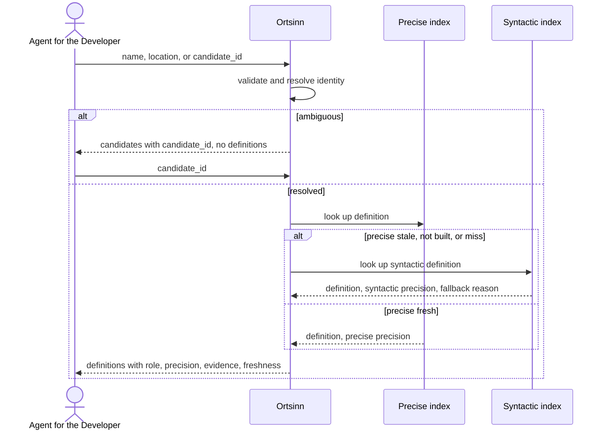

# Use case: UC7.1

## Level
!

## Actors
- Agent for the Developer (primary)
- Supporting: Developer (reads the same definition when verifying an answer)

## Goal
The agent for the developer gets the definition of a symbol with its precision
level.

## Trigger
The agent for the developer requests the definition for a symbol name, a
source location, or a previously returned candidate.

## Preconditions
- A workspace is configured.
- The index may be empty or stale; the result reports the available level.
- The agent supplies exactly one of a symbol name, a source location, or a
  candidate identifier.

## Main flow
1. The agent submits a definition request with exactly one of `name`,
   `location` (`repository`, `path`, `line`, optional `column`), or
   `candidate_id`, plus optional `language`, `repository_scope`, `limit`,
   `token_budget`, and `cursor`; the system validates the input.
2. The system resolves the input to a symbol identity:
   - `name`: exact match first; when none, typo-tolerant match over the last
     name segment with Damerau-Levenshtein distance at most two, case-folded.
   - `location`: the innermost symbol whose declared range contains the
     position; a position inside a reference resolves to the referenced
     identity.
   - `candidate_id`: the identity pinned to the candidate's index revision.
   If more than one distinct identity matches, the result is ambiguous.
3. The system returns `status: ambiguous` with the candidates and no
   definitions when the identity is ambiguous; the request ends, and the agent
   selects a `candidate_id` and resubmits.
4. For a unique identity, the system looks up the definition in the precise
   index when that level is fresh for the requested language. When the precise
   level is stale or not built, or when it has no entry for the identity, the
   system falls back to the syntactic symbol table and records the fallback
   reason.
5. The system returns the definition or definitions with role, precision,
   index level, stale flag, fallback reason, evidence, and freshness.
   Declarations are included with role `declaration` and ranked after
   definitions; partial parts and overloads carry their role and part count.
6. The system applies `repository_scope` and `language` as hard filters and
   records when definitions were removed by scope.
7. The agent reads the definitions; when the result is ambiguous, it selects a
   candidate and resubmits; when paginated, it requests the next page.

## Extensions
- 1: Zero or more than one of `name`, `location`, and `candidate_id` are
  supplied → `status: invalid`, `empty_reason: invalid_input`, with an entry in
  `errors` naming the offending fields; protects the minimal guarantee.
- 1: A `repository_scope` entry is unknown to the workspace → `status:
  invalid` with the repository named; protects the minimal guarantee.
- 1: `token_budget` exceeds the hard cap → the system clamps to the cap and
  states the applied cap; protects the budget guarantee.
- 2: No name matches exactly or within the typo threshold → `status: empty`,
  `empty_reason: no_match`, with the attempts listed; protects the minimal
  guarantee.
- 2: Several symbols share the best typo distance → `status: ambiguous` with
  all best-distance candidates, ordered by distance then identity; protects
  the success guarantee.
- 2: The location path is outside the workspace, unreadable, or beyond the end
  of the file → `status: invalid` with the location named; protects the
  minimal guarantee.
- 2: The location has no enclosing symbol → `status: empty`,
  `empty_reason: no_enclosing_symbol`; protects the minimal guarantee.
- 2: The location is inside a reference to an identity outside the workspace
  or not indexed → `status: empty`, `empty_reason: not_indexed`, with the
  location and the reference named; protects the minimal guarantee.
- 3: The agent selects a `candidate_id` from an older index revision → the
  system returns `status: invalid` or a stale-marked result naming the
  revision mismatch; protects determinism.
- 4: The precise level is stale or not built → the syntactic definition with
  `precision: syntactic`, `index_level: syntactic`, the fallback reason, and
  the syntactic level's stale flag; protects the precision guarantee.
- 4: The precise level is fresh but has no entry for the identity → the
  syntactic definition with fallback `precise_miss`; protects the success
  guarantee.
- 4: Neither level can answer → `status: empty`, `empty_reason: not_indexed`,
  with both level states; protects the minimal guarantee.
- 5: The symbol has multiple definitions, partial parts, or overloads → the
  system returns all of them with roles, part indices, and part counts; the
  order is definitions, then declarations, then partial parts and overloads;
  protects the success guarantee.
- 5: `repository_scope` removes some definitions of one identity → the system
  returns the remaining definitions and sets `scope.filtered` with the
  excluded repositories; protects the success guarantee.
- 5: `repository_scope` removes all definitions → `status: empty`,
  `empty_reason: out_of_scope`, with the resolved identity and the scope
  named; protects the minimal guarantee.
- 5: `language` excludes the resolved identity or definition → `status:
  empty`, `empty_reason: language_excluded`; protects the minimal guarantee.
- 5: The result exceeds the token budget → the system paginates at definition
  or candidate boundaries and returns a cursor; a single atomic item larger
  than the budget is returned whole with `budget.exceeded: true`; protects the
  budget guarantee.
- 5: A cursor is presented with different input, scope, language, or page
  parameters → `status: invalid` with the mismatch named; protects
  determinism.
- 5: A cursor is from an older index revision → the system returns the pinned
  revision's page when retained, otherwise `status: empty` with
  `restart_required: true`; protects the freshness guarantee.
- 7: The agent refines the request → the flow restarts at step 1.

## Rules
- R1. A definition is the location where the symbol is introduced, never a
  reference. Declarations are returned with role `declaration` and ranked
  after definitions. Implementations are UC7.3, not this use case.
- R2. Every definition states `precision` (`precise` or `syntactic`) and
  `index_level` (`precise` or `syntactic`). There is no top-level precision
  value; clients read the per-definition value.
- R3. A precise definition is preferred over a syntactic one for the same
  identity. A fallback carries `fallback`: `precise_stale`,
  `precise_not_built`, or `precise_miss`.
- R4. A symbol identity is the qualified name, kind, container or namespace,
  language, repository, and signature where the language and level provide
  one. Distinct identities with the same short name make the result
  ambiguous; one identity with several declaration sites makes it a
  multiple-definition result.
- R5. Every definition carries its identity, repository, language, path,
  range, kind, role, precision, index level, stale flag, fallback, and
  evidence.
- R6. The result states the resolution basis (`exact`, `typo`, `location`,
  `candidate`, or `none`) and the attempts made for the supplied input.
- R7. Typo resolution uses Damerau-Levenshtein over the case-folded last name
  segment with distance at most two. An exact match suppresses typo
  candidates. Several best-distance candidates make the result ambiguous; the
  system never silently picks one.
- R8. The result is deterministic for the same input, scope, language,
  effective page parameters, index revisions, and workspace revision.
- R9. The use case never changes the repository or the index.
- R10. The default token budget is 4,000; `token_budget` may raise it to a
  hard cap and `limit` bounds the item count. The envelope counts toward the
  budget; definitions and candidates are atomic; pages are disjoint slices of
  one ordering.
- R11. `repository_scope` (repository names, exact match) and `language`
  (workspace language identifier, exact match) are hard filters. When a filter
  removes some definitions of a resolved identity, `scope.filtered` and
  `scope.repositories` record it.
- R12. Ordering: definitions before declarations; within a role group by
  repository, path, range start, range end, then qualified identity.
  Ambiguity candidates order by typo distance, then identity.
- R13. A range is `{start_line, start_column, end_line, end_column}`, 1-based
  and inclusive; columns count Unicode code points. A definition range runs
  from the declaration's first modifier or decorator through its body and
  excludes leading comments.
- R14. Evidence is the smallest checkable citation: path, a line within the
  returned range, and a bounded excerpt of that line or the matched symbol.
- R15. A cursor is bound to the input, scope, language, page parameters, and
  index revision. A mismatch is invalid; an older revision returns the pinned
  page or `restart_required: true`.
- R16. Every outcome uses the same envelope: `status`, `input`, `errors`,
  `resolution`, `definitions`, `candidates`, `freshness`, `budget`, `cursor`,
  `empty_reason`, `scope`, `restart_required`. `status: ok` holds exactly when
  `definitions` is non-empty.
- R17. Freshness is per index level for the requested language:
  `fresh`, `stale`, `not_built`, or `error`, with as-of time and revision.
  The workspace revision is reported. A level is stale when its revision
  differs from the workspace revision or a file changed after its as-of time.
  Evidence from a stale level may not match the current file.
- R18. Invalid results carry `errors[]` entries with field, value, and reason,
  and no definitions.
- R19. An ambiguity candidate carries `candidate_id`, identity, repository,
  language, kind, `definition_range` (or null), evidence (or null), and typo
  distance when applicable.
- R20. `candidate_id` is opaque and stable within an index revision. Selecting
  it is a resubmission at step 1; a changed revision may invalidate it.
- R21. `empty_reason` is one of `invalid_input`, `no_match`,
  `no_enclosing_symbol`, `out_of_scope`, `language_excluded`, `not_indexed`,
  or `budget_exceeded`; it is null for `ok` and `ambiguous`.
- R22. `language` and `repository_scope` never infer silently; when supplied,
  a mismatch is reported rather than widened.

## Examples

### Example 1 — exact name (full envelope)

```json
{
  "status": "ok",
  "input": {"name": "getUserProfile", "language": "typescript", "repository_scope": ["api"], "limit": null, "token_budget": 4000},
  "errors": [],
  "resolution": {
    "basis": "exact",
    "attempts": ["exact"],
    "symbol": {"qualified_name": "UserService.getUserProfile", "short_name": "getUserProfile", "kind": "function", "container": "UserService", "language": "typescript", "repository": "api", "signature": "(id: string) => Promise<User>"},
    "candidates": []
  },
  "definitions": [
    {
      "symbol": {"qualified_name": "UserService.getUserProfile", "short_name": "getUserProfile", "kind": "function", "container": "UserService", "language": "typescript", "repository": "api"},
      "repository": "api",
      "language": "typescript",
      "path": "src/user/profile.ts",
      "range": {"start_line": 41, "start_column": 1, "end_line": 68, "end_column": 2},
      "kind": "function",
      "role": "definition",
      "precision": "precise",
      "index_level": "precise",
      "stale": false,
      "fallback": null,
      "evidence": {"path": "src/user/profile.ts", "line": 41, "excerpt": "export async function getUserProfile("}
    }
  ],
  "candidates": [],
  "freshness": {
    "workspace_revision": "w-2026-10-20T10:00Z",
    "language": "typescript",
    "levels": {
      "syntactic": {"state": "fresh", "as_of": "2026-10-20T10:00Z", "revision": "r-2026-10-20T10:00Z"},
      "precise": {"state": "fresh", "as_of": "2026-10-20T09:55Z", "revision": "r-2026-10-20T09:55Z"}
    }
  },
  "budget": {"limit": null, "used": 420, "max": 4000, "exceeded": false},
  "cursor": null,
  "empty_reason": null,
  "scope": {"filtered": 0, "repositories": []},
  "restart_required": false
}
```

### Example 2 — typo

Input: `getUserProfle`.

Resolution basis `typo` (Damerau-Levenshtein distance 1, last segment);
definition `getUserProfile` at `api/src/user/profile.ts:41-68`, precision
`precise`, evidence line 41.

The agent can answer with the corrected name and location.

### Example 3 — source location

Input: location `api/src/user/profile.ts:55:10`.

Resolution basis `location`; the innermost symbol at line 55 is
`getUserProfile`; the definition is lines 41-68, precision `precise`, evidence
line 41. The location is inside a reference; the system resolved the
referenced identity.

### Example 4 — ambiguous name

Input: `parse`.

Result: `status: ambiguous`; `resolution.basis: exact`; `resolution.symbol:
null`; `definitions: []`; candidates:

1. `candidate_id: "c-1"`, identity `Parser.parse` (method, container
   `Parser`, language `typescript`, repository `api`), definition range
   `src/parser.ts:12-30`, evidence line 12.
2. `candidate_id: "c-2"`, identity `Config.parse` (function, container
   `Config`, language `typescript`, repository `api`), definition range
   `src/config.ts:8-20`, evidence line 8.

The agent selects `candidate_id: "c-1"` and resubmits; the system then
returns that definition with `resolution.basis: candidate`.

### Example 5 — precise level stale

Input: `getUserProfile`; the precise level for TypeScript is stale.

Result: the syntactic definition at `api/src/user/profile.ts:41-68`,
`precision: syntactic`, `index_level: syntactic`, `stale: <syntactic state>`,
`fallback: precise_stale`; the freshness block marks precise `stale` with its
as-of time.

The agent knows the location is name-matched, not type-resolved.

### Example 6 — no match

Input: `zzzz`.

Result: `status: empty`; `resolution.basis: none`; `attempts:
["exact", "typo"]`; `empty_reason: no_match`; `definitions: []`; freshness
per level. Not an error.

### Example 7 — partial type

Input: `User`, a partial class.

Result: `status: ok`; two definitions with the same identity
`User` (class, container `models`, repository `api`):
`src/user/user.part1.ts:5-40`, role `partial_part`, part 1 of 2, and
`src/user/user.part2.ts:5-52`, role `partial_part`, part 2 of 2; both
precision `precise`, each with evidence.

The agent gets both parts and does not mistake one for the whole type.

### Example 8 — scope excludes the definition

Input: `getUserProfile` with `repository_scope: ["web"]`.

Result: `status: empty`; `empty_reason: out_of_scope`; `resolution.symbol`
is the resolved identity; `scope: {filtered: 1, repositories: ["api"]}`;
`definitions: []`. Not an error.

### Example 9 — pagination

Input: `parse` with `limit: 1` and `token_budget: 4000`.

Result: one candidate or definition, `cursor: {next: "page-2",
revision: "r-..."}`, `budget.used` under the budget. The agent requests the
next page; pages are disjoint slices of the same order.

### Example 10 — invalid input

Input: both `name: "parse"` and `location: {repository: "api", path:
"src/parser.ts", line: 12}`.

Result: `status: invalid`; `empty_reason: invalid_input`; `errors:
[{field: "name,location", value: "...", reason: "exactly one input is
allowed"}]`; `definitions: []`.

## Minimal guarantee
Always: the agent receives the echoed input, a status, any errors, and no
fabricated definition; the repository and the index are unchanged. When
resolution ran: the resolution basis, the attempts, and the candidates or
definitions. When an index was consulted: freshness per level with the
workspace revision. Precision and fallback appear only where a definition
exists.

## Success guarantee
The agent receives the definition location or locations of the requested
symbol with the resolution basis, the precision level and index level per
definition, evidence, symbol identity, role, fallback reason when any, and
freshness.

## Personas
- agent--coding-harness
- developer--agent-first

## Capabilities
- Exact-name resolution.
- Typo-tolerant name resolution with a named metric and tie rule.
- Location-to-symbol resolution, including references.
- Candidate selection by stable identifier.
- Ambiguity reporting with qualified identities and definition ranges.
- Precise lookup with syntactic fallback and explicit fallback reasons.
- Multiple-definition, partial-part, and overload reporting with roles.
- Scope and language filtering with notices.
- Pagination under a token budget.

## Interactions
- none at ideation time; the MCP tool mapping is a design concern.

## Includes
- none

## Extends
- none

## Out of scope
- References (UC7.2).
- Implementations (UC7.3).
- Retrieving the source text of the definition (UC8.2).
- Editing the repository or the index.
- Direct human query from a CLI or editor (Q1: MCP only).

## Diagram


