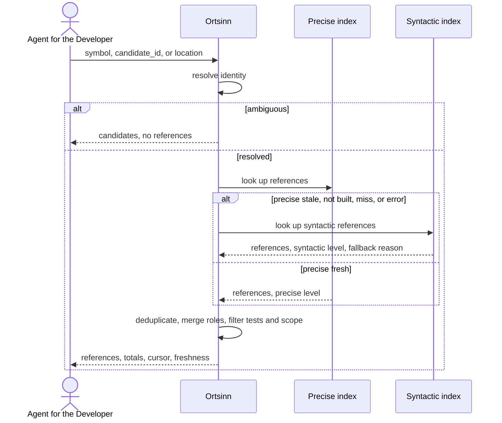

# Use case: UC7.2

## Level
!

## Actors
- Agent for the Developer (primary)
- Supporting: Developer (verifies the reference set)

## Goal
The agent for the developer gets the references of a symbol with their
precision level.

## Trigger
The agent for the developer requests references for a known symbol identity, a
candidate identifier from UC7.1 Resolve a definition, or a source location.

## Preconditions
- A workspace is configured.
- The index may be empty or stale; the result reports the available level.
- The agent supplies exactly one of `symbol`, `candidate_id`, or `location`.
- `symbol` is the identity object returned by UC7.1 or UC6; a bare short name
  is not an identity.

## Main flow
1. The agent submits a references request with exactly one of `symbol`
   (identity), `candidate_id`, or `location` (`repository`, `path`, `line`,
   optional `column`), plus optional `include_tests` (default true),
   `language`, `repository_scope`, `limit`, `token_budget`, and `cursor`.
2. The system resolves the input to one symbol identity: `symbol` as supplied,
   `candidate_id` pinned to its index revision, or `location` by precedence:
   a definition at the position resolves that identity; a reference resolves
   the referenced identity; otherwise the nearest enclosing symbol resolves
   (`location_definition`, `location_reference`, `location_enclosing`).
3. When more than one identity matches a location, the system returns
   `status: ambiguous` with candidates and no references; the request ends.
4. For a unique identity, the system consults the precise level when it is
   fresh for the identity's language. When the precise level is stale, not
   built, missing the identity, or in error, the system consults the
   syntactic level and records one result-level fallback reason. One response
   uses one level for all references.
5. The system deduplicates references by location identity, merges roles,
   classifies test references, applies `include_tests`, `repository_scope`,
   and `language` filters in that order, and records counts.
6. The system returns the references with the symbol identity, enclosing
   symbol and its definition when known, occurrence repository, language,
   path, range, roles, precision, index level, stale flag, test marker, and
   evidence; it paginates under the token budget and reports totals.
7. The agent reads the references and selects one, requests the next page, or
   narrows the request.

## Extensions
- 1: Zero or more than one of `symbol`, `candidate_id`, and `location` are
  supplied → `status: invalid`, `empty_reason: invalid_input`, one `errors`
  entry per offending field; protects the minimal guarantee.
- 1: A `repository_scope` entry is unknown to the workspace → `status:
  invalid` with the repository named; protects the minimal guarantee.
- 1: `language` is unknown to the workspace → `status: invalid` with the
  language named; protects the minimal guarantee.
- 1: `token_budget` exceeds the hard cap → the system clamps it and reports
  `budget.requested` and `budget.applied_max`; protects the budget guarantee.
- 2: A `candidate_id` is unknown or foreign to this workspace → `status:
  invalid` with the identifier echoed; protects the minimal guarantee.
- 2: A `candidate_id` is from an older index revision → the pinned result
  when retained, otherwise `status: empty`, `empty_reason: stale_cursor`,
  `restart_required: true`; protects the freshness guarantee.
- 2: The location is outside the workspace, unreadable, or beyond the end of
  the file → `status: invalid` with the location named; protects the minimal
  guarantee.
- 2: The location has no enclosing symbol and is not on a definition or
  reference → `status: empty`, `empty_reason: no_enclosing_symbol`; protects
  the minimal guarantee.
- 2: The location is inside a reference to an identity outside the workspace
  or not indexed → `status: empty`, `empty_reason: not_indexed`, with the
  location and the reference named; protects the minimal guarantee.
- 3: The location resolves to several identities → `status: ambiguous` with
  candidates; the request ends and the agent resubmits a `candidate_id`.
- 4: The precise level is stale or not built → syntactic references with
  result-level `fallback: precise_stale` or `precise_not_built`; protects the
  precision guarantee.
- 4: The precise level is fresh but has no entry for the identity → syntactic
  references with `fallback: precise_miss`; protects the success guarantee.
- 4: The precise level is in error → syntactic references with `fallback:
  precise_error`; protects the success guarantee.
- 4: Neither level can answer → `status: error` when a level is in error, or
  `status: empty` with `empty_reason: not_indexed` when a level lacks
  coverage; `errors` names the level and reason; protects the minimal
  guarantee.
- 5: `include_tests: false` → test references are removed first;
  `tests_excluded` reports the count; protects the success guarantee.
- 5: `repository_scope` or `language` removes some references → the remaining
  references are returned and `scope.filtered`, `scope.repositories`, and
  `scope.languages` record the removals; protects the success guarantee.
- 5: The filters remove all references → `status: empty`; `empty_reason` is
  `out_of_scope` when scope removed the last reference, `language_excluded`
  when the language filter removed the last reference, and `no_references`
  when only `include_tests: false` removed the last reference; protects the
  minimal guarantee.
- 5: The identity exists and a covering level returns an authoritative empty
  set → `status: empty`, `empty_reason: no_references`, not `no_match`;
  protects the minimal guarantee.
- 6: The result exceeds the token budget → the system paginates at reference
  boundaries and returns `has_more: true` with a cursor; a single reference
  larger than the budget is returned whole with `budget.exceeded: true`; if
  the envelope alone cannot fit, `status: empty`, `empty_reason:
  budget_exceeded`; protects the budget guarantee.
- 6: A cursor is presented with any other input or page parameter → `status:
  invalid` with the mismatch named; the next-page request carries the cursor
  alone; protects determinism.
- 6: A cursor is expired or from an older index revision and its page is no
  longer retained → `status: empty`, `empty_reason: stale_cursor`,
  `restart_required: true`; protects the freshness guarantee.
- 7: The agent narrows the request → the flow restarts at step 1.

## Rules
- R1. A reference is an occurrence of the resolved identity at a location,
  never its definition. At syntactic precision, occurrences of unrelated
  same-named symbols — including their definitions — may appear; every such
  reference is marked syntactic.
- R2. One response uses one level for all references. Each reference states
  `precision` (`precise` or `syntactic`) and `index_level` (`precise` or
  `syntactic`); they are equal in this use case. There is no top-level
  precision or mixed-level page.
- R3. A precise response is preferred. A syntactic response carries one
  result-level `fallback`: `precise_stale`, `precise_not_built`,
  `precise_miss`, or `precise_error`.
- R4. A symbol identity is `{qualified_name, short_name, kind, container,
  language, repository, signature}`; `qualified_name` is container-qualified
  only, and repository and language are separate fields. The same identity
  object is used by UC7.1, UC7.2, and UC7.3.
- R5. Every reference carries the symbol identity, the occurrence repository,
  occurrence language, path, range, roles, precision, index level, stale flag,
  test marker, and evidence. It also carries `enclosing_symbol` (identity or
  null at module scope) and `enclosing_definition` (`path` and `range`, or
  null) when the index knows it. `symbol.repository` is the definition
  repository; `repository` is the occurrence repository.
- R6. Roles are a set drawn from `call`, `read`, `write`, `import`,
  `type_use`, `annotation`, and `other`. `call` covers invocations and
  constructions; `read` covers value uses; `type_use` covers type positions.
  At syntactic precision, roles are `other` unless the grammar proves the
  role; non-precise roles are hints. A location is deduplicated by location
  identity (repository, path, range); roles from several occurrences at the
  same location are merged.
- R7. `include_tests` defaults to true. Test paths come from the workspace
  `test_paths` setting; the language index may also mark test symbols. At
  syntactic precision only path matching is available, and `is_test` is
  best-effort. `tests_excluded` reports removed references.
- R8. `repository_scope` (repository names, exact match) filters the
  occurrence repository; `language` filters the occurrence language. Both are
  hard filters. Filter order is dedup → test classification → `include_tests`
  → `repository_scope` → `language`. Each removed reference is counted once,
  at the first filter that removes it. Counts are totals over the resolved,
  pre-pagination set.
- R9. `empty_reason` is one of `invalid_input`, `no_match`,
  `no_enclosing_symbol`, `no_references`, `out_of_scope`,
  `language_excluded`, `not_indexed`, `budget_exceeded`, or `stale_cursor`.
  Precedence: invalid input; no match; no enclosing symbol; then filters
  (scope, language, tests); then `no_references`; `not_indexed` only when no
  consulted level covers the identity's language or repository; `budget_exceeded`
  only when the envelope cannot fit; `stale_cursor` for an expired page.
- R10. Ordering is deterministic: repository, path, range start, range end,
  enclosing qualified identity. Repository and path compare by Unicode code
  point, case-sensitively. Pages are disjoint slices of that order.
- R11. The use case never changes the repository or the index.
- R12. The default token budget is 4,000; `token_budget` may raise it to a
  configured hard cap. `budget` reports `requested`, `applied_max`,
  `used_estimate`, and `exceeded`; counting is an estimate with the configured
  tokenizer and includes the envelope. References are atomic; pages are
  disjoint slices of one ordering.
- R13. A cursor is bound to the input, filters, page parameters including the
  applied budget cap, and the index revision. The next-page request carries
  the cursor alone; the server reconstructs and echoes the bound request. A
  cursor carries `expires_at`; an expired or unretained cursor returns
  `stale_cursor` with `restart_required`.
- R14. Syntactic references are name-matched and may include unrelated
  same-named symbols. Every syntactic reference is marked; the result states
  the precision limitation; roles at that level are hints.
- R15. A range is `{start_line, start_column, end_line, end_column}`, 1-based
  and inclusive; columns count Unicode code points and `end_column` is the
  last character of the occurrence. Evidence is the smallest checkable
  citation: path, a line within the range, and an excerpt of at most 200 code
  points with an ellipsis when truncated.
- R16. Every outcome uses the same envelope: `status`, `input`, `errors`,
  `resolution`, `references`, `candidates`, `freshness`,
  `workspace_revision`, `budget`, `cursor`, `empty_reason`, `scope`,
  `tests_excluded`, `references_total`, `returned`, `has_more`,
  `restart_required`. `status` is `ok`, `empty`, `ambiguous`, `invalid`, or
  `error`; `ok` holds exactly when `references` is non-empty. Absent
  collections are `[]`; absent scalars are `null`.
- R17. Freshness is reported per language and index level: `fresh`, `stale`,
  `not_built`, or `error`, with as-of time and revision. A level is stale when
  its revision differs from the workspace revision or a file changed after its
  as-of time. A reference's `stale` is the state of its own `index_level`.
  Evidence from a stale level may not match the current file.
- R18. Invalid results carry one `errors[]` entry per offending field, with
  field, value, and reason, and no references. Error results carry the level
  and reason in `errors[]`.
- R19. Ambiguity candidates use the UC7.1 candidate shape: `candidate_id`,
  identity including signature, repository, language, kind, definition range
  or null, evidence or null, and typo distance when applicable.
- R20. `language` and `repository_scope` are never inferred silently. An
  unknown value is invalid; a known value that excludes the resolved identity
  yields `language_excluded` or `out_of_scope`.
- R21. `candidate_id` is shared with UC7.1 within one index revision. An
  unknown identifier is invalid; an older revision returns the pinned result
  when retained, otherwise `stale_cursor` with `restart_required`.
- R22. `workspace_revision` identifies the indexed content snapshot; it is not
  a VCS commit. The cursor binds to it.

## Examples

### Example 1 — precise references (full envelope)

```json
{
  "status": "ok",
  "input": {
    "symbol": {"qualified_name": "UserService.getUserProfile", "short_name": "getUserProfile", "kind": "function", "container": "UserService", "language": "typescript", "repository": "api", "signature": "(id: string) => Promise<User>"},
    "include_tests": true,
    "language": "typescript",
    "repository_scope": ["api", "web"],
    "limit": 2,
    "token_budget": 4000
  },
  "errors": [],
  "resolution": {
    "basis": "symbol",
    "symbol": {"qualified_name": "UserService.getUserProfile", "short_name": "getUserProfile", "kind": "function", "container": "UserService", "language": "typescript", "repository": "api", "signature": "(id: string) => Promise<User>"},
    "fallback": null
  },
  "references": [
    {
      "symbol": {"qualified_name": "UserService.getUserProfile", "short_name": "getUserProfile", "kind": "function", "container": "UserService", "language": "typescript", "repository": "api", "signature": "(id: string) => Promise<User>"},
      "enclosing_symbol": {"qualified_name": "ProfileController.show", "short_name": "show", "kind": "function", "container": "ProfileController", "language": "typescript", "repository": "api", "signature": null},
      "enclosing_definition": {"path": "src/profile/controller.ts", "range": {"start_line": 18, "start_column": 3, "end_line": 27, "end_column": 4}},
      "repository": "api",
      "language": "typescript",
      "path": "src/profile/controller.ts",
      "range": {"start_line": 22, "start_column": 37, "end_line": 22, "end_column": 50},
      "roles": ["call"],
      "precision": "precise",
      "index_level": "precise",
      "stale": false,
      "is_test": false,
      "evidence": {"path": "src/profile/controller.ts", "line": 22, "excerpt": "const user = await this.userService.getUserProfile(id);"}
    },
    {
      "symbol": {"qualified_name": "UserService.getUserProfile", "short_name": "getUserProfile", "kind": "function", "container": "UserService", "language": "typescript", "repository": "api", "signature": "(id: string) => Promise<User>"},
      "enclosing_symbol": {"qualified_name": "ProfilePage", "short_name": "ProfilePage", "kind": "function", "container": null, "language": "typescript", "repository": "web", "signature": null},
      "enclosing_definition": {"path": "src/pages/profile.tsx", "range": {"start_line": 12, "start_column": 1, "end_line": 28, "end_column": 2}},
      "repository": "web",
      "language": "typescript",
      "path": "src/pages/profile.tsx",
      "range": {"start_line": 20, "start_column": 37, "end_line": 20, "end_column": 50},
      "roles": ["call"],
      "precision": "precise",
      "index_level": "precise",
      "stale": false,
      "is_test": false,
      "evidence": {"path": "src/pages/profile.tsx", "line": 20, "excerpt": "const user = await service.getUserProfile(id);"}
    }
  ],
  "candidates": [],
  "freshness": [
    {
      "language": "typescript",
      "levels": {
        "syntactic": {"state": "fresh", "as_of": "2026-10-20T10:00Z", "revision": "r-2026-10-20T10:00Z"},
        "precise": {"state": "fresh", "as_of": "2026-10-20T10:00Z", "revision": "r-2026-10-20T10:00Z"}
      }
    }
  ],
  "workspace_revision": "w-2026-10-20T10:00Z",
  "budget": {"requested": 4000, "applied_max": 4000, "used_estimate": 980, "exceeded": false},
  "cursor": {"next": "page-2", "revision": "r-2026-10-20T10:00Z", "expires_at": "2026-10-21T10:00Z"},
  "empty_reason": null,
  "scope": {"filtered": 0, "repositories": [], "languages": []},
  "tests_excluded": 0,
  "references_total": 7,
  "returned": 2,
  "has_more": true,
  "restart_required": false
}
```

The example is a valid first page: `limit: 2`, seven references total, two
returned, cursor present.

### Example 2 — cross-repository references

`User` is defined in `shared`; references occur in `api` and `web`. Each
reference carries `symbol.repository: "shared"` and its own occurrence
`repository`, so the agent can attribute impact to both consumers. With
`repository_scope: ["api"]`, the `web` reference is removed and
`scope: {filtered: 1, repositories: ["web"], languages: []}` is reported.

### Example 3 — tests excluded

Input: the same symbol, `include_tests: false`.

Seven references, three in files matching `workspace.test_paths`; four are
returned with `tests_excluded: 3`, `references_total: 4`, `returned: 4`,
`has_more: false`.

### Example 4 — precise level stale

Input: the same symbol; the precise level is stale.

Result: `resolution.fallback: precise_stale`; every reference has
`precision: syntactic`, `index_level: syntactic`, and `stale` equal to the
syntactic level's state. The result states that syntactic references are
name-matched and may include unrelated same-named symbols; roles are hints.

### Example 5 — no references

Input: the same symbol; the precise level is fresh and returns an
authoritative empty set.

Result: `status: empty`, `empty_reason: no_references`, `references_total: 0`,
`references: []`. The symbol exists but is unused.

### Example 6 — unknown symbol

Input: an identity not present in the workspace.

Result: `status: empty`, `empty_reason: no_match`, the identity echoed. The
symbol does not exist, as distinct from existing but unused.

### Example 7 — scope filter removes all

Input: the same symbol, `repository_scope: ["web"]`; all references are in
`api`.

Result: `status: empty`, `empty_reason: out_of_scope`,
`scope: {filtered: 7, repositories: ["api"], languages: []}`,
`references: []`.

### Example 8 — pagination

The first page has `limit: 2`, `references_total: 7`, `returned: 2`,
`has_more: true`, and a cursor. The next request carries the cursor alone; the
server echoes the bound input and returns the next two references in the same
order.

### Example 9 — invalid input

Input: both `symbol` and `location`.

Result: `status: invalid`, `empty_reason: invalid_input`; `errors` has one
entry per offending field, e.g.
`{field: "symbol", value: "...", reason: "exactly one input is allowed"}` and
`{field: "location", value: "...", reason: "exactly one input is allowed"}`;
`references: []`.

### Example 10 — syntactic false positive

Input: the same symbol; the precise level is fresh but has no entry, so the
syntactic level answers with `fallback: precise_miss`.

A same-named method in an unrelated class is returned with
`precision: syntactic`, `index_level: syntactic`, `roles: ["other"]`. The
result states the name-matching limitation; the developer can inspect the
evidence and discard it.

### Example 11 — location resolution

Input: a location on a call site of `getUserProfile`.

`resolution.basis: location_reference`; the identity is
`UserService.getUserProfile`, not the caller. A location on the definition
yields `location_definition`; a location inside the caller but not on a
definition or reference yields `location_enclosing` and the caller's
identity.

### Example 12 — index error

Input: the same symbol; both levels are in error.

Result: `status: error`; `errors` names each level and its message;
`references: []`; `empty_reason: null`. The developer can distinguish a
broken index from an unused symbol.

## Minimal guarantee
Always: the agent receives the echoed input, a status, any errors, and no
fabricated reference; the repository and the index are unchanged. When
resolution ran: the resolution basis, the symbol or candidates, and the
result-level fallback. When an index was consulted: freshness per language and
level with the workspace revision. Precision, fallback, and references appear
only where the level produced a result.

## Success guarantee
The agent receives the reference locations of the requested symbol with their
enclosing symbol and definition, occurrence repository, roles, precision
level and index level, evidence, test marker, fallback reason when any, and
freshness, plus the total and page counts.

## Personas
- agent--coding-harness
- developer--agent-first

## Capabilities
- Reference lookup by identity, candidate identifier, or location.
- Location resolution with definition, reference, and enclosing precedence.
- Precise references with a single-level syntactic fallback and explicit
  fallback reasons.
- Cross-repository references in one workspace.
- Role classification, deduplication by location, and syntactic-role hints.
- Test-reference classification and exclusion with counts.
- Scope and language filtering with counts.
- Pagination under a token budget with totals and a cursor.

## Interactions
- none at ideation time; the MCP tool mapping is a design concern.

## Includes
- none

## Extends
- none

## Out of scope
- Definitions (UC7.1).
- Implementations (UC7.3).
- Retrieving the source text of a reference (UC8.2).
- Editing the repository or the index.
- Direct human query from a CLI or editor (Q1: MCP only).

## Diagram


