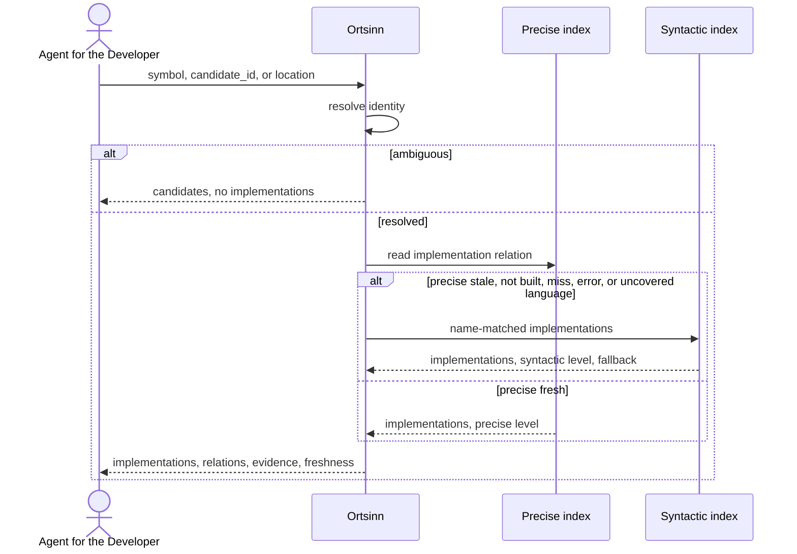

# Use case: UC7.3

## Level
!

## Actors
- Agent for the Developer (primary)
- Supporting: Developer (verifies the implementation set)

## Goal
The agent for the developer gets the implementations of a symbol.

## Trigger
The agent for the developer requests implementations for a known interface,
abstract type, trait, or overridable member.

## Preconditions
- A workspace is configured.
- The index may be empty or stale; the result reports the available level.
- The agent supplies exactly one of `symbol` (identity object), `candidate_id`,
  or `location`.
- `symbol` is the identity shape shared with UC7.1 Resolve a definition; a
  bare short name is not an identity.

## Main flow
1. The agent submits an implementations request with exactly one of `symbol`,
   `candidate_id`, or `location` (`repository`, `path`, `line`, optional
   `column`), plus optional `language`, `repository_scope`, `limit`,
   `token_budget`, and `cursor`.
2. The system resolves the input using the shared rules of UC7.2 Find
   references: `symbol` as supplied, `candidate_id` pinned, or `location` by
   definition, reference, then enclosing precedence. A location that resolves
   to a concrete implementing type is not an implementable symbol; the result
   is `empty` with `no_implementations` and a note naming the concrete type.
3. When more than one identity matches, the result is `ambiguous` with
   candidates and no implementations; the request ends.
4. For a unique identity, the system reads the precise implementation
   relation when the precise level is fresh for every language in which an
   implementation may occur. When the precise level is stale, not built,
   missing the identity, in error, or lacks fresh coverage for a language, the
   system returns a syntactic response for the whole result and records one
   fallback reason. One response uses one level.
5. The system deduplicates implementations by identity and declaration
   location, applies `language` and `repository_scope` filters, and records
   counts. The requested definition's own location is excluded at both levels.
6. The system returns each implementation with its identity, the implemented
   symbol identity and its definition, relations, repository, language, path,
   range, precision, index level, stale flag, and evidence; it paginates under
   the token budget and reports totals.
7. The agent reads the implementations and selects one, requests the next
   page, or narrows the request.

## Extensions
- 1: Zero or more than one input is supplied → `status: invalid`,
  `empty_reason: invalid_input`, one `errors` entry per field; protects the
  minimal guarantee.
- 1: An unknown `repository_scope` or `language` → `status: invalid` naming
  the value; protects the minimal guarantee.
- 1: `token_budget` exceeds the hard cap → the system clamps it and reports
  `budget.requested` and `budget.applied_max`; protects the budget guarantee.
- 2: The `symbol` identity is unknown → `status: empty`, `empty_reason:
  no_match`, with the identity and resolution basis echoed; protects the
  minimal guarantee.
- 2: A `candidate_id` is unknown or foreign → `status: invalid`; an older
  revision returns the pinned result when retained, otherwise `status:
  empty`, `empty_reason: stale_cursor`, `restart_required: true`; protects the
  freshness guarantee.
- 2: The location is invalid or has no enclosing symbol → `invalid` or
  `empty` with the reason; protects the minimal guarantee.
- 2: The location resolves to a concrete implementing type rather than an
  implementable symbol → `status: empty`, `empty_reason:
  no_implementations`, with a note naming the concrete type; protects the
  minimal guarantee.
- 3: The location resolves to several identities → `ambiguous` with
  candidates; the agent resubmits a `candidate_id`.
- 4: The precise level is stale, not built, missing the identity, in error, or
  lacks fresh coverage for an implementation language → syntactic
  implementations with one of `precise_stale`, `precise_not_built`,
  `precise_miss`, `precise_error`, `precise_unsupported_language`; protects the
  precision guarantee.
- 4: The language or level has no implementation support → `status: empty`,
  `empty_reason: not_supported`, with the language and level named; protects
  the minimal guarantee.
- 4: Neither level can answer → `status: error` when a level is in error, or
  `status: empty` with `empty_reason: not_indexed`; `errors` names the level
  and reason; protects the minimal guarantee.
- 4: The resolved symbol cannot have implementations (plain function, final
  class, non-overridable member) → `status: empty`, `empty_reason:
  not_applicable`, with the kind named; protects the minimal guarantee.
- 5: The identity has no implementations → `status: empty`,
  `empty_reason: no_implementations`, when a covering precise level is fresh
  and authoritative; protects the minimal guarantee.
- 5: `repository_scope` or `language` removes some implementations → the
  remaining results and `scope` counts are returned; removes all →
  `out_of_scope` or `language_excluded`; protects the minimal guarantee.
- 6: The result exceeds the token budget → pagination with `has_more` and a
  cursor; a single implementation larger than the budget is returned whole
  with `budget.exceeded`; the envelope alone not fitting yields `status:
  empty`, `empty_reason: budget_exceeded`; protects the budget guarantee.
- 6: A cursor is presented with other input or page parameters → `invalid`;
  an expired cursor → `stale_cursor` with `restart_required`; protects
  determinism.
- 7: The agent narrows the request → restart at step 1.

## Rules
- R1. An implementation is a type or member that realizes the requested
  interface, abstract type, trait, or overridable member. It is not a
  reference and not the requested definition. The requested definition's own
  location is excluded.
- R2. One response uses one level for all implementations. Each implementation
  states `precision` and `index_level`, both `precise` or both `syntactic`.
- R3. A precise response requires fresh precise coverage for every
  implementation language. Otherwise the whole response is syntactic and
  carries one result-level `fallback`: `precise_stale`, `precise_not_built`,
  `precise_miss`, `precise_error`, or `precise_unsupported_language`.
- R4. A syntactic response is name-matched and may miss implementations that
  do not repeat the type name; it may also include unrelated same-named types.
  Every implementation is marked syntactic and the limitation is stated.
  `implementations_total` is approximate in a syntactic response.
- R5. An implementation carries its identity, the implemented symbol identity
  and `implemented_definition` (`path`, `range`, `evidence`), `relations` (a
  set of `implements`, `extends`, `overrides`; empty at syntactic precision
  when the relation is unknown), repository, language, path, range, precision,
  index level, stale flag, and evidence.
- R6. Implementations are deduplicated by identity and declaration location.
  A type that both extends and implements the requested symbol appears once
  with both relations.
- R7. Ordering: repository, path, range start, range end, qualified identity.
  Pages are disjoint slices of that order. `implementations_total` is the
  post-filter, pre-pagination count.
- R8. `repository_scope` (repository names, exact match) filters the
  implementation repository; `language` filters the implementation language,
  not the requested symbol's language. A symbol implemented in another
  language is normal. Removed counts appear in `scope`.
- R9. `empty_reason` is one of `invalid_input`, `no_match`,
  `no_enclosing_symbol`, `no_implementations`, `not_applicable`,
  `not_supported`, `not_indexed`, `out_of_scope`, `language_excluded`,
  `budget_exceeded`, or `stale_cursor`. Precedence: invalid input; no match;
  no enclosing symbol; filters (scope, language); not applicable;
  not supported; no implementations; not indexed; budget; stale cursor.
- R10. `not_supported` means the language or level cannot answer
  implementation queries; `no_implementations` means a covering precise level
  answered authoritatively with none; `not_indexed` means no consulted level
  covers the language or repository; `not_applicable` means the symbol's kind
  cannot have implementations.
- R11. Freshness is an array per language and index level with as-of time,
  revision, and a top-level workspace revision, as in UC7.2.
- R12. The default token budget is 4,000; `limit` bounds the item count;
  `budget` reports requested, applied maximum, used estimate, and exceeded.
  Implementations are atomic; evidence excerpts are capped at 200 code points.
- R13. A cursor is bound to the input, filters, page parameters including the
  applied budget cap, and the index revision; the next page carries the cursor
  alone; expiry returns `stale_cursor`.
- R14. The use case never changes the repository or the index.
- R15. Determinism holds for the same input, filters, page parameters, index
  revisions, and workspace revision.
- R16. Every outcome uses the same envelope: `status`, `input`, `errors`,
  `resolution`, `implementations`, `candidates`, `freshness`,
  `workspace_revision`, `budget`, `cursor`, `empty_reason`, `scope`,
  `implementations_total`, `returned`, `has_more`, `restart_required`.
  `status` is `ok`, `empty`, `ambiguous`, `invalid`, or `error`; `ok` holds
  exactly when `implementations` is non-empty.
- R17. `resolution` is `{basis, attempts, symbol, fallback}`; basis is
  `symbol`, `candidate`, `location_definition`, `location_reference`, or
  `location_enclosing`; `fallback` is null in a precise response.

## Examples

### Example 1 — precise implementations

Input: `symbol: {qualified_name: "UserRepository", short_name:
"UserRepository", kind: "interface", container: null, language: "typescript",
repository: "api", signature: null}`.

Result: `status: ok`, `resolution.basis: symbol`, `resolution.fallback: null`;
implementations:
`SqlUserRepository` (repository `api`, `src/user/sql-repository.ts`, range
10-80, relations `[implements]`, precise, evidence line 10) and
`InMemoryUserRepository` (repository `api`,
`src/user/memory-repository.ts`, range 8-60, relations `[implements]`,
precise, evidence line 8). `implemented_definition` is
`src/user/repository.ts:5-20` for both.

### Example 2 — Java interface

Input: identity `{qualified_name: "com.example.OrderRepository", kind:
"interface", container: "com.example", language: "java", repository:
"orders", signature: null}`.

Result: `JpaOrderRepository` and `InMemoryOrderRepository`, relations
`[implements]`, precise, with repository-relative paths and their evidence
lines. A Kotlin implementation is included if the precise level has fresh
coverage for Kotlin; otherwise the whole response is syntactic.

### Example 3 — Rust trait

Input: identity `{qualified_name: "Storage", kind: "trait", container: null,
language: "rust", repository: "core", signature: null}`.

Result: `FileStorage` and `MemoryStorage`, relations `[implements]`, precise.
Trait default-method overrides appear with relation `overrides` when the
precise index records them; the rule is that they are returned, not a
conditional statement.

### Example 4 — precise level stale

Input: the `UserRepository` identity; the precise level is stale.

Result: `resolution.fallback: precise_stale`; syntactic name-matched types
whose names contain `UserRepository`; each implementation marked syntactic
with `relations: []`; `implementations_total` approximate; the result states
that implementations without the type name may be missed.

### Example 5 — no implementations

Input: the `UserRepository` identity; the precise level is fresh and
authoritative.

Result: `status: empty`, `empty_reason: no_implementations`,
`implementations_total: 0`.

### Example 6 — not applicable

Input: a plain function identity.

Result: `status: empty`, `empty_reason: not_applicable`, with the kind named.
The question does not apply, as distinct from "none exist".

### Example 7 — not supported

Input: a language with no implementation relation in the precise index and no
reliable syntactic relation.

Result: `status: empty`, `empty_reason: not_supported`, with the language and
level named.

### Example 8 — scope filter

Input: the `UserRepository` identity, `repository_scope: ["api"]`; one
implementation is in `web`.

Result: the `api` implementation; `scope: {filtered: 1, repositories:
["web"], languages: []}`. If all are outside, `empty_reason: out_of_scope`.

### Example 9 — pagination

Input: the `UserRepository` identity, `limit: 1`.

Result: one implementation, `implementations_total: 2`, `returned: 1`,
`has_more: true`, cursor. The next page continues the same order.

### Example 10 — concrete location

Input: a location inside `SqlUserRepository`.

Result: `status: empty`, `empty_reason: no_implementations`, with a note that
the location is a concrete implementing type, not an implementable symbol.

### Example 11 — invalid input

Input: both `symbol` and `location`.

Result: `status: invalid`, `empty_reason: invalid_input`, one error entry per
offending field, `implementations: []`.

## Minimal guarantee
Always: the agent receives the echoed input, a status, any errors, and no
fabricated implementation; the repository and the index are unchanged. When
resolution ran: the resolution basis, the symbol or candidates, and the
fallback. When an index was consulted: freshness per language and level with
the workspace revision. Precision and fallback appear only where a level
answered.

## Success guarantee
The agent receives the implementation identities with their implemented
symbol and its definition, relations, precision level and index level,
evidence, repository, language, definition location, fallback reason when any,
and freshness, plus the total and page counts.

## Personas
- agent--coding-harness
- developer--agent-first

## Capabilities
- Implementation lookup by identity, candidate identifier, or location.
- Relation classification: implements, extends, overrides, with syntactic
  relations marked unknown.
- Precise implementation relation with a single-level syntactic fallback.
- Distinguishing no implementations, not applicable, not supported, and not
  indexed.
- Cross-language implementations with per-language freshness coverage.
- Scope and language filtering with counts.
- Pagination under a token budget with totals.

## Interactions
- none at ideation time; the MCP tool mapping is a design concern.

## Includes
- none

## Extends
- none

## Out of scope
- Definitions (UC7.1).
- References (UC7.2).
- Reading the implementation source (UC8.2).
- Editing the repository or the index.
- Direct human query from a CLI or editor (Q1: MCP only).

## Diagram

