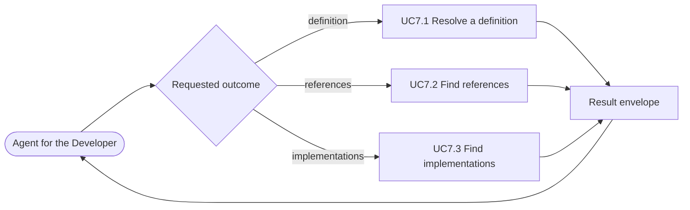

# Use case: UC7

## Level
+

## Actors
- Agent for the Developer (primary)
- Supporting: Developer (verifies the navigation result)

## Goal
The agent for the developer resolves a symbol to its definition, references,
or implementations. The coverage is the union of UC7.1, UC7.2, and UC7.3.

## Trigger
The agent for the developer has a symbol identity or a location and needs a
navigation outcome.

## Preconditions
- A workspace is configured.
- The index may be empty or stale; each child reports the available level.
- The agent supplies a symbol identity, name, location, or candidate
  identifier, as defined by the selected child, and requests one child
  outcome.

## Main flow
1. The agent selects the navigation outcome it needs: definition (UC7.1),
   references (UC7.2), or implementations (UC7.3), and supplies that child's
   input.
2. The system dispatches to the selected child.
3. The child returns its own result envelope with its precision level,
   evidence, fallback reason, and freshness.
4. The agent reads the result and may request another child outcome for the
   same symbol.

## Extensions
- 1: The agent does not name an outcome → the system returns `status:
  invalid`, `empty_reason: invalid_input`, and
  `errors: [{field: "outcome", value: null, reason: "required; supported:
  definition|references|implementations"}]`; protects the minimal guarantee.
- 1: The requested child's input is invalid → the child returns `invalid`;
  the parent does not substitute another outcome; protects the minimal
  guarantee.
- 1: The symbol is ambiguous → the child returns `ambiguous` with candidates;
  the agent selects a candidate before any outcome proceeds; protects the
  success guarantee.

## Rules
- R1. The parent owns no direct capability; coverage is the union of the
  three children.
- R2. The parent returns the selected child's envelope verbatim, with no
  wrapper, and never fabricates a child result. The child's own precision,
  fallback, evidence, and freshness govern.
- R3. The three children share the identity shape, the one-level-per-response
  rule, the empty-reason *conventions* (each child has its own closed set),
  and the cursor and budget conventions. No child may return another child's
  reason.
- R4. The parent does not change the repository or the index.
- R5. The parent is deterministic in proportion to its children: the same
  request, filters, page parameters, index revisions, and workspace revision
  return the same result.

## Examples
- A definition request returns UC7.1's result; a references request returns
  UC7.2's; an implementations request returns UC7.3's, verbatim.
- An ambiguous name in UC7.1 returns candidates; the agent selects
  `candidate_id`, then passes that identifier to UC7.2 for references.
- A stale precise level yields the child's syntactic fallback, marked as such.
- A missing outcome returns `status: invalid` with the supported outcomes in
  `errors`, as defined in extension 1.

## Minimal guarantee
Even when the requested child cannot answer, the agent receives that child's
minimal-guarantee result: status, errors, resolution, fallback, freshness, and
no fabricated location; the repository and the index are unchanged.

## Success guarantee
The selected child returns its own result — `ok`, `empty`, `ambiguous`,
`invalid`, or `error` — with its evidence, precision, fallback, and freshness.
Because coverage is the union, an empty child result is a successful parent
outcome, not a parent failure; the parent never substitutes another child.

## Personas
- agent--coding-harness
- developer--agent-first

## Capabilities
- none directly; the parent owns only the child relationships.

## Interactions
- none at ideation time; the MCP tool mapping is a design concern.

## Includes
- UC7.1 Resolve a definition.
- UC7.2 Find references.
- UC7.3 Find implementations.

## Extends
- none

## Out of scope
- Understanding a chosen location (UC8).
- Assessing change impact (UC9).
- Editing the repository or the index.
- Direct human query from a CLI or editor (Q1: MCP only).

## Diagram

