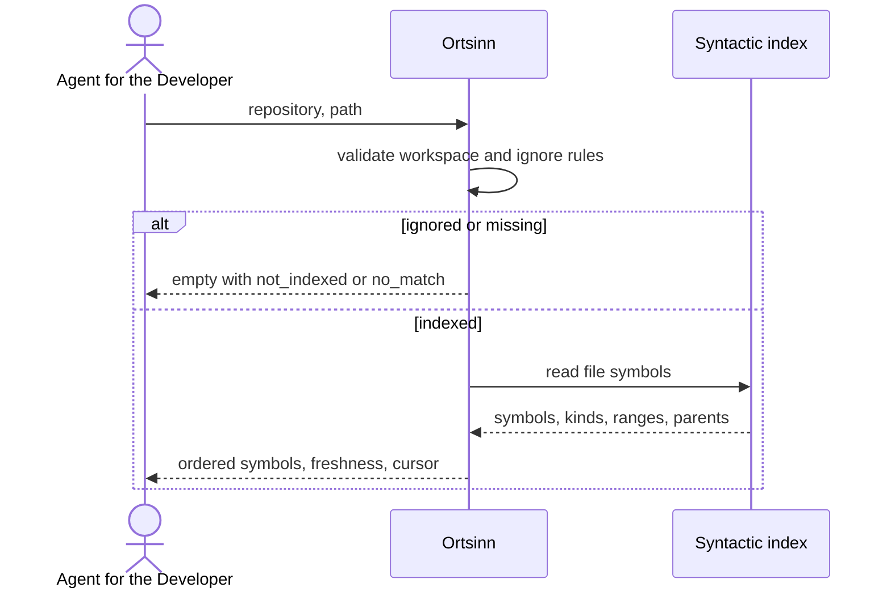

# Use case: UC8.1

## Level
!

## Actors
- Agent for the Developer (primary)
- Supporting: Developer (verifies the file structure)

## Goal
The agent for the developer gets the symbols of a file.

## Trigger
The agent for the developer requests the symbols of a file path.

## Preconditions
- A workspace is configured.
- The file belongs to a repository in the workspace.
- The index may be empty or stale; the result reports the available level.

## Main flow
1. The agent submits a file-symbols request with `repository` and `path`,
   plus optional `language`, `limit`, `token_budget`, and `cursor`.
2. The system validates that the repository and path are in the workspace and
   that the path is indexed.
3. The system reads the file's syntactic symbols from the symbol table, with
   their kinds, ranges, and parent symbols.
4. The system orders the symbols by source range, returns each symbol identity,
   parent identity, kind, range, precision, index level, stale flag, and
   evidence, and paginates under the token budget.
5. The agent reads the symbol list and selects a symbol or requests the next
   page.

## Extensions
- 1: `repository` or `path` is missing or unknown → `status: invalid`,
  `empty_reason: invalid_input`, one `errors` entry per field; protects the
  minimal guarantee.
- 1: `language` is unknown → `status: invalid` naming the value; a known
  language that differs from the file's language → `status: invalid` naming
  the mismatch; protects the minimal guarantee.
- 1: `token_budget` exceeds the hard cap → the system clamps it and reports
  `budget.requested` and `budget.applied_max`; protects the budget guarantee.
- 2: The file is outside the workspace or ignored by a workspace rule →
  `status: empty`, `empty_reason: not_indexed`, with the path and rule named;
  protects the minimal guarantee.
- 2: The file was indexed but has since been deleted → `status: empty`,
  `empty_reason: not_indexed`, with the path named; protects the minimal
  guarantee. A well-formed path that is not currently in the index is always
  `not_indexed`; `no_match` is not used for files.
- 2: The file is unparseable → `status: error`, with `errors` naming the path
  and the parse failure; the system never returns an empty list as if the file
  had no symbols; protects the minimal guarantee.
- 3: The file parses but declares no symbols → `status: empty`,
  `empty_reason: no_symbols`; protects the minimal guarantee.
- 4: The symbol list exceeds the token budget → pagination with `has_more`
  and a cursor; a single symbol larger than the budget is returned whole with
  `budget.exceeded`; protects the budget guarantee.
- 4: The syntactic level is stale → every symbol carries `stale: true` and
  the freshness block names the as-of time and revision; protects the
  freshness guarantee.
- 4: A cursor is presented with other input or page parameters → `invalid`;
  an expired cursor → `stale_cursor` with `restart_required`; protects
  determinism.
- 5: The agent selects a symbol → the flow ends; source retrieval is UC8.2.

## Rules
- R1. A file symbol is a named declaration the syntactic index found in the
  file. Comments, string literals, and references are not symbols.
- R2. The outline is derived from the syntactic index; every symbol states
  `precision: syntactic` and `index_level: syntactic`.
- R3. Each symbol carries its identity in the shape of UC7.1 Resolve a
  definition, its parent identity or null, kind, range, stale flag, and
  evidence.
- R4. Symbols are ordered by range start, then range end, then qualified
  identity. Nested symbols keep a `parent` link; the order remains source
  order.
- R5. A range is `{start_line, start_column, end_line, end_column}`, 1-based
  and inclusive; columns count Unicode code points. Evidence is the
  declaration line and a bounded excerpt of at most 200 code points.
- R6. The path is relative to the repository root. The file's language is the
  indexed language; an unknown `language` is invalid, and a known language
  that differs from the file's language is invalid with the mismatch named.
- R6a. Validation order is: input syntax and workspace membership, then ignore
  rules and index presence. A malformed path or unknown repository is
  `invalid_input`; a well-formed path not currently in the index is
  `not_indexed`.
- R7. Freshness is reported for the file's syntactic level with as-of time,
  revision, and workspace revision, as in UC7.2.
- R8. `empty_reason` is one of `invalid_input`, `not_indexed`, `no_symbols`,
  `budget_exceeded`, or `stale_cursor`.
- R9. The default token budget is 4,000; `limit` bounds the symbol count; the
  effective page is `min(limit, symbols that fit the budget)`;
  `symbols_total` is the post-filter, pre-pagination count. `budget` reports
  requested, applied maximum, used estimate, and exceeded. If the envelope
  alone cannot fit, the result is `status: empty`, `empty_reason:
  budget_exceeded`.
- R10. A cursor is bound to the repository, path, language, page parameters
  including the applied budget cap, the index revision, and the workspace
  revision; the next page carries the cursor alone.
- R11. The use case never changes the repository or the index.
- R12. The same input, filters, page parameters, index revision, and
  workspace revision return the same order.
- R13. Every outcome uses the same envelope: `status`, `input`, `errors`,
  `file`, `symbols`, `freshness`, `workspace_revision`, `budget`, `cursor`,
  `empty_reason`, `symbols_total`, `returned`, `has_more`,
  `restart_required`. `file` is `{repository, path, language, revision,
  stale, precision, index_level}`. `status` is `ok`, `empty`, `invalid`, or
  `error`; `ok` holds exactly when `symbols` is non-empty.
- R14. `parent` is the syntactic enclosing symbol; it may differ from the
  identity's `container` (for example, a nested class inside a namespace).
  Kinds use the shared symbol-kind set of the identity.

## Examples

### Example 1 — TypeScript file

Input: `repository: "api"`, `path: "src/user/profile.ts"`.

Result: `status: ok`; `file: {repository: "api", path:
"src/user/profile.ts", language: "typescript", revision: "...", stale:
false, precision: "syntactic", index_level: "syntactic"}`; symbols:
`UserService` (class, range `{start_line: 12, start_column: 1, end_line: 96,
end_column: 2}`, parent null), `getUserProfile` (function, range
`{start_line: 41, start_column: 1, end_line: 68, end_column: 2}`, parent
`UserService`), `updateProfile` (function, range `{start_line: 72,
start_column: 1, end_line: 96, end_column: 2}`, parent `UserService`);
all precision `syntactic`, evidence at each declaration line.

### Example 2 — empty file

Input: `repository: "api"`, `path: "src/empty.ts"`.

Result: `status: empty`, `empty_reason: no_symbols`, `symbols_total: 0`.

### Example 3 — unparseable file

Input: `repository: "api"`, `path: "src/broken.ts"`.

Result: `status: error`; `errors: [{field: "path", value:
"src/broken.ts", reason: "parse error at line 4"}]`; `symbols: []`. The
agent knows the outline is unavailable, not empty.

### Example 4 — ignored file

Input: `repository: "api"`, `path: "vendor/generated.ts"`, excluded by the
workspace ignore rule.

Result: `status: empty`, `empty_reason: not_indexed`, with the path and rule
named.

### Example 5 — stale syntactic level

Input: a file whose syntactic level is stale.

Result: the same symbols, each `stale: true`; the freshness block names the
stale level and its as-of time. The agent knows the outline may not match the
current file.

### Example 6 — pagination

Input: a file with 80 symbols, `limit: 20`.

Result: 20 symbols, `symbols_total: 80`, `returned: 20`, `has_more: true`,
cursor. The next page continues the same source order.

### Example 7 — invalid input

Input: missing `path`.

Result: `status: invalid`, `empty_reason: invalid_input`,
`errors: [{field: "path", value: null, reason: "required"}]`.

## Minimal guarantee
Always: the agent receives the echoed input, a status, any errors, and no
fabricated symbol; the repository and the index are unchanged. When the file
was read: the file identity, freshness, and an empty or partial symbol list.
An unparseable file is an error, never an empty outline.

## Success guarantee
The agent receives the file's symbols with their identities, parents, kinds,
ranges, evidence, and freshness.

## Personas
- agent--coding-harness
- developer--agent-first

## Capabilities
- File symbol listing from the syntactic index.
- Parent links and source order.
- Parse-failure reporting distinct from an empty file.
- Ignore-rule and missing-file reporting.
- Pagination under a token budget.

## Interactions
- none at ideation time; the MCP tool mapping is a design concern.

## Includes
- none

## Extends
- none

## Out of scope
- Retrieving a symbol's source (UC8.2).
- Explaining the file (UC8.3).
- Resolving a definition or reference (UC7).
- Editing the repository or the index.

## Diagram

