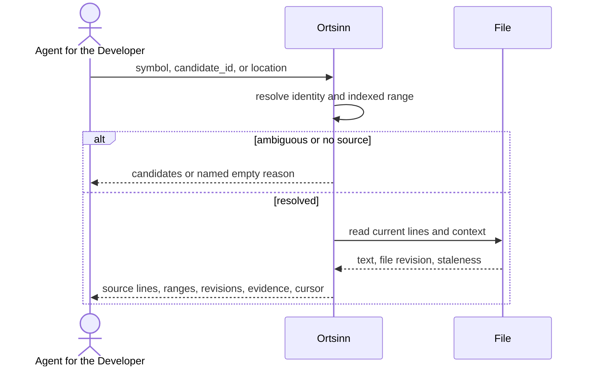

# Use case: UC8.2

## Level
!

## Actors
- Agent for the Developer (primary)
- Supporting: Developer (reads the same source)

## Goal
The agent for the developer gets the source of a symbol with surrounding
context.

## Trigger
The agent for the developer requests the source of a symbol.

## Preconditions
- A workspace is configured.
- The index may be empty or stale; the result reports the available level.
- The agent supplies exactly one of `symbol` (identity object), `candidate_id`,
  or `location`.

## Main flow
1. The agent submits a source request with exactly one of `symbol`,
   `candidate_id`, or `location`, plus optional `context_lines` (default 5,
   maximum 50), `token_budget`, and `cursor`.
2. The system resolves the input using the shared resolution rules of UC7.2
   Find references: `symbol` as supplied, `candidate_id` pinned, or `location`
   by definition, reference, then enclosing precedence.
3. When more than one identity matches, the system returns `status:
   ambiguous` with candidates and no source; the request ends.
4. The system reads the symbol's indexed range and the current file content,
   clamps the requested context to the file bounds, and returns the current
   file's lines for the range and context with their line numbers.
5. When the current file revision differs from the index revision used for
   the symbol range, the result sets `stale: true` and `range_verified:
   false`, and states that the indexed range may not match the current file.
6. The system paginates the source by lines under the token budget and returns
   a cursor bound to the file and index revisions when more lines follow.
7. The agent reads the source; when the result is ambiguous, it selects a
   candidate and resubmits; when truncated, it requests the next page.

## Extensions
- 1: Zero or more than one input is supplied → `status: invalid`,
  `empty_reason: invalid_input`, one `errors` entry per field; protects the
  minimal guarantee.
- 1: `context_lines` is negative, not an integer, or above 50 → `status:
  invalid` naming the field; protects the minimal guarantee.
- 1: `token_budget` exceeds the hard cap → the system clamps it and reports
  `budget.requested` and `budget.applied_max`; protects the budget guarantee.
- 2: The identity is unknown → `status: empty`, `empty_reason: no_match`;
  protects the minimal guarantee.
- 2: The location has no enclosing symbol → `status: empty`,
  `empty_reason: no_enclosing_symbol`; protects the minimal guarantee.
- 3: The identity is ambiguous → candidates, no source; the agent resubmits a
  `candidate_id`.
- 4: The symbol has no source range (external or generated symbol) → `status:
  empty`, `empty_reason: no_source`; protects the minimal guarantee.
- 4: The file is missing or no longer in the index → `status: empty`,
  `empty_reason: not_indexed`; protects the minimal guarantee.
- 5: The file changed after the index revision → `status: ok` with
  `source.stale: true` and `source.range_verified: false`; protects the
  freshness guarantee.
- 6: The source exceeds the token budget → the first lines that fit are
  returned, `source.truncated: true`, and a line cursor follows; a single line
  longer than the budget is returned whole with `budget.exceeded: true`;
  protects the budget guarantee.
- 6: The file changes between pages → `status: empty`, `empty_reason:
  stale_cursor`, `restart_required: true`; protects determinism and freshness.
- 6: The envelope alone cannot fit → `status: empty`, `empty_reason:
  budget_exceeded`; protects the budget guarantee.
- 7: The agent narrows the request → restart at step 1.

## Rules
- R1. The source is the current file's actual text for the indexed symbol
  range plus the requested context. The system never synthesizes or reformats
  code.
- R2. `source` is `{identity, repository, language, path, symbol_range,
  context_range, lines: [{line, text}], file_revision, index_revision, stale,
  range_verified, truncated, precision, index_level, evidence}`.
- R3. `context_lines` is clamped to the file bounds; the default is 5 lines
  before and after the symbol range; the maximum accepted value is 50.
- R4. Line numbers are 1-based; columns count Unicode code points. The source
  lines carry their original line numbers.
- R5. The source is read from the current file. `range_verified` is true only
  when the file revision equals the index revision used for the symbol range.
  When false, `stale` is true and the result states that the range may not
  match the current file.
- R6. `source.truncated` is true when the token budget cut the source; a
  cursor continues at the next line. A single line longer than the budget is
  returned whole with `budget.exceeded: true`.
- R7. `empty_reason` is one of `invalid_input`, `no_match`,
  `no_enclosing_symbol`, `no_source`, `not_indexed`, `budget_exceeded`, or
  `stale_cursor`.
- R8. Freshness is an array per language and index level with as-of time,
  revision, and a top-level workspace revision, as in UC7.2.
- R9. The default token budget is 4,000; `budget` reports requested, applied
  maximum, used estimate, and exceeded.
- R10. A cursor is bound to the input, page parameters, the file content
  revision observed on the first page, and the index revision; the next page
  carries the cursor alone. A file or index revision change returns
  `stale_cursor`.
- R11. The use case never changes the repository or the index.
- R12. The same input, page parameters, file revision, index revision, and
  workspace revision return the same source.
- R13. Every outcome uses the same envelope: `status`, `input`, `errors`,
  `resolution`, `source`, `freshness`, `workspace_revision`, `budget`,
  `cursor`, `empty_reason`, `restart_required`. `status` is `ok`, `empty`,
  `ambiguous`, `invalid`, or `error`; `ok` holds exactly when `source` is
  non-null.
- R14. `resolution` is `{basis, attempts, symbol, fallback}`; basis is
  `symbol`, `candidate`, `location_definition`, `location_reference`, or
  `location_enclosing`.
- R15. Paths are repository-relative; the repository is a separate field.

## Examples

### Example 1 — function source

Input: `symbol: UserService.getUserProfile`, `context_lines: 5`.

Result: `status: ok`; `source: {identity: UserService.getUserProfile,
repository: "api", language: "typescript", path: "src/user/profile.ts",
symbol_range: {41,1,68,2}, context_range: {36,1,73,2}, lines: 36-73 with
their line numbers, file_revision: "f-...", index_revision: "r-...", stale:
false, range_verified: true, truncated: false, precision: "precise",
index_level: "precise", evidence: {path: "src/user/profile.ts", line: 41}}`.

### Example 2 — class source

Input: `symbol: UserService`, `context_lines: 0`.

Result: the class body from its declaration through its closing brace, no
extra context; line numbers preserved; `context_range` equals
`symbol_range`.

### Example 3 — symbol without source

Input: an identity for an external or generated symbol.

Result: `status: empty`, `empty_reason: no_source`, the identity echoed.

### Example 4 — stale file

Input: a symbol whose file changed after the index revision.

Result: `status: ok`; `source.stale: true`; `source.range_verified: false`;
the current file's lines at the indexed range, with the result stating that
the range may not match the current file. The developer can compare the
evidence line with the returned text.

### Example 5 — truncated source

Input: a large function, `token_budget: 1000`.

Result: the first lines that fit, `source.truncated: true`,
`budget.exceeded: false`, and a cursor at the next line. A later page with a
changed file returns `stale_cursor`.

### Example 6 — missing file

Input: a symbol whose file was deleted.

Result: `status: empty`, `empty_reason: not_indexed`, the path named.

### Example 7 — invalid input

Input: both `symbol` and `location`.

Result: `status: invalid`, `empty_reason: invalid_input`, one error entry per
field, `source: null`.

### Example 8 — location on a call site

Input: a location on a call of `getUserProfile`.

Result: `resolution.basis: location_reference`; the identity is
`UserService.getUserProfile`; the source is that symbol's definition.

## Minimal guarantee
Always: the agent receives the echoed input, a status, any errors, and no
synthesized source; the repository and the index are unchanged. When
resolution ran: the resolution basis and the symbol or candidates. When the
file was read: source lines or a named reason, the file and index revisions,
and freshness.

## Success guarantee
The agent receives the symbol's current source lines with the symbol range,
context range, line numbers, file and index revisions, range verification,
evidence, stale flag, and freshness.

## Personas
- agent--coding-harness
- developer--agent-first

## Capabilities
- Source retrieval by identity, candidate identifier, or location.
- Context lines around the symbol with a 50-line cap.
- Current-file reading with range verification.
- Line-based pagination under a token budget.
- Missing-file, no-source, and stale-range reporting.

## Interactions
- none at ideation time; the MCP tool mapping is a design concern.

## Includes
- none

## Extends
- none

## Out of scope
- File symbol listing (UC8.1).
- Explaining the symbol (UC8.3).
- Editing the source.
- Direct human query from a CLI or editor (Q1: MCP only).

## Diagram

