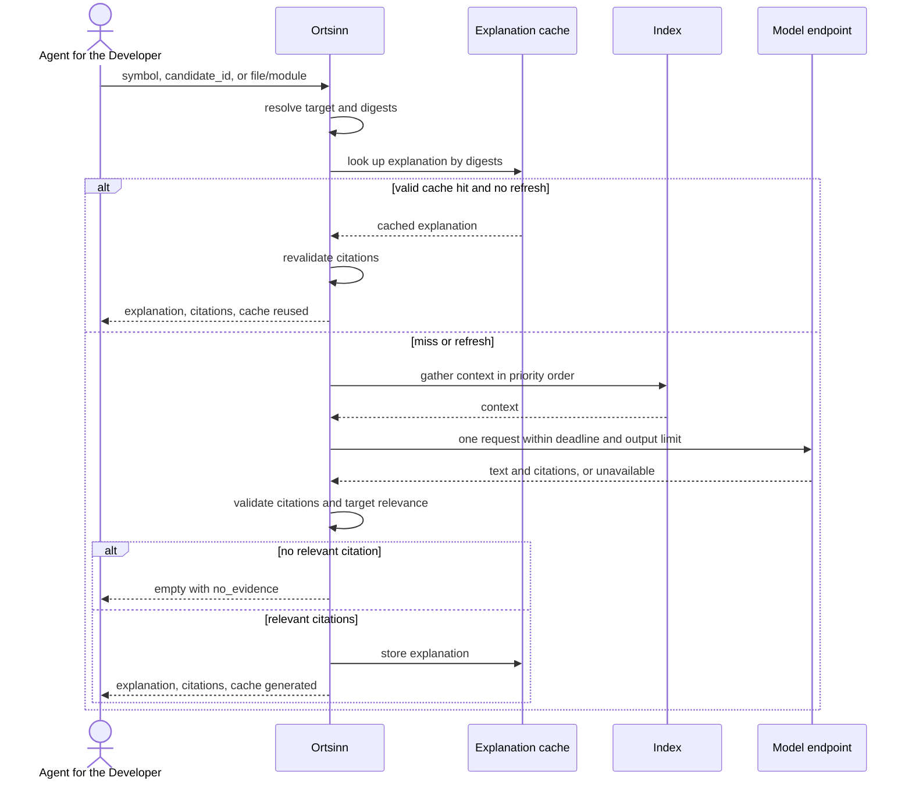

# Use case: UC8.3

## Level
!

## Actors
- Agent for the Developer (primary)
- Supporting: Developer (checks the cited evidence)
- Supporting: Model endpoint operator (serves explanation requests)

## Goal
The agent for the developer gets an evidence-backed explanation of a symbol or
file.

## Trigger
The agent for the developer requests an explanation of a symbol, a file, or a
module directory.

## Preconditions
- A workspace is configured and indexed.
- The target may be unknown, ignored, stale, or ambiguous; the result reports
  it.
- An external model endpoint is configured and external transfer is permitted
  (`offline: false` and `model_endpoint.permitted: true`), or a cached
  explanation exists. Cached explanations are served even when transfer is
  not permitted.
- Offline is a named workspace setting; when set, no external request is
  issued.

## Main flow
1. The agent submits an explanation request with exactly one of `symbol`
   (identity object), `candidate_id`, or `file` (`repository`, `path`; a
   directory path means a module), plus optional `refresh` (default false),
   `language`, and `token_budget`.
2. The system resolves the target: the symbol identity, the selected
   candidate, or the file or module path.
3. The system computes the target content digest and a context digest
   (glossary revision, docs revision, index revision) and looks up a cached
   explanation keyed by both digests, the prompt version, and the model
   identity. A valid cache hit is returned with `cache: reused` unless
   `refresh` is true. A cache hit whose citations no longer resolve is
   treated as a miss.
4. On a miss or refresh, the system gathers context in a fixed priority
   order: target source, symbol structure, glossary terms, related docs or
   decision records, dependency metrics. The context is capped before the
   call; context that does not fit is dropped in that order.
5. The system calls the model endpoint once with a stated deadline, a fixed
   generation context budget, a declared output-token limit, and a prompt
   version; it does not retry automatically. Identical cache keys in flight
   share one generation; a request that cannot wait returns
   `empty/unavailable` with reason `in_flight`.
6. The system parses the explanation and its citations, validates every
   citation, and drops citations that do not resolve. For a symbol target, at
   least one valid citation must lie inside the target's own range; for a file
   or module target, at least one must lie inside the target file or module.
   When no such citation remains, no explanation is returned.
7. The system caches the explanation outside the repository and the index and
   returns the text with its citations, cache state, model, prompt version,
   generation time, budgets, freshness, and any truncation.
8. The agent reads the explanation and verifies the cited locations; it may
   refresh the explanation or request another target.

## Extensions
- 1: Zero or more than one target is supplied → `status: invalid`,
  `empty_reason: invalid_input`, one `errors` entry per field; protects the
  minimal guarantee.
- 1: A malformed repository, path, language, or symbol → `status: invalid`
  with the field named; protects the minimal guarantee.
- 1: `token_budget` exceeds the hard cap → the system clamps it and reports
  the applied cap; protects the budget guarantee.
- 2: A well-formed target that does not exist → `status: empty`,
  `empty_reason: no_match`, with the target named; protects the minimal
  guarantee.
- 2: The target is ignored or not currently in the index → `status: empty`,
  `empty_reason: not_indexed`; protects the minimal guarantee.
- 3: A valid cached explanation exists and `refresh` is false → the
  explanation is returned with `cache: reused`, no external request; citations
  are revalidated and invalid ones are dropped. If none remain, the entry is
  treated as a miss and step 4 runs.
- 3: An identical cache key is being generated → the request waits until its
  deadline; if the generation completes, it returns that result with `cache:
  shared`; if the deadline expires, it returns `status: empty`,
  `empty_reason: unavailable`, reason `in_flight`, `retryable: true`, and no
  second request.
- 4: The context cannot fit enough to ground an explanation → `status: empty`,
  `empty_reason: budget_exceeded`, no external call; protects the budget
  guarantee.
- 5: The product is offline and no cached explanation exists → `status:
  empty`, `empty_reason: unavailable`, reason `offline`, `retryable: false`;
  no external request; protects the minimal guarantee.
- 5: External transfer is not permitted (`model_endpoint.permitted: false`)
  and no cached explanation exists → `status: empty`, `empty_reason:
  unavailable`, reason `not_permitted`, `retryable: false`; no external
  request; protects the data-boundary guarantee.
- 5: No model endpoint is configured and no cached explanation exists →
  `status: empty`, `empty_reason: unavailable`, reason `not_configured`,
  `retryable: false`; no external request; protects the minimal guarantee.
- 5: The endpoint times out → `status: empty`, `empty_reason: unavailable`,
  reason `timeout`, `retryable: true`; the single attempt is abandoned at the
  deadline.
- 5: The endpoint throttles → reason `throttled`, `retryable: true`.
- 5: The endpoint refuses or rejects authorization → reason `refused` or
  `unauthorized`, `retryable: false`.
- 5: The endpoint returns malformed output → `status: empty`, `empty_reason:
  unavailable`, reason `malformed`, `retryable: true`; no explanation is
  cached.
- 6: The model returns no citation that resolves and is relevant to the target
  → `status: empty`, `empty_reason: no_evidence`, with the dropped citation
  count; no explanation text is returned.
- 6: Some citations resolve and are relevant, some do not → the explanation is
  returned with only the valid, relevant citations; the dropped count is
  reported.
- 7: The explanation exceeds the requested token budget → the returned text is
  truncated at a sentence or line boundary, `truncated: true`, citations
  preserved; the cache entry is not truncated.
- 7: The explanation cannot fit even the envelope → `status: empty`,
  `empty_reason: budget_exceeded`.
- 8: The agent refreshes → the cache is bypassed and one generation is
  attempted; on failure the previous cache entry remains.

## Rules
- R1. An explanation is interpretive text about a symbol, file, or module; it
  is not a precision answer and does not replace UC7's definition or reference
  result.
- R2. Every returned explanation carries at least one citation that resolves
  to a repository location and is relevant to the target.
- R3. A citation is `{repository, path, line}`. It is valid when the path
  exists in the workspace and the line is within the file. For a symbol
  target, at least one valid citation lies inside the target's own range; for
  a file or module target, at least one lies inside the target. Additional
  citations may be in indexed code, docs, or decision records.
- R4. The cache key is the target content digest, the context digest (glossary
  revision, docs revision, index revision), the prompt version, and the model
  identity. A cache hit is revalidated; invalid citations are dropped; when no
  relevant citation remains, the entry is a miss.
- R5. The explanation is cached outside the repository and the index; a cache
  write does not change freshness and is not a repository mutation.
- R6. The request to the model carries the target's source, repository-relative
  paths, and the selected context within the generation context budget. It
  never carries repository names, unrelated repository content, or evidence
  for other targets. The server attaches the repository to citations after
  parsing. Offline, `model_endpoint.permitted: false`, or an unconfigured
  endpoint issues no request.
- R7. One explanation generation makes at most one external attempt, with no
  automatic retry, and completes within the stated deadline. Failures carry
  `reason` and `retryable`: `offline` false, `not_permitted` false,
  `not_configured` false, `timeout` true, `throttled` true, `refused` false,
  `unauthorized` false, `malformed` true, `in_flight` true.
- R8. The request declares an output-token limit derived from the response
  budget; client-side truncation is a safety net for a non-conforming
  endpoint. Context and output budgets are separate and reported.
- R9. `token_budget` bounds the returned text only; generation uses the fixed
  generation budgets. A cached explanation is truncated on return to the
  current budget without changing the cache entry.
- R10. `empty_reason` is one of `invalid_input`, `no_match`, `not_indexed`,
  `unavailable`, `no_evidence`, or `budget_exceeded`.
- R11. The same target digest, context digest, prompt version, model identity,
  and `refresh: false` return the cached explanation. A changed digest is a
  miss.
- R12. The use case never changes the repository or the index.
- R13. Freshness is an array per language and index level with as-of time,
  revision, and a top-level workspace revision, as in UC7.2. A stale level
  means the explanation may describe older content.
- R14. Identical cache keys in flight share one generation; a completed
  generation is written once.
- R15. Every outcome uses the same envelope: `status`, `input`, `errors`,
  `resolution`, `explanation`, `freshness`, `workspace_revision`, `budget`,
  `reason`, `retryable`, `empty_reason`. `status` is `ok`, `empty`, `invalid`,
  or `error`; `ok` holds exactly when `explanation` is non-null.
- R16. `explanation` is `{text, citations: [{repository, path, line}],
  truncated, dropped_citations, cache: reused|generated|shared, model,
  prompt_version, generated_at}`.
- R17. `resolution` is `{target, kind: symbol|file|module, basis:
  symbol|candidate|file}`.
- R18. `budget` is `{request: {cap, used}, response: {cap, used, exceeded},
  requested, applied_max}`.

## Examples

### Example 1 — explain a function

Input: `symbol: UserService.getUserProfile`.

Result: `status: ok`; `resolution: {target: UserService.getUserProfile,
kind: "symbol", basis: "symbol"}`; `explanation: {text: "...", citations:
[{repository: "api", path: "src/user/profile.ts", line: 41}, {repository:
"api", path: "src/auth/service.ts", line: 88}], truncated: false,
dropped_citations: 0, cache: "generated", model: "...", prompt_version: "v1",
generated_at: "..."}`; `budget: {request: {cap: 3000, used: 2100}, response:
{cap: 800, used: 420, exceeded: false}, requested: 4000, applied_max: 4000}`.

### Example 2 — explain a file or module

Input: `file: {repository: "api", path: "src/auth"}` (a module directory).

Result: an explanation of the module's responsibilities, public symbols, and
dependency direction; citations inside the module, e.g.
`src/auth/middleware.ts:20` and `src/auth/jwt.ts:14`. The module target is
valid; its citation relevance is checked against the directory.

### Example 3 — cached

Input: the same target, `refresh: false`.

Result: the cached explanation, `cache: reused`, no external request. Its
citations were revalidated; the count of dropped citations is reported.

### Example 4 — refresh

Input: the same target, `refresh: true`.

Result: one generation attempt; on success the cache is replaced and
`cache: generated`; on endpoint failure `status: empty`, `empty_reason:
unavailable`, `reason: "timeout"`, `retryable: true`, and the previous cache
entry remains.

### Example 5 — offline with cache

Input: a target with a valid cached explanation, offline.

Result: `cache: reused`, `status: ok`; no external request.

### Example 6 — offline without cache

Input: a fresh target, offline.

Result: `status: empty`, `empty_reason: unavailable`, reason `offline`,
`retryable: false`; no external request.

### Example 7 — no relevant evidence

Input: a fresh target; the model returns text whose citations resolve only
outside the target and outside its module.

Result: `status: empty`, `empty_reason: no_evidence`; `dropped_citations`
reports the count; no explanation text is returned.

### Example 8 — in-flight duplicate

Input: the same target while another identical request is generating.

Result: either the shared result with `cache: shared` after completion, or
`status: empty`, `empty_reason: unavailable`, reason `in_flight`,
`retryable: true`; no second external request.

### Example 9 — invalid input

Input: both `symbol` and `file`.

Result: `status: invalid`, `empty_reason: invalid_input`, one error entry per
field, `explanation: null`.

## Minimal guarantee
Always: the agent receives the echoed input, a status, any errors, and no
ungrounded explanation; the repository and the index are unchanged, and the
cache is outside both. When a target was resolved: the resolution basis and
the target. When a generation or cache lookup ran: the cache state, model,
prompt version, freshness, and budgets.

## Success guarantee
The agent receives an explanation of the target with at least one citation
that resolves to the target's own range, file, or module, the cache state,
model and prompt version, generation time, freshness, and budgets.

## Personas
- agent--coding-harness
- developer--agent-first
- provider--model-endpoint

## Capabilities
- Explanation of a symbol, a selected symbol, a file, or a module.
- Cached explanations keyed by target and context digests, prompt version, and
  model.
- Citation validation and target relevance.
- Offline cache reuse and explicit unavailability.
- One bounded generation attempt with a deadline and an output limit.
- Shared in-flight generation for identical targets.
- Truncation under a response budget with citations preserved.

## Interactions
- none at ideation time; the MCP tool mapping is a design concern.

## Includes
- none

## Extends
- none

## Out of scope
- Definitions and references (UC7).
- Source retrieval without explanation (UC8.2).
- Editing the repository or the index.
- Guaranteed correctness of the explanation without evidence.
- Direct human query from a CLI or editor (Q1: MCP only).

## Diagram

