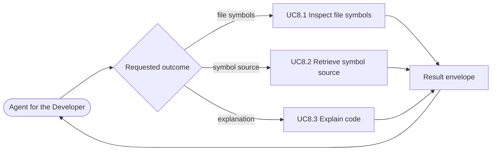

# Use case: UC8

## Level
+

## Actors
- Agent for the Developer (primary)
- Supporting: Developer (verifies the returned context)

## Goal
The agent for the developer gets enough context to understand a file or
symbol. The coverage is the union of UC8.1, UC8.2, and UC8.3.

## Trigger
The agent for the developer has a file or symbol and needs structure, source,
or an explanation.

## Preconditions
- A workspace is configured and indexed.
- The target may be unknown, ignored, stale, or ambiguous; the selected child
  reports it.
- The agent requests one child outcome.

## Main flow
1. The agent selects the understanding outcome it needs: file symbols
   (UC8.1), symbol source (UC8.2), or an explanation (UC8.3), and supplies
   that child's input.
2. The system dispatches to the selected child.
3. The child returns its own envelope with evidence, freshness, and any
   fallback or unavailability reason.
4. The agent reads the result and may request another child outcome for the
   same target.

## Extensions
- 1: The agent does not name an outcome → the system returns `status:
  invalid` and names the supported outcomes; protects the minimal guarantee.
- 1: The requested child's input is invalid → the child returns `invalid`;
  the parent does not substitute another outcome; protects the minimal
  guarantee.
- 1: The target is ambiguous → the child returns `ambiguous` with candidates;
  the agent selects a candidate before proceeding; protects the success
  guarantee.
- 1: The child returns `error` (for example an unparseable file) → the parent
  returns the same envelope; it never downgrades `error` to `empty`; protects
  the minimal guarantee.

## Rules
- R1. The parent owns no direct capability; coverage is the union of the
  three children.
- R2. The parent never fabricates a child result. The requested child's own
  precision, evidence, cache state, and freshness govern.
- R3. The children share the identity shape and the token-budget conventions
  of UC7. Cursors appear only where the child paginates, with child-defined
  units (symbols in UC8.1, lines in UC8.2; UC8.3 has no cursor).
- R4. The parent does not change the repository or the index. A cached
  explanation is outside both.
- R5. The parent is deterministic in proportion to its children: the same
  request, filters, page parameters, index revisions, workspace revision, and
  cache state return the same result.

## Examples
- A file-symbols request returns UC8.1's outline verbatim; a source request
  returns UC8.2's lines; an explanation request returns UC8.3's text and
  citations.
- A cached explanation returns with `cache: reused` and no external request.
- A stale syntactic level marks the outline or source as stale
  (`range_verified: false` for source); an explanation states its cache and
  freshness separately.
- An unparseable file returns the child's `error` envelope unchanged; the
  parent does not turn it into an empty outline.

## Minimal guarantee
Even when the requested child cannot answer, the agent receives that child's
minimal-guarantee result: status, errors, resolution, freshness, and no
fabricated content; the repository and the index are unchanged.

## Success guarantee
The selected child returns its own result — `ok`, `empty`, `ambiguous`,
`invalid`, or `error` — with its evidence, freshness, and any fallback,
unavailability, or cache state. Because coverage is the union, an empty child
result is a successful parent outcome, not a parent failure; the parent never
substitutes another child.

## Personas
- agent--coding-harness
- developer--agent-first

## Capabilities
- none directly; the parent owns only the child relationships.

## Interactions
- none at ideation time; the MCP tool mapping is a design concern.

## Includes
- UC8.1 Inspect file symbols.
- UC8.2 Retrieve symbol source.
- UC8.3 Explain code.

## Extends
- none

## Out of scope
- Definitions, references, and implementations (UC7).
- Assessing change impact (UC9).
- Editing the repository or the index.
- Direct human query from a CLI or editor (Q1: MCP only).

## Diagram

