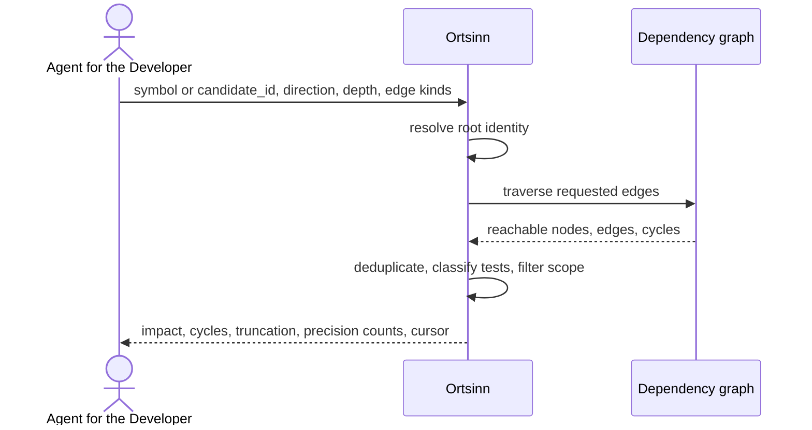

# Use case: UC9

## Level
!

## Actors
- Agent for the Developer (primary)
- Supporting: Developer (verifies the affected set)

## Goal
The agent for the developer gets the transitive dependents affected by a change
to a symbol.

## Trigger
The agent for the developer requests the impact of a proposed change to a
symbol.

## Preconditions
- A workspace is configured and indexed.
- The dependency graph has at least the syntactic edges.
- The agent supplies a symbol identity or a candidate identifier.

## Main flow
1. The agent submits an impact request with exactly one of `symbol` (identity
   object) or `candidate_id`, plus optional `direction` (default `in`),
   `depth` (default 2, maximum 5), `edge_kinds` (default `calls`, `imports`,
   `implements`), `include_tests` (default true), `repository_scope`,
   `language`, `limit`, `token_budget`, and `cursor`.
2. The system resolves the input to one identity; a `candidate_id` is pinned
   to its index revision. An unknown identity is `no_match`; an unknown or
   foreign candidate is `invalid`.
3. The system traverses the dependency graph from the root in the requested
   direction, following only the requested edge kinds, up to the depth. It
   detects cycles, keeps the shortest distance per node, and deduplicates
   edges by source, target, and kind, preferring a precise edge over a
   syntactic one.
4. The system classifies test nodes, applies `include_tests`,
   `repository_scope`, and `language` in order, and records counts. Filters
   apply to dependents; if the root itself is excluded, the result is
   `out_of_scope`.
5. The system returns the impact object: the root, direction, applied depth,
   dependents with distance and role, edges with kind, precision, index level,
   and evidence, cycles as node identifiers, unsupported requested kinds,
   precision counts, and a partial-result marker. It paginates dependents in
   breadth-first order under the token budget; a page contains edges whose
   endpoints are both in the page and reports the total.
6. The agent reads the impact set and selects a node, requests the next page,
   or narrows the depth or edge kinds.

## Extensions
- 1: Zero or more than one symbol input is supplied → `status: invalid`,
  `empty_reason: invalid_input`, one `errors` entry per field; protects the
  minimal guarantee.
- 1: `direction` is not `in` or `out` → `status: invalid`; protects the
  minimal guarantee.
- 1: `depth` is outside 1..5 → `status: invalid`; protects the minimal
  guarantee.
- 1: An unknown `edge_kind`, `repository_scope`, or `language` → `status:
  invalid` naming the value; protects the minimal guarantee.
- 1: `token_budget` exceeds the hard cap → the system clamps it and reports
  the applied cap; protects the budget guarantee.
- 2: The identity is unknown → `status: empty`, `empty_reason: no_match`;
  protects the minimal guarantee.
- 2: A `candidate_id` is unknown or foreign → `status: invalid`; an older
  revision returns the pinned result when retained, otherwise `status:
  empty`, `empty_reason: stale_cursor`, `restart_required: true`; protects the
  freshness guarantee.
- 3: A requested edge kind has no providing level → the system returns the
  available requested kinds, reports the missing kinds in
  `impact.unsupported_edge_kinds`, and does not substitute other kinds;
  protects the minimal guarantee.
- 3: No graph exists at all → `status: empty`, `empty_reason:
  graph_not_built`; protects the minimal guarantee.
- 3: A cycle is found → the repeated node is not re-expanded; the cycle is
  reported with node identifiers; other branches continue; protects the
  success guarantee.
- 4: `include_tests: false` → test nodes are removed first; `tests_excluded`
  reports the count; protects the success guarantee.
- 4: Scope or language removes some dependents → remaining nodes and
  `scope` counts are returned; removes all → `out_of_scope` or
  `language_excluded`; protects the minimal guarantee.
- 5: The root exists and the traversal finds no dependent → `status: empty`,
  `empty_reason: no_dependents`; protects the minimal guarantee.
- 5: The traversal reaches the depth bound or filters remove reachable nodes
  → `impact.truncated: true` and `boundary_nodes` report the cut; protects
  the success guarantee.
- 5: Pagination → `limit` bounds dependents; `nodes_total` and
  `edges_total` are the post-filter totals; `returned` and `edges_returned`
  are this page; `edges_truncated` is true when the page omits edges crossing
  its boundary; protects the budget guarantee.
- 5: The envelope alone cannot fit → `status: empty`, `empty_reason:
  budget_exceeded`; protects the budget guarantee.
- 5: A cursor is presented with other input or page parameters, or the index
  or content revision changed → `status: empty`, `empty_reason:
  stale_cursor`, `restart_required: true`; protects determinism.
- 6: The agent narrows the request → restart at step 1.

## Rules
- R1. Impact is the transitive set of dependents reachable from the root in
  the `in` direction, following the requested edge kinds, up to the depth.
  `out` returns dependencies and is labeled as such; it is not impact.
- R2. The root is a symbol identity in the shared shape of UC7.1. The root is
  returned in `impact.root`, not in `impact.nodes`.
- R3. A dependent node is `{identity, repository, path, range, distance,
  role: dependent, is_test, stale}`. Edges are `{from, to, kind, precision,
  index_level, stale, evidence}`; `from` and `to` are node identifiers, and
  identities appear once in `nodes`.
- R4. Edge kinds and their providers: `imports` and `contains` from the
  syntactic graph; `calls` and `implements` from the precise graph, with a
  syntactic name-matched `calls` fallback when precise is unavailable. A kind
  not valid for the requested direction is reported, never silently
  reinterpreted.
- R5. Edge direction is source → target. `direction: in` traverses edges
  backwards from the root; `direction: out` traverses forward. `contains`
  points container → member; `implements` points implementation → interface.
- R6. Cycles are detected and reported; the repeated node is not re-expanded;
  a node is returned once at its shortest distance.
- R7. Test nodes use UC7.2's classification; `include_tests` defaults to
  true; `tests_excluded` is the count.
- R8. Filters apply in order: dedup → test classification → `include_tests`
  → `repository_scope` → `language`. Each node is counted once at the first
  filter that removes it. `nodes_total = reachable − tests_excluded −
  scope.filtered`.
- R9. `empty_reason` is one of `invalid_input`, `no_match`, `no_dependents`,
  `graph_not_built`, `not_indexed`, `out_of_scope`, `language_excluded`,
  `budget_exceeded`, or `stale_cursor`. Precedence: invalid → no_match →
  graph/not_indexed → filters → no_dependents → budget/stale cursor.
- R10. Ordering: dependents by distance, then repository, path, range start,
  then qualified identity; edges by source, target, kind. `limit` bounds
  dependents; effective page = `min(limit, nodes that fit the budget)`.
- R11. Freshness is an array per repository, language, and index level with
  as-of time, revision, and a top-level content revision. A node or edge is
  stale when its own index level is stale.
- R12. The response may mix edge precisions by design; `impact.precision`
  reports `{precise_edges, syntactic_edges}`. The one-level-per-response rule
  does not apply to this graph result.
- R13. The default token budget is 4,000; `budget` reports requested,
  applied maximum, used estimate, and exceeded. Evidence excerpts are capped
  at 200 code points.
- R14. A cursor is bound to the input, filters, page parameters including
  the applied budget cap, the index revisions, and the content revision; the
  next page carries the cursor alone.
- R15. The use case never changes the repository or the index.
- R16. The same input, filters, page parameters, index revisions, and content
  revision return the same result.
- R17. Every outcome uses the same envelope: `status`, `input`, `errors`,
  `resolution`, `impact`, `freshness`, `content_revision`, `budget`,
  `cursor`, `empty_reason`, `scope`, `tests_excluded`, `nodes_total`,
  `edges_total`, `returned`, `edges_returned`, `has_more`,
  `restart_required`. `status` is `ok`, `empty`, `invalid`, or `error`; `ok`
  holds exactly when `impact.nodes` is non-empty.

## Examples

### Example 1 — direct and transitive dependents

Input: identity `OrderService.place`, `direction: in`, `depth: 3`.

Result: `status: ok`; `impact.root` is the identity at distance 0;
dependents at distances 1-3; edges with kinds and per-edge precision;
`precision: {precise_edges: 12, syntactic_edges: 9}`; `nodes_total: 14`,
`returned: 14`, `edges_total: 21`, `edges_returned: 21`, `has_more: false`.

### Example 2 — tests excluded

Input: the same root, `include_tests: false`.

Result: the production dependents; `tests_excluded: 3`; `nodes_total: 11`.

### Example 3 — cycle

Input: mutually recursive functions.

Result: the reachable dependents, plus `impact.cycles: [["api:module:A",
"api:module:B", "api:module:C", "api:module:A"]]`; the repeated node is not
re-expanded; other branches continue.

### Example 4 — no dependents

Input: an exported but unused function, `direction: in`.

Result: `status: empty`, `empty_reason: no_dependents`; `impact.root` is the
identity; `impact.nodes: []`; `nodes_total: 0`.

### Example 5 — graph not built

Input: a symbol whose language has no dependency graph.

Result: `status: empty`, `empty_reason: graph_not_built`; the missing level
and kinds are named.

### Example 6 — unsupported edge kind

Input: `edge_kinds: ["calls", "implements"]` when only the syntactic graph
exists.

Result: no unrequested kinds are substituted; the available requested kinds
are returned; `impact.unsupported_edge_kinds: ["calls", "implements"]`; the
required precise level is named. If none of the requested kinds is available,
`status: ok` with the root and an empty dependent set, or `empty` with
`graph_not_built` when no graph exists.

### Example 7 — scope filter

Input: the same root, `repository_scope: ["api"]`; dependents exist in `api`
and `web`.

Result: the `api` dependents; `scope: {filtered: 4, repositories: ["web"],
languages: []}`. If the root is outside the scope, `empty_reason:
out_of_scope`.

### Example 8 — pagination

Input: a large impact set, `limit: 10`.

Result: ten dependents in breadth-first order, edges whose endpoints are both
in the page, `nodes_total: 40`, `returned: 10`, `edges_total: 62`,
`edges_returned: 14`, `edges_truncated: true`, `has_more: true`, cursor.

### Example 9 — depth cut

Input: `depth: 2` while further dependents exist at distance 3.

Result: `impact.truncated: true`, `boundary_nodes: 6`; the agent knows the
set is depth-bounded, not complete.

### Example 10 — invalid input

Input: `depth: 9`.

Result: `status: invalid`, `empty_reason: invalid_input`,
`errors: [{field: "depth", value: 9, reason: "must be between 1 and 5"}]`.

## Minimal guarantee
Always: the agent receives the echoed input, a status, any errors, and no
fabricated node or edge; the repository and the index are unchanged. When the
root resolved: the root identity and direction. When the graph was consulted:
the available dependents and edges, unsupported kinds, cycles, truncation,
and freshness.

## Success guarantee
The agent receives the transitive dependent set up to the requested depth and
edge kinds, with node distances and roles, edge kinds and precision, cycles,
truncation and boundary markers, evidence, test markers, freshness, and
totals.

## Personas
- agent--coding-harness
- developer--agent-first

## Capabilities
- Transitive dependents and dependencies by direction.
- Depth and edge-kind control with a coverage matrix.
- Cycle detection with node identifiers.
- Per-edge precision with precision counts.
- Test-node classification and exclusion.
- Scope and language filtering with counts.
- Breadth-first pagination under a token budget with truncation markers.

## Interactions
- none at ideation time; the MCP tool mapping is a design concern.

## Includes
- none

## Extends
- none

## Out of scope
- Editing call sites or refactoring.
- Definitions, references, and implementations (UC7).
- Reading a node's source (UC8.2).
- Direct human query from a CLI or editor (Q1: MCP only).

## Diagram

